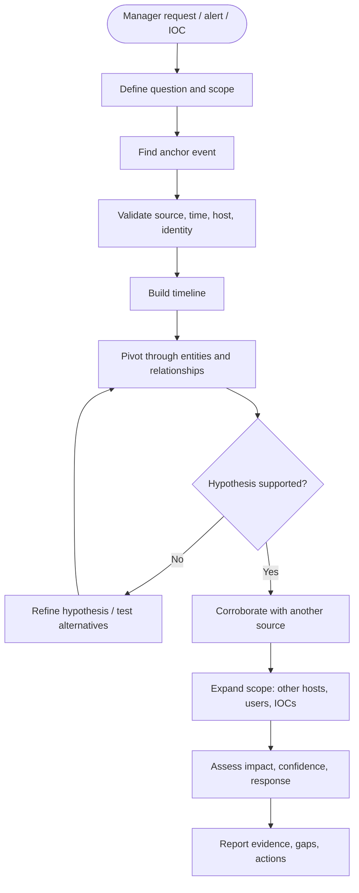
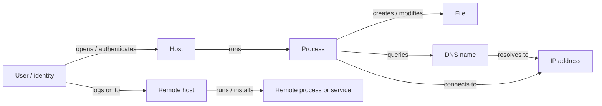
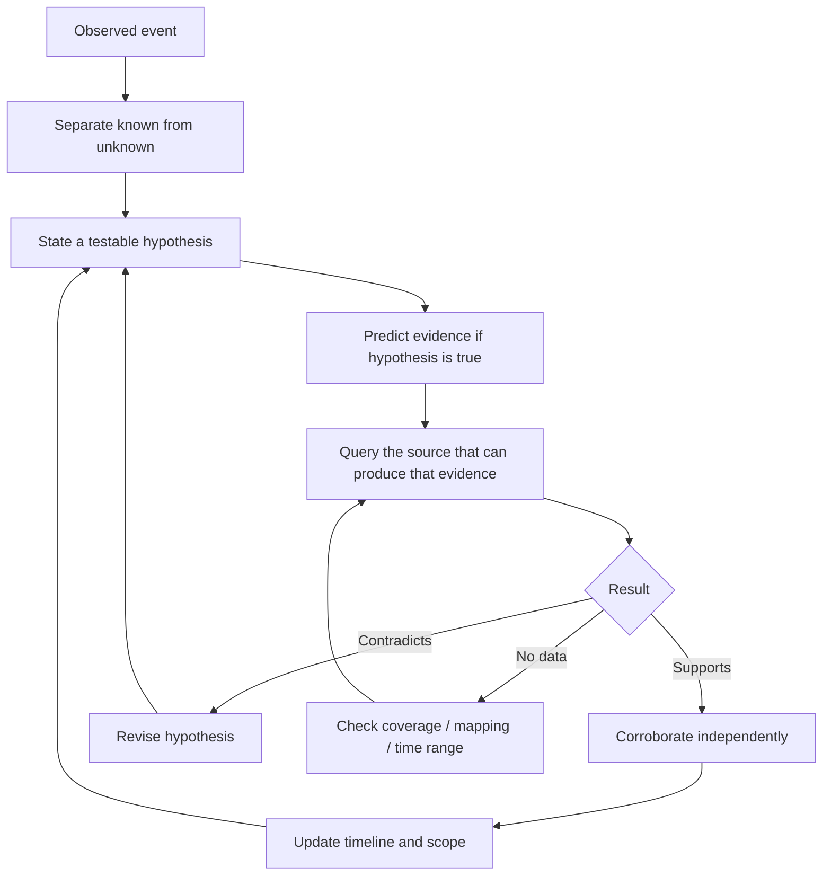
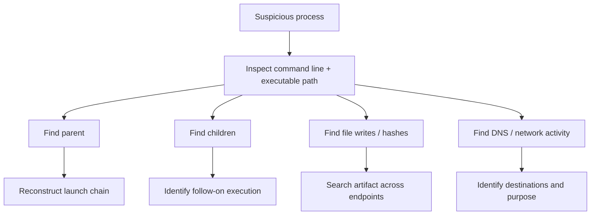
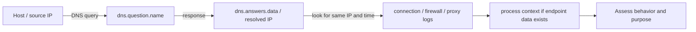
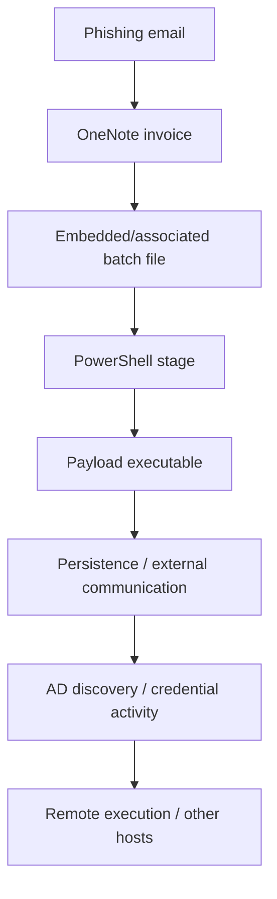

# SOC Investigation Playbook — Standalone Edition

> Best used inside the accompanying Obsidian vault for linked navigation and visual maps.


---


# 🧭 SOC Investigation OS

> [!abstract] Purpose
> A repeatable operating system for answering investigation questions in a SIEM. The goal is **not** to memorize every Event ID. The goal is to identify the behavior, find the right telemetry, pivot through related entities, test a hypothesis, establish scope, and communicate defensible findings.

## The whole investigation at a glance



## TRACE: the reusable investigation method

| Step | What you do | The question in your head |
|---|---|---|
| **T — Trigger & scope** | Translate the request into a question; identify timeframe, assets, identities, data sources and constraints. | What exactly must I prove or rule out? |
| **R — Reconstruct timeline** | Find the anchor event and search before/after it. Keep timezone and time boundaries explicit. | What happened immediately before and after? |
| **A — Analyze relationships** | Pivot through process, file, host, user, DNS, IP, session and service relationships. | What is connected to this event? |
| **C — Corroborate & expand** | Test alternative explanations; use independent telemetry; search for the same indicators across the estate. | What evidence would confirm or disprove my theory? |
| **E — Establish impact & end state** | Determine affected hosts/accounts, attacker activity, uncertainty, urgency and response needs. | How far did this go, and what must happen next? |

> [!tip] The one question to ask after every query
> **“Given what I just learned, what do I need to establish next, and which data source could answer that?”**

## Jump to the right playbook

- Thinking pattern and TRACE methodology
- Elastic fields and entity pivots
- Event IDs and log source reference
- Scenario playbooks: phishing, execution, DNS, auth, persistence, lateral movement, exfiltration
- Reusable KQL query patterns
- Start here when the manager asks a question
- Case notes, timeline, evidence ledger and checklist
- Worked example from HTB Stuxbot
- Manager-ready conclusions and reporting
- Official references and caveats

## Manager asks → where do I start?

| Request | Start with | First useful pivots |
|---|---|---|
| “Did this file run?” | Sysmon 1 / Security 4688; EDR process events | `file.name`, `file.hash.*`, `process.name`, `process.command_line`, host, time |
| “Where did this file come from?” | Download/email/proxy data; Sysmon 15/11 as supporting evidence | user, host, `file.path`, timestamp, browser process, DNS, proxy destination |
| “What did this process do?” | Process creation and related events | process GUID/entity ID, PID + host + time, parent/child, files, DNS, connections |
| “Did this domain communicate with us?” | DNS, proxy, firewall, Zeek `dns.log` / `conn.log` | queried name, DNS answers, source host/IP, destination IP, time, ports |
| “Was the account compromised?” | Security 4624/4625/4648, identity provider logs, endpoint timeline | user, source IP/device, logon type, logon ID, MFA/risk context, subsequent actions |
| “Did the attacker move laterally?” | Remote logons, service/task/process/share events on destination hosts | source host/IP, account, destination host, process, service, share, time |
| “Is this IOC anywhere else?” | Environment-wide IOC search across relevant data | hash, domain, IP, path, command line, certificate, account; validate matches |
| “Was data stolen?” | Proxy/firewall/Zeek/EDR/DLP/cloud audit logs | outbound destination, bytes, process, file access, upload evidence, cloud account activity |
| “Did they establish persistence?” | Sysmon registry/WMI plus services/tasks/run keys and EDR | registry path/value, service/task name, executable path, user, first-seen time |
| “Give me the incident timeline.” | Anchor events + broad surrounding window | timestamps, event source, action, entity, evidence reference, confidence |

## Before you query

> [!check] Scope checklist
> - [ ] What question is the request asking me to answer?
> - [ ] What is the timeframe, including timezone?
> - [ ] Which hosts, users, IPs, domains, hashes or other IOCs are known?
> - [ ] Which index/data view and log sources contain relevant data?
> - [ ] Are the expected logs actually collected and mapped?
> - [ ] What is the immediate operational risk? Is escalation/containment needed now?

## Core visual: think in relationships



The graph is conceptual: a data source may not contain every relationship. A relationship inferred by time or shared IP is weaker than a direct process GUID, session ID, or event linkage.

## A good investigation ends with

1. A clear answer to the original request.
2. A defensible timeline with evidence references.
3. A list of affected hosts, accounts and artifacts.
4. Observed facts separated from hypotheses.
5. Confidence and telemetry gaps stated explicitly.
6. Recommended response/escalation and next owner.

> [!warning] No-log ≠ no-activity
> Missing telemetry can mean the behavior did not happen, but it can also mean logging was disabled, filtered, delayed, dropped, outside retention, or not mapped to the field you queried. Validate collection before declaring “no evidence.”


---


# 🧠 Think like an investigator, not a query collector

## The four building blocks

> [!info] Every investigation is built from
> **Time** — when things happened.  
> **Entities** — host, user, process, file, domain, IP, session, service.  
> **Relationships** — parent/child, created-by, connected-to, authenticated-to, resolved-to.  
> **Hypotheses** — explanations that predict what other evidence should exist.



## Five questions for every event

1. **What happened?** Process start, file creation, DNS request, connection, logon, registry change?
2. **Who/what performed it?** User, process, service, endpoint, external IP?
3. **Where did it occur?** Host, path, destination, account, cloud tenant?
4. **What happened before and after?** Establish chronology and causal clues.
5. **What evidence should exist if my explanation is right?** Query that source next, then look for contradicting evidence too.

## Build a hypothesis, not a story

Use this note structure:

- **Observation:** what the log literally says.
- **Hypothesis:** what may explain the observation.
- **Prediction:** what else should be visible if the hypothesis is true.
- **Test:** query/data source that checks the prediction.
- **Alternative:** a legitimate or competing explanation.
- **Result:** supported / disproved / inconclusive.
- **Confidence:** low / medium / high, with reasons.

> [!example] Example
> **Observation:** `powershell.exe` started with a command line referencing a remote script.  
> **Hypothesis:** the process may be downloading and executing a payload.  
> **Prediction:** there may be network/DNS activity, file writes, child processes or PowerShell script logs around the same time.  
> **Test:** correlate process creation with Sysmon 3/22, Zeek DNS/connections, Sysmon 11, PowerShell 4103/4104 and subsequent process events.  
> **Alternative:** authorized admin automation or software deployment. Confirm owner, expected task, signer/path, change ticket and baseline.

## Pattern recognition: behavior → evidence family

| You observe | Predict / investigate next |
|---|---|
| Document downloaded | Browser/email/proxy history, file-create events, Mark-of-the-Web evidence, user and host |
| Office/browser starts script interpreter | Parent/child process creation, command line, file path, script logging |
| Script interpreter downloads a file | DNS, proxy, network connection, file creation, hashes, follow-on execution |
| Process resolves unusual domain | Query response, related process, destination IP, connection telemetry, prevalence and reputation |
| New executable in Temp/Public/profile directory | Process creation, hash, signer, parent process, persistence, network activity, prevalence |
| Login failures followed by success | Account/source/target timeline, logon type, authentication method, MFA and post-login actions |
| Remote logon + service/process creation | Lateral movement investigation on destination host; source, account, service, process and time |
| Registry/task/service change | Writer process, command/path, account, persistence trigger, recurrence, deletion/cleanup |
| Large outbound transfer | Process, destination, bytes, timing, accessed files, proxy/DLP/cloud logs; distinguish transfer from exfiltration proof |
| Log gap, audit policy change or log clear | Event provider/configuration, adjacent log sources, system health, forwarding status and potential defense evasion |

## How to choose the next pivot

Choose the strongest available key first:

1. **Direct identifier:** process GUID/entity ID, event/session ID, unique file hash, alert ID.
2. **Specific entity:** hostname + file path, username + target host, domain/IP.
3. **Constrained temporal correlation:** same host + narrow timeframe + matching behavior.
4. **Broad similarity:** same filename, generic process name, similar command line. Use as a lead, not proof.

> [!important] Correlation is not causation
> Same host and nearby timestamps provide a lead. A process GUID, parent process, logon ID, network UID or explicit event reference can provide a stronger connection. Always say which kind of linkage you have.

## Timeline reasoning

- First set a timezone and use it consistently.
- Start broad enough to find the anchor event.
- Narrow around the event to understand immediate behavior.
- Expand the window again to detect delayed persistence, beaconing or later movement.
- Preserve exact timestamps from records; distinguish event time from ingestion/receipt time when both exist.
- Avoid relying on screenshots alone: save the query, event details and evidence references.

## When can I stop?

A case is ready for a defensible handoff when you have:

- answered the manager's original question as far as available telemetry permits;
- established what is confirmed, likely, not observed and unknown;
- checked plausible alternative explanations;
- scoped affected hosts/accounts/artifacts, or explained why scope is incomplete;
- evaluated urgency and passed response actions to the right owner;
- documented queries/data sources, timeframe, evidence and remaining gaps.

You do **not** need to know every low-level detail before escalating credible compromise. Investigation and containment may proceed in parallel under company policy.


---


# 🧩 Elastic field map: learn families, then pivot

> [!abstract] Main principle
> The exact schema depends on the integration and ingest pipeline. Treat the fields below as common ECS-style starting points, not a guarantee that every field exists in every index. In Discover, inspect the actual event and available fields before copying a query.

## 1. Context and event source

| Field | Why it matters |
|---|---|
| `@timestamp` | Event time used to build the timeline. Check timezone and time-picker bounds. |
| `event.code` | Source-specific event ID/code, often stored as a keyword/string. |
| `event.provider` / `winlog.provider_name` | Helps distinguish event providers, including Sysmon vs Security vs PowerShell. |
| `event.category` | Broad ECS category, when populated. |
| `event.action` | Normalized action, where mapped. |
| `event.outcome` | success/failure/unknown when supported and mapped. |
| `event.dataset`, `data_stream.dataset` | Helps identify the dataset/integration. |
| `agent.name`, `agent.id` | Collector/agent identity, not necessarily the affected endpoint identity. |
| `observer.name`, `observer.product` | Sensor or monitoring device, if populated. |

## 2. Host and identity

| Family | Fields to recognize | Pivot question |
|---|---|---|
| Host | `host.name`, `host.hostname`, `host.id`, `host.ip`, `host.os.*` | What happened on this endpoint? Are multiple name/IP fields mapped differently? |
| User | `user.name`, `user.id`, `user.domain`, `user.roles` | Which identity performed or was targeted by the action? |
| Source identity | `source.ip`, `source.domain`, `source.user.*` if populated | Which origin or client is represented? |
| Destination identity | `destination.ip`, `destination.domain`, `destination.user.*` if populated | What system or service was targeted? |
| Authentication | `winlog.event_data.LogonType`, `winlog.event_data.TargetLogonId`, `winlog.event_data.LogonId`, `related.user` where mapped | Can logon, process and account activity be connected? |

> [!warning] Host identity caveat
> `host.name`, `host.hostname`, and `host.ip` are related but not interchangeable. A device may have multiple IPs, DHCP changes, aliases, NAT, or different mappings across log sources. Verify the asset identity.

## 3. Process — execution and relationships

| Field | Meaning / use |
|---|---|
| `process.name` | Process/program name. |
| `process.executable` | Full executable path, if collected. |
| `process.command_line` | Full process command line, often one of the richest fields. |
| `process.args` | Argument array, if correctly parsed. |
| `process.pid` | PID; may be reused over time. |
| `process.entity_id` | Unique process identifier supplied by the source; Sysmon Process GUIDs may map here. Prefer it when available. |
| `process.parent.name` | Parent process name. |
| `process.parent.executable` | Parent executable path. |
| `process.parent.command_line` | Command line used to start the parent. |
| `process.parent.pid` / `process.parent.entity_id` | Parent identity, if mapped. |
| `process.hash.sha256` | Hash associated with process image, depending on mapping. |
| `process.code_signature.*` | Signer/signature metadata, if collected. |
| `process.working_directory` | Working directory, if logged. |

### Process pivot logic



**Caveat:** the process object may only exist in endpoint records. A Zeek connection log may not have process fields. Correlate via process identity when present; otherwise use host + IP + time and describe that as temporal correlation.

## 4. Files, hashes and registry

| Family | Fields | Questions |
|---|---|---|
| File | `file.name`, `file.path`, `file.directory`, `file.extension`, `file.size`, `file.type` | What file appeared or changed, and where? |
| Hash | `file.hash.sha256`, `file.hash.md5`, `process.hash.sha256`, `hash.sha256` depending on mapping | Can the same artifact be found elsewhere? Which object was hashed? |
| File origin / stream | `file.name`, path, stream/alternate-data-stream fields where available; Sysmon 15 details | Is there evidence associated with a named stream such as `Zone.Identifier`? |
| Registry | `registry.path`, `registry.key`, `registry.value`, `registry.data.strings`, `registry.data.type` | Which key/value changed, and could it relate to persistence or configuration? |

Do not assume the hash field is the same across every event. Check whether it describes a file on disk, the process image or an object from an EDR alert.

## 5. DNS and network

| Field | Use |
|---|---|
| `source.ip`, `source.port` | Source endpoint/address/port in that event's direction. |
| `destination.ip`, `destination.port` | Destination endpoint/address/port in that event's direction. |
| `network.transport`, `network.protocol`, `network.direction` | Protocol/direction, if mapped. |
| `network.bytes`, `source.bytes`, `destination.bytes` | Transfer volumes, if collected. Bytes alone do not prove exfiltration. |
| `dns.question.name` | DNS name that was queried. It does **not** mean the domain is malicious. |
| `dns.question.type` | Record type requested. |
| `dns.answers.data` | Returned answer data, when available. May contain addresses or other record values. |
| `dns.response_code` | Result code, if mapped. |
| `dns.resolved_ip` | Sometimes used by a pipeline; verify whether this custom/alternative field exists. |
| `url.domain`, `url.full`, `url.path` | URL/proxy/HTTP telemetry only when collected; DNS does not reveal the full URL path. |
| `http.request.method`, `http.response.status_code`, `user_agent.original` | HTTP metadata when available and mapped. |
| `tls.server.name` / `server.name` | TLS/SNI/certificate-related metadata, depending on data source. |

### DNS → IP → connection pivot



> [!important] DNS limits
> DNS shows name-resolution activity. It usually does not prove successful HTTP access, successful download, maliciousness, or the URL path. Correlate query time, answers, connection logs and endpoint activity. A cached DNS response can also mean no new DNS query appears in the time window.

## 6. Zeek raw fields vs ECS fields

| Zeek log | Common raw fields | What you learn |
|---|---|---|
| `dns.log` | `id.orig_h`, `id.resp_h`, `query`, `qtype_name`, `answers`, `rcode_name`, `uid` | Who queried what, the responder, answer and response status. |
| `conn.log` | `id.orig_h`, `id.orig_p`, `id.resp_h`, `id.resp_p`, `proto`, `service`, `duration`, `orig_bytes`, `resp_bytes`, `uid` | Connection endpoints, ports, protocol and traffic metrics. |
| `http.log` | `host`, `uri`, `method`, `user_agent`, `status_code` in relevant versions/mappings | Observed HTTP request metadata. |
| `ssl.log` | `server_name`, `version`, `cipher`, certificate fields if logged | TLS metadata; encrypted payload content is not thereby visible. |

A Zeek-to-ECS pipeline may map raw fields to `source.ip`, `destination.ip`, `dns.question.name`, `dns.answers.data`, etc. If a query returns zero hits, inspect the field list and raw document before concluding the activity is absent.

## 7. Universal pivot priority

1. Unique ID: process GUID/entity ID, event/session ID, alert ID, network UID.
2. Unique artifact: SHA-256, exact path, unique domain or IP plus context.
3. Entity + narrow time: host + process/file/user + timestamp.
4. Broad similarity: filename, common process name, generic command fragment.

Broad matches are leads; validate them. PID alone, filename alone, or IP reputation alone should not be your only proof.


---


# 🧾 Event IDs & Telemetry Sources

> [!warning] Event IDs are provider-specific
> Sysmon Event ID 1 and Windows Security Event ID 4688 both describe process creation, but they are different events and have different schemas. Always check **provider, channel, dataset, event ID and actual event fields**. IDs can be absent if auditing/log collection is not enabled.

## 1. Sysmon — best first map for endpoint behavior

Official reference: [Microsoft Sysmon events](https://learn.microsoft.com/en-us/windows/security/operating-system-security/sysmon/sysmon-events).

| ID | Event | Investigative question |
|---:|---|---|
| **1** | Process Create | What started? Command line, parent, process GUID, hashes. |
| 2 | File creation time changed | Could a file timestamp have been manipulated? |
| **3** | Network connection | Did the process make a network connection? Collection can be configured out. |
| 4 | Sysmon service state changed | Was the Sysmon service state changed? |
| 5 | Process terminated | When did the process end? Often configuration/volume dependent. |
| 6 | Driver loaded | Was a kernel driver loaded? Validate signature/path. |
| 7 | Image loaded | Which DLL/image was loaded by a process? Often noisy and configuration-dependent. |
| 8 | CreateRemoteThread | Did one process create a thread in another process? Investigate possible injection. |
| 9 | RawAccessRead | Was a device/drive read via raw access? Investigate context. |
| 10 | ProcessAccess | Did a process access another process? Useful for credential-access/injection hypotheses. |
| **11** | FileCreate | What file was created or overwritten? |
| **12** | Registry object create/delete | Were registry keys created or deleted? |
| **13** | Registry value set | What registry value was set? |
| **14** | Registry key/value rename | Was a registry key/value renamed? |
| **15** | FileCreateStreamHash | Was a named file stream created/hashed? Can include `Zone.Identifier`; **not proof by itself that a download succeeded**. |
| 16 | Sysmon configuration changed | Did Sysmon configuration change? Inspect before/after telemetry coverage. |
| 17 | Named pipe created | Was a named pipe created? |
| 18 | Named pipe connected | Did a process connect to a pipe? |
| 19 | WMI event filter activity | Was a WMI event filter registered? |
| 20 | WMI event consumer activity | Was a WMI consumer registered? |
| 21 | WMI consumer-to-filter binding | Was a WMI filter/consumer binding created? |
| **22** | DNS query | Which domain did a process query? Query may fail; use time/process context. |
| 23 | FileDelete (archive) | Was a file deleted and archived by Sysmon configuration? |
| 24 | Clipboard change | Was clipboard content change observed? Collection may be limited. |
| 25 | Process tampering | Was a process tampering behavior detected? |
| 26 | FileDeleteDetected | Was file deletion observed without the archive behavior of Event 23? |
| 27 | FileBlockExecutable | Was executable creation blocked by a configured rule? |
| 28 | FileBlockShredding | Was a file shredding behavior blocked/detected? |
| 29 | FileExecutableDetected | Was executable file creation detected by this event type/version? Validate current Sysmon version/docs. |
| 255 | Error | Sysmon encountered an error. Check sensor health and event loss. |

### Minimum set to become fluent with first

**1, 3, 11, 15, 22**, then **10, 12–14, 17–21, 25–26** as the investigation demands.

Remember: Event 3 and Event 22 are different. Event 3 is a connection event; Event 22 is a DNS query. DNS can be visible when the actual browser connection was excluded from Sysmon, which is why network sensors such as Zeek are valuable.

## 2. Windows Security — authentication, identity and auditing

Useful reference: [Microsoft Windows security event collections](https://learn.microsoft.com/azure/sentinel/windows-security-event-id-reference) and [Active Directory events to monitor](https://learn.microsoft.com/windows-server/identity/ad-ds/plan/appendix-l--events-to-monitor).

| ID | Meaning | What to inspect |
|---:|---|---|
| **4624** | Successful logon | Account, logon type, source/workstation, IP, target host, Logon ID. |
| **4625** | Failed logon | Account, source, status/substatus, timing, repetition. |
| 4634 | Logon session logged off | Session timeline; often lower priority for initial detection. |
| **4648** | Logon attempted using explicit credentials | Subject/target account, process and target server if present. |
| **4672** | Special privileges assigned to new logon | Account/session with sensitive privileges; not proof of abuse by itself. |
| **4688** | New process created | Process path, creator/subject, command line if policy enables it. |
| 4689 | Process exited | Process lifecycle if enabled. |
| 4697 | Service installed | Service details; often useful in persistence/lateral movement. |
| **4698** | Scheduled task created | Task name, task content, creator. |
| 4702 | Scheduled task updated | Changed task and actor. |
| **4719** | System audit policy changed | Possible security-audit configuration change. |
| **4720** | User account created | Creator, target account, time and domain context. |
| 4722 / 4725 | User account enabled / disabled | Account lifecycle changes. |
| 4723 / 4724 | Password change / reset attempt | Actor and target, outcome/context. |
| **4728** | Member added to a global security group | Which group/user and who made the change. |
| **4732** | Member added to a local security group | Local privilege/group changes. |
| 4738 | User account changed | Changed attributes and actor. |
| 4740 | User account locked out | Account and caller/source details when present. |
| **4768** | Kerberos TGT requested | Domain-controller Kerberos authentication activity. |
| **4769** | Kerberos service ticket requested | Service-ticket activity; interpret in context and baseline. |
| 4771 | Kerberos pre-authentication failed | Possible credential issues/attack patterns. |
| **4776** | NTLM credential validation | NTLM validation activity; inspect source/workstation and status. |
| 1102 | Security audit log cleared | Potential defense evasion; verify authorized activity and other logs. |
| 4657 | Registry value modified (auditing required) | Registry value changes recorded by Security auditing. |
| 5140 | Network share accessed | Share access context. |
| 5145 | Detailed network share access check | Account, share/path and requested access where auditing is enabled. |

**Logon Type 3** often indicates network logon; **Type 10** is commonly remote interactive/RDP. Interpret the complete event schema and authentication method rather than using the logon type alone as proof of attack.

`TargetLogonId`/`LogonId` values can help correlate events for the same session on the relevant machine. The raw field may be nested as `winlog.event_data.TargetLogonId`; names/case depend on the pipeline. Logon IDs are local to a security context/host and are not globally unique.

## 3. Windows System log

| ID | Meaning | Why investigate |
|---:|---|---|
| **7045** | A service was installed | New service; examine service name, image path, account and source timeline. |
| 7040 | Service start type changed | Unexpected changes to automatic/manual/disabled state. |
| 6005 / 6006 | Event Log service started/stopped | System startup/shutdown clues; not sufficient by themselves to prove tampering. |

Provider/channel matters: 7045 is typically a **System** log service-installation event, unlike Security 4697.

## 4. PowerShell Operational log

Usually under `Microsoft-Windows-PowerShell/Operational`; what you see depends on version and logging policy.

| ID | Meaning | Investigative use |
|---:|---|---|
| **4103** | Module logging | Commands/module pipeline details, if configured. |
| **4104** | Script Block Logging | Script block content, if enabled. Helpful when process command line alone is insufficient. |
| 400 / 403 | Engine lifecycle events in relevant versions | Context for PowerShell engine start/stop. Verify provider/version. |

Reference: [PowerShell logging in about_Logging](https://learn.microsoft.com/en-us/powershell/module/microsoft.powershell.core/about/about_logging).

## 5. Zeek network logs — not Windows Event IDs

| Log | Use | Common raw fields |
|---|---|---|
| `dns.log` | DNS questions and answers | `id.orig_h`, `id.resp_h`, `query`, `qtype_name`, `answers`, `rcode_name`, `uid` |
| `conn.log` | Connection summaries | `id.orig_h`, `id.orig_p`, `id.resp_h`, `id.resp_p`, `proto`, `service`, `duration`, `orig_bytes`, `resp_bytes`, `uid` |
| `http.log` | HTTP request metadata, if observed | `host`, `uri`, `method`, `user_agent`, `status_code` depending on Zeek version/pipeline |
| `ssl.log` | TLS handshake/metadata, if configured | `server_name`, TLS version, cipher and certificate metadata depending on version |

- Zeek raw `id.orig_h`/`id.resp_h` can be mapped into ECS `source.ip`/`destination.ip` (check the pipeline's direction mapping).
- `uid` can correlate related Zeek records.
- Encrypted TLS traffic does not make the payload readable just because `ssl.log` exists.

## 6. Other telemetry a SOC may need

| Source | Questions it can help answer | Fields/evidence to look for |
|---|---|---|
| Email security / message trace | Was there a phishing email? Who received it? Was URL/file clicked? | Sender, recipient, subject/message ID, URL, attachment hash, delivery/remediation actions. |
| Web proxy / secure web gateway | Did the endpoint request a URL or download a file? | URL/host/path, user, device, status, bytes, category, policy result. |
| Firewall / NDR | Was there a connection, allowed/blocked, volume or unusual pattern? | Source/destination IP and port, protocol, action, bytes, session ID. |
| EDR | Process tree, detections, file operations, isolation/response history | Process GUID/tree, signer, hash, detection ID, action/result. |
| Identity provider / Entra ID | Sign-in risk, MFA, app consent, token/session context | User, IP, device, application, conditional access, MFA and risk results. |
| DNS resolver | Client query/answer and policy result | Client, query, type, answer, response code, policy/block result. |
| Cloud/SaaS audit | File sharing, app consent, mailbox rule, role changes, downloads | Actor, action, object, target, source IP, application/session, result. |
| DLP / CASB / storage audit | Possible sensitive data movement | Data classification, object, actor, destination, bytes, policy, result. |

> [!important] Coverage comes first
> Before making a conclusion, determine whether the source records the behavior you're searching for, whether the data is ingested, whether retention covers the timeframe, and whether the field is mapped as expected.


---


# 🚨 Scenario playbooks: question → evidence → pivot

Use the playbook that matches the **behavior under investigation**. These are investigation guides, not a claim that every environment records every event.

## A. Phishing, attachment or downloaded file

**Goal:** Determine delivery, execution and scope.

1. Find the message/download event using email trace, proxy, browser/EDR telemetry and artifact name/hash.
2. Identify recipient/user, host, file path, timestamp and any available hash.
3. Correlate file-creation evidence (Sysmon 11; Sysmon 15 can add named-stream evidence such as `Zone.Identifier`) without treating it alone as proof of a successful download.
4. Check whether the file was opened/executed: Sysmon 1, Security 4688, EDR process tree, Office/browser child processes.
5. Follow child processes, script logs, file writes, DNS lookups and network connections.
6. Search for the same hash, URL/domain, subject/sender and behavior across the estate.

**Patterns to notice:** user-facing app → script interpreter; document → temporary file → child process; downloaded artifact → later execution. These patterns warrant investigation but need contextual validation.

## B. Suspicious process or command line

**Goal:** Explain what started a process, what it did and what it touched.

- Start with `process.name`, `process.executable`, `process.command_line`, signer, hash, user, host and timestamp.
- Find parent and child records using process GUID/entity ID when present; otherwise use PID + host + time cautiously.
- Look for files created/modified, registry changes, DNS and connections, authentication activity and subsequent process execution.
- Compare the process path, signer, user context, parent and expected software/administrative baseline.
- Search the same unique hash/path/command behavior on other hosts.

**Do not conclude malware from process name alone.** A legitimate binary can be abused; a suspiciously named file can be benign. The full chain matters.

## C. DNS anomaly or suspected command-and-control

**Goal:** Establish which host/process looked up the name and whether meaningful communication followed.

1. Identify the query source and time: `source.ip` (or raw Zeek `id.orig_h`), `dns.question.name`/raw `query`, query type and response code.
2. Inspect returned answers (ECS `dns.answers.data` or raw Zeek `answers`), TTL and repetition where available.
3. Pivot from answer IP to Zeek `conn.log`, firewall, proxy and endpoint connection events.
4. Tie the connection to a process if endpoint telemetry has it; otherwise describe only host/time correlation.
5. Assess prevalence, business purpose, domain age/reputation when policy permits, SNI/proxy context and repeated timing/beacon-like patterns.
6. Check whether other hosts queried or connected to the same infrastructure.

**Limits:** DNS lookup ≠ successful connection; connection ≠ command-and-control; common cloud/CDN IPs can serve many customers; encrypted traffic may hide payload content.

## D. Credential attack, suspicious login or compromised account

**Goal:** Separate failed attempts, successful authentication and post-auth activity.

- Examine 4625 failures, 4624 successes and 4648 explicit-credential attempts; use relevant IdP logs for MFA/device/session evidence.
- Group by account, source device/IP, target host, time, logon type, auth package and status/substatus.
- Compare to normal source locations/devices, shift patterns, service-account behavior and known automation.
- After suspicious success, follow that account's process activity, remote logons, group changes, scheduled tasks, services, mailbox/cloud changes and data access.
- For suspected password spraying, compare many accounts from one source; for brute force, compare many attempts against one/few accounts—but confirm thresholds, time window and normal behavior.

**Important:** Failed logons can be mistakes; successful logon may be legitimate; 4672 does not independently prove malicious privilege use. Correlate the session and subsequent activity.

## E. Persistence

**Goal:** Find how the activity survives reboot/logoff and which actor established it.

Investigate:
- Registry autorun locations and registry telemetry (Sysmon 12–14; Security 4657 when auditing is configured).
- Services (Security 4697; System 7045; service config changes such as 7040).
- Scheduled tasks (4698, 4702 and task operational logs if available).
- WMI persistence (Sysmon 19–21 if enabled).
- Startup folders, logon scripts, browser extensions, cloud app persistence or other platform-specific mechanisms when relevant.

For each item, record object/path/name, command or image path, user, creator process, timestamp, signature/hash and whether it executed. Persistence is not established merely because a registry key or task exists; assess whether it is unexpected and tied to the incident.

## F. Lateral movement / remote execution

**Goal:** Link the suspected source host/account to a destination host and prove what ran there.

- Look for remote authentication (4624 with relevant logon type, 4648, RDP/WinRM/SMB-specific telemetry where collected).
- Search destination-host process creation (Sysmon 1 / Security 4688) and service/task evidence (4697, 4698, System 7045).
- Investigate share access (5140/5145) if file-copy or SMB activity is suspected.
- Correlate account, source IP/workstation, target host, session/logon ID, process, service name/path and timeline.
- Look for tools/protocols such as PsExec, WinRM, RDP or remote services, but do not infer the method from an executable name alone.
- Repeat from newly identified hosts to understand the full scope.

## G. Possible exfiltration / data theft

**Goal:** Determine whether data access and transfer occurred, what data was involved and how confident the claim is.

- Identify sensitive file access/download/export actions and actor.
- Correlate process activity with proxy/firewall/NDR/Zeek/cloud audit/DLP evidence.
- Examine destinations, protocols, byte counts, duration, transfer direction, object IDs, upload/download actions and business purpose.
- Check if a large transfer is expected backup/sync/update activity or unusual for the host/account.
- Look for archive creation, staging directories, compression tools, file enumeration and cloud-sharing/permission changes.

**Do not call a large outbound transfer “exfiltration” without evidence connecting the transfer to unauthorized data movement.** Report observed transfer and the evidence that supports or fails to support exfiltration.

## H. Malware execution / ransomware-like behavior

**Goal:** Determine the execution chain, affected assets, impact and response urgency.

- Process trees and hashes; suspicious script interpreters and command lines.
- Rapid/large-scale file writes/renames/deletes; unusual extensions; ransom notes; shadow-copy/backup tampering or recovery-service changes where telemetry exists.
- Network connections, remote logons and spread to shared drives/other endpoints.
- Confirm business impact and affected systems with EDR, file server and backup/security teams.
- Escalate promptly under IR policy; preserve evidence and avoid delaying containment to finish every pivot.

## I. Defense evasion / telemetry tampering

Investigate log clearing, auditing/configuration changes, sensor health, process termination, disabled security services and unexplained gaps. Relevant starting points can include Security 1102 and 4719, Sysmon 4/16/255, System service records and EDR health telemetry. A single event can also have legitimate causes; validate change tickets and sensor status.

## J. Any manager request not covered above

1. Rewrite the request as a question with a yes/no or bounded deliverable if possible.
2. Identify the entity the manager supplied (alert, host, user, file, IP, domain, application, time).
3. Find the source that directly records that behavior.
4. Establish a time-bounded anchor.
5. Pivot through relationships and predict next evidence.
6. Test alternative explanations and inspect coverage gaps.
7. Search for scope expansion and summarize evidence, impact and unknowns.

See 06 - Question to Telemetry Matrix and 09 - Reporting and Evidence Standards.


---


# 🔎 Elastic KQL query cookbook

> [!warning] Adapt before use
> These are starting templates for Kibana Query Language (KQL), like the syntax used in the HTB Stuxbot lab. Confirm your index/data view, field mappings and provider. `event.code` may be a string or mapped differently. A query returning zero hits is not proof of absence until time range, data view and field mapping are checked.

## 1. Basic KQL patterns

| Pattern | Meaning |
|---|---|
| `field:value` | Exact or field-appropriate match. |
| `field:*` | Field exists. |
| `AND`, `OR`, `NOT` | Combine conditions. |
| `field:prefix*` | Prefix wildcard where supported by field mapping. |
| `field:*fragment*` | Contains-style wildcard on fields that support it; can be expensive and may not work on analyzed text fields. |
| `(A OR B) AND C` | Group conditions explicitly. |

> [!tip] Query discipline
> Start narrow when you have a strong anchor. Inspect one event. Then widen based on the entity and hypothesis. Add columns before adding ten more clauses: timestamp, host, user, process, path, command line, source/destination IP, event ID and dataset as relevant.

## 2. Find the anchor

```kql
host.name:"WS001"
```

```kql
event.code:"1" AND process.name:"powershell.exe"
```

```kql
file.name:"invoice.one"
```

The exact values and quotes may vary with mappings. If one field returns nothing, inspect a known event and validate the field path and data type.

## 3. File and download-related evidence

HTB-style Sysmon examples:

```kql
event.code:"15" AND file.name:*invoice.one*
```

```kql
event.code:"11" AND file.name:*invoice.one*
```

Pivot through the fields actually present: `host.name`, `user.name`, `file.name`, `file.path`, `file.hash.sha256`, `process.name`, `process.executable`, `@timestamp`.

**Interpretation:** Event 15 can give evidence about a named stream; Event 11 can give file creation/overwrite evidence. Neither alone proves successful download and execution.

## 4. Process creation and process-tree pivots

```kql
event.code:"1" AND process.command_line:*invoice.one*
```

```kql
event.code:"1" AND process.parent.name:"ONENOTE.EXE"
```

```kql
event.code:"1" AND process.parent.command_line:*invoice.bat*
```

```kql
process.name:"powershell.exe" AND process.command_line:*
```

```kql
process.entity_id:"<process-entity-id>"
```

Inspect parent, child, PID/GUID/entity ID, user, host, executable path, command line and timeline. The last query is a placeholder: replace it with an exact value from your records.

## 5. Search for an artifact across hosts

```kql
process.hash.sha256:"<sha256-value>"
```

```kql
file.hash.sha256:"<sha256-value>"
```

```kql
file.name:"default.exe"
```

Use both process/file hash fields if your pipeline stores hashes differently. A filename-only hit may be unrelated. Confirm hash, full path, host, time and process relationship.

## 6. DNS and network pivots

```kql
source.ip:"192.168.28.130" AND dns.question.name:*
```

```kql
dns.question.name:"example.org"
```

```kql
destination.ip:"34.197.10.85"
```

```kql
source.ip:"192.168.28.130" AND destination.ip:"34.197.10.85"
```

Inspect DNS answer fields available in your data, such as `dns.answers.data` or a pipeline-specific `dns.resolved_ip`. Then check Zeek connection, firewall, proxy or endpoint network records in the same timeframe. Direction conventions differ by event type and pipeline—validate source/destination against a known record.

## 7. Windows authentication pivots

```kql
(event.code:"4624" OR event.code:"4625") AND source.ip:"192.168.28.130"
```

```kql
event.code:"4624" AND winlog.event_data.LogonType:"3"
```

```kql
event.code:"4648" AND user.name:"<account>"
```

```kql
event.code:"4697" OR event.code:"4698" OR event.code:"4702"
```

In the actual Security event, the actor/target account may be represented in nested provider-specific fields rather than `user.name`. Inspect the document and use its actual mappings. Logon type or a successful event alone does not prove compromise.

## 8. Time and host correlation

Use the UI time picker to set the timeframe explicitly. Example workflow:

1. Search a broad period to locate the anchor.
2. Record the exact `@timestamp` and timezone.
3. Narrow to a few minutes around the event to find direct causal clues.
4. Widen the time range again to find delayed activity, repeated connections or lateral movement.
5. Expand from one host to all hosts only after you have useful pivots (hash, domain, account, path or behavior).

Do not rely on time alone. Where possible, correlate process entity IDs, PIDs plus host/start time, Zeek UIDs, logon IDs or other stable identifiers.

## 9. Common query failures and what to check

| Symptom | Checks |
|---|---|
| Zero hits | Time range/timezone, correct data view, field exists, mapping/type, source collected, exact spelling/case. |
| Too many hits | Add host/user, time range, event source/code, exact IOC, process or other known context. |
| Wildcard fails | Field type and wildcard support; try exact term or inspect raw event. Avoid expensive leading wildcards on huge datasets. |
| Same event seems duplicated | Check multiple integrations/indices, event IDs, `event.original`, ingest pipeline and deduplication behavior. |
| Timestamps don't line up | Event timezone vs display timezone, clock skew, event time vs ingest time. |
| Process query finds PID on multiple hosts/times | PID reuse; constrain host/start time and prefer process GUID/entity ID. |
| DNS query found but no connection | Cache, failed resolution, connection not collected, time mismatch, use of proxy, or a different destination. Do not assume any single explanation. |

## 10. Before saving a query

Record:

- What question is the query designed to answer?
- Which index/data view and time zone are assumed?
- Which fields are environment-specific?
- What does a hit prove, and what does it **not** prove?
- What is the next pivot if the result is positive? What will you check if zero hits?


---


# 🗺️ If asked X, inspect Y

Use this as a navigation map, not as an exhaustive list. Available data and event IDs vary by environment.

| Manager / alert question | First data sources | Starting event types / fields | Key next pivot |
|---|---|---|---|
| Did a file download? | Email, proxy, browser/EDR, Sysmon | file name/path/hash, user, host, timestamps; Sysmon 11/15 as supporting evidence | Origin URL/domain, process that wrote/opened it, later execution |
| Did the file execute? | Sysmon, Security process auditing, EDR | Sysmon 1; Security 4688; process name/path/command/hash | Parent/child process tree, network and file actions |
| What did the process do? | Endpoint/EDR/Sysmon, PowerShell logs | 1, 3, 10, 11, 12–14, 22; 4103/4104 | Entity ID/GUID, parent/children, files, domains, connections |
| Which site did host query? | DNS resolver, Sysmon, Zeek | Sysmon 22; `dns.question.name`, Zeek `query` | DNS answer → connection/proxy to IP, process context |
| Did host connect to IP? | Zeek conn, firewall, NDR, EDR | source/destination IP+port, protocol, time, result/action | Process attribution, DNS, destination purpose, other hosts |
| Is a domain/IP/hash present elsewhere? | Cross-estate SIEM/EDR/network | IOC field(s), timestamp, host, dataset | Validate each match and expand to connected entities |
| Was PowerShell abused? | Process creation + PowerShell Operational + EDR/network | command line, parent, 4103/4104 if enabled, network/file events | Downloaded content, child processes, file writes, account context |
| Was a credential attacked? | Windows Security, identity provider, VPN/RDP, EDR | 4625/4624/4648, account, source, target, logon type/status | Successful sessions and post-auth actions; assess baseline |
| Did privileged access occur? | Security/domain controller, identity systems | 4672, group membership changes, 4768/4769, account changes | What did the session perform? Which assets/services were accessed? |
| Was persistence established? | EDR, Sysmon, Security/System, task logs | Registry 12–14; WMI 19–21; 4697/4698/4702; System 7045 | Creator process/user, path/command, trigger, later execution |
| Did lateral movement occur? | Source + destination endpoint, authentication, SMB/RDP/WinRM | 4624, 4648, 4688/1, 4697, 7045, 5140/5145 | Prove source→account→destination and process/service execution |
| Was data exfiltrated? | Proxy, firewall/NDR, EDR, DLP, cloud audit | destinations, bytes, uploads, file access, audit actions | Tie sensitive object access to the external transfer and actor |
| Did attacker clear logs or weaken detection? | Windows Security, System, Sysmon, EDR health | 1102, 4719, Sysmon 4/16/255, security-service changes | Validate policy change, telemetry gaps and alternate sources |
| Did user click a phishing link? | Email security, proxy, browser, DNS, endpoint | message/URL IDs, recipient, request, DNS, file/child processes | Determine access, payload delivery and whether execution followed |
| Is this alert a false positive? | Alert source plus context/baselines | alert rule + source records + signer/path/user/asset context | Test legitimate explanations; document why they do or don't fit |
| What is the blast radius? | Whole-estate SIEM, EDR, identity/network | hash, domain, IP, user, process command, paths, related users | Enumerate affected devices/accounts and confirm each distinct hit |
| What happened during a specified time? | Relevant sources across the scoped assets | timestamp, event source/action, user/host, process/network | Sort into a timeline; state gaps and clock/timezone caveats |

## Data-source selection rule

- **Endpoint behavior:** endpoint/EDR, Sysmon, Windows event logs, PowerShell logs.
- **Network communication:** DNS, Zeek, firewall, NDR, proxy, packet evidence if retained.
- **Identity and access:** Security logs, domain controller, identity provider, VPN/RDP logs.
- **Email delivery:** message trace, anti-phishing controls, URL/attachment telemetry.
- **Cloud/SaaS activity:** provider audit logs, identity/session logs, DLP/CASB.
- **Sensitive data movement:** file access, storage audit, proxy/firewall, DLP and destination context.

> [!important] Match question to visibility
> If the manager asks “what did the user open?” and the available logs only record process creation, you may be unable to prove the specific document opened. Say what the data supports, identify the missing source, and recommend what would resolve the gap.


---


# 🗂️ Investigation: {{case_id}}

> [!abstract] Executive question
> **What did the requester ask us to determine?** Write one or two sentences. Separate the requested question from any assumption embedded in the alert.

## 1. Scope

- **Original request / alert:**
- **In-scope hosts/assets:**
- **In-scope users/accounts:**
- **Known indicators:**
- **Start / end time:**
- **Timezone:**
- **Data views / indexes and log sources:**
- **Business context / expected activity:**
- **Operational urgency / escalation:**

## 2. Current assessment

- **Status:** `New` / `Investigating` / `Escalated` / `Contained` / `Closed`
- **Assessment:** `Benign` / `Suspicious` / `Likely malicious` / `Confirmed incident` / `Inconclusive`
- **Confidence:** `Low` / `Medium` / `High`
- **One-sentence rationale:**

## 3. Timeline

| Time (include timezone) | Host / user | Observed event | Source / event code | Evidence reference | Interpretation / confidence |
|---|---|---|---|---|---|
| | | | | | |
| | | | | | |
| | | | | | |

## 4. Evidence ledger

| ID | Type | Artifact / event | Source and query | What it proves | What it does not prove |
|---|---|---|---|---|---|
| E-01 | | | | | |
| E-02 | | | | | |

## 5. Hypothesis tracker

| Hypothesis | Supporting evidence | Contradicting evidence / alternatives | Next test | Status |
|---|---|---|---|---|
| | | | | Open |

## 6. Entities and pivots

- **Hosts:**
- **Users / accounts:**
- **Processes / process IDs / GUIDs:**
- **Files / paths / hashes:**
- **Domains / URLs / IPs / ports:**
- **Logon/session IDs:**
- **Services / tasks / registry objects:**
- **Other related cases/alerts:**

## 7. Query log

| Query/time | Data view | Purpose | Result count | Key finding | Next pivot |
|---|---|---|---:|---|---|
| | | | | | |

## 8. Scope and impact

- Affected endpoints:
- Affected identities:
- Evidence of execution:
- Evidence of persistence:
- Evidence of credential access:
- Evidence of lateral movement:
- Evidence of data access/transfer:
- Business impact:
- Known limitations and missing telemetry:

## 9. Response and handoff

- [ ] Escalated to incident response / on-call owner when warranted
- [ ] Evidence and relevant queries saved according to policy
- [ ] Affected hosts/accounts/artifacts scoped
- [ ] Containment/remediation decisions assigned to authorized owner
- [ ] Relevant IOCs shared through approved workflow
- [ ] Follow-up detection/telemetry gaps recorded

## 10. Final answer to requester

**Answer:**

**What we observed:**

**What we infer:**

**What remains unknown:**

**Scope / impact:**

**Recommended actions and owner:**

**Confidence and reason:**

> [!warning] Evidence hygiene
> Follow the organization's evidence-handling policy. Preserve event IDs, source names, timestamps/timezones, query details and relevant record references. Do not put secrets, credentials, tokens or unnecessary personal data into notes.


---


# 🧪 Worked example: HTB Hunting for Stuxbot

> [!abstract] Why this note exists
> This is a worked example based on the provided HTB Academy section. The IPs, hostnames, dates and commands below are specific to that training dataset; do not treat them as current real-world indicators or reuse them as generic conclusions.

## Threat hypothesis

The report describes an opportunistic phishing campaign delivering a malicious OneNote invoice, then a batch file, PowerShell staging and a RAT/persistence payload. Potential follow-on behaviors include credential access, Active Directory discovery and lateral movement using PsExec or WinRM.



## Step 1 — Look for the file

HTB query:

```kql
event.code:15 AND file.name:*invoice.one
```

The section reports an event at **March 26, 2023 @ 22:05:47** associated with `invoice.one` and Microsoft Edge. The lesson: event 15 provides named-stream evidence; do not independently treat it as definitive proof of a successful download.

Corroboration query:

```kql
event.code:11 AND file.name:invoice.one*
```

The training data includes `invoice.one:Zone.Identifier` activity, associated with host `WS001`. The exercise identifies the host IP as `192.168.28.130`.

**Next question:** What network activity surrounded the file event, and did the document execute?

## Step 2 — DNS and network correlation

HTB query:

```kql
source.ip:192.168.28.130 AND dns.question.name:*
```

Time window used in the walkthrough: **March 26, 2023 @ 22:05:00–22:05:48**, with a Europe/Copenhagen display timezone requested by the lab.

The observed DNS activity includes `mail.google.com`, Microsoft Defender SmartScreen-related activity and `file.io`. The lab identifies DNS answers including `34.197.10.85` and `3.213.216.16` for `file.io`, and then finds network connections to `34.197.10.85` on port 443.

**Reasoning:** DNS gives domain-resolution context; network connections corroborate traffic. These records strengthen the delivery-path hypothesis but should be interpreted alongside the endpoint and file events.

## Step 3 — Determine whether the document was opened

```kql
event.code:1 AND process.command_line:*invoice.one*
```

The walkthrough identifies process activity around **22:05:53**, approximately six seconds after the download-related event.

Then follow OneNote child processes:

```kql
event.code:1 AND process.parent.name:"ONENOTE.EXE"
```

The exercise identifies `cmd.exe` executing `invoice.bat`, as well as a OneNote-related process.

**Pattern recognized:** user-facing document → command interpreter → batch script.

## Step 4 — Follow the batch file into PowerShell

```kql
event.code:1 AND process.parent.command_line:*invoice.bat*
```

The output shows PowerShell command-line activity referencing a script hosted on Pastebin.

Next inspect related PowerShell activity:

```kql
process.pid:"9944" AND process.name:"powershell.exe"
```

The lab associates PID 9944 with file creation, attempted network connections and DNS activity, including use of Ngrok infrastructure and a dropped executable named `default.exe`.

> [!important] PID caution
> A PID is only meaningful when scoped to a host and process lifetime. Prefer a process GUID/entity ID when present; do not treat PID 9944 as globally unique across the estate.

## Step 5 — Follow the payload and find other hosts

```kql
process.name:"default.exe"
```

The walkthrough reports activity involving `SharpHound.exe`, `svchost.exe`, `payload.exe` and a VBS file. It identifies the hash:

```kql
process.hash.sha256:018d37cbd3878258c29db3bc3f2988b6ae688843801b9abc28e6151141ab66d4
```

The hash is reported on `WS001` and `PKI`. The training data also shows a process on `PKI` whose parent is `PSEXESVC`, prompting investigation of possible PsExec-based remote execution.

**Pattern recognized:** known artifact on a second host → expand incident scope → inspect remote logons, process creation, service evidence and account use on the destination.

## Step 6 — Authentication and likely scope

HTB query:

```kql
(event.code:4624 OR event.code:4625) AND winlog.event_data.LogonType:3 AND source.ip:192.168.28.130
```

The walkthrough discusses failed attempts targeting `administrator`, followed by successful logons associated with `svc-sql1`. These events require correlation with source host, target host, account, time and subsequent activity; a successful logon by itself does not prove an attacker used the account.

## The transferable reasoning chain

| Observation | Hypothesis | Next evidence to seek |
|---|---|---|
| `invoice.one` has file/stream events | Suspicious document may have arrived | Host, user, browser, email/proxy, timestamp, hash |
| DNS includes `file.io` | Host may have accessed a file host | DNS answer and matching network/proxy connection |
| OneNote starts `cmd.exe` and batch script | Document may have led to code execution | Batch child processes, command lines and script logs |
| PowerShell accesses remote content | Script may stage a payload | PowerShell logs, file creation, DNS and connection events |
| `default.exe` appears in execution telemetry | Payload may have executed | Process timeline, hash, persistence, network behavior |
| Same hash on another host | Scope may include a second endpoint/server | Destination execution, remote authentication, service/task activity |
| Suspicious account logons follow | Account may be compromised | Correlate session, source, destination and post-authentication actions |

## What should be in the incident handoff?

- A timestamped timeline with event/source references.
- The initial endpoint and the evidence linking document → process tree → payload.
- DNS and connection records, clearly distinguishing lookups from successful communications.
- Artifact hashes and the full set of affected hosts where verified.
- Evidence for credential access, account misuse, AD discovery and remote execution.
- Confirmed facts, inferences, alternative explanations and missing telemetry.
- Escalation/containment needs according to the lab or organization's incident-response process.

**Do not copy the lab's full story into a new case without verifying it.** Use its reasoning pattern, then let the current event evidence determine what happened.


---


# 📣 Reporting: answer the manager's question

## Translate a vague request into a testable question

Examples:

- “Look into this IP” → Which hosts contacted it, when, which processes/accounts were involved, and what evidence explains the traffic?
- “Is the user compromised?” → What authentication and post-authentication activity supports or contradicts account compromise in the requested timeframe?
- “Find all affected systems” → Which systems show matching high-confidence IOCs or related behavior, and what evidence validates each match?
- “Did data leave the company?” → Is there evidence connecting access to identified data with an unauthorized outbound transfer, and what is still unknown?

Confirm or document scope assumptions rather than letting a vague request silently expand forever.

## Separate fact, inference and unknown

> [!success] Observed fact
> “Sysmon Event ID 1 on host WS001 at the recorded timestamp shows `cmd.exe` with a command line referencing `invoice.bat`.”

> [!question] Inference
> “This is consistent with the OneNote document leading to batch-script execution; related parent-child records and subsequent PowerShell activity strengthen the hypothesis.”

> [!warning] Unknown
> “The available event records do not independently establish what the email body contained or whether every attempted network connection completed successfully.”

This language protects the quality of the report. Say “consistent with,” “suggests,” or “supports” when evidence is circumstantial; say “confirmed” only when your evidence warrants it.

## Confidence scale

| Level | Meaning |
|---|---|
| **Low** | One weak indicator or incomplete correlation; multiple benign explanations remain. |
| **Medium** | Several consistent observations, but an important causal link or independent corroboration is missing. |
| **High** | Multiple strong, mutually consistent records; key relationships and scope are validated. Remaining gaps are stated. |

This is a practical rubric, not a formal company severity standard. Follow your employer's incident classification and escalation rules.

## Manager-ready summary template

> **Question:** [exact question being answered]  
> **Assessment:** [benign / suspicious / likely malicious / confirmed incident / inconclusive]  
> **Confidence:** [low / medium / high + reason]  
> **Answer:** [two or three sentences directly answering the request]  
> **Evidence:** [timestamps, hosts/users, event sources/IDs, artifact identifiers and saved queries]  
> **Scope:** [known affected and checked unaffected assets; distinguish “no hits found” from “verified not affected”]  
> **Impact:** [what was accessed/executed/transferred, or what is not established]  
> **Gaps:** [missing data, unmapped fields, retention/visibility limits]  
> **Actions:** [containment/escalation, owner, priority, follow-up detection or collection]

## Evidence quality checklist

- [ ] The source provider/channel/dataset is known.
- [ ] Timestamp and timezone are explicit.
- [ ] Host and user identity are validated, not guessed from one IP alone.
- [ ] The query and time window can be repeated.
- [ ] Strong identifiers are retained (hash, entity ID/GUID, session ID, network UID, message ID).
- [ ] Each conclusion is linked to evidence.
- [ ] Alternative explanations were considered.
- [ ] Missing or uncollected telemetry is documented.
- [ ] Scope expansion was performed when appropriate.
- [ ] Response action and ownership are clear.

## When evidence is incomplete

Avoid saying “the machine is clean” because a query returned no hits. Prefer:

> “No matching events were found in the collected [data source] for [time range]. This does not rule out activity outside the source's coverage or retention period. [Specific source/configuration] would be required to answer [remaining question].”

## Urgency vs completeness

A credible ongoing compromise, privileged account abuse, active ransomware-like behavior or impact to a critical server may require immediate escalation/containment under organizational policy. Do not delay urgent response just to complete the full report. Preserve enough evidence for responders and continue investigation in parallel where safe and authorized.


---


# 📚 Sources and validation notes

These references support the event/field explanations. Always check documentation that matches the versions and integrations deployed at work.

## Microsoft: Sysmon and Windows events

- [Sysmon events — Microsoft Learn](https://learn.microsoft.com/en-us/windows/security/operating-system-security/sysmon/sysmon-events) — event meanings and the role of Sysmon telemetry.
- [Windows security event reference for Microsoft Sentinel](https://learn.microsoft.com/azure/sentinel/windows-security-event-id-reference) — common Windows Security auditing event collection.
- [Windows Server AD DS: events to monitor](https://learn.microsoft.com/windows-server/identity/ad-ds/plan/appendix-l--events-to-monitor) — authentication, account and directory event reference.
- [Event 4624 — successful logon](https://learn.microsoft.com/windows/security/threat-protection/auditing/event-4624) — logon details and interpretation.
- [Event 4688 — new process created](https://learn.microsoft.com/en-us/previous-versions/windows/it-pro/windows-10/security/threat-protection/auditing/event-4688) — process auditing details.
- [Event 4698 — scheduled task created](https://learn.microsoft.com/en-us/previous-versions/windows/it-pro/windows-10/security/threat-protection/auditing/event-4698) — scheduled-task auditing details.
- [PowerShell logging — about_Logging](https://learn.microsoft.com/en-us/powershell/module/microsoft.powershell.core/about/about_logging) — PowerShell logging policy and event availability.

## Elastic Common Schema

- [ECS field reference](https://www.elastic.co/docs/reference/ecs/ecs-field-reference)
- [ECS process fields](https://www.elastic.co/docs/reference/ecs/ecs-process) — process IDs, command lines, parents and process entity IDs.
- [ECS DNS fields](https://www.elastic.co/docs/reference/ecs/ecs-dns) — DNS question and answer mappings.
- [ECS network fields](https://www.elastic.co/docs/reference/ecs/ecs-network) — network endpoint and transfer fields.
- [Kibana Query Language](https://www.elastic.co/docs/reference/query-languages/kql) — KQL syntax and behavior.

## Zeek

- [Zeek DNS log](https://docs.zeek.org/en/current/reference/logs/dns.html)
- [Zeek connection log](https://docs.zeek.org/en/current/reference/logs/conn.html)
- [Zeek HTTP log](https://docs.zeek.org/en/current/reference/logs/http.html)
- [Zeek SSL/TLS log](https://docs.zeek.org/en/current/reference/logs/ssl.html)

## Source-derived example: HTB Stuxbot

The worked example in 08 - Stuxbot Worked Investigation is based on the HTB Academy content supplied for this conversation. It preserves that exercise's names, dates and sample environment values only to explain the reasoning chain. Treat those as training data, not current production indicators.

## Validation checklist for your actual Elastic environment

When adapting this playbook to work:

1. Check the integration, data view, `event.dataset`, provider and channel.
2. Inspect one raw/expanded document and confirm real field names and types.
3. Verify time zone, event timestamp vs ingest timestamp, retention and source clock health.
4. Verify Sysmon configuration and Windows audit policy; Event IDs are not guaranteed to be present.
5. Validate normalization from Zeek/raw event fields to ECS fields; direction mappings can differ.
6. Test one known-good event before relying on a zero-hit result.
7. Follow internal rules for privacy, evidence handling, escalation, containment and reporting.
