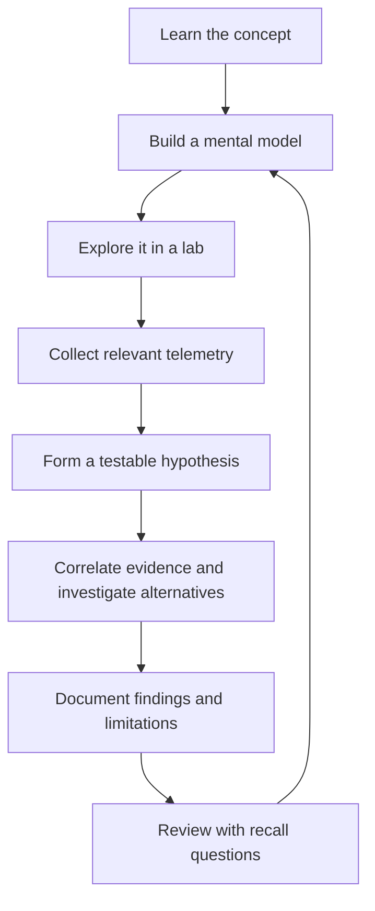

# SOC Analyst Journey

<p align="center">
  
</p>

<p align="center">
  
  
  
</p>

<p align="center">
  <a href="https://github.com/bugbountyguy121">
    
  </a>
  
  
</p>

> A practical, evolving knowledge base documenting my development toward SOC analysis. This repository focuses on understanding security telemetry, investigating suspicious activity, validating hypotheses with evidence, and turning lab work into reusable analyst workflows.

---

## Purpose

This is more than a collection of commands, screenshots, or completed labs. It is a record of how I build the mental models and practical habits needed to investigate security events.

My guiding principle is:

**Understand the system → identify the evidence → test a hypothesis → validate the conclusion → document what was learned.**

The goal is to become better at explaining *why* an event matters, how it connects to other telemetry, what it does and does not prove, and what an analyst should investigate next.

## How I learn

Each topic should move beyond memorization and toward practical understanding.



For each substantial topic, I aim to document:

- **Plain-language explanation:** What it means, with an analogy where useful.
- **Technical model:** How the components, events, fields, and processes relate.
- **Practical workflow:** How to reproduce or investigate the behaviour in a lab.
- **Evidence and reasoning:** What was observed and how the conclusion follows.
- **Limitations:** False positives, missing telemetry, assumptions, and uncertainty.
- **Recall practice:** Questions and scenarios that test understanding rather than memorization.

## Learning areas

### Security operations and investigation

- Event triage and investigation workflows
- Timeline construction and event correlation
- Hypothesis-driven investigation and evidence validation
- Incident-response fundamentals and analyst documentation

### Windows telemetry

- Windows Security Event Logs
- Sysmon events and process relationships
- Event Tracing for Windows (ETW)
- Process IDs, logon sessions, executable paths, and command lines
- `Get-WinEvent`, XPath, and XML event-log queries

### SIEM and detection

- Log collection, normalization, and searching
- Detection logic and investigative pivots
- Alert validation, false positives, and telemetry gaps
- Building clear, reproducible detection notes

### Network visibility

- Network traffic analysis with Wireshark
- Network intrusion detection with Suricata
- Understanding alerts alongside packet and endpoint evidence

### Linux and security automation

- Linux command-line fundamentals for investigation
- Python for data parsing and repeatable security tasks
- Git-based documentation and reproducible workflows

> These are learning and practice areas, not a claim of equal proficiency in every tool. Individual notes and project write-ups should show what was actually tested and learned.

## Repository organization

As the knowledge base grows, I aim to keep concepts, investigations, detections, and automation separate so that notes remain easy to navigate and connect.

```text
.
├── README.md                  # Project overview and navigation
├── fundamentals/              # Core concepts and mental models
├── windows-telemetry/         # Windows logs, Sysmon, ETW, PowerShell
├── siem-detection/            # Queries, detections, triage and tuning
├── network-analysis/          # Wireshark, Suricata and network evidence
├── investigations/            # End-to-end lab investigations and write-ups
├── scripts/                   # Small, documented investigation utilities
└── resources/                 # References and useful learning material
```

This is the intended organization; folders can be introduced as the corresponding material is added. Links in future notes should use relative Markdown paths so they work in both Obsidian and GitHub.

## Investigation write-up standard

A lab write-up should be useful to my future self and understandable to another learner. Where relevant, each investigation will cover:

1. **Objective** — the question being answered.
2. **Environment** — the lab, operating system, and relevant constraints.
3. **Concepts** — the minimum background needed to understand the activity.
4. **Evidence sources** — logs, event IDs, fields, files, or network records examined.
5. **Method** — the filtering, query, or analysis steps used.
6. **Findings** — the observations actually returned by the lab.
7. **Reasoning** — how the evidence supports the conclusion.
8. **Limitations** — ambiguity, missing telemetry, alternative explanations, and false positives.
9. **Lessons learned** — the mental model and skills to retain.
10. **References and related notes** — sources and links to connected concepts.

I will distinguish observed output from interpretation and avoid presenting a single indicator as definitive proof when additional validation is needed.

## Current learning priorities

- [ ] Strengthen Windows event-log analysis and field-level interpretation.
- [ ] Practise correlating logon, process, file, and network telemetry.
- [ ] Build confidence writing and troubleshooting `Get-WinEvent` XML queries.
- [ ] Develop repeatable SIEM triage and investigation workflows.
- [ ] Improve Python skills for security-data handling and automation.
- [ ] Document completed labs with evidence, reasoning, and lessons learned.
- [ ] Revisit notes using active recall and scenario-based questions.

Progress will be reflected in the actual notes and lab write-ups rather than inferred from badges alone.

## Tools and technologies

<p>
  
  
  
  
  
  
  
  
  
</p>

Tools listed here represent the technologies used or explored throughout the learning process. Each project should describe its actual scope, setup, and results.

## Principles

- **Evidence before assumptions.** Validate findings against the event fields and surrounding context.
- **Understand before memorizing.** Explain concepts simply, then connect them to the underlying technical details.
- **Reproducibility matters.** Record the query, filters, environment, and relevant output needed to repeat an investigation.
- **Be precise about uncertainty.** Separate confirmed observations from hypotheses and unverified conclusions.
- **Connect the knowledge.** Link related Markdown notes so the repository works as a knowledge graph in Obsidian and remains navigable on GitHub.
- **Practise responsibly.** Use authorized labs and avoid publishing credentials, tokens, VPN configuration, personal data, or sensitive target information.

## About this repository

This repository is a work in progress. Its value will come from the quality of the investigations, the clarity of the reasoning, and the ability to reproduce and explain what each lab demonstrates.

<p align="center">
  <strong>Learn the why. Follow the evidence. Document the reasoning.</strong>
</p>
