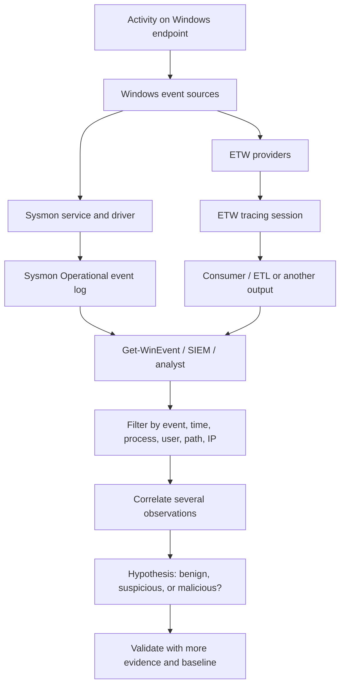

# SOC L3 Field Notes: Sysmon, ETW & `Get-WinEvent`

> **Purpose:** a connected mental model and practical recap—not a replacement for the HTB module or a claim that one event proves an attack.
>
> **Source boundary:** the core examples and terminology below come from the uploaded HTB Academy export. Sections labelled **Analyst note** add interpretation or safer, more maintainable ways to investigate the same evidence. HTB's repeated ETW and `Get-WinEvent` material has been consolidated.

## Table of contents

- [0. The lesson in 30 seconds](SOC-L3-Sysmon-ETW-Get-WinEvent-Guide.md##0-the-lesson-in-30-seconds)
- [1. Explain it to a three-year-old](SOC-L3-Sysmon-ETW-Get-WinEvent-Guide.md##1-explain-it-to-a-three-year-old)
- [2. The whole system: how the ideas connect](SOC-L3-Sysmon-ETW-Get-WinEvent-Guide.md##2-the-whole-system-how-the-ideas-connect)
- [3. Sysmon foundations](SOC-L3-Sysmon-ETW-Get-WinEvent-Guide.md##3-sysmon-foundations)
- [4. Detection playbook A — DLL hijacking](SOC-L3-Sysmon-ETW-Get-WinEvent-Guide.md##4-detection-playbook-a--dll-hijacking)
- [5. Detection playbook B — unusual .NET runtime loading / injection](SOC-L3-Sysmon-ETW-Get-WinEvent-Guide.md##5-detection-playbook-b--unusual-net-runtime-loading--injection)
- [6. Detection playbook C — credential dumping and LSASS](SOC-L3-Sysmon-ETW-Get-WinEvent-Guide.md##6-detection-playbook-c--credential-dumping-and-lsass)
- [7. ETW: what it is and why the lesson introduces it](SOC-L3-Sysmon-ETW-Get-WinEvent-Guide.md##7-etw-what-it-is-and-why-the-lesson-introduces-it)
- [8. ETW case study — parent-process spoofing](SOC-L3-Sysmon-ETW-Get-WinEvent-Guide.md##8-etw-case-study--parent-process-spoofing)
- [9. ETW case study — suspicious .NET assembly loading](SOC-L3-Sysmon-ETW-Get-WinEvent-Guide.md##9-etw-case-study--suspicious-net-assembly-loading)
- [10. Get-WinEvent](SOC-L3-Sysmon-ETW-Get-WinEvent-Guide.md##10-get-winevent-turn-a-huge-log-pile-into-a-useful-question)
- [11. Practical assessment workflow](SOC-L3-Sysmon-ETW-Get-WinEvent-Guide.md##11-practical-assessment-workflow-for-c-logs)
- [12. L3 detective's checklist](SOC-L3-Sysmon-ETW-Get-WinEvent-Guide.md##12-l3-detectives-checklist)
- [13. Common wrong conclusions to avoid](SOC-L3-Sysmon-ETW-Get-WinEvent-Guide.md##13-common-wrong-conclusions-to-avoid)
- [14. One-minute teach-back](SOC-L3-Sysmon-ETW-Get-WinEvent-Guide.md##14-one-minute-teach-back)
- [15. Quick review / flashcards](SOC-L3-Sysmon-ETW-Get-WinEvent-Guide.md##15-quick-review--flashcards)
- [16. Practice prompts](SOC-L3-Sysmon-ETW-Get-WinEvent-Guide.md##16-practice-prompts)
- [17. Source links](SOC-L3-Sysmon-ETW-Get-WinEvent-Guide.md##17-source-links)

## 0. The lesson in 30 seconds

A SOC analyst is trying to reconstruct **what happened, which process did it, what that process touched, and whether the behavior makes sense**. Sysmon records useful endpoint events, ETW can provide additional tracing detail, and PowerShell's `Get-WinEvent` helps search and correlate the resulting logs.

The key pattern is:

1. **Collect the right evidence.** Sysmon configuration determines which event types are captured; ETW sessions determine which providers are traced.
2. **Search for behavior, not just names.** A process loading an unexpected DLL, an ordinary service process suddenly loading .NET runtime libraries, or an unknown process accessing LSASS deserves investigation.
3. **Join evidence together.** Compare timestamps, process GUIDs, image paths, parent-child relationships, command lines, users, signatures, and network destinations.
4. **Test the hypothesis.** Compare suspicious behavior with a known-good example, collect another telemetry source, and account for legitimate software.
5. **State confidence honestly.** An indicator is a clue. A single event ID, unsigned file, encoded command, or unusual parent-child pair is not automatically proof of compromise.

## 1. Explain it to a three-year-old

Imagine a house with security cameras.

- **Windows** is the house.
- **Processes** are people doing jobs inside it.
- **Sysmon** is a camera system that writes selected observations into a notebook.
- **ETW** is a more flexible recording system that can listen to different parts of the house when a recording session is enabled.
- **Event IDs** are labels that tell you what kind of thing the camera recorded.
- **`Get-WinEvent`** is a search tool for finding the notebook pages you need.
- **The SOC analyst** connects the pages into a story: what happened first, what happened next, and whether that sequence is normal.

The cameras do not automatically know whether someone is a burglar. They record evidence. The analyst has to interpret it.

## 2. The whole system: how the ideas connect



### The important links

- **Activity → telemetry:** If a provider or event type is not collecting the activity, the analyst may not have that evidence later.
- **Telemetry → event record:** An event has a category and fields. The event ID says what kind of event it is; the fields describe the particular observation.
- **Event record → detection idea:** A rule combines a meaningful event with context, such as an unusual path, a suspicious parent, an unsigned module, or an unexpected target process.
- **Detection idea → investigation:** A match creates a question to test, not a verdict.
- **Investigation → conclusion:** A stronger conclusion comes from several consistent facts, not one isolated field.

## 3. Sysmon foundations

### 3.1 What Sysmon adds

The HTB notes describe Sysmon as a Windows service and device driver that stays resident across reboots and records detailed system activity into the Windows event log. Its components are:

- **Service:** monitors system activity.
- **Driver:** helps capture that activity.
- **Event log:** stores the resulting observations for review.

The lesson contrasts Sysmon's extra detail with native Windows Security events. It mentions Security Event ID **4624** for logon events and **4688** for process creation, then introduces Sysmon as an additional source of endpoint telemetry.

### 3.2 Event IDs to remember for this lesson

| Source / ID | Meaning in the lesson | First question to ask |
|---|---|---|
| Windows Security **4624** | Logon event | Who logged on, when, and how does it compare with expected access? |
| Windows Security **4688** | Process creation | What new process was created and under which account? |
| Sysmon **1** | Process creation | What executable ran, with what command line, and what parent was recorded? |
| Sysmon **3** | Network connection | Which process connected to which address, and when? |
| Sysmon **7** | Image loaded (for example, a DLL) | Which process loaded which module, from what path, with what signature information? |
| Sysmon **10** | Process access | Which source process attempted to access which target process? Is the access expected? |

**Memory hook:** `1 = started`, `3 = connected`, `7 = loaded`, `10 = accessed another process`.

**Analyst note:** these IDs describe event categories; they are not severity ratings. An ordinary program creates processes, connects to networks, loads DLLs, and accesses other processes. The suspicious part is the *context and combination of fields*.

### 3.3 Configuration is part of detection

Sysmon uses an XML configuration that can include or exclude event categories and filter by attributes such as process names or IP addresses. The HTB lesson points to two configuration examples:

- [SwiftOnSecurity/sysmon-config](https://github.com/SwiftOnSecurity/sysmon-config), used in the lesson.
- [olafhartong/sysmon-modular](https://github.com/olafhartong/sysmon-modular), a modular alternative.

The lesson demonstrates installing Sysmon and updating its configuration with `sysmon.exe -c filename.xml`. It also changes ImageLoad filtering to collect the image-load data needed for the DLL-hijacking example.

**L3 connection:** collection policy is upstream of detection quality. A beautifully written query cannot find events that were never collected, were filtered out, have already rolled out of the log, or lack the needed fields. First verify collection; then debug the query.

## 4. Detection playbook A — DLL hijacking

### The idea

A Windows executable may load a DLL by name. If an attacker places a malicious DLL where the application will load it instead of the expected legitimate DLL, the executable may run attacker-controlled code under its own process context. In the HTB demonstration, `calc.exe` and `WININET.dll` are used to illustrate the behavior.

### What the lesson observes

Sysmon **Event ID 7 (Image loaded)** records the process image, the loaded DLL, and signature-related information. The HTB comparison shows:

- A suspicious case: a copy of `calc.exe` is run from a writable directory and loads a `WININET.dll` in that scenario that is **unsigned**.
- A comparison case: the expected `wininet.dll` is Microsoft-signed and located in the Windows system directory.

### Detection logic

| Clue | Why it matters | What to verify |
|---|---|---|
| `calc.exe` running outside its expected system location | A copy of a trusted executable in a writable directory can be used as a staging point | Full image path, file hash, owner, creation time, and whether this installation legitimately uses that path |
| `calc.exe` loads `WININET.dll` from an unexpected location | The process/module/path combination does not match the expected system layout described in the lab | Full `ImageLoaded` path, not only the DLL filename |
| Loaded DLL is unsigned or has an unexpected signer | It differs from the legitimate signed example | Signature status, signer, hash, and file origin |
| Several clues appear in the same process/time window | Independent indicators reinforce one another | Correlate by process GUID/PID and timestamp where possible |

### The analyst's reasoning

1. Find Event ID 7 records for the process of interest.
2. Compare the suspicious load to an authentic load by the same application.
3. Check the executable's full path and the loaded DLL's full path.
4. Review the signature and hash information.
5. Search for related process creation (Event ID 1), network activity (Event ID 3), and other suspicious actions.

**False-positive guardrail:** do not alert on every DLL loaded outside `System32`. Some applications bundle legitimate DLL versions. The combination of process, module name, full path, signature, and environment baseline makes the case much stronger.

**Remember:** the lab's specific `calc.exe` example demonstrates a technique; paths and behavior can vary between Windows versions and application builds. Validate against the actual endpoint.

## 5. Detection playbook B — unusual .NET runtime loading / injection

### The core concept

C# applications often execute as **managed code** under the .NET Common Language Runtime (CLR). The HTB notes point to `clr.dll` and `clrjit.dll` as runtime-related modules. They show that a process such as PowerShell is normally managed and has .NET runtime modules loaded.

The lesson then demonstrates an unmanaged process (`spoolsv.exe`, the Print Spooler process) changing to a managed state after an injection demonstration. Sysmon Event ID 7 is used to confirm CLR-related module loading.

### Why a SOC analyst cares

A process that normally has no reason to host the .NET runtime suddenly loading modules such as:

- `clr.dll`
- `clrjit.dll`
- `mscoree.dll`

may be executing .NET code in an unexpected context. This can be consistent with unmanaged PowerShell/C# injection or in-memory .NET assembly execution.

### Detection and investigation

- Start with Event ID 7 and search for the runtime modules.
- Identify the process that loaded them, its path, user, timestamp, and signature.
- Ask whether that process ordinarily needs a .NET runtime.
- Link to Event ID 1 to understand how the process started and to command-line context.
- Look for related process access, suspicious process relationships, or network events.

**False-positive guardrail:** runtime DLLs are not malware by themselves. Some legitimate programs load .NET dynamically. The question is whether the *process and its behavior* make sense for that host.

### LotL vs BYOL, as presented in the lesson

- **Living off the Land (LotL):** use legitimate tools already present on the endpoint, such as PowerShell, for operations that can blend into ordinary administration.
- **Bring Your Own Land (BYOL), in the lesson's use of the term:** execute custom .NET assemblies—potentially directly in memory—instead of relying solely on preinstalled tools. This may reduce ordinary on-disk artifacts, so defenders need runtime and behavioral telemetry as well as file-based checks.

The lesson uses execution of the Seatbelt .NET assembly as an example and points to Sysmon Event ID 7 for checking `clr.dll` and `mscoree.dll` loads.

## 6. Detection playbook C — credential dumping and LSASS

### What matters

The Local Security Authority Subsystem Service (`lsass.exe`) is involved in Windows authentication and is a target for tools that attempt to obtain credential material. The lesson uses Sysmon **Event ID 10 (ProcessAccess)** to look for suspicious processes accessing LSASS.

### Suspicion signals in the HTB example

- The source image is an unexpected executable from a user-writable location such as Downloads.
- The target image is `lsass.exe`.
- The source user and target user/security context are unusual relative to each other (the lesson shows a normal user accessing a SYSTEM-owned target).
- The activity may coincide with attempts to obtain debugging privileges such as `SeDebugPrivilege`.

### Triage questions

1. What is the exact source executable path and signer?
2. Is this a known security product, authentication component, or approved diagnostic tool?
3. What account launched it, and what else did the account/process do?
4. Is there evidence of privilege escalation or other suspicious activity around the same time?
5. Can the behavior be corroborated by another source?

**False-positive guardrail:** legitimate authentication components, AV, and EDR products may access LSASS. Do not equate `TargetImage = lsass.exe` with confirmed credential theft.

## 7. ETW: what it is and why the lesson introduces it

**Event Tracing for Windows (ETW)** is a Windows tracing facility for high-speed event collection from user-mode applications and kernel-mode components. The HTB lesson introduces it because ordinary event logs and Sysmon, while valuable, may not show every detail needed to reconstruct an event.

### 7.1 ETW's main components

| Component | Plain-English meaning | Analogy |
|---|---|---|
| **Provider** | The source that emits a type of event | A witness who can report on one area |
| **Controller** | Starts/stops sessions and enables/disables providers | The person deciding which witnesses to record |
| **Session** | The active collection arrangement: providers, filters, buffering and output | A recording session |
| **Consumer** | Reads or processes the events | The investigator reviewing the recording |
| **Channel** | A logical event destination/category used by certain provider events | A named notebook or stream |
| **ETL file** | A file that stores event trace data for later analysis | A saved recording |

ETW uses a publish/subscribe model: providers emit events into enabled tracing sessions, and consumers receive or process events. The lesson identifies four provider families: MOF, WPP, manifest-based, and TraceLogging.

Some providers can generate a high volume of events and may not be enabled continuously. Collection has to be chosen deliberately, balancing visibility, storage, and performance. The lesson also notes that only provider events with a Channel property can be consumed by the Windows Event Log; ETW data and ordinary visible Event Viewer logs are related, but are not interchangeable concepts.

### 7.2 Useful ETW commands from the lesson

Run in a Windows command prompt:

```cmd
:: Show active ETW tracing sessions
logman.exe query -ets

:: List providers available on the machine
logman.exe query providers

:: Narrow the provider list to process-related providers
logman.exe query providers | findstr "Process"

:: Inspect details for a specific provider
logman.exe query providers Microsoft-Windows-Winlogon

:: Inspect a named session and its providers/settings
logman.exe query "EventLog-System" -ets
```

The `-ets` parameter matters when querying active Event Tracing Sessions. The lesson discusses looking at provider GUIDs, event levels, and keywords to understand what a session records.

### 7.3 Provider names worth recognizing

The HTB export lists providers and example detection areas:

| Provider | Potential investigation area |
|---|---|
| `Microsoft-Windows-Kernel-Process` | Process activity, process relationships, injection-related behaviors |
| `Microsoft-Windows-Kernel-File` | File activity and suspicious file operations |
| `Microsoft-Windows-Kernel-Network` | Network activity |
| `Microsoft-Windows-DotNETRuntime` | .NET runtime and assembly activity |
| `Microsoft-Windows-PowerShell` | PowerShell activity |
| `Microsoft-Windows-Kernel-Registry` | Registry changes and possible persistence |
| `Microsoft-Windows-DNS-Client` | DNS activity, including unusual lookups |
| `Microsoft-Windows-CodeIntegrity` | Code/driver integrity events |
| `Microsoft-Windows-WinRM` | Remote management activity |
| `Microsoft-Windows-SMBClient` / `SMBServer` | SMB client/server activity |
| `Microsoft-Windows-TerminalServices-LocalSessionManager` | RDP/local session activity |
| `OpenSSH` | SSH connection/authentication activity |

These are **places to investigate**, not a statement that every provider is enabled or every listed event is available in every environment.

### 7.4 Restricted provider concept

The HTB lesson calls out `Microsoft-Windows-Threat-Intelligence` as a restricted, high-value provider and explains that access is tied to privileged, protected anti-malware processes (PPL) and Microsoft's security requirements. For the SOC mental model, the takeaway is that **not all telemetry is available to every process or tool**. Permission boundaries affect collection and visibility.

## 8. ETW case study — parent-process spoofing

### Normal behavioral question

A process tree helps an analyst ask: *Which process launched this process? Does that relationship make sense?* The lesson's examples include unusual relationships such as `calc.exe` spawning `cmd.exe`, or `spoolsv.exe` spawning `whoami.exe` rather than its more expected child activity.

### Why Sysmon alone can mislead

In the lab, parent PID spoofing makes Sysmon Event ID 1 display `spoolsv.exe` as the parent of `cmd.exe`, although `powershell.exe` actually created `cmd.exe`. In other words, the recorded parent relationship can be manipulated.

### How the lesson uses ETW

The lesson collects data from the `Microsoft-Windows-Kernel-Process` provider with SilkETW, repeats the activity, and inspects its JSON output. The ETW data indicates that PowerShell created `cmd.exe`, helping explain the discrepancy.

Example command shown by the lesson (for the HTB lab environment):

```cmd
SilkETW.exe -t user -pn Microsoft-Windows-Kernel-Process -ot file -p C:\windows\temp\etw.json
```

### L3 conclusion

- A process tree is an **observation** that may need verification.
- Parent-child relationships are useful for anomaly detection, but parent attribution is not infallible.
- When telemetry conflicts, preserve that disagreement as evidence and investigate how each source generated its view.
- ETW can add a different view of process activity, but do not assume that one source is universally complete or impossible to manipulate.

## 9. ETW case study — suspicious .NET assembly loading

The lesson describes attackers using built-in tools (LotL), then potentially shifting to .NET assemblies executed in memory (BYOL / `execute-assembly` style behavior). This can reduce obvious file-on-disk artifacts.

The detection thread returns to familiar fields: monitor the loading of .NET-related libraries such as `clr.dll` and `mscoree.dll`, particularly in processes that do not normally need them. The lesson demonstrates that Sysmon Event ID 7 can provide this module-load evidence.

**Connect the concepts:**

`in-memory .NET execution` → `runtime must participate` → `runtime-related modules may load` → `Event ID 7 may record the load` → `the process context determines whether it is suspicious`.

That last link is the crucial one: a matching module name is only the start of the investigation.

## 10. `Get-WinEvent`: turn a huge log pile into a useful question

`Get-WinEvent` is a PowerShell cmdlet for querying classic Windows event logs, newer Windows Event Log logs, and ETW-related event logs. The HTB lesson emphasizes mass analysis: logs can contain too much data to inspect manually, so analysts filter first and then read the relevant records.

### 10.1 Discover what exists

List event logs and their basic properties:

```powershell
Get-WinEvent -ListLog * |
  Select-Object LogName, RecordCount, IsClassicLog, IsEnabled, LogMode, LogType |
  Format-Table -AutoSize
```

List event providers and the logs they link to:

```powershell
Get-WinEvent -ListProvider * | Format-Table -AutoSize
```

**Why start here?** You cannot query the correct log until you know its name and whether it is enabled/contains records.

### 10.2 Read a small sample

Latest events from a named log:

```powershell
Get-WinEvent -LogName 'Microsoft-Windows-WinRM/Operational' -MaxEvents 30 |
  Select-Object TimeCreated, Id, ProviderName, LevelDisplayName, Message |
  Format-Table -AutoSize
```

Oldest events from that log:

```powershell
Get-WinEvent -LogName 'Microsoft-Windows-WinRM/Operational' -Oldest -MaxEvents 30 |
  Select-Object TimeCreated, Id, ProviderName, LevelDisplayName, Message |
  Format-Table -AutoSize
```

Read an exported `.evtx` file:

```powershell
Get-WinEvent -Path 'C:\Logs\sample.evtx' -MaxEvents 20 |
  Select-Object TimeCreated, Id, ProviderName, LevelDisplayName, Message |
  Format-Table -AutoSize
```

### 10.3 Filter by log, event ID, and time

The lesson uses `-FilterHashtable` to retrieve Sysmon process-create and network-connection events (IDs 1 and 3):

```powershell
$startDate = Get-Date '2023-05-28'
$endDate   = Get-Date '2023-06-03'

Get-WinEvent -FilterHashtable @{
    LogName   = 'Microsoft-Windows-Sysmon/Operational'
    Id        = 1,3
    StartTime = $startDate
    EndTime   = $endDate
} | Select-Object TimeCreated, Id, ProviderName, Message
```

**Time-window detail:** in the lesson's example, the end date is exclusive. Specifying June 3 as the end boundary is a way to include June 2 without accidentally cutting off that day's later events.

The lesson also illustrates querying exported logs with `-Path` and filtering on event IDs, and querying a suspicious destination IP from Sysmon Event ID 3.

### 10.4 Parse event XML when you need named fields

Event messages are convenient to read, but scripts are often more reliable when they extract the event's named data fields. The source demonstrates parsing Event ID 3 to obtain `SourceIp`, `DestinationIp`, `ProcessGuid`, and `ProcessId`, then filtering for a destination address.

A reusable pattern for inspecting named EventData fields:

```powershell
Get-WinEvent -FilterHashtable @{
    LogName = 'Microsoft-Windows-Sysmon/Operational'
    Id      = 3
} | ForEach-Object {
    $xml = [xml]$_.ToXml()
    $data = @{}
    foreach ($item in $xml.Event.EventData.Data) {
        $data[$item.Name] = $item.InnerText
    }

    [pscustomobject]@{
        TimeCreated   = $_.TimeCreated
        SourceIP      = $data['SourceIp']
        DestinationIP = $data['DestinationIp']
        ProcessGuid   = $data['ProcessGuid']
        ProcessId     = $data['ProcessId']
    }
} | Where-Object { $_.DestinationIP -eq '52.113.194.132' }
```

Change the address to the value relevant to your investigation. This is a field-extraction pattern based on the source's approach; confirm the field names against the event schema you actually have.

### 10.5 Filter XML / XPath

The HTB lesson also uses:

- `-FilterXml` with an XML `QueryList` when filtering EventData, including Event ID 7 events that mention `mscoree.dll` or `clr.dll`.
- `-FilterXPath` to select events matching specific named fields, such as a Sysmon Event ID 3 network connection with a given `DestinationIp`.

Conceptually:

- **Hashtable filter:** filter by common attributes such as log name, ID, and time range.
- **XPath/XML filter:** express a more specific query against event fields.
- **Post-filter with `Where-Object`:** retrieve a set and then filter its event objects in PowerShell.

Prefer the most selective filter practical for large logs so you do not retrieve and parse a massive dataset unnecessarily.

### 10.6 Encoded PowerShell command lines

The lesson's Event ID 1 example looks for `-enc` in a parent command line. Encoded PowerShell is worth examining because encoding can obscure command content, but **`-enc` alone is not proof of malicious intent**.

The HTB example uses an indexed field such as `Properties[21]` for `ParentCommandLine`. **Analyst note:** numeric indexes are tied to the ordering of event properties and can be brittle across event schemas or tooling. When possible, parse the XML and address the named `ParentCommandLine` field instead. Then inspect the full command line, parent process, user, timestamp, and any child/network activity.

### 10.7 Connect process creation to network activity

The lesson points out that a suspicious process creation (ID 1) followed shortly by a network connection (ID 3) may suggest command-and-control activity. The stronger investigation links the events by process GUID, timestamps, executable path, and destination rather than merely observing that two event types occurred close together.

Ask:

- Was the process unusual for this user or host?
- What was its full path and command line?
- Did the network connection belong to that same process?
- Is the destination expected for this application/environment?
- Do DNS, proxy, firewall, ETW, or other endpoint records support the same story?

## 11. Practical assessment workflow for `C:\Logs\*`

The export's final Skills Assessment asks you to examine older attack logs in `C:\Logs\*`. Use a repeatable process rather than randomly opening files.

1. **Inventory:** enumerate log files, note names/extensions, sizes, and time coverage.
2. **Identify format:** for `.evtx` files, use `Get-WinEvent -Path`; determine which provider/log and event categories are represented.
3. **Build a time line:** note earliest/latest events and normalize timestamps/time zones before correlating different sources.
4. **Search the required clue:** narrow by event IDs and time ranges, then extract only the fields needed to test the hypothesis.
5. **Pivot:** from a suspicious process, pivot to parent/child process records, command line, file/module loads, process access, DNS/network events, user identity, and privilege context.
6. **Corroborate:** look for independent supporting evidence. A single suspicious event is a lead, not the entire story.
7. **Answer precisely:** record the exact field and event supporting each answer; distinguish direct evidence from inference.
8. **Report unknowns:** if the logs do not contain enough evidence, say what is missing instead of guessing.

## 12. L3 detective's checklist

When an event looks suspicious, ask these questions in order:

### Collection and integrity
- Is the relevant provider/event type enabled and present?
- Does the configuration exclude the events I need?
- Are there log gaps, retention limits, or time-zone issues?
- Could this telemetry source misattribute part of the behavior?

### Process identity and behavior
- What are `Image`, `CommandLine`, `ParentImage`, `ParentCommandLine`, `ProcessGuid`, and `ParentProcessGuid`?
- Does the full image path make sense for the binary name?
- Is the signer expected? What do hash and file origin say?
- Is a runtime/module load normal for this process?
- Does the parent-child relationship fit the host's baseline?

### Access and impact
- Which process accessed which target (Event ID 10)?
- Was the target sensitive, such as LSASS?
- Which user/security context was involved?
- Were privilege changes or other suspicious actions recorded?

### Network and sequence
- Did a network connection follow the process creation?
- Can the connection be attributed to the same process GUID?
- Are destination IP/domain, DNS, ports, and timing expected?
- What evidence would disprove the initial theory?

### Conclusion
- What do I know directly from the events?
- What am I inferring?
- What benign explanation remains plausible?
- Which additional log/provider would resolve the uncertainty?

## 13. Common wrong conclusions to avoid

| Weak conclusion | Better analyst conclusion |
|---|---|
| “Event ID 7 appeared, so it is malware.” | “A module was loaded. I need the process, module path, signer, and baseline.” |
| “The DLL is unsigned, so it is malicious.” | “The signature is a risk clue; I also need provenance, path, hash, and behavior.” |
| “`lsass.exe` was accessed, so credentials were stolen.” | “This is potentially sensitive access; I need to identify the source and rule out legitimate security/authentication tools.” |
| “Sysmon says `spoolsv.exe` is the parent, so it definitely created the child.” | “The recorded parent is one piece of evidence; the HTB example demonstrates that parent attribution can be spoofed.” |
| “A process created and then connected, so this is C2.” | “The sequence is a useful lead; I must connect the events to the same process and assess the destination and context.” |
| “The query returned nothing, so the event never happened.” | “Check collection/configuration, log name, time range, field names, retention, and query syntax before concluding absence.” |

## 14. One-minute teach-back

> Sysmon records detailed Windows activity such as process creation, network connections, DLL loads, and process access. Its configuration controls what evidence is available. Event IDs are event categories, not maliciousness labels. To detect DLL hijacking, compare the executable path and loaded DLL path/signature. To investigate possible .NET injection, look for runtime modules in unexpected processes. To investigate credential dumping, examine process-access events targeting LSASS and identify the source process and context. ETW provides another tracing mechanism, organized around providers and sessions; in the HTB parent-spoofing example, kernel-process ETW data helps challenge the parent reported by Sysmon. `Get-WinEvent` makes large logs searchable by log, event ID, time, and event fields. The job is to correlate evidence, test alternatives, and describe confidence—not to label every unusual event as malicious.

## 15. Quick review / flashcards

<details>
<summary>What does Sysmon Event ID 1 tell you?</summary>

A process was created. Pivot into its path, command line, user, parent, timestamp, and process GUID.
</details>

<details>
<summary>What does Sysmon Event ID 3 tell you?</summary>

A network connection was recorded. Find the owning process, source/destination IPs, timestamp, and whether the destination is expected.
</details>

<details>
<summary>What does Sysmon Event ID 7 tell you?</summary>

A module/image was loaded by a process. Inspect the process path, module path, signer, hash, and whether the load is expected.
</details>

<details>
<summary>What does Sysmon Event ID 10 tell you?</summary>

A process accessed another process. Identify source and target; access to LSASS can be sensitive but requires context.
</details>

<details>
<summary>Why use ETW if Sysmon already exists?</summary>

ETW can provide additional tracing through different providers and sessions. In the lesson, kernel-process ETW helps expose a discrepancy in parent-process attribution.
</details>

<details>
<summary>What is the difference between an ETW provider and a consumer?</summary>

The provider emits events; a consumer receives or processes them.
</details>

<details>
<summary>What is the purpose of `logman query -ets`?</summary>

To inspect active ETW tracing sessions.
</details>

<details>
<summary>When should you prefer event XML/named fields over `Properties[21]`?</summary>

When you want maintainable queries tied to semantic field names rather than positional indexes that may vary with event schema/tooling.
</details>

<details>
<summary>Why is Event ID 1 followed by Event ID 3 only a lead?</summary>

Many legitimate processes create a process and then connect to the network. Attribution to the same process and the destination/context matter.
</details>

## 16. Practice prompts

Try answering without looking at the notes:

1. A signed Windows process loads an unsigned DLL from a user-writable folder. Which fields would you collect before deciding whether to alert?
2. Sysmon shows `spoolsv.exe` as the parent of `cmd.exe`, but ETW indicates PowerShell created it. How do you explain and investigate the discrepancy?
3. Event ID 10 shows an unfamiliar executable accessing LSASS. What benign explanations must you consider, and what related evidence would you search for?
4. Event ID 7 shows `clr.dll` loaded by a service process that normally does not use .NET. What is your next pivot?
5. A search for Event ID 3 returns nothing. Name at least four collection/query reasons this might happen before you conclude there was no connection.
6. You find process creation and network connection events seconds apart. How would you prove or disprove that they belong to the same process?

**Mastery test:** you can explain every field you rely on, why it matters, what else could explain it, and what evidence would change your mind.

## 17. Source links

These references are present in or directly linked from the HTB export:

- [HTB Academy — Analyzing Evil With Sysmon & Event Logs](https://academy.hackthebox.com/app/module/216/section/2301)
- [HTB Academy — Event Tracing for Windows (ETW)](https://academy.hackthebox.com/app/module/216/section/2302)
- [HTB Academy — Tapping Into ETW](https://academy.hackthebox.com/app/module/216/section/2325)
- [HTB Academy — Get-WinEvent](https://academy.hackthebox.com/app/module/216/section/2322)
- [Microsoft Sysmon documentation](https://learn.microsoft.com/en-us/sysinternals/downloads/sysmon)
- [Microsoft `Get-WinEvent` documentation](https://learn.microsoft.com/en-us/powershell/module/microsoft.powershell.diagnostics/get-winevent?view=powershell-7.3)
- [SwiftOnSecurity Sysmon configuration](https://github.com/SwiftOnSecurity/sysmon-config)
- [Olaf Hartong Sysmon modular configuration](https://github.com/olafhartong/sysmon-modular)
- [Mandiant SilkETW](https://github.com/mandiant/SilkETW)

---

## Final mental model

**Sysmon tells you what selected endpoint events looked like. ETW can expose additional tracing detail. `Get-WinEvent` helps you search both historical and operational evidence. Your job is to correlate, validate, and explain the behavior.**
