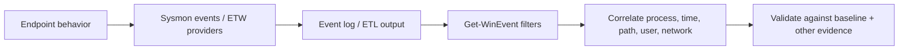

# Sysmon + ETW + `Get-WinEvent` — Quick Reference

## The whole point

**Collect evidence → filter the logs → link events → test the hypothesis → state what you know and what you only infer.** Event IDs describe event types; they do not label something as malicious.



## Event ID memory map

| Event | Meaning | First pivot |
|---|---|---|
| Security 4624 | Logon | Account, time, logon context |
| Security 4688 | Process creation | Image, command line, user |
| Sysmon 1 | Process create | Image, command line, parent, ProcessGuid |
| Sysmon 3 | Network connection | Source/destination IP, process, time |
| Sysmon 7 | Image/DLL loaded | ImageLoaded path, signer, host process |
| Sysmon 10 | Process access | SourceImage, TargetImage, users/context |

**Memory hook:** `1 started · 3 connected · 7 loaded · 10 accessed another process`.

## Detection patterns from the HTB lesson

| Scenario | Clues to combine | Don't conclude too early |
|---|---|---|
| DLL hijacking | Event 7; executable in unexpected writable path; DLL loaded from unexpected path; signer differs from expected | One unsigned DLL or one unusual path is not enough alone |
| Unusual .NET execution / injection | Event 7 shows `clr.dll`, `clrjit.dll`, or `mscoree.dll` in a process that normally doesn't need .NET | Runtime modules can be legitimate; assess process role and environment |
| Possible credential dumping | Event 10 shows an unfamiliar source process accessing `lsass.exe`; unusual source path/user/privilege context | AV/EDR and authentication software may legitimately access LSASS |
| Parent PID spoofing | Sysmon Event 1 parent looks implausible or conflicts with other data; kernel-process ETW may show a different creator | Parent data is evidence to validate, not infallible truth |
| Possible C2 sequence | Unusual Event 1 followed by Event 3; same process identity, close timing, unexpected destination | Two nearby events are only a lead unless attribution and context align |

## ETW mental model

- **Provider:** emits events.
- **Controller:** manages providers/sessions.
- **Session:** collection configuration and active trace.
- **Consumer:** receives/processes events.
- **Channel:** logical event destination/category.
- **ETL:** file for stored trace data.

Useful providers mentioned by HTB: `Microsoft-Windows-Kernel-Process`, `Microsoft-Windows-Kernel-File`, `Microsoft-Windows-Kernel-Network`, `Microsoft-Windows-DotNETRuntime`, `Microsoft-Windows-PowerShell`, `Microsoft-Windows-Kernel-Registry`, and `Microsoft-Windows-DNS-Client`.

## Commands to remember

```cmd
:: Active ETW sessions
logman.exe query -ets

:: Available ETW providers
logman.exe query providers

:: Narrow the provider list
logman.exe query providers | findstr "Process"

:: Inspect one provider
logman.exe query providers Microsoft-Windows-Winlogon
```

```powershell
# Discover logs and record counts/status
Get-WinEvent -ListLog * |
  Select-Object LogName, RecordCount, IsEnabled, LogMode, LogType

# Read a recent sample from the Sysmon log
Get-WinEvent -FilterHashtable @{
  LogName = 'Microsoft-Windows-Sysmon/Operational'
  Id      = 1,3,7,10
} -MaxEvents 100 |
  Select-Object TimeCreated, Id, ProviderName, Message

# Filter by date window (end boundary is exclusive in the HTB example)
$start = Get-Date '2023-05-28'
$end   = Get-Date '2023-06-03'
Get-WinEvent -FilterHashtable @{
  LogName   = 'Microsoft-Windows-Sysmon/Operational'
  Id        = 1,3
  StartTime = $start
  EndTime   = $end
}

# Read an exported EVTX
Get-WinEvent -Path 'C:\Logs\sample.evtx' -MaxEvents 50
```

## Five-question triage checklist

1. **Collection:** was the correct log/event type enabled, retained, and queried over the right time range?
2. **Identity:** which exact process, user, command line, file path, and process GUID are involved?
3. **Behavior:** is the module load, parent-child relationship, target process, or network destination expected for this endpoint?
4. **Correlation:** can separate records be linked to the same process and timeline?
5. **Alternative:** what legitimate explanation exists, and what other event/provider could confirm or contradict it?

## Pitfalls

- Event ID ≠ verdict.
- Unsigned ≠ automatically malicious.
- Parent process fields can be spoofed or misleading.
- `-enc` is suspicious context, not proof by itself.
- Numeric indexes such as `Properties[21]` are fragile; named XML fields are easier to maintain.
- A query returning no rows may mean wrong log, missing collection, excluded events, retention loss, bad time bounds, or wrong field names—not necessarily that nothing happened.

For the full explanation, investigation examples, teach-back, and recall questions, use [SOC-L3-Sysmon-ETW-Get-WinEvent-Guide.md](./SOC-L3-Sysmon-ETW-Get-WinEvent-Guide.md#).
