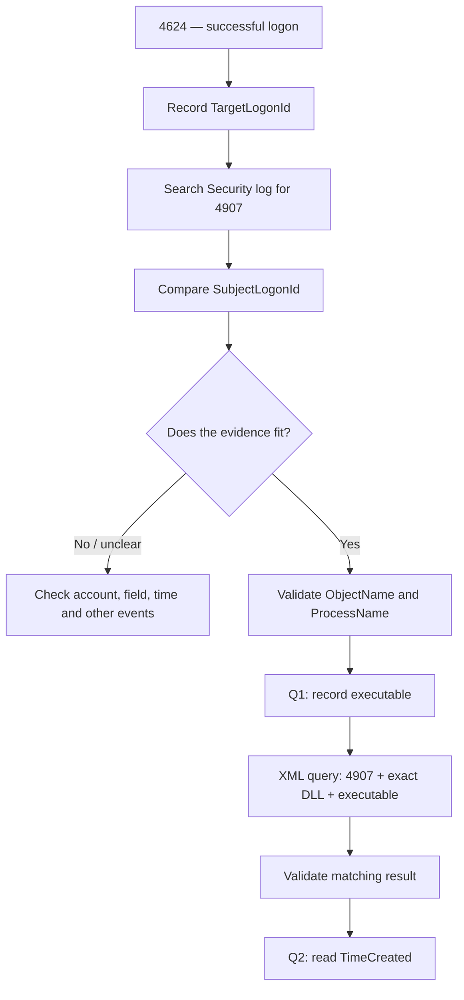
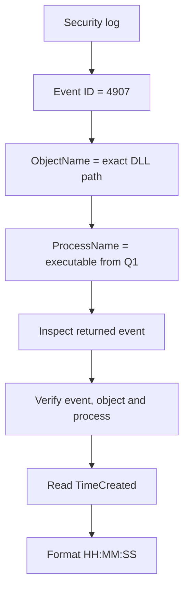

# HTB Lab — Windows Event Correlation and Auditing Changes

> [!abstract] Objective
> Use a logon event as an investigative pivot, identify the executable associated with an object-auditing change, then query the evidence to find when that executable changed the auditing settings of a specified DLL.

## Lab questions

**Q1.** Investigate Event ID `4624` recorded at `8/3/2022 10:23:25` and identify the executable responsible for the auditing-settings modification. Required format: `T_W_____.exe`.

**Q2.** Build an XML query to determine whether that executable modified the auditing settings of:

```text
C:\Windows\Microsoft.NET\Framework64\v4.0.30319\WPF\wpfgfx_v0400.dll
```

Return the matching event's time in `HH:MM:SS` format.

> [!warning] Evidence rule
> The executable name and timestamp must come from the target machine's event logs. Do not copy example values from this note into the answer.

---

## 1. The mental model

**4624 gives logon context. 4907 records a change to an object's auditing settings. Logon IDs can help correlate the events; the relevant 4907's `ProcessName` identifies the executable involved. A targeted XML query then verifies the file/process combination and reveals the event time.**



### Why Event 4907?

The question asks about a change to an object's **auditing settings**. Event ID `4907` records that an object's auditing settings (its SACL) changed. Event ID `4624` is a successful logon event; it is a starting point for context, not the event that directly records the auditing change. Event ID `4719`, by contrast, concerns a change to the system audit policy.

## 2. The concepts that must not be confused

| Concept / field | What it identifies | Role in this investigation |
|---|---|---|
| Event ID | Type of activity recorded | `4624` = successful logon; `4907` = object-auditing settings changed |
| Logon ID | A logon session/security context | Helps correlate events associated with the same session |
| PID / `ProcessId` | A process instance | Helps identify or investigate the process associated with an event |
| `ProcessName` | Executable path recorded by the event | Identifies the executable involved in the event that contains the field |
| `TargetLogonId` | Target/new session in a 4624 event | Candidate session identifier to record from the starting event |
| `SubjectLogonId` | Subject session in an event such as 4907 | Compare it with the relevant session ID from 4624 |
| `ObjectName` | Object whose auditing settings changed | Confirms whether the event concerns the target DLL |
| `TimeCreated` | Event timestamp | Supplies the time requested by Q2 when read from the matching event |

> [!important] The key distinction
> A PID is **not** a Logon ID. One logon session can involve multiple processes, so related events may have different PIDs. Also, `ProcessName` tells you which executable is associated with *that event*; the process shown in 4624 is not automatically the executable responsible for a later modification.

### Analogy: building entry records and security cameras

A person enters a building and gets a session number. Later, a separate record shows a tool changing the security settings on a cabinet. The shared session number helps connect the records; the second record tells you which tool was involved and which cabinet was affected. You then search the archive for the same cabinet and tool to find the exact time.

| Analogy | Windows |
|---|---|
| Entry record | Event 4624 |
| Session number | Logon ID |
| Change to cabinet's security settings | Event 4907 |
| Cabinet | `ObjectName` |
| Tool used for the change | `ProcessName` |
| Archive search | XML query |
| Recording time | `TimeCreated` |

---

## 3. Solve Q1 — find the executable

### Step A — inspect the starting 4624

1. On the HTB target, press `Win + R`, type `eventvwr.msc`, and press Enter.
2. Navigate to **Windows Logs → Security**.
3. Choose **Filter Current Log…**, enter `4624`, and apply the filter.
4. Find the event at the specified date/time. Open it and select **Details → XML View**.
5. Record the relevant fields. Make sure you distinguish the subject from the target.

```text
Event 4624
TimeCreated:     __________________________
TargetUserName:  __________________________
TargetUserSid:   __________________________
LogonType:       __________________________
SubjectLogonId:  __________________________
TargetLogonId:   __________________________
```

### Step B — search the Security log for 4907

1. Keep **Windows Logs → Security** selected.
2. Choose **Filter Current Log…** and enter `4907`.
3. Open candidate events and use **Details → XML View** to inspect their named fields.
4. Compare the relevant 4907 event's `SubjectLogonId` with the `TargetLogonId` you recorded from the starting 4624.

For each plausible candidate, record:

```text
Event 4907
TimeCreated:     __________________________
SubjectLogonId:  __________________________
ObjectName:      __________________________
ProcessId:       __________________________
ProcessName:     __________________________
```

### Step C — validate before deciding

A matching Logon ID is a **correlation clue**, not proof by itself. Check the event time, affected object, process path and surrounding evidence. If multiple events match the Logon ID, don't automatically choose the first one.

- `ObjectName` tells you what object's auditing settings changed.
- `ProcessName` is the executable path recorded on the auditing-change event.
- `ProcessId` identifies the process instance; it is not the executable filename.
- `TimeCreated` tells you when that specific event was recorded.

Once you've identified the relevant event, extract the executable filename from its `ProcessName` path and use the format required by Q1.

### Special caution: `0x3e7`

`0x3e7` is commonly associated with the Windows Local System (`SYSTEM`) logon session. Its meaning depends on the **field in which it appears**. In a 4624 event, `SubjectLogonId` and `TargetLogonId` can be different. Verify `TargetUserName`, `TargetUserSid`, `LogonType`, and the precise XML field before assuming that `0x3e7` represents the Administrator RDP session. Do not treat every occurrence of this value as the same login.

---

## 4. Solve Q2 — query the exact DLL and executable

Once Q1 has given you a verified executable path, search for a 4907 event satisfying all three conditions:

1. `EventID = 4907`.
2. `ObjectName` equals the DLL path from the question.
3. `ProcessName` equals the executable path established in Q1.



### XML query template

Replace the executable placeholder with the **full path** from the relevant 4907 event. This query assumes the event XML contains the field names shown below; inspect a real 4907 event if the query returns no results.

```powershell
$Exe = 'C:\Windows\WinSxS\amd64_microsoft-windows-servicingstack_31bf3856ad364e35_10.0.19041.1790_none_7df2aec07ca10e81\TiWorker.exe'

$Object = 'C:\Windows\Microsoft.NET\Framework64\v4.0.30319\WPF\wpfgfx_v0400.dll'

$Query = @"
<QueryList>
  <Query Id="0" Path="Security">
    <Select Path="Security">
      *[System[(EventID=4907)]] and
      *[EventData[Data[@Name='ObjectName']='$Object']] and
      *[EventData[Data[@Name='ProcessName']='$Exe']]
    </Select>
  </Query>
</QueryList>
"@

Get-WinEvent -FilterXml $Query |
    Select-Object TimeCreated, Id, Message |
    Format-List
```

flowchart TD
    A["Event 4624<br/>Successful logon"] --> B["Record TargetLogonId"]
    B --> C["Find Event 4907"]
    C --> D["Compare Logon IDs"]
    D --> E["Validate session and event context"]
    E --> F["ProcessName identifies executable"]
    F --> G["Build query using executable and DLL"]
    G --> H["Matching Event 4907"]
    H --> I["Read TimeCreated"]


### Read the result

Verify the returned event rather than trusting the fact that a query returned a row:

- Is the event ID `4907`?
- Does `ObjectName` exactly match the target DLL?
- Does `ProcessName` match the executable from Q1?
- Is `TimeCreated` the timestamp of this modification event?

Record that event time in `HH:MM:SS` format.

### How the XPath works

| Query part | Meaning |
|---|---|
| `QueryList` / `Query` | Containers defining the event-log query |
| `Path="Security"` | Search the Security log |
| `System[(EventID=4907)]` | Keep auditing-change events |
| `Data[@Name='ObjectName']` | Test the affected object path |
| `Data[@Name='ProcessName']` | Test the executable path |
| `and` | Require every condition to match |
| `Get-WinEvent -FilterXml` | Run the XML query |
| `TimeCreated` | Display the event timestamp |

The query doesn't calculate the time. It finds the event matching your conditions, and you read the timestamp from that event.

---

## 5. Troubleshooting and pitfalls

| Symptom | What to check |
|---|---|
| No 4624 event appears | Confirm Security log, date/time, filters and target machine |
| No 4907 results appear | Clear restrictive date filters; verify that relevant events exist in the Security log |
| Logon IDs differ | Recheck `TargetLogonId` vs `SubjectLogonId`; validate whether this is the correct candidate event |
| Several 4907 events share the ID | Inspect `ObjectName`, `ProcessName`, timestamps and surrounding evidence |
| Query returns no rows | Verify exact paths, field names, query syntax, log availability and permissions |
| PIDs differ | This alone does not disprove correlation; a session may involve multiple processes |
| `0x3e7` appears | Verify the XML field and account/session details; don't assume it is the Administrator target session |
| Wrong time seems selected | Use the `TimeCreated` of the event matching both the DLL and executable, not the initial 4624 time |

## 6. Evidence worksheet and final answers

> [!warning] Complete only from your target's evidence
> Do not fill these fields from illustrative examples. Capture the values from the actual HTB event records.

### Q1 — executable

**Answer:** `__________________________`

| Evidence | Observed value |
|---|---|
| 4624 timestamp |  |
| 4624 `TargetUserName` / SID |  |
| 4624 `TargetLogonId` |  |
| 4907 `SubjectLogonId` |  |
| 4907 `ObjectName` |  |
| 4907 `ProcessName` |  |
| 4907 `TimeCreated` |  |
| Why this event is the right candidate |  |

### Q2 — timestamp

**Answer (`HH:MM:SS`):** `________________`

| Verification | Observed value |
|---|---|
| Event ID | 4907 |
| `ObjectName` matches requested DLL |  |
| `ProcessName` matches Q1 executable |  |
| `TimeCreated` |  |

### Evidence-based explanation

Write two or three sentences explaining how you got each answer. Include the fields that support the conclusion, not just the final value.

- **Q1 reasoning:** …
- **Q2 reasoning:** …

---

## 7. Final recap

```text
START: 4624 at the specified time
  ↓ record TargetLogonId and identify the right session
PIVOT: inspect 4907 auditing-change events
  ↓ compare SubjectLogonId and validate object/process/time
Q1: read ProcessName from the relevant 4907
  ↓ use the discovered executable in the next query
Q2: filter 4907 by exact DLL path + executable path
  ↓ validate the result and read TimeCreated
OUTPUT: executable filename + HH:MM:SS
```

### Knowledge check

1. Why doesn't the process shown in Event 4624 automatically answer Q1?
2. What is the difference between a PID and a Logon ID?
3. Which fields connect the two event records?
4. Why should a matching Logon ID be treated as a clue rather than proof?
5. Why does the Q2 query filter by both `ObjectName` and `ProcessName`?
6. Which event's `TimeCreated` answers Q2?
7. What should you verify if the query returns zero results?

### Related notes

Update these relative paths to match the folders in your vault/repository:

- [Sysmon, ETW and Get-WinEvent — Deep Guide](../NOTES/SOC-L3-Sysmon-ETW-Get-WinEvent-Guide.md#)
- [SOC — Quick Reference](../NOTES/SOC-L3-Sysmon-ETW-Quick-Reference.md#)
- [Reusable HTB Study Prompt](../../Attathemnts/SOC-L3-HTB-Study-Prompt.md#)

> [!security] Repository hygiene
> Do not publish lab passwords, VPN files, tokens or other credentials in a public GitHub repository.

## References

- [HTB Academy — Analyzing Evil With Sysmon & Event Logs](https://academy.hackthebox.com/app/module/216/section/2301)
- [Microsoft Sysinternals — Sysmon](https://learn.microsoft.com/en-us/sysinternals/downloads/sysmon)
