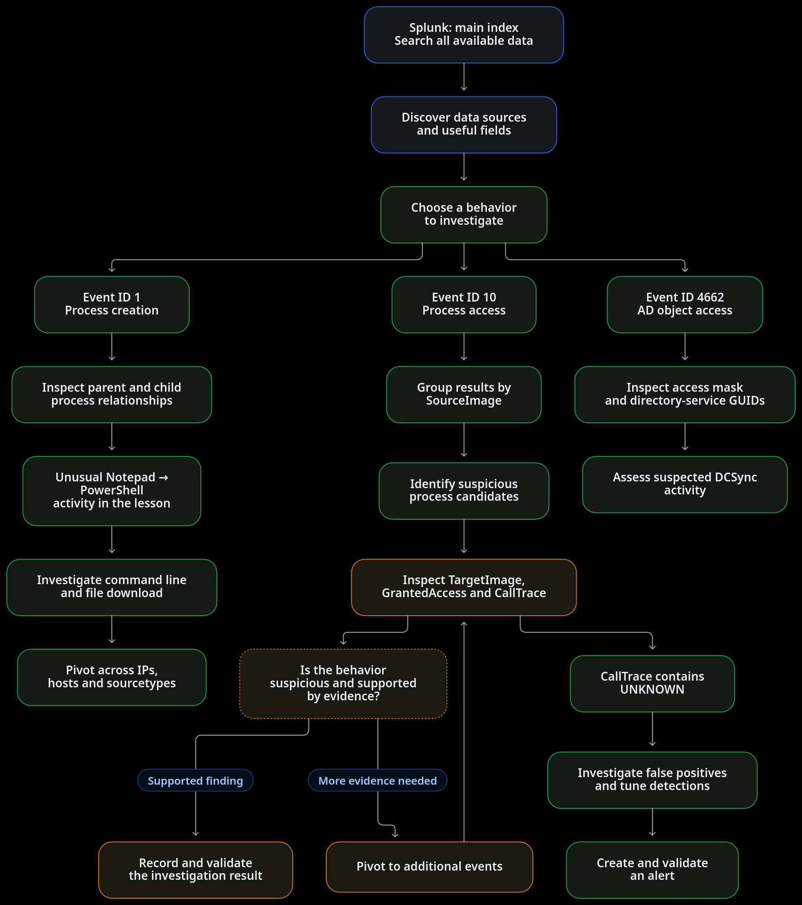
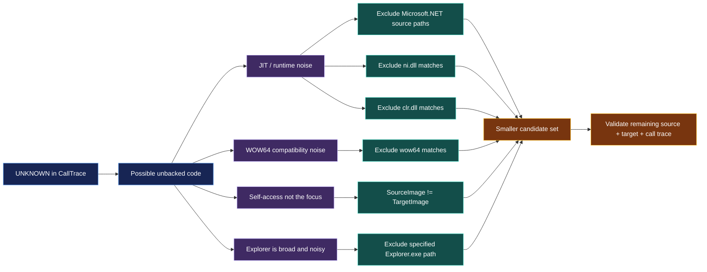

First of all started by discovering the source events 

```

index="main" earliest=0

```


Lest Hunt after wineventlog:sysmon

Next we are gong to run 
What this is doing is that we are hunting after [Sysmon Event ID 10 - ProcessAccess](https://www.ultimatewindowssecurity.com/securitylog/encyclopedia/event.aspx?eventid=90010): Useful for spotting remote code injection and memory dumping, as it records when handles on processes are made.

```
index="main" EventCode=10 lsass
| stats count by SourceImage
```


Relation ship  :


> But don't immediately select the first row. A rare process can be perfectly legitimate, while a frequently observed process can still be compromised.


Wowwww i just spot it i was trying to start with the lowest count but if you focus a bit you are going to see that their is tow Source image of runddl32.exe and i've said maybe its the same thing and the data is not clean but if you look closer its :


System32\rundll32.exe and system32\rundll32.exe 

Did you saw it ?

S != s


> [!NOTE] Not from Ai explaining :

You were about to treat them as two different entries, then stopped and compared the strings character by character. That is excellent investigative thinking.

You have just discovered an important distinction:

*Different text values do not necessarily mean different processes or different files.*


Finally found it by modifying the SPL they gave us in the notes section

```
index="main" EventCode=10 lsass CallTrace="*UNKNOWN*" SourceImage!="*Microsoft.NET*" CallTrace!=*ni.dll* CallTrace!=*clr.dll* CallTrace!=*wow64* SourceImage!="C:\\Windows\\Explorer.EXE" | where SourceImage!=TargetImage | stats count by SourceImage, TargetImage, CallTrace

```


# Splunk — UNKNOWN CallTrace Alert Tuning

> [!abstract] Purpose
> Understand how the HTB lesson turns a broad hunt for `UNKNOWN` call-trace segments into a more focused **candidate alert** for suspicious process access. This note explains what each filter removes, why it is used, what evidence it preserves, and what blind spots it can introduce.
>
> **Core principle:** every exclusion is a noise-reduction hypothesis, not proof that the excluded activity is safe.

## 1. The investigation in one sentence

Find Sysmon process-access events whose call trace contains `UNKNOWN`, identify legitimate sources of that pattern (especially JIT/runtime activity), progressively suppress known noisy cases, then inspect the remaining source/target/call-trace combinations before creating an alert.

## 2. Mind map — the complete detection logic

```mermaid

```

## 3. Flowchart — why each filter is applied

```mermaid
flowchart TD
    A[Start: all searchable events] --> B[Filter CallTrace containing UNKNOWN]
    B --> C[Group by EventCode]
    C --> D{Which event type contains UNKNOWN?}
    D -->|HTB dataset: EventCode 10| E[Focus on Sysmon ProcessAccess]
    D -->|Other event types| X[Investigate their meaning separately]
    E --> F[Group by SourceImage]
    F --> G[Review frequent and rare source processes]
    G --> H[Remove SourceImage = TargetImage]
    H --> I[Why? Focus on cross-process access, not self-access]
    I --> J[Exclude Microsoft.NET source paths]
    J --> K[Exclude ni.dll and clr.dll call-trace matches]
    K --> L[Why? Reduce known JIT/runtime-generated UNKNOWN noise]
    L --> M[Exclude wow64 call-trace matches]
    M --> N[Why? Reduce compatibility-layer call-trace noise]
    N --> O[Exclude Explorer.exe]
    O --> P[Why? Highly versatile process; difficult baseline; high noise]
    P --> Q[Group by SourceImage, TargetImage, CallTrace]
    Q --> R[Inspect remaining evidence manually]
    R --> S{Is suspicious behavior corroborated?}
    S -->|No / uncertain| T[Refine hypothesis; inspect events and benign explanations]
    T --> R
    S -->|Yes| U[Build, test, document and monitor candidate alert]

    classDef start fill:#172554,stroke:#60A5FA,color:#FFFFFF
    classDef filter fill:#134E4A,stroke:#5EEAD4,color:#FFFFFF
    classDef reason fill:#3F2A63,stroke:#C4B5FD,color:#FFFFFF
    classDef decision fill:#78350F,stroke:#FBBF24,color:#FFFFFF
    classDef outcome fill:#14532D,stroke:#86EFAC,color:#FFFFFF
    class A,B,C,E,F,G,Q,R start
    class H,J,K,M,O filter
    class I,L,N,P reason
    class D,S decision
    class T,U outcome
```

## 4. The evidence: what does `UNKNOWN` mean?

Sysmon **Event ID 10 — ProcessAccess** records one process opening/accessing another process. The lesson investigates the `CallTrace` field, which contains stack/call-path context associated with the access.

A call trace containing `UNKNOWN` can indicate that part of the call path comes from memory that does not map cleanly to a known file-backed image. Shellcode or injected code can execute from such memory, so this can be suspicious.

But:

- `UNKNOWN` does **not** automatically mean shellcode.
- JIT compilers deliberately generate executable code in memory at runtime.
- Some compatibility/runtime mechanisms can also produce call-trace segments that are not straightforwardly mapped to a normal file path.
- Event ID 10 says a process accessed another process; it does not, by itself, prove a successful LSASS dump or credential theft.

**Analyst interpretation:** `UNKNOWN` is a useful hunting clue. It needs context and corroboration before it becomes a high-confidence detection.

## 5. Query progression — each stage and its purpose

### Stage 1 — Find which event types contain `UNKNOWN`

```spl
index="main" CallTrace="*UNKNOWN*"
| stats count by EventCode
```

**Grammar**

- `index="main"`: select the dataset.
- `CallTrace="*UNKNOWN*"`: keep events where the `CallTrace` field contains the text `UNKNOWN`.
- `|`: pass matching events into the next pipeline command.
- `stats count by EventCode`: count matching events per event code.

**HTB observation:** the lesson reports 1,575 matching events, all under EventCode 10 in this dataset. That is why the investigation focuses on Sysmon ProcessAccess. This is a result from the HTB lab, not a universal rule for every Splunk environment.

### Stage 2 — See which processes are generating the events

```spl
index="main" CallTrace="*UNKNOWN*"
| stats count by SourceImage
```

`SourceImage` identifies the process that initiated access. Grouping by it gives a manageable list of process paths and counts.

**Why do this?** You cannot manually inspect 1,575 raw events efficiently. First summarize by source process, then select candidates for deeper review.

**Important:** rare does not equal malicious; common does not equal safe. Frequency is prioritization context, not a verdict.

### Stage 3 — Exclude self-access

```spl
index="main" CallTrace="*UNKNOWN*"
| where SourceImage!=TargetImage
| stats count by SourceImage
```

**What it removes:** events where the source process and target process are the same according to these fields.

**Why:** this hunt is interested in a process accessing a *different* process. Self-access is not the behavior being prioritized in this particular detection idea, so removing it reduces irrelevant records.

**What it does not prove:** self-access is not universally harmless. This is a scope choice for this hunt, not a general rule that same-process events can never matter.

### Stage 4 — Reduce .NET / CLR JIT noise

```spl
index="main" CallTrace="*UNKNOWN*"
SourceImage!="*Microsoft.NET*"
CallTrace!=*ni.dll*
CallTrace!=*clr.dll*
| where SourceImage!=TargetImage
| stats count by SourceImage
```

There are three exclusions here, and they address related but distinct clues.

| Exclusion | What it filters | Why the lesson filters it |
|---|---|---|
| `SourceImage!="*Microsoft.NET*"` | Source process paths containing `Microsoft.NET` | The lesson identifies .NET/JIT activity as a source of legitimate `UNKNOWN` call-trace noise. |
| `CallTrace!=*ni.dll*` | Call traces containing `ni.dll` | The lesson treats this as related to .NET native-image/JIT behavior and excludes it to improve alert fidelity. |
| `CallTrace!=*clr.dll*` | Call traces containing `clr.dll` | `clr.dll` is associated with the .NET Common Language Runtime; runtime/JIT activity can produce legitimate call-trace patterns. |

**JIT in plain English:** Just-In-Time compilation turns managed/intermediate code into machine code while a program is running. That generated code lives in memory. Since it may not correspond to an ordinary standalone executable image on disk, memory/call-stack telemetry can contain regions that look `UNKNOWN` to a file-backed module lookup.

**Why exclude these?** The objective is to avoid alerting on a known class of legitimate runtime behavior every time it produces an `UNKNOWN` call-trace segment. This reduces false positives and alert fatigue.

**Caution:** these are broad string/path exclusions. A malicious process can use .NET, and a process running from a .NET directory is not automatically benign. Excluding the whole category can hide malicious activity that abuses the runtime. The lesson chooses a simplified, higher-fidelity filter for its lab dataset; a production detection should validate the exact runtime behavior and scope exclusions narrowly.

### Stage 5 — Exclude WOW64-related call traces

```spl
index="main" CallTrace="*UNKNOWN*"
SourceImage!="*Microsoft.NET*"
CallTrace!=*ni.dll*
CallTrace!=*clr.dll*
CallTrace!=*wow64*
| where SourceImage!=TargetImage
| stats count by SourceImage
```

**What it filters:** events whose `CallTrace` contains `wow64`.

**Why the lesson filters it:** WOW64 is the Windows compatibility mechanism that allows 32-bit applications to run on 64-bit Windows. Its transition/compatibility paths can involve memory/call-trace regions that are not represented like ordinary file-backed modules. The lesson treats these as another source of `UNKNOWN` noise and mentions a possible relationship to Heaven's Gate.

**Important nuance:** the lesson presents this as a hunt-tuning explanation, not proof that every WOW64-related `UNKNOWN` segment is benign or that Heaven's Gate is occurring. Treat the exclusion as a lab heuristic. Attackers can operate through compatibility layers too, so a blanket exclusion can create a blind spot.

### Stage 6 — Exclude Explorer.exe

```spl
index="main" CallTrace="*UNKNOWN*"
SourceImage!="*Microsoft.NET*"
CallTrace!=*ni.dll*
CallTrace!=*clr.dll*
CallTrace!=*wow64*
SourceImage!="C:\\Windows\\Explorer.EXE"
| where SourceImage!=TargetImage
| stats count by SourceImage
```

**What it filters:** events where the source process is the specified Windows Explorer executable path.

**Why the lesson filters it:** Explorer is a general-purpose Windows shell process. It participates in many types of normal user and system activity, and many tools interact with it. That makes its behavior broad and difficult to baseline using this simple `UNKNOWN` call-trace rule. Keeping every Explorer-related match would add substantial noise and make the remaining candidates harder to review.

**Caution:** Explorer is not inherently safe. Attackers can inject into, abuse, or run code through legitimate Windows processes. Excluding Explorer entirely makes the alert quieter but also means this specific alert will not catch suspicious activity sourced from that path. In production, consider a narrower exception based on verified benign behavior rather than excluding the process wholesale.

### Stage 7 — Review the remaining combinations, not only the process name

```
index="main" CallTrace="*UNKNOWN*"
SourceImage!="*Microsoft.NET*"
CallTrace!=*ni.dll*
CallTrace!=*clr.dll*
CallTrace!=*wow64*
SourceImage!="C:\\Windows\\Explorer.EXE"
| where SourceImage!=TargetImage
| stats count by SourceImage, TargetImage, CallTrace
```

**Why add `TargetImage` and `CallTrace` back?**

A list grouped only by `SourceImage` tells you which source process generated matches. It does not show the target of each access or the call-trace pattern associated with it. Grouping by all three preserves more investigative context:

- `SourceImage`: who initiated the access?
- `TargetImage`: which process was accessed?
- `CallTrace`: what call-path evidence was recorded?
- `count`: how often did that particular combination occur?

This is still an aggregation. It does not preserve every original event field or prove maliciousness. Use a focused detail search to inspect raw event samples for a suspicious combination.

## 6. Mind map — the reason behind every exclusion



## 7. Why do we exclude anything at all?

The goal is to balance two competing outcomes:

| Detection outcome | Meaning | Operational impact |
|---|---|---|
| True positive | Suspicious activity is alerted | Analyst investigates a real threat. |
| False positive | Benign activity is alerted | Analyst time is wasted; alert fatigue grows. |
| False negative | Malicious activity is filtered out or not detected | Threat activity may go unnoticed. |
| True negative | Benign activity is correctly not alerted | Alert queue stays focused. |

The exclusions aim to reduce false positives. But every exclusion can increase false negatives if attackers use the excluded process, runtime, or call-trace pattern.

> [!important] The trade-off
> A quieter alert is not automatically a better alert. A high-fidelity rule must still detect the malicious behaviors it was designed to catch. Always measure what the exclusions remove, not just how many alerts remain.

## 8. How could an attacker bypass this rule?

The HTB lesson gives one explicit example: an attacker could load a DLL whose name ends with `NI`, causing the call trace to contain a string that matches the `ni.dll` exclusion pattern. Because the filter is based on a substring, the event could be excluded even though the DLL is not a trusted .NET native image.

General detection-engineering lessons:

1. **String exclusions are brittle.** A name can be chosen to resemble a trusted module or contain an excluded substring.
2. **Path exclusions are brittle.** An attacker may run from an excluded location or abuse a legitimate process that is excluded.
3. **Process-name exclusions are brittle.** A trusted executable can be abused; a familiar name does not guarantee trusted behavior.
4. **A single telemetry signal is incomplete.** `UNKNOWN` alone is not proof of shellcode, and absence of `UNKNOWN` does not prove no injection occurred.
5. **Over-tuning can hide the threat.** Every added exception needs a documented reason, owner, scope, and review date.

### How to strengthen the logic

- Prefer specific, verified module identities and expected paths over loose substring matches where the telemetry supports it.
- Correlate the access event with process creation, process identity, user, host, parent process, command line, target process, and timestamp.
- Where available, use process GUIDs and process IDs to tie activity to a process instance rather than relying only on executable names.
- Maintain an allowlist of known-good behavior with narrow scope (specific signer, path, version, host role, or parent-child relationship) rather than broad process-name exclusions.
- Test the alert against known benign JIT/runtime activity **and** known malicious examples.
- Review excluded events periodically; legitimate software and attacker techniques change.

## 9. What this query is — and what it is not

**It is:** a lab-scale candidate detection based on process-access events with `UNKNOWN` call-trace segments, followed by exclusions intended to suppress known noisy patterns.

**It is not:** a universal LSASS-dumping detector, proof of shellcode, proof of credential theft, or a production-ready rule that can be deployed without validation.

Before promoting it to an alert, answer:

- What exact behavior are we detecting?
- Which event source and fields must be present?
- Which known benign cases are excluded, and why?
- What malicious cases might the exclusions hide?
- What evidence will an analyst see when the alert fires?
- How will we test and maintain the rule?

## 10. Analyst memory hook

```text
UNKNOWN ≠ malicious
UNKNOWN = investigate

JIT / CLR / ni.dll  → possible legitimate generated code
WOW64               → possible compatibility-layer noise
SourceImage=TargetImage → not the cross-process behavior prioritized here
Explorer.exe        → broad behavior, difficult baseline

Exclude to reduce noise.
Validate to avoid blind spots.
```

## 11. SPL grammar reminders for this hunt

| Syntax | Meaning in this investigation |
|---|---|
| `CallTrace="*UNKNOWN*"` | Keep events whose CallTrace contains `UNKNOWN`. |
| `SourceImage!="*Microsoft.NET*"` | Exclude source paths matching the Microsoft.NET pattern. |
| `CallTrace!=*ni.dll*` | Exclude call traces matching the `ni.dll` substring pattern. |
| `CallTrace!=*clr.dll*` | Exclude call traces matching the `clr.dll` substring pattern. |
| `CallTrace!=*wow64*` | Exclude call traces matching the `wow64` substring pattern. |
| `SourceImage!="C:\\Windows\\Explorer.EXE"` | Exclude the specified Explorer source path. |
| `where SourceImage!=TargetImage` | Compare two field values and keep events where they differ. |
| `stats count by A, B, C` | Group by the combination of fields and count events in each group. |

> [!tip] Query debugging
> Add one exclusion at a time. After each edit, compare the number of events and inspect a few removed samples. If an exclusion removes both known-benign and known-malicious examples, it is too broad for the intended purpose.

## 12. Final analyst workflow

1. Start broad enough to discover where `UNKNOWN` appears.
2. Identify the relevant event type and understand its semantics.
3. Group by source process to prioritize the work.
4. Add one exclusion at a time, based on a specific benign explanation.
5. Inspect what each exclusion removes.
6. Reintroduce source, target, and call-trace context.
7. Validate raw events and correlate with other telemetry.
8. Only then convert the hunt into an alert with documented limitations.

**The core skill is not knowing which strings to exclude. It is being able to explain what each exclusion is trying to remove, what evidence supports that decision, and what attack activity might disappear with it.**


rundll32.exe

by using :


```
index="main" EventCode=10 lsass SourceImage= *rundll32.exe*
| table _time host Image ImageLoaded ProcessId CallTrace
| sort 0 _time
```

I was able to reterive a lot of misused dlls 


```
index="main" sourcetype="WinEventLog:Sysmon" EventCode=7 Image="*rundll32.exe" lsass
| table _time host ProcessId ProcessGuid Image ImageLoaded
| sort 0 - _time
```


---

---


.png)


It's going to be something like this : 


```
index="main" EventCode=7 ImageLoaded="*clr.dll*"
| stats count by Image
| sort 0 + count
```


```
Image = C:\Users\waldo\Downloads\SharpHound.exe
```


Now we are going to run this : 

```
index="main" (EventCode=1 OR EventCode=5)
Image="*SharpHound.exe"
| table _time host EventCode Image ProcessGuid ProcessId ParentImage CommandLine
| sort 0 _time
```


```
index="main" EventCode=1 ParentImage="*randomfile.exe*"
| table _time ComputerName User Image CommandLine

```


here me again after the weekend trying to solve this lets see how it go

By using :

```
index=* EventCode=7 ImageLoaded="*clr.dll*"
| stats count by Image
```


I was completely wrong 


## 🎯 Objective

Find suspicious processes loading `clr.dll`, then identify which process could be used as a temporary execution host for C# code.

## 1. Understand the concept

- `clr.dll` = .NET Common Language Runtime, needed to execute managed .NET code.
    
- C# applications normally load the CLR.
    
- Attackers can abuse existing processes to host .NET code.
    
- `rundll32.exe` is a legitimate Windows utility designed to execute functions exported by DLLs. It can also be abused as a code execution host.
    

**Important:** Loading `clr.dll` alone does not prove an attack. We need to understand which process loaded it and why.

## 2. Investigation workflow

### Step 1 — Find CLR loads

```
index="main" sourcetype="WinEventLog:Sysmon" EventCode=7 ImageLoaded="*clr.dll"
| stats count by Image
| sort 0 - count
```

Sysmon Event ID 7 = Image loaded.

Important fields:

- `Image`: process loading the DLL.
    
- `ImageLoaded`: DLL being loaded.
    

### Step 2 — Separate expected applications from unusual candidates

The original investigation excluded known legitimate .NET applications, then reviewed the remaining processes.

Candidates included:

- `notepad.exe`
    
- `rundll32.exe`
    
- `randomfile.exe`
    
- `SharpHound.exe`
    

Do not assume every CLR load is malicious. SharpHound, for example, is a .NET application, so its CLR load is expected.

### Step 3 — Investigate process instances

Use `ProcessGuid` to follow one exact process instance.

|Sysmon Event|Meaning|
|---|---|
|ID 1|Process creation|
|ID 5|Process termination|
|ID 7|DLL loading|

Useful fields:

- `ProcessGuid`: identity of the process instance.
    
- `ParentProcessGuid`: identity of its parent.
    
- `ParentImage`: executable that launched it.
    
- `CommandLine`: command used to launch it.
    

### Step 4 — The detour we took

We investigated `randomfile.exe`:

- It loaded `clr.dll`.
    
- It started at 12:09:34 and terminated at 12:33:27.
    
- It launched `cmd.exe`, which launched PsExec64.
    
- It also had a `WerFault.exe` child near termination.
    

This was genuinely suspicious activity, but following its child processes did not establish that it was the temporary C# execution host being asked for.

**Lesson:** Suspicious activity is not automatically the answer to the specific investigation question.

### Step 5 — Understand the role of rundll32.exe

`rundll32.exe` is designed to execute functions exported by DLLs.

The important combination was:

1. It appeared among the suspicious CLR-loading candidates.
    
2. Its intended functionality is DLL-based code execution.
    
3. Its loading of the .NET runtime made it a relevant candidate for hosting managed C# execution.
    

This is the key reasoning behind the exercise's intended answer.

## 3. Investigation mind map

```
flowchart TD
    A["Question: Find suspicious CLR loads"] --> B["Sysmon Event ID 7"]
    B --> C["Search ImageLoaded = clr.dll"]
    C --> D["Identify candidate processes"]
    D --> E["Filter expected .NET applications"]
    E --> F["Investigate suspicious candidates"]
    F --> G["Understand each process's purpose"]
    G --> H["rundll32.exe"]
    H --> I["Designed to execute DLL functions"]
    I --> J["CLR load raises suspicion of managed code execution"]
    J --> K["Intended answer: rundll32.exe"]

    classDef start fill:#1d4ed8,color:#fff,stroke:#1d4ed8
    classDef evidence fill:#6d28d9,color:#fff,stroke:#6d28d9
    classDef detour fill:#92400e,color:#fff,stroke:#92400e
    classDef answer fill:#15803d,color:#fff,stroke:#15803d

    class A,B,C start
    class D,E,F,G evidence
    class H,I,J,K answer
```

## 4. SPL grammar learned

|Syntax|Meaning|
|---|---|
|`index="main"`|Select the index|
|`EventCode=7`|Filter for Event ID 7|
|`ImageLoaded="*clr.dll"`|Match the DLL name|
|`AND` / `OR`|Combine conditions|
|`NOT` / `!=`|Exclude matching values|
|`\|`|Pass results to the next command|
|`stats count by Image`|Count events per process|
|`where`|Filter results using conditions|
|`table`|Display selected fields|
|`sort`|Order results|

## 5. Final takeaway

**The intended HTB answer:** `**rundll32.exe**`

The biggest lesson wasn't memorising a suspicious executable. It was understanding the difference between:

- What a process normally does.
    
- What it actually did.
    
- Whether its observed behaviour could indicate abuse.
    

A good SOC analyst follows the evidence, but also understands the purpose and capabilities of the executable being investigated.


```
index="main" sourcetype="WinEventLog:Sysmon" EventCode=3 (Image="*rundll32.exe" OR Image="*cmd.exe" OR Image="*randomfile.exe" OR Image="*SharpHound.exe") | table _time, Image, DestinationIp, DestinationPort
```


# HTB SOC Analyst — Splunk Skills Assessment: Complete Investigation Guide

## 🎯 The mission

Investigate Windows security telemetry using Splunk SPL to identify:

1. Another process that accessed and dumped LSASS.
    
2. The DLL associated with the LSASS dumping method.
    
3. A suspicious process used to execute C# code.
    
4. Two Command and Control (C2) callback server IPs.
    
5. The port used by a C2 server to connect to a compromised machine.
    

---

# 1. The complete investigation mind map

```
flowchart TD
    A["HTB Splunk Skills Assessment"] --> B["Q1: LSASS Process Access"]
    A --> C["Q2: LSASS Dumping Method"]
    A --> D["Q3: C# Injection"]
    A --> E["Q4: C2 Discovery"]
    A --> F["Q5: C2 Connection Port"]

    B --> B1["Sysmon Event ID 10"]
    B1 --> B2["TargetImage = lsass.exe"]
    B2 --> B3["Group by SourceImage"]
    B3 --> B4["Identify the other suspicious process"]

    C --> C1["Inspect Event ID 10"]
    C1 --> C2["Examine CallTrace"]
    C2 --> C3["Identify DLL involved in the call stack"]

    D --> D1["Sysmon Event ID 7"]
    D1 --> D2["ImageLoaded contains clr.dll"]
    D2 --> D3["Identify unusual CLR-loading processes"]
    D3 --> D4["Understand process functionality"]
    D4 --> D5["rundll32.exe: potential DLL execution host"]

    E --> E1["Sysmon Event ID 3"]
    E1 --> E2["Discover network connections"]
    E2 --> E3["Analyse source and destination IPs"]
    E3 --> E4["Identify recurring suspicious destinations"]
    E4 --> E5["Identify two C2 callback servers"]

    F --> F1["Reuse the two C2 IPs"]
    F1 --> F2["Filter SourceIp"]
    F2 --> F3["Identify compromised DestinationIp"]
    F3 --> F4["Inspect DestinationPort"]
    F4 --> F5["Determine the port"]

    classDef root fill:#1d4ed8,color:#fff,stroke:#1d4ed8
    classDef evidence fill:#6d28d9,color:#fff,stroke:#6d28d9
    classDef result fill:#15803d,color:#fff,stroke:#15803d
    class A root
    class B1,C1,D1,E1,F1,B2,C2,D2,E2,F2,F3 evidence
    class B4,C3,D5,E5,F5 result
```

# 2. Question-by-question investigation

## Q1 — Find the other process that dumped LSASS

**Concept:** Process access.

Sysmon Event ID 10 records one process accessing another process.

Important fields:

|Field|Meaning|
|---|---|
|`SourceImage`|Process accessing another process|
|`TargetImage`|Process being accessed|
|`GrantedAccess`|Permissions requested|
|`CallTrace`|Stack trace associated with the access|

**Initial search:**

```
index="main" sourcetype="WinEventLog:Sysmon" EventCode=10 TargetImage="*lsass.exe"
| stats count by SourceImage
| sort 0 - count
```

**Investigation logic:**

1. Filter events targeting LSASS.
    
2. Identify which processes accessed it.
    
3. Distinguish ordinary Windows activity from suspicious access.
    
4. Identify the other process responsible for the dumping activity.
    

**Key lesson:** `SourceImage` tells you WHO accessed LSASS. `TargetImage` tells you WHAT was accessed.

## Q2 — Find the misused DLL

**Concept:** Investigating the method behind process access.

Return to the Event ID 10 records for the suspicious process identified in Q1.

```
index="main" sourcetype="WinEventLog:Sysmon" EventCode=10 TargetImage="*lsass.exe"
| table _time SourceImage TargetImage GrantedAccess CallTrace
```

**Focus on** `**CallTrace**`**.**

It provides information about the calling stack, including modules involved in the process-access operation.

Your objective is to inspect the trace and identify the DLL associated with the suspicious LSASS access.

**Key lesson:** Do not just identify which executable performed an action. Investigate how it performed that action.

## Q3 — Find the suspicious C# execution host

**Concept:** .NET runtime loading and execution.

Sysmon Event ID 7 records DLL loading.

Initial search:

```
index="main" sourcetype="WinEventLog:Sysmon" EventCode=7 ImageLoaded="*clr.dll"
| stats count by Image
| sort 0 - count
```

Investigation logic:

1. Find all processes loading `clr.dll`.
    
2. Separate expected .NET applications from unusual candidates.
    
3. Review what the remaining executable is designed to do.
    
4. Consider whether it can act as an execution host for managed code.
    

Candidates investigated included:

- `notepad.exe`
    
- `rundll32.exe`
    
- `randomfile.exe`
    
- `SharpHound.exe`
    

The intended answer was `**rundll32.exe**`.

Why?

`rundll32.exe` is a Windows utility designed to execute functions exported by DLLs. Its CLR loading makes it an interesting candidate for abuse as a managed-code execution host.

**Our detour:** We spent too much time following the child processes of `randomfile.exe`. Its PsExec activity was suspicious, but it did not answer the specific question.

**Key lesson:** Understand the purpose of the executable. Don't assume temporary code execution always means launching a child process.

## Q4 — Find the two C2 callback server IPs

**Concept:** Network traffic analysis and Command and Control.

Sysmon Event ID 3 records network connections.

Important fields:

|Field|Meaning|
|---|---|
|`SourceIp`|Originating IP|
|`DestinationIp`|Receiving IP|
|`SourcePort`|Originating port|
|`DestinationPort`|Receiving port|
|`Image`|Process associated with the connection|
|`Initiated`|Connection initiation information|

Initial discovery:

```
index="main" sourcetype="WinEventLog:Sysmon" EventCode=3
| stats count by SourceIp DestinationIp DestinationPort Image
| sort 0 - count
```

Then we narrowed the investigation to suspicious processes:

```
index="main" sourcetype="WinEventLog:Sysmon" EventCode=3
(Image="*rundll32.exe" OR Image="*cmd.exe" OR Image="*randomfile.exe" OR Image="*SharpHound.exe")
| table _time Image DestinationIp DestinationPort
```

**Investigation logic:**

1. Identify unusual network connections.
    
2. Check which processes are communicating.
    
3. Look for repeated communication with common IP addresses.
    
4. Investigate the connection direction and endpoints.
    
5. Identify the two C2 callback servers.
    

Our subsequent investigation used these two IPs:

- `10.0.0.186`
    
- `10.0.0.91`
    

**Key lesson:** Do not select an IP simply because it has the highest connection count. Investigate the traffic pattern and the process responsible.

## Q5 — Find the C2 connection port

**Concept:** Pivoting from a known network indicator.

Now we already have the two C2 addresses from Q4.

Instead of searching all network traffic again, filter for connections initiated from those two IPs.

Our corrected search:

```
index="main" sourcetype="WinEventLog:Sysmon" EventCode=3
(
    SourceIp="10.0.0.186" OR SourceIp="10.0.0.91"
)
| table _time host Image SourceIp SourcePort DestinationIp DestinationPort Initiated Protocol
| sort 0 _time
```

**Why filter** `**SourceIp**`**?**

The question describes the C2 server connecting to a compromised machine.

In the relevant connection direction:

```
C2 server (SourceIp)
       |
       | Network connection
       v
Compromised machine (DestinationIp)
```

Therefore:

- `SourceIp` identifies the C2 server.
    
- `DestinationIp` identifies the receiving machine.
    
- `DestinationPort` identifies the port on the receiving machine.
    

The answer is determined from the relevant `DestinationPort` value in the matching event.

**Key lesson:** Always establish connection direction before deciding whether to use `SourcePort` or `DestinationPort`.

---

# 3. Sysmon Event ID cheat sheet

|Event ID|What it records|Used in|
|---|---|---|
|1|Process creation|Q1–Q3|
|3|Network connection|Q4–Q5|
|5|Process termination|Q3|
|7|DLL/image loading|Q3|
|10|Process access|Q1–Q2|

# 4. SPL grammar — the language behind the investigation

|Syntax|Meaning|
|---|---|
|`index="main"`|Select data index|
|`sourcetype="..."`|Select event type/source classification|
|`EventCode=10`|Filter by Sysmon event|
|`Image="*name.exe"`|Match a process path using a wildcard|
|`AND`|Both conditions must match|
|`OR`|Either condition can match|
|`NOT`|Exclude matching records|
|`|`|Pass results into the next command|
|`stats count by field`|Count and group records|
|`dc(field)`|Count distinct values|
|`values(field)`|List unique values|
|`where`|Filter results using an expression|
|`table`|Display selected fields|
|`sort 0 - count`|Sort descending without a result limit|

## 5. The SOC investigation methodology

The five questions taught us one reusable process:

```
flowchart TD
    A["Understand the question"] --> B["Identify relevant telemetry"]
    B --> C["Select the correct Sysmon Event ID"]
    C --> D["Filter the relevant events"]
    D --> E["Summarise and discover patterns"]
    E --> F["Identify a suspicious artifact"]
    F --> G["Pivot using a process, GUID, IP or DLL"]
    G --> H["Inspect original events"]
    H --> I["Correlate evidence"]
    I --> J["Validate the conclusion"]
    J --> K["Answer the question"]
```

### The four most important investigation habits

1. **Start with the question.** What evidence are you being asked to find?
    
2. **Choose the right telemetry.** Process access, DLL loading and network connections require different Sysmon events.
    
3. **Pivot using evidence.** A process name, ProcessGuid, DLL or IP address becomes your next search filter.
    
4. **Don't confuse suspicious with confirmed.** A clue starts an investigation; correlated evidence supports a conclusion.
    

---

## Final takeaway

The real purpose of this assessment was not to memorise five SPL queries.

It was to learn how to move from one piece of evidence to another:

**Process → DLL → Execution behaviour → Network connection → C2 infrastructure → Port.**

That is the investigative chain you should remember.