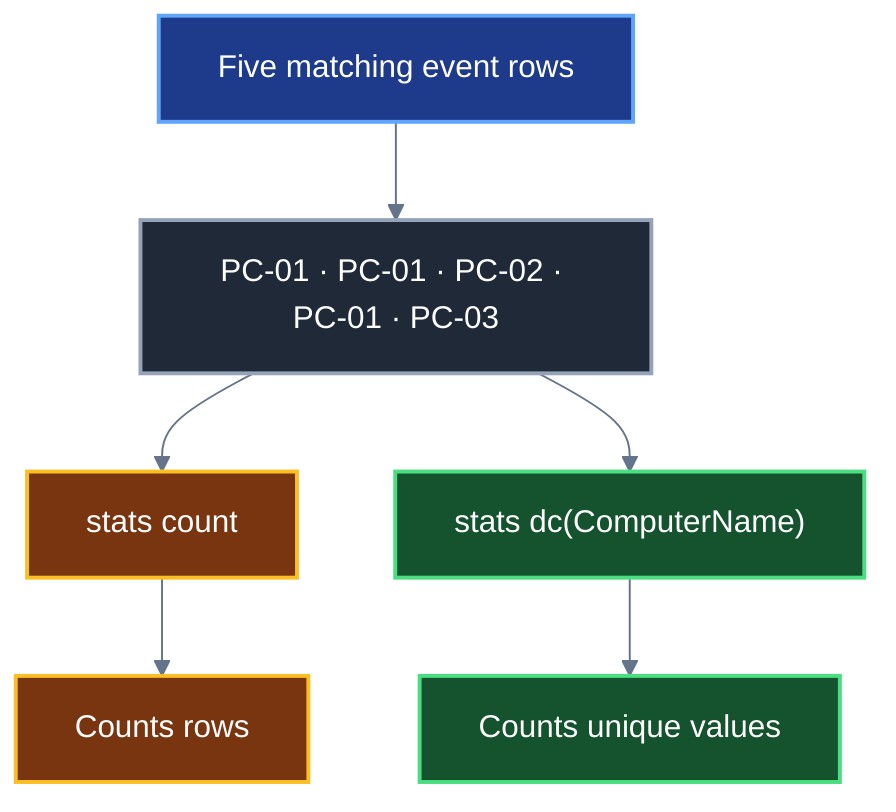
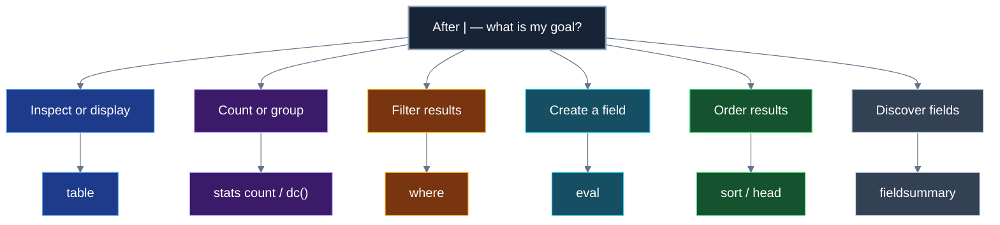

First of all what they want ?

### the count of distinct computers accessed by the account name SYSTEM.


```
EventCode=4768 | stats count by Account_Name | sort -count

```


Now lets try to figure out this :


Lets try to build this 

its related to : ```
WinEventLog:Security


```
index="main" sourcetype="WinEventLog:Security" EventCode=4624 
```

```
index="main" sourcetype="WinEventLog:Security" EventCode=4624  Account_Name="SYSTEM"
```

```
index="main" sourcetype="WinEventLog:Security" EventCode=4624  Account_Name="SYSTEM" | fieldsummary
```


![[Pasted image 20261027105638.png]]


```
index="main" sourcetype="WinEventLog:Security" EventCode=4624 Account_Name="SYSTEM" | stats dc(ComputerName) as Distinct_Computer_Count
```


# Splunk SPL — Pipeline Quick Reference

> [!abstract] When to use this note
> Use this beside your HTB lab notes when writing a search or when you get stuck. **The content stays the same; the visuals are here to make the flow easier to remember.**

## 1. The mental model

**Before `|`: find the events.**  
**After `|`: process the events you found.**

```text
Base search and filters  |  command that transforms, summarizes, or displays results
Which records?          |  What do I want to do with them?
```

### Visual — follow the query

![[Splunk_SPL_Pipeline_Animation.gif]]

> [!info] What the animation demonstrates
> The event rows and result count are a **toy example**, not the answer to your HTB question. Five example rows contain three unique computer names. The animation shows why counting events and counting distinct values are different.

```mermaid
%%{init: {"theme":"base","themeVariables":{"background":"#0B1220","primaryTextColor":"#FFFFFF","lineColor":"#64748B","fontFamily":"Inter"}}}%%
flowchart LR
    Q["Question<br/>What do I need to know?"]:::question --> A["Base search<br/>index + filters"]:::base
    A --> B["Matching events"]:::events
    B --> P["|<br/>pass results"]:::pipe
    P --> C["stats dc(ComputerName)"]:::aggregate
    C --> D["as Distinct_Computer_Count"]:::output
    classDef question fill:#172337,stroke:#94A3B8,color:#FFFFFF,stroke-width:2px;
    classDef base fill:#1E3A8A,stroke:#60A5FA,color:#FFFFFF,stroke-width:2px;
    classDef events fill:#1F2937,stroke:#94A3B8,color:#FFFFFF,stroke-width:2px;
    classDef pipe fill:#164E63,stroke:#22D3EE,color:#FFFFFF,stroke-width:3px;
    classDef aggregate fill:#3B1B69,stroke:#C4B5FD,color:#FFFFFF,stroke-width:2px;
    classDef output fill:#14532D,stroke:#4ADE80,color:#FFFFFF,stroke-width:2px;
```



## 2. Before the pipe: scope and filter

```spl
index="main" sourcetype="WinEventLog:Security" EventCode=4624 Account_Name="SYSTEM"
```

- `index="main"` — search the `main` index.
- `sourcetype="WinEventLog:Security"` — limit results to this log type.
- `EventCode=4624` — keep matching event IDs.
- `Account_Name="SYSTEM"` — keep events where this field matches `SYSTEM`.
- Conditions separated by spaces are normally combined as **AND**.

> [!warning] Check the scope
> Adding a `sourcetype` condition excludes matching events from other sourcetypes. If the question says “all events,” check whether that restriction is appropriate.

## 3. The pipe `|`

The pipe passes the results on the left to the command on the right. It does **not** mean `AND`, `OR`, or `WHERE`.

```spl
<base search and filters>
| <next command>
| <another command, if needed>
```

Build one stage at a time. Run the search after adding each pipe so you can inspect how its output changes.

## 4. `stats dc(field) as Alias`

```spl
| stats dc(ComputerName) as Distinct_Computer_Count
```

- `stats` — calculate a summary from the matching events.
- `dc(ComputerName)` — count **distinct/unique** values in `ComputerName`.
- `as Distinct_Computer_Count` — name the calculated output field. This alias is a result label, not necessarily a field in the original logs.
- With **no `by` clause**, this produces one aggregate result for the matching events.

### Know the difference

| SPL | What it calculates |
|---|---|
| `stats count` | Number of matching events |
| `stats dc(ComputerName)` | Number of unique computer-name values |
| `stats count by ComputerName` | Event count for each computer name |
| `stats dc(ComputerName) by Account_Name` | Unique computers per account |

### Visual — distinct count vs event count



> [!tip] What does `as` mean?
> `as Distinct_Computer_Count` gives the calculated value a readable output name. It is an **alias**. It does not mean Splunk has found an original log field with that name.

## 5. What should come after `|`?

Choose based on the question:

| Goal | Common command / pattern |
|---|---|
| Show selected evidence fields | `table field1, field2` |
| Count events or unique values | `stats count` / `stats dc(field)` |
| Count by category | `stats count by field` |
| Find frequent values | `top field` |
| Sort results | `sort - count` or `sort - _time` |
| Keep first N rows | `head 10` |
| Filter by a field expression | `where condition` |
| Create/transform a field | `eval new_field=expression` |
| Discover fields in current results | `fieldsummary` |



`where` filters the results at the point it appears. For example, after `stats count by Account_Name`, `| where count > 100` filters the **summary rows**, not the original events.

## 6. If you get stuck: field-discovery checklist

1. Run a broad-enough base search with the right index, event type, and time range.
2. Expand one event and inspect its raw data and extracted fields.
3. Try `| fieldsummary` to see fields and sample values in the matched events.
4. Confirm the field name and value before using it in a filter or aggregation.
5. Check that the field is populated in the events you are counting.

Do not assume field names are universal. `ComputerName`, `Computer`, and `host` may represent different things depending on the data source and configuration.

## 7. Troubleshooting checklist

> [!warning] Too many events?
> You have probably found records, but haven't summarized them yet. Ask whether the question wants events, unique values, or counts by group.

> [!warning] Zero results?
> Check time range, index, sourcetype, event ID, field spelling, and value.

> [!warning] Unexpected count?
> Verify the target field, null/missing values, filters, and whether a sourcetype restriction excludes relevant data.

> [!tip] Multiple rows but expected one number?
> Check whether you added `by field` to `stats`.

> [!tip] Need to inspect events after `stats`?
> `stats` transforms events into summary rows; fields not used in the aggregation/grouping generally won't remain available.

## 8. Reusable method

1. **Translate the question:** identify the event, filters, target field, and desired operation.
2. **Build the base search:** narrow the data without accidentally excluding relevant sources.
3. **Discover fields:** inspect events instead of guessing names.
4. **Choose the operation:** count, distinct-count, group, sort, extract, enrich, or display.
5. **Add one pipe at a time:** inspect the output after each stage.
6. **Validate:** make sure the result answers the exact question.

> [!success] Remember
> Before `|`, ask **“Which records do I need?”** After `|`, ask **“What do I want to calculate or show next?”**


```
index="main" EventCode=4624
| stats count as login_attempts min(_time) as first_login max(_time) as last_login by Account_Name
```
![[Pasted image 20261027113553.png]]

# Splunk — Query Construction & Pipeline Template

> [!summary] The core method
> **Question → required fields → operation → group → filter → rank → display.**  
> Before `|`, decide which events you need. After `|`, decide what to do with those events.

## 1. Read a question like an analyst

Example HTB task: identify accounts whose 4624 login activity spans **less than 10 minutes**, then find the account with the most login events among those accounts.

| Wording in the task | Translate it into | What to use / discover |
|---|---|---|
| Successful Windows logons | Event filter | `EventCode=4624` |
| Accounts | Grouping field | `Account_Name` (verify in the events) |
| Number of login events | Aggregation | `count` |
| Earliest event | Timestamp aggregation | `min(_time)` |
| Latest event | Timestamp aggregation | `max(_time)` |
| Total elapsed span | Calculation | `last_login - first_login` |
| Less than 10 minutes | Condition | duration `< 600` seconds |
| Highest event count | Ranking | `sort - login_attempts` |

**Do not guess fields.** Expand an event and inspect the extracted fields, or use `fieldsummary`. Field names can vary by sourcetype and data configuration.

## 2. Full worked query

This version returns only the highest-count account among those whose earliest-to-latest activity span is below ten minutes. It assumes `Account_Name` is the correct account field in this dataset.

```spl
index="main" EventCode=4624
| stats count as login_attempts min(_time) as first_login max(_time) as last_login by Account_Name
| eval duration_seconds = last_login - first_login
| where duration_seconds < 600
| sort - login_attempts
| head 1
| eval first_login_readable = strftime(first_login, "%Y-%m-%d %H:%M:%S"), last_login_readable = strftime(last_login, "%Y-%m-%d %H:%M:%S")
| table Account_Name, login_attempts, duration_seconds, first_login_readable, last_login_readable
```

> [!important] Time picker and scope
> Set the time picker to cover the full relevant lab dataset. Do **not** set the time picker to only ten minutes: the task asks for each account's earliest-to-latest activity span within the searched data. Also confirm whether your lab has relevant 4624 events in more than one sourcetype before adding a `sourcetype=` restriction.

## 3. Walk through it one stage at a time

The best way to learn is to run each stage, inspect the results, then add the next stage.

### Stage A — Select matching events

```spl
index="main" EventCode=4624
```

**What it does:** searches the `main` index for events where `EventCode` is `4624`.

**Output:** the matching raw events. You may see many rows; each row is a log event, not necessarily a unique account or a unique computer.

To inspect relevant data while learning:

```spl
index="main" EventCode=4624
| table _time, Account_Name, ComputerName
```

This table is only a quick inspection aid. If a field is empty or absent, inspect the raw event and confirm the actual field name.

### Stage B — Summarise by account

```spl
index="main" EventCode=4624
| stats count as login_attempts min(_time) as first_login max(_time) as last_login by Account_Name
```

**What it does:** makes one result row for each distinct `Account_Name`, and calculates three values for that account.

| Output field | Meaning | Where it came from |
|---|---|---|
| `Account_Name` | Account used as the grouping key | Existing event field |
| `login_attempts` | Number of matching events for that account | `count`, renamed with `as` |
| `first_login` | Earliest `_time` within that account's events | `min(_time)`, renamed with `as` |
| `last_login` | Latest `_time` within that account's events | `max(_time)`, renamed with `as` |

**Illustrative output only — not HTB results:**

| Account_Name | login_attempts | first_login | last_login |
|---|---:|---|---|
| SYSTEM | 120 | timestamp A | timestamp B |
| analyst1 | 18 | timestamp C | timestamp D |
| backup_svc | 42 | timestamp E | timestamp F |

The actual output contains the account groups and their values. The timestamp values may appear as numeric epoch values after aggregation; that's okay for calculations.

### Stage C — Calculate each account's activity span

```spl
| eval duration_seconds = last_login - first_login
```

**What it does:** subtracts the earliest timestamp from the latest timestamp for each result row.

**Output change:** adds a `duration_seconds` column. It does not create more account rows.

**Tiny example:** if an account's first event is at 10:00:00 and its last event is at 10:07:00, the duration is 420 seconds. This is illustrative data, not a lab answer.

`eval` uses the pattern:

```spl
| eval new_field = expression
```

Here, `duration_seconds` is the field you're creating; `last_login - first_login` is the expression that calculates its value.

### Stage D — Keep only spans below ten minutes

```spl
| where duration_seconds < 600
```

**What it does:** removes result rows whose `duration_seconds` is 600 or more.

Ten minutes × 60 seconds per minute = **600 seconds**. Because the wording says *less than* ten minutes, use `< 600`, not `<= 600`.

**Output change:** fewer account rows remain. `where` is filtering the account summaries created by `stats`, not the original raw events.

### Stage E — Rank the remaining accounts

```spl
| sort - login_attempts
```

**What it does:** sorts the qualifying account rows by `login_attempts` in descending order. The minus sign means descending.

**Output change:** the rows are reordered; the values themselves are not recalculated.

### Stage F — Keep only the top-ranked row

```spl
| head 1
```

**What it does:** keeps the first row after sorting.

**Important:** put `head 1` after `sort - login_attempts`. Otherwise, you could keep an arbitrary/earlier row rather than the highest-count qualifying account.

### Stage G — Make timestamps readable and choose columns

```spl
| eval first_login_readable = strftime(first_login, "%Y-%m-%d %H:%M:%S"), last_login_readable = strftime(last_login, "%Y-%m-%d %H:%M:%S")
| table Account_Name, login_attempts, duration_seconds, first_login_readable, last_login_readable
```

`strftime()` formats the timestamp for human reading. It's for display; the duration calculation should happen first while `first_login` and `last_login` remain numeric timestamps.

`table` selects and orders the columns you want to see. It does not calculate new values.

**Final output shape:** one row with the account, its number of matching events, the duration in seconds, and readable first/last times. The account name and count depend on the lab data and are not supplied in this note.

## 4. Are aliases like variables?

**Similar idea, but not exactly a normal programming-language variable.** An alias names a result field produced by a command. The name then becomes available as a field in later pipeline stages, subject to what the next command keeps.

```spl
| stats count as login_attempts by Account_Name
| eval duration_seconds = last_login - first_login
```

- `count` is a built-in aggregation function.
- `Account_Name` is an existing field in the input events.
- `login_attempts` is an alias **you chose** for the calculated count.
- `first_login` and `last_login` are aliases **you chose** for the timestamp calculations.
- `duration_seconds` is a new field created by `eval`.

### Naming rules and good habits

1. **Choose meaningful names.** `login_attempts` is clearer than `x`; `duration_seconds` tells you the units.
2. **For beginner-friendly names, use letters, digits, and underscores.** Examples: `login_attempts`, `first_login`, `duration_seconds`. Avoid spaces and punctuation unless you know the quoting rules.
3. **The name after `as` is not searched for in the original logs.** You are creating the name for a computed output field.
4. **Match existing source-field spelling exactly.** `Account_Name` is an input field in this task; an alias you create can use a different name.
5. **An alias is usable only after the stage that creates it.** For example, `where duration_seconds < 600` belongs after the `eval duration_seconds=...` stage.
6. **Do not accidentally reuse an existing name in `eval`.** `eval` can overwrite a field of the same name. Prefer clear, new names unless replacement is intentional.
7. **Use `as` to name a calculated result, not to rename the original source field everywhere.** `stats ... as login_attempts` names the aggregate output.

## 5. Reusable template for “group → time span → filter → rank” tasks

This is a **pattern for tasks like this one**, not a universal query that fits every SOC question. Replace the placeholders with fields and conditions you have verified.

```spl
index="<your_index>" <event_filter>
| stats count as event_count min(_time) as first_seen max(_time) as last_seen by <group_field>
| eval duration_seconds = last_seen - first_seen
| where duration_seconds < <threshold_in_seconds>
| sort - event_count
| head <number_of_results>
| table <group_field>, event_count, duration_seconds, first_seen, last_seen
```

Before running it, ask:

- **Scope:** Is the index correct, and does the selected time range include the data I need?
- **Fields:** Did I verify the event filter and grouping field in the actual events?
- **Operation:** Does the wording ask for an event count, distinct count, earliest/latest time, or something else?
- **Grouping:** What should one output row represent—a user, computer, process, or combination?
- **Calculation:** Are the units correct? Here the timestamp difference is in seconds.
- **Filtering:** Should the boundary be `<` or `<=`?
- **Ranking:** Did I sort in the correct direction before using `head`?
- **Validation:** Does the output actually answer the question, and are missing-field or time-range issues possible?

## 6. Fast reference — choose an operation from the wording

| The question asks… | Think about… | Typical SPL building block |
|---|---|---|
| How many events? | Event count | `stats count` |
| How many unique values? | Distinct count | `stats dc(field)` |
| How many for each account? | Grouping | `stats count by Account_Name` |
| Earliest/latest event? | Time extrema | `min(_time)` / `max(_time)` |
| Calculate a difference? | Derived field | `eval new_field = end - start` |
| Keep rows matching a calculated condition? | Post-calculation filter | `where condition` |
| Highest first? | Descending order | `sort - field` |
| Show only the first few rows? | Limit results | `head N` |
| Display selected columns? | Presentation | `table field1, field2` |

## 7. If it does not work

- **Zero results:** verify the time picker, index, `EventCode`, and field spelling.
- **Unexpectedly many accounts:** check whether the intended account field is populated or whether null/empty account groups are included.
- **Duration seems wrong:** confirm the earliest/latest calculations are grouped by account, and calculate the duration before formatting timestamps as strings.
- **Wrong top account:** ensure `where` happens before ranking, `sort - login_attempts` happens before `head 1`, and the search covers the intended time range.
- **A field disappears:** remember that `stats` reduces raw events to grouped summaries and normally keeps only the group-by fields and calculated results.

## 8. Official documentation to look up

Use these when you need syntax details rather than memorising finished queries:

- [Understanding SPL syntax](https://help.splunk.com/en/splunk-enterprise/search/spl-search-reference/9.2/introduction/understanding-spl-syntax)
- [`stats` command — aggregation, `by`, and aliases](https://help.splunk.com/en/splunk-enterprise/search/spl2-search-reference/stats-command/stats-command-overview-syntax-and-usage)
- [`eval` command — calculations and creating fields](https://help.splunk.com/en/splunk-enterprise/spl-search-reference/10.2/search-commands/eval)
- [Time format variables and modifiers](https://help.splunk.com/en/splunk-enterprise/search/spl-search-reference/10.6/time-format-variables-and-modifiers/time-modifiers)

> [!tip] The habit to build
> Before each pipe, ask **“What do I have now?”** Before the next command, ask **“What do I need to get next?”** Then check the command's documentation for its syntax and required fields.


