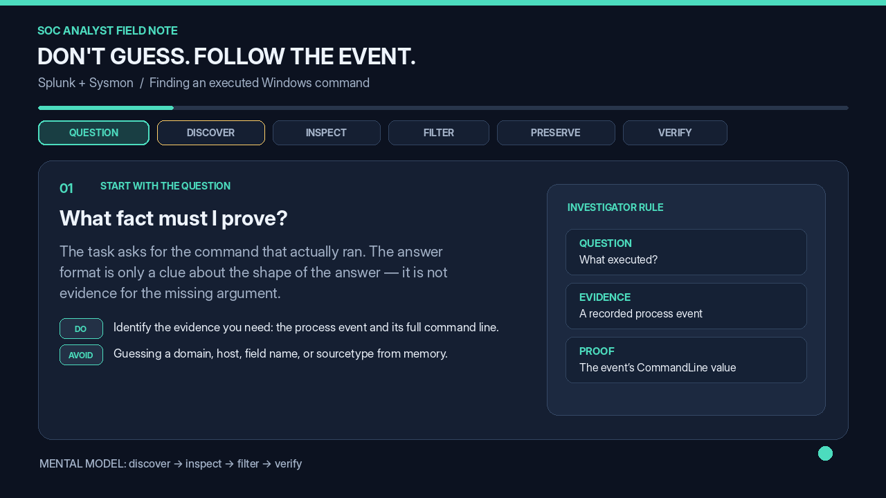

Im smiling hahaha their is not hing like just keep clicking here and their and understand the app 


This is the net view command 

```
`sysmon` process=net.exe (CommandLine="net  view") | stats count by Computer,CommandLine
```


Lets try to make some changes on this 


```
index="main" sourcetype="WinEventLog:Sysmon" EventCode=1
| stats count by ParentImage, Image
| sort - count
```


```
sourcetype= "sysmon" process=net.exe (CommandLine="net view") | stats count by Computer_CommandLine
```


I was wrong and by using Ai im trying to figure out how to solve this 

i thought they already gave me the broken command and  i need to fix it but their is a logic lost behind it 


# Splunk + Sysmon: Finding a Command Without Guessing


> **Goal:** Recover what actually executed from event evidence, then repair the saved report. Don't invent missing values from the answer format.



## The investigation mindset

1. **Translate the question into evidence.** Here, the thing to prove is the complete command line recorded for a process.
    
2. **Discover broadly, narrow with evidence.** Start with a useful phrase, then verify the index, sourcetype, event type, and field names. Every filter should have a reason.
    
3. **Inspect a raw event.** Common Sysmon process-creation fields include `Image` (executable path), `CommandLine` (command + arguments), `ParentImage` (parent executable), and often `EventCode` (event ID). Confirm which ones your Splunk data actually has. Sysmon Event ID `1` commonly represents process creation.
    
4. **Build the query one condition at a time.** A nonexistent field, wrong sourcetype, or exact-match condition that is too narrow can silently remove the event you need.
    
5. **Preserve raw evidence before summarizing.** `table` helps display fields; `stats` groups and aggregates events, which may hide row-level command details.
    
6. **Validate the saved report.** Compare its SPL to the known-good event, correct the smallest wrong assumption, rerun it, and read the full `CommandLine` value. The final answer should come from that value, not a guess.
    

## SPL pipeline: what each part does

```
index="main" "net view"
```

This is a **discovery search** to find candidate events. If it returns nothing useful, check the index and available data before assuming the command was never logged.

```
 | table _time, Image, CommandLine
```

The `|` passes the current results into another command. `table` displays selected fields, assuming those fields exist in the events.

```
... | stats count by ComputerName, CommandLine
```

`stats` creates a grouped summary. `count` counts events; `by` groups by the listed fields. `ComputerName, CommandLine` means **two field names**. A name like `Computer_CommandLine` means one field with that exact name; the underscore does not automatically combine fields.

## Tiny glossary

- **Index:** The Splunk data set being searched.
    
- **Sourcetype:** Classification/format label assigned to incoming events; inspect it rather than assuming its name.
    
- **Field:** A named value extracted from an event.
    
- **Filter:** A condition that keeps matching events.
    
- **Pipe (**`**|**`**):** Sends results to the next SPL command.
    
- `**CommandLine**`**:** Often the best evidence for the executable's arguments.
    

## Before saving the report — checklist

- Does the result contain the relevant process-creation event?
    
- Did I verify the actual sourcetype and field names?
    
- Is the command-line condition broad enough to find the full value?
    
- Did I inspect the returned event before using `stats`?
    
- Does the repaired report return the evidence needed to answer the question?
    

**Rule to remember:** A search result is evidence; an assumption is only a hypothesis. Make the data earn every filter.

Finally :


Lets work on this :


```
`sysmon` EventCode=3 Image="$imgsel$" protocol="$protosel$" dest_port="$portsel$" "$destinations$" | eval Destination=coalesce(dest_host,dest_ip) | stats count, values(Destination) AS "Destinations", values(dest_port) AS "Ports", values(protocol) AS "Protocols" by Image | fields Image Destinations Ports Protocols count
```


