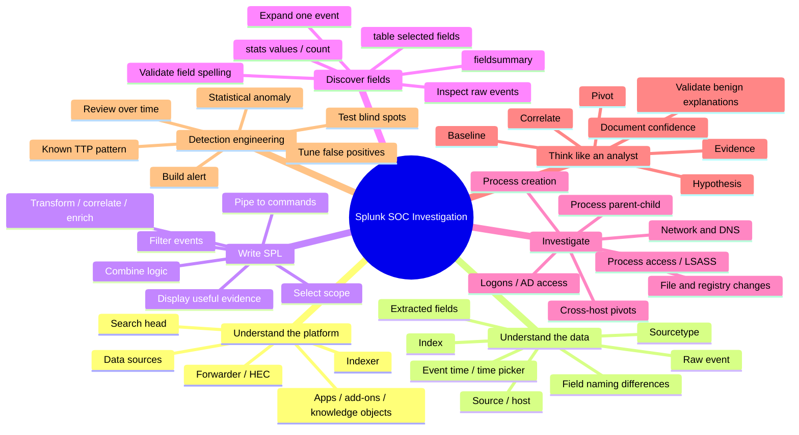
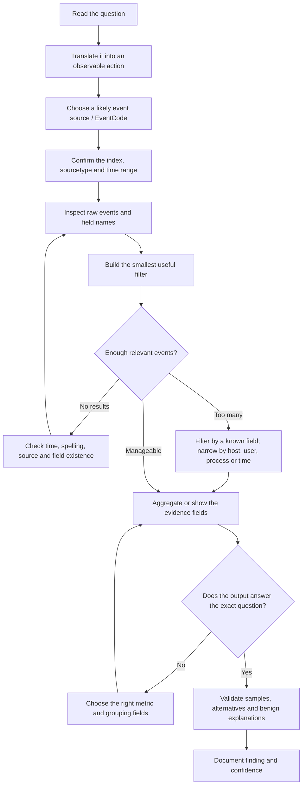

# Splunk & SPL — HTB Full Module Deep Dive

> [!abstract] What this note is for
> This is a companion to the **complete exported HTB Academy module**, not a replacement for the original source. It covers all six main sections in that export—**Introduction to Splunk & SPL**, **Using Splunk Applications**, **Intrusion Detection With Splunk**, **Detecting Attacker Behaviour Based on TTPs**, **Detecting Attacker Behaviour Based on Analytics**, and the **Skills Assessment**—including the important **Creating Meaningful Alerts** subsection. Its goal is to teach the reasoning behind searches so you can build and debug them yourself.
>
> Course examples use fields and data from the HTB lab. Your field names, data sources, time coverage, and Splunk configuration may differ in another environment.

## How to use this note

1. Read the **mind map** once to understand the shape of the skill.
2. Study the **query-building method** before memorising commands.
3. Work through the source-discovery sections in your own spawned lab.
4. For every query, explain it in plain English before running it.
5. If stuck, use the **stuck protocol** near the end. Do not immediately copy a finished query: first identify what evidence or field you are missing.
6. Keep the original HTB note. This is a reasoning guide that links to it; it does not replace the course screenshots, exact prompts, or target-lab state.

**Source discipline:** “HTB example” means the pattern appears in the uploaded notes. “Analyst explanation” is additional interpretation to help you reason about that pattern. A query returning an unusual result does not, by itself, prove malicious activity.

---

# 0. The complete skill map

## 0.1 Mind map



## 0.2 Investigation flow



## 0.3 What “knowing Splunk” means for a SOC analyst

You do **not** need to memorise a hundred commands before starting investigations. You need to learn to do these things reliably:

- Identify **which data can answer the question**.
- Locate the exact **field names** in that dataset rather than guessing.
- Write a narrow, readable search to retrieve relevant events.
- Decide whether the question asks for events, unique entities, a count, a top value, a time pattern, or a relationship.
- Use the appropriate command to derive that answer.
- Verify that the output is not an artefact of grouping, missing fields, a time filter, or a bad assumption.
- Pivot from one useful artifact—process, account, host, IP, filename, registry path, or time—to other events that may explain it.
- Explain why the finding matters and what would disprove it.

---

# 1. A mental model of Splunk before writing SPL

## 1.1 What happens to an event?

A useful simplified path is:

**Source → collection → parsing/indexing → searchable event → SPL search → result/evidence**

- **Source:** Windows Event Logs, Sysmon, Linux syslog, a firewall, DNS, an application, or another system.
- **Collection:** a Universal Forwarder, Heavy Forwarder, HTTP Event Collector (HEC), or another input mechanism gets data into Splunk.
- **Indexing:** indexers store event data and searchable structures.
- **Search head / Search & Reporting:** the search head provides the interface and coordinates searches against indexed data.
- **SPL:** filters, transforms, compares, enriches, or visualises the search results.

The course distinguishes:
- **Universal Forwarder (UF):** lightweight data collection/forwarding, generally with little preprocessing.
- **Heavy Forwarder (HF):** can parse, filter, aggregate, or route incoming data before forwarding; may also index locally.
- **HEC:** an HTTP endpoint applications can use to send data with a token.
- **Indexer:** stores indexed event data and processes searches.
- **Search head:** user-facing search coordination and knowledge-object layer.
- **Deployment Server:** distributes configurations and apps to forwarders.
- **Cluster management and licensing components:** coordinate clustered indexers and license management in deployments that use them.

For a beginner doing HTB labs, architecture knowledge helps answer **where data comes from** and **why data may be missing**. Most day-to-day lab work begins in the Search & Reporting app, not by configuring forwarders.

## 1.2 The five words you must not confuse

| Term | Mental model | Typical question |
|---|---|---|
| `index` | Which searchable data store? | “Where were these events stored?” |
| `sourcetype` | What kind/format of event is this? | “Are these Sysmon records or Windows Security records?” |
| `source` | Which input/file/channel supplied the event? | “Which file or input produced it?” |
| `host` | Which system Splunk associates with the event? | “Which machine sent/logged it?” |
| `field` | A named attribute extracted from an event | “What process, user, IP, event code, or filename is recorded?” |

These terms are related but **not interchangeable**. One index can contain many sourcetypes. One sourcetype may contain events from many hosts. A field can exist in one sourcetype and be absent in another.

## 1.3 Event, field, and raw data

An **event** is one recorded occurrence. An event may include:
- `_time`: the timestamp Splunk uses for the event.
- `host`, `source`, `sourcetype`: metadata used to identify the event and its origin/type.
- `_raw`: the raw event text as stored/returned by the search.
- Extracted fields such as `EventCode`, `Image`, `CommandLine`, `User`, `ComputerName`, `DestinationIp`, or `TargetFilename`.

Imagine an event as a record:

```text
_time: 2026-10-27 09:41:02
host: DESKTOP-EXAMPLE
sourcetype: WinEventLog:Sysmon
EventCode: 1
User: EXAMPLE\alex
ParentImage: C:\Windows\System32\notepad.exe
Image: C:\Windows\System32\WindowsPowerShell\v1.0\powershell.exe
CommandLine: powershell.exe ... [arguments omitted]
```

This is a teaching example, **not an assertion that your target contains these exact values**. The point is that fields provide handles for asking precise questions. The raw event helps confirm whether the extracted field interpretation is accurate.

## 1.4 Field names are a schema you must discover

Never assume that a field name used in a tutorial is present in every event. The HTB app example explicitly demonstrates that Sysmon Event ID 11 data may contain `ComputerName` rather than `Computer`. A dashboard search using the nonexistent field can produce “No results found” even when the underlying events exist.

Common examples of fields in the uploaded notes include:

- Metadata: `_time`, `_raw`, `host`, `source`, `sourcetype`, `index`.
- Process: `Image`, `ParentImage`, `CommandLine`, `ParentCommandLine`, `User`, `ProcessGuid`, `ParentProcessGuid`.
- Sysmon and host context: `EventCode`, `ComputerName`, `ImageLoaded`, `TargetFilename`, `TargetObject`, `Details`, `PipeName`, `QueryName`, `CallTrace`.
- Process access: `SourceImage`, `TargetImage`, `TargetProcessId`, `GrantedAccess`.
- Network: `SourceIp`, `DestinationIp`, `DestinationPort`.
- Account / directory: `Account_Name`, `Access_Mask`.

This is **not** a universal schema. Some environments use `EventID` instead of `EventCode`, `AccountName` instead of `Account_Name`, different capitalization, or CIM-normalised field names. Inspect your data, then use its actual field names.

---

# 2. SPL syntax: learn to read it as a sentence

## 2.1 The pipeline

A standard search is a sequence of stages joined by the pipe character `|`.

```spl
index="main" sourcetype="WinEventLog:Sysmon" EventCode=1
| stats count by ParentImage, Image
| sort - count
```

Read it from left to right:

1. `index="main"`: search this index.
2. `sourcetype="WinEventLog:Sysmon"`: restrict it to this kind of data.
3. `EventCode=1`: keep process-creation event records according to the Sysmon mapping used by the course.
4. `| stats count by ParentImage, Image`: stop showing every raw event; produce a count for each parent/child process pair.
5. `| sort - count`: show the most frequent pairs first.

The pipe is not an “OR” symbol. It means **send the current result set to the next command**.

## 2.2 A general SPL skeleton

```spl
index="<known index>" sourcetype="<known data type>" <event filter>
| <optional transformation or calculation>
| <optional aggregation>
| <optional final filter or sorting>
| table <evidence fields>
```

This is a mental template, not a requirement to use every stage. A short search can be correct. A long search can be wrong. The important thing is that every stage has a reason.

## 2.3 The initial search is often implicit

These are usually equivalent in the course’s classic SPL context:

```spl
index="main" "UNKNOWN"
```

```spl
search index="main" "UNKNOWN"
```

The first search command is commonly implied. The `search` command is still useful later in the pipeline when you want to filter the output of a preceding command.

## 2.4 AND, OR, NOT, and parentheses

- Multiple search conditions are usually treated as **AND** conditions: both must match.
- `OR` means at least one alternative must match.
- `NOT` excludes matching events/field values, depending on the expression.
- Parentheses make grouped logic explicit and easier for you to verify.

Example: focus on process creation and either `cmd.exe` or `powershell.exe`:

```spl
index="main" sourcetype="WinEventLog:Sysmon" EventCode=1
(Image="*cmd.exe" OR Image="*powershell.exe")
```

Plain English: “Search Sysmon process-creation events where the executable path matches either cmd or PowerShell.”

A common beginner error is to write several OR branches without grouping them. When a query combines a required condition such as `EventCode=1` with multiple OR alternatives, **group the alternatives deliberately** so that the required condition applies to every branch.

## 2.5 Strings, quotes, wildcards, and field matching

```spl
index="main" "UNKNOWN"
```
Searches event text for the term `UNKNOWN` in the selected data.

```spl
index="main" Image="C:\Windows\System32\notepad.exe"
```
Targets a particular field value. For Windows paths, the exact escaping/quotation needed can depend on the command and interface; copy a known-good format from your environment and inspect the raw value if uncertain.

```spl
index="main" Image="*powershell.exe*"
```
The `*` wildcard matches any number of characters. This can match a path containing `powershell.exe`, not only a field equal to that bare filename.

```spl
index="main" ComputerName="*uniwaldo.local"
```
A suffix-style match in the named field. It is narrower than searching all fields for the text, but the leading wildcard still asks for a broad match within that field.

### The useful distinctions

| Search style | What it is useful for | Risk / cost |
|---|---|---|
| `index="main" uniwaldo.local` | Fast initial pivot when you do not know which field contains a string | May return multiple event types and many irrelevant matches |
| `index="main" *uniwaldo.local*` | Finding the text embedded inside longer strings | Broad wildcard searches can be expensive |
| `index="main" ComputerName="*uniwaldo.local"` | Restricting the same clue to a known field | Requires that field to exist and be extracted |
| `index="main" ComputerName="DESKTOP-EXAMPLE"` | Exact value when known | Misses variants if the value is not exact |

The HTB real-world section compares broad text searches and a field-targeted search, showing why targeting a known field is often faster. First discover the field; then target it.

## 2.6 Comparisons and existence

Examples:

```spl
EventCode=1
EventCode!=1
DestinationPort>=1024
status=*
```

- `=`: equals.
- `!=`: not equal, but be careful with missing values. Do not assume “not equal” always means “the field is present and has a different value”; verify how missing fields behave in your search.
- `>`, `<`, `>=`, `<=`: numeric or sortable comparisons as appropriate to the field.
- `field=*`: a useful way to require that the field exists in the matching events.

If a query uses `NOT Field="value"` and field presence matters to your logic, first inspect whether missing-field events are being included or excluded in the way you intended.

## 2.7 The difference between a search filter and a post-processing filter

| Command | Intuition | Example |
|---|---|---|
| `search` | Filter search results using SPL search expressions | `... | search isOutlier=1` |
| `where` | Filter using evaluation expressions / comparisons between fields | `... | where SourceImage!=TargetImage` |
| `regex` | Filter events using a regular expression on a field | `... | regex Image="..."` |

For example, `where SourceImage!=TargetImage` compares the value of one field with another. That is different from filtering for a fixed literal value.

A `where` clause can be especially useful after a calculation:

```spl
... | eval len=len(CommandLine) | where len > 300
```

This says: create a field named `len`, calculate the command-line length, then keep records whose length is above the chosen threshold. The threshold shown is an illustrative value, not a universal detection threshold.

---

# 3. The four decisions hidden inside every lab question

Before typing SPL, rewrite the question into these four parts.

## Decision 1 — What entity or behaviour am I investigating?

Examples:
- A logon/authentication attempt.
- A process creation.
- A network connection.
- A file created or deleted.
- A registry value changed.
- A process accessing another process.
- DNS resolving a domain.
- A repeated or statistically unusual behaviour.

This determines the likely event source and event identifier.

## Decision 2 — Which data source can show it?

In the uploaded module, examples include:
- `WinEventLog:Sysmon`
- `WinEventLog:Security`
- `linux:syslog`

Do not assume these are the only available sourcetypes. Discover what your target actually contains.

## Decision 3 — What field contains the answer?

Translate the noun in the question into a candidate field, then verify it.

| Question says… | Candidate field(s) to investigate |
|---|---|
| “which account / user?” | `User`, `Account_Name`, or a dataset-specific account field |
| “which process / executable?” | `Image`, `SourceImage`, `TargetImage` |
| “which parent launched it?” | `ParentImage`, `ParentCommandLine` |
| “what command was executed?” | `CommandLine`, `ParentCommandLine` |
| “which system/computer?” | `ComputerName`, `host`, or a dataset-specific host field |
| “which file was created?” | `TargetFilename` |
| “which registry key/value?” | `TargetObject`, `Details` |
| “which domain was queried?” | `QueryName` |
| “which IP/port?” | `SourceIp`, `DestinationIp`, `DestinationPort` |
| “how many unique computers?” | candidate computer field plus `dc(...)` |
| “which occurred most often?” | candidate category plus `stats count by ...`, then sort descending |
| “what happened first / within a time window?” | `_time`, time picker, `earliest`/`latest`, `bin`/`bucket`, or transaction/time-aware logic |

These are search ideas, **not guaranteed field mappings**. Confirm them using the actual events and field panel.

## Decision 4 — What shape should the result have?

- **Raw events**: “Show me what happened.”
- **A row per category and a count**: `stats count by <field>`.
- **A number of unique values**: `dc(<field>)`.
- **Top/common values**: `top <field>` or aggregate and sort.
- **A timeline**: bucket `_time`, aggregate by time, or use a timechart.
- **A comparison against a baseline**: `eventstats` or `streamstats`, plus `eval`/`where` or `search`.
- **A sequence of related records**: correlation using shared IDs/fields or, where appropriate, `transaction`.

If you can answer these four decisions in English, the query becomes a translation exercise instead of a guessing game.


---

# 4. Data discovery: what to do when you do not know the schema

This is one of the most important skills in the entire module. When stuck, do **not** invent field names. Use a repeatable discovery sequence.

## 4.1 Step A — Discover the indexes

HTB example:

```spl
| eventcount summarize=false index=* | table index
```

This is an inventory-style search that shows indexes with counts. The exact output depends on permissions and the lab’s configuration. If you already know the likely index (`main` in the HTB examples), you can scope later searches to it.

The course’s broad-scope starting point for the real-world dataset is:

```spl
index="main" earliest=0
```

The point is to include older data by setting the search start to the beginning of the available event time. It can return hundreds of thousands of events; do not use a broad search unnecessarily after you understand the dataset.

## 4.2 Step B — Discover the sourcetypes

```spl
index="main" | stats count by sourcetype | sort - count
```

Read this as:
- take events from `main`;
- group them by `sourcetype`;
- count how many events are in each group;
- put the most populated types at the top.

This is often the best first query in an unknown lab because it answers: **“What kinds of records do I have, and how much of each?”**

The module also shows metadata-oriented discovery:

```spl
| metadata type=sourcetypes
| metadata type=sourcetypes index=*
| metadata type=sourcetypes index=* | table sourcetype
| metadata type=sources index=* | table source
```

`metadata` is useful for a summary of indexed data and when source types/sources were seen. For actual forensic questions, you will usually need the matching events, not just metadata.

## 4.3 Step C — Inspect the records, not just the counts

Start narrow:

```spl
index="main" sourcetype="WinEventLog:Sysmon"
```

Then click to expand several events. Ask:
- Is this really the source/type I intended?
- What does `_raw` contain?
- Which fields are extracted?
- Are values complete paths or only filenames?
- Is the computer represented by `host`, `ComputerName`, or another field?
- Are the event codes present and in the format I expect?
- Is this a sample of the time range or a complete view?

To display the raw event text:

```spl
sourcetype="WinEventLog:Security" | table _raw
```

To display all fields, for a small scoped sample only:

```spl
sourcetype="WinEventLog:Security" | table *
```

`table *` can be too wide and visually confusing. It is a discovery tool, not usually a good final investigation output.

## 4.4 Step D — Summarise available field names

```spl
sourcetype="WinEventLog:Security" | fieldsummary
```

`fieldsummary` reports fields found in the current result set and useful information about them, such as:
- `field`: field name;
- `count`: how many returned events contain it;
- `distinct_count`: number of distinct values observed;
- `values`: sample values (when included by the result);
- statistics such as min/max/mean where applicable.

**Critical limitation:** `fieldsummary` only knows about the events that your current search returned. If the time range is too small, or you filtered down to a tiny subset, a field may be absent from the summary simply because no returned event contained it.

Example:

```spl
sourcetype="WinEventLog:Security"
| fieldsummary
| table field, count, distinct_count, values
```

Use the field list to discover candidate fields, then run a focused query on the candidate field and inspect actual sample values.

## 4.5 Step E — Inspect values in a specific field

```spl
index="main" sourcetype="WinEventLog:Sysmon" EventCode=1
| stats count by Image
| sort - count
```

This makes the values in `Image` visible and lets you see whether the field is present and how it is populated.

To see common values in one field:

```spl
index="main" sourcetype="WinEventLog:Sysmon" EventCode=1
| top limit=20 Image
```

To inspect uncommon values:

```spl
index="main" sourcetype="WinEventLog:Sysmon" EventCode=1
| rare limit=20 Image
```

“Rare” does not mean malicious. It means infrequent in the searched sample.

## 4.6 Step F — Inspect event counts by time

The course shows this pattern:

```spl
index=* sourcetype=*
| bucket _time span=1d
| stats count by _time, index, sourcetype
| sort - _time
```

`bucket _time span=1d` groups timestamps into daily buckets. Then `stats` counts events within each day for each index and sourcetype combination.

This helps answer:
- Is the source present during the interval I am searching?
- Is a sourcetype quiet on one day and active on another?
- Is the time picker cutting off relevant evidence?

Use an appropriately scoped search in real environments. `index=* sourcetype=*` across all accessible data can be expensive.

## 4.7 Step G — Use the interface as a schema browser

The course highlights two views:
- **Fast** mode: useful for scanning lots of results quickly.
- **Verbose** mode: useful when you need detailed event/field information.

Expand an event and inspect:
- Selected fields;
- Interesting fields;
- All fields;
- the raw event itself.

The “Interesting Fields” panel is a convenience, not a complete schema. A field that appears in fewer than the UI’s display threshold can still be crucial to a hunt.

## 4.8 A safe field-discovery ladder

Run these in order, adjusting the scope as needed:

```spl
index="main" sourcetype="WinEventLog:Sysmon"
```

```spl
index="main" sourcetype="WinEventLog:Sysmon" | stats count by EventCode
```

```spl
index="main" sourcetype="WinEventLog:Sysmon" EventCode=1
```

```spl
index="main" sourcetype="WinEventLog:Sysmon" EventCode=1 | fieldsummary
```

```spl
index="main" sourcetype="WinEventLog:Sysmon" EventCode=1 | table _time, host, ComputerName, User, ParentImage, Image, CommandLine
```

If the last search has empty columns, do not blindly assume the logs are bad. The field may be named differently, absent in that event type, or not extracted. Remove suspect fields, inspect `_raw`, and retry with actual field names.

---

# 5. Field reference: connect the question to the evidence

## 5.1 Baseline fields

| Field | What it generally represents | What to verify |
|---|---|---|
| `_time` | Event timestamp as interpreted by Splunk | Time picker, timezone, timestamp extraction, and whether the timeline includes the event |
| `_raw` | Raw event data | Whether the original content supports the extracted-field interpretation |
| `host` | Splunk’s host metadata | Could be hostname, agent name, or another configured value |
| `source` | Input source / file / channel context | Exact value is configuration-dependent |
| `sourcetype` | Event data type / parsing classification | Identify the right source before field-specific hunts |
| `index` | Index that stores the event | Scope searches to the appropriate dataset |

## 5.2 Process and execution fields

| Field | Common investigative use | Questions it can help answer |
|---|---|---|
| `EventCode` | Select the event category | “What kind of Sysmon event is this?” |
| `Image` | Process executable path/name | “Which process started or performed the recorded action?” |
| `ParentImage` | Parent process image | “What launched this process?” |
| `CommandLine` | Process command line | “What arguments / script / URL were used?” |
| `ParentCommandLine` | Parent process command line | “What did the launcher itself execute?” |
| `ProcessGuid` | Process-instance identifier when provided | “Are these events about the same process instance?” |
| `ParentProcessGuid` | Parent process identifier when provided | “Can I connect the child to a particular parent instance?” |
| `User` | User associated with the action | “Under which user context did this execute?” |
| `ComputerName` | Windows computer named in the event | “Which machine recorded this?” |
| `host` | Splunk host metadata | “Which host is associated with the event?” Cross-check against `ComputerName` rather than assuming they are identical |

**Do not confuse `Image` and `TargetImage`.** The source field names vary by event class:
- `Image` commonly names the process involved in a Sysmon event;
- `SourceImage` and `TargetImage` are used in process-access examples;
- `ImageLoaded` appears in the DLL/image-load analytics example.

## 5.3 File and registry fields

| Field | Common investigative use |
|---|---|
| `TargetFilename` | A file path involved in a creation/deletion event |
| `Image` | Which process is recorded as performing the file activity |
| `TargetObject` | Registry key/value or another target object, depending on event type |
| `Details` | Data/detail field that can hold a new value or path |
| `EventCode=11` | In the course’s Sysmon mapping, file creation |
| `EventCode=12` | In the course’s Sysmon mapping, registry object create/delete |
| `EventCode=13` | In the course’s Sysmon mapping, registry value set |

File-extension filters such as `TargetFilename="*.exe"` are **leads**, not verdicts. Legitimate installers and updaters create executables too. Determine who wrote the file, where it was written, which account was involved, and whether a related process executed it.

## 5.4 Network and DNS fields

| Field | Common investigative use |
|---|---|
| `SourceIp` | Originating/source IP in the recorded connection |
| `DestinationIp` | Destination IP |
| `DestinationPort` | Destination service/port |
| `QueryName` | DNS name queried |
| `Image` | Process associated with the connection or DNS event, if available |
| `EventCode=3` | Sysmon network connection in the course mapping |
| `EventCode=22` | Sysmon DNS query in the course mapping |

Before treating an IP as an attacker-controlled server, pivot across sources and check ownership/context. The HTB scenario discovers `10.0.0.229` in both Sysmon and Linux syslog, then uses the Linux event’s host metadata to identify the Linux system associated with it. The IP is a pivot point, not a full conclusion by itself.

## 5.5 Process access / credential-access fields

| Field | Common investigative use |
|---|---|
| `SourceImage` | Process that requested access to another process |
| `TargetImage` | Process being accessed |
| `TargetProcessId` | Process identifier for the target, when populated |
| `GrantedAccess` | Access rights requested/granted in the event, encoded as a value |
| `CallTrace` | Call-stack context; may include `UNKNOWN` segments |
| `EventCode=10` | Sysmon ProcessAccess in the course mapping |

The course uses events indicating `notepad.exe` accessed LSASS, then examines the `CallTrace`. This is a strong investigation lead in that lab. In an actual environment, validate process identity, access mask, call stack, event configuration, and corroborating telemetry before concluding that credential dumping occurred.

## 5.6 Windows Security / directory-service fields

| Field | What the module uses it for |
|---|---|
| `EventCode=4624` | Successful logon event in the HTB lab questions |
| `Account_Name` | Account name in the course’s extracted fields |
| `EventCode=4662` | Directory-service object access in the module’s DCSync investigation |
| `Access_Mask` | Object-access permissions; the notes use `0x100` as part of the hunt |
| GUIDs in event details | Help identify which directory rights were accessed, after external reference checking |

Event IDs are only useful if you know the relevant log source and event schema. A code such as `4662` does not guarantee that the event contains every field you need. The HTB notes point out that the audit policy must be enabled for the relevant directory-service events to be present.

## 5.7 The course’s Sysmon event map

This is the mapping explicitly used or described in the uploaded notes. It is a study starting point; always confirm the data source and Event ID meaning in the environment.

| Sysmon Event ID | Course description | Why a SOC analyst may look at it |
|---:|---|---|
| 1 | Process creation | Parent/child anomalies, command lines, process origin |
| 2 | File creation time changed | Possible timestamp manipulation; can also be benign |
| 3 | Network connection | Process-to-network pivots; often noisy |
| 4 | Sysmon service state changed | Possible logging tampering; many normal start/stop events |
| 5 | Process terminated | Termination patterns and process lifecycle |
| 6 | Driver loaded | Driver activity; potential high-risk edge cases |
| 7 | Image loaded | DLL/image load patterns and potential hijacking clues |
| 8 | CreateRemoteThread | Potential injection behaviour; legitimate uses exist |
| 10 | ProcessAccess | Process handles, credential-access investigation |
| 11 | FileCreate | File creation; downloaded tools and executable placement |
| 12 | Registry object create/delete | Persistence and registry change investigations |
| 13 | Registry value set | Registry configuration/service-path changes |
| 15 | FileCreateStreamHash | Alternate data stream / download context |
| 16 | Sysmon configuration changed | Possible telemetry tampering |
| 17 | Pipe created | Inter-process communication; may be relevant to remote-service tools |
| 18 | Pipe connected | Pipe communication; may be relevant to remote-service tools |
| 22 | DNS query | Domain lookup, beaconing/payload-hosting pivots |
| 23 | File delete | Cleanup or destructive activity; context required |
| 25 | ProcessTampering | Process image manipulation/hollowing-related behaviour |

The course calls out that Event ID 3 can be noisy, Event IDs 4/5 can often be legitimate, and Event IDs 11/12/13 can be fruitful but also high-volume. Event IDs are not a replacement for understanding which fields exist in the event.

---

# 6. SPL command guide: from basic to more advanced

## 6.1 Filtering and selecting

### `search` / implicit search
Use the initial search to reduce the dataset with index, sourcetype, event code, field values, time and keywords.

```spl
index="main" sourcetype="WinEventLog:Sysmon" EventCode=1
```

Best habit: place the most selective, known constraints early—especially the index, source type, and event class. Do not add a condition merely because it looks professional; each condition should follow from evidence or a hypothesis.

### `fields`
Selects which fields are kept for later output/processing. `fields - FieldName` removes a field.

```spl
index="main" sourcetype="WinEventLog:Sysmon" EventCode=1
| fields - User
```

This example removes `User` from the result. It does not remove the user from the original indexed event. Keep fields you need for subsequent steps; removing a field too early can make later commands impossible.

### `table`
Controls the final columns you want to inspect.

```spl
index="main" sourcetype="WinEventLog:Sysmon" EventCode=1
| table _time, host, ComputerName, User, ParentImage, Image, CommandLine
```

Use it late, after your investigative logic, because you may need other fields to filter or aggregate. A query can still run when the `table` output lacks the field that you hoped to see; that should trigger schema validation, not an immediate assumption that the activity did not occur.

### `rename`
Renames a field in the current result set:

```spl
... | rename Image as Process
```

This can make result tables easier to read. Be careful: after renaming, subsequent commands need to refer to the new name (`Process`), not the old one (`Image`), unless both fields are retained through some other method.

### `sort`
Examples:

```spl
... | sort - _time
... | stats count by Image | sort - count
... | stats count by Image | sort + count
```

- `sort - field`: descending order.
- `sort + field`: ascending order.

Check what you are sorting. If you aggregate to one row per process, sorting by `_time` later may no longer make sense because `_time` may not survive the aggregation.

### `dedup`
Keeps one result for each unique combination of the specified field(s):

```spl
... | dedup Image
```

This answers “show me each distinct `Image` once,” not “count how often it appeared.” If you need frequency, use `stats count by Image`. Deduplicating too early can destroy evidence about repetition and counts.

## 6.2 Aggregation: the most important concept

### `stats count by <fields>`

```spl
index="main" sourcetype="WinEventLog:Sysmon" EventCode=1
| stats count by ParentImage, Image
```

**Mental model:** group events by each unique `ParentImage` + `Image` pair and count the rows in every group.

If the output has 5 rows, those are 5 distinct parent/child combinations, not 5 total events. To see the raw events behind one suspicious pair, add a search filter for that pair and inspect event details.

### Count versus distinct count

- `count`: how many matching events/rows.
- `dc(Field)`: how many distinct values of `Field`.

Example concept:

```spl
index="main" EventCode=4624 Account_Name="SYSTEM"
| stats dc(ComputerName) as distinct_computers
```

This is the shape for a “how many distinct computers?” question **if** the actual field is `ComputerName` and the relevant account field is `Account_Name`. Check the field names first. If asked to count distinct computers reached by an account, a raw event count would answer a different question.

### Grouping changes the unit of the result

These two questions require different groupings:

```spl
... | stats count by User
```
“What is the number of events per user?”

```spl
... | stats count by User, ComputerName
```
“What is the number of events per user on each computer?”

Each extra `by` field creates more distinct groups and can fragment one story into many rows. Use only grouping fields that fit the question you are trying to answer.

### Other useful stats functions

| Function | Meaning in plain English | Typical use |
|---|---|---|
| `count` | Number of events/results in each group | Frequency, most common account/process |
| `dc(field)` | Number of distinct values | Distinct hosts, processes, or domains |
| `values(field)` | Set of distinct field values for each group | See the command lines or targets that appear in a group |
| `avg(field)` | Average numeric value | Build a baseline |
| `stdev(field)` | Standard deviation | Estimate variability |
| `min(field)` / `max(field)` | Lowest / highest value | Bounds and durations |
| `sum(field)` | Total of numeric values | Cumulative volume |

If the question asks for the most frequent account, the likely pattern is `stats count by <account field>` followed by sorting descending or `top`. If the question asks for the account with the **most unique computers**, count distinct computers by account; do not use raw event frequency.

## 6.3 `chart`, `time`, and buckets

### `chart`

```spl
index="main" sourcetype="WinEventLog:Sysmon" EventCode=3
| chart count by _time, Image
```

`chart` reshapes aggregate results for visualization. In the course example, a time value becomes a row and each process image becomes a column, which makes it easier to compare processes across time buckets. For a cleaner timeline, bucket `_time` first; otherwise you may have too many timestamp values.

### `bucket` / `bin`

```spl
index="main" sourcetype="WinEventLog:Sysmon" EventCode=3
| bucket _time span=1h
| stats count by _time, Image
```

Events are grouped into hourly time intervals. `bin` is used as an alias for `bucket` in the course example.

**Why bucket time?** Exact timestamps can be unique for nearly every record. Grouping by the raw `_time` may produce lots of rows and hide a burst. Grouping into hourly (or minute-level) bins helps you identify activity volume by interval. Choose a bin width that fits the behaviour you are hunting; a one-hour bin can hide a 30-second burst, while a one-second bin can be too granular.

### Time picker and explicit bounds

Course example:

```spl
index="main" earliest=-7d EventCode!=1
```

This limits the search to the last seven days (relative to search execution) and excludes EventCode 1 records in the `main` index.

The Search & Reporting time picker also affects what the search can return. If a search has zero results:
1. Check the time picker.
2. Check the search’s `earliest` / `latest` constraints.
3. Confirm the source has events during that interval.
4. Expand the time range for discovery, then return to the smallest interval that answers the question.

The data may be historical or deliberately fixed in a lab. For a historical HTB target, “Last 24 hours” may not include the lab events; use the time interval the lab specifies or `All time` where appropriate.

## 6.4 `eval`: create a field from other fields

```spl
index="main" sourcetype="WinEventLog:Sysmon" EventCode=1
| eval Process_Path=lower(Image)
```

`eval` creates or replaces a search-time field. Here it creates a lowercased copy of `Image`; it does not rewrite the original event on disk.

Common useful functions and patterns:
- `lower(field)`: normalise text to lowercase for comparison.
- `len(field)`: calculate string length, used in the long-command example.
- `if(condition, value_if_true, value_if_false)`: choose a value based on a condition.
- `isnull(field)`: test whether a field is null.
- `split(field, delimiter)`, `mvindex(...)`, `mvdedup(...)`: manipulate multivalue data in the filename-extraction example.
- `mvcount(field)`: count items in a multivalue field.

The important question is: **does this transformation express a useful investigative idea?** For example, lowercasing a filename can normalise case; calculating command length can help rank unusual commands; assigning `isOutlier` creates a label you can filter on afterward.

## 6.5 `rex`: extract a field using a regular expression

Course example:

```spl
index="main" EventCode=4662
| rex max_match=0 "[^%](?<guid>{.*})"
| table guid
```

Read the pattern conceptually:
- `(?<guid>...)` creates a captured field called `guid`.
- `{.*}` tries to capture a brace-delimited substring.
- `[^%]` matches a character that is not `%` immediately before that capture.
- `max_match=0` requests all matches rather than only one.

This exact pattern is course-specific; regex is sensitive to quoting, escaping, and the actual event text. To debug `rex`, start by displaying a few raw events, then test a simpler pattern, then add the named capture group. Do not assume the same pattern will work for a different event structure.

The module also extracts a filename from a Windows path using the `Image` field. The objective is not to memorise the slash escaping; it is to recognise the transformation:
**full path → extract last path component → normalise filename → enrich it using a lookup.**

## 6.6 `lookup` and `inputlookup`

Suppose a lookup table called `malware_lookup.csv` contains two columns:

```csv
filename,is_malware
notepad.exe,false
cmd.exe,false
powershell.exe,false
sharphound.exe,true
randomfile.exe,true
```

The course query:

```spl
index="main" sourcetype="WinEventLog:Sysmon" EventCode=1
| rex field=Image "(?P<filename>[^\\\]+)$"
| eval filename=lower(filename)
| lookup malware_lookup.csv filename OUTPUTNEW is_malware
| table filename, is_malware
```

Its logic is:
1. Find process-creation events.
2. Extract a filename from the executable path.
3. Normalise the filename to lowercase.
4. Match it against the lookup table’s `filename` column.
5. Add the `is_malware` lookup value when a match exists.
6. Display the relevant columns.

**Important:** in this example, the `filename` after the lookup-table name is the key field in the CSV that matches the search result’s `filename` field. The lookup name and key field must exist and match how the lookup was configured. An unmatched row is not automatically “clean”; it may simply be absent from the lookup.

`OUTPUTNEW` adds an output field only when it is not already populated. `OUTPUT` can overwrite a field with the lookup output. Choose intentionally.

```spl
| inputlookup malware_lookup.csv
```

`inputlookup` reads the lookup table itself. It is useful to confirm that the table is present and contains the values you think it does. It does not require you to first find an event to enrich.

## 6.7 `transaction`: group events into an event sequence

Course example:

```spl
index="main" sourcetype="WinEventLog:Sysmon" (EventCode=1 OR EventCode=3)
| transaction Image startswith=eval(EventCode=1) endswith=eval(EventCode=3) maxspan=1m
| table Image
| dedup Image
```

The intended learning point is that `transaction` can group events sharing key field(s), constrained by a start condition, an end condition, and a time span. In this example it looks for process-creation and network-connection events associated with the same `Image`, within a one-minute transaction span.

### When transaction is helpful
- You need a sequence of related raw events shown together.
- There is a reasonable key that ties the events together.
- Start/end conditions describe the activity you need to group.
- The time constraints fit the investigation.

### When transaction can mislead or hurt performance
- The chosen key is too broad. A common executable name may appear in many unrelated events.
- The timeframe is too wide.
- The event ordering/definition does not match the sequence you are trying to detect.
- You only need counts by a field—in that case `stats` is often simpler and faster.
- You assume records belong to the same process merely because they share an executable path. The same `Image` can represent many separate process instances; process GUIDs, hosts, timestamps, and parent context may be needed.

Always inspect a few raw transactions and ask whether the resulting grouping is truly meaningful. A `transaction` is not automatically proof that events came from one attack chain.

## 6.8 Subsearches: a search inside another search

Course pattern:

```spl
index="main" sourcetype="WinEventLog:Sysmon" EventCode=1
NOT [
  search index="main" sourcetype="WinEventLog:Sysmon" EventCode=1
  | top limit=100 Image
  | fields Image
]
| table _time, Image, CommandLine, User, ComputerName
```

The inner search:
1. finds process-creation events;
2. identifies the most common `Image` values;
3. returns the `Image` field.

The outer search excludes results matching those returned values, then displays details for the remaining process-creation events.

This is a **course example of a technique**, not a universally robust rarity detector. It can generate noise because “not in the top 100” is not equivalent to malicious. Results depend on the time range, data completeness, the chosen limit, and the way the subsearch returns values. Also verify how your event fields and query logic interact before using a subsearch in a detection.

## 6.9 `top` and `rare`

```spl
... | top limit=20 Image
```
Shows common values for `Image` (with count and percentage in the output, subject to command options).

```spl
... | rare limit=20 useother=f ParentImage
```
Shows uncommon values of `ParentImage`, with `useother=f` suppressing the rolled-up “OTHER” category.

Use `top` to learn what dominates the baseline or identify high-volume values. Use `rare` to surface less frequent values worth inspecting. Neither command decides whether an event is malicious.

## 6.10 `where` / `regex` for more exact filtering

Course example:

```spl
index="main" EventCode=10 lsass
| where SourceImage!=TargetImage
| stats count by SourceImage
```

The `where` clause compares two fields. This is useful when you want to exclude records where source and target are the same process.

Course example:

```spl
index="main" EventCode=1
| regex Image="C:\\\\Users\\\\.*\\\\Downloads\\\\.*"
| stats count by Image
```

This uses regex to match process image paths under a user's Downloads directory. Regex differs from a simple wildcard:
- Search wildcards use `*`.
- Regex has its own syntax (`.*`, character classes, anchors, escaping).
- The number of backslashes can be confusing when Windows paths are involved; always validate against the displayed field value.

## 6.11 `eventstats` and `streamstats`: keep the events while calculating a baseline

These commands come up in the analytics section.

### `eventstats`
Calculates aggregate values from the search results and adds them back as fields on events, so the event-level rows remain available. In the module, the idea is to calculate an average and standard deviation that can be compared against an individual command-count value.

### `streamstats`
Calculates running or windowed statistics while iterating through the incoming result set. The ordering and time-window assumptions matter. With time-oriented analysis, explicitly consider sorting by `_time` and whether a “previous activity” baseline is what you want.

### `stats` vs `eventstats` vs `streamstats`

| Command | Output shape | Think of it as… |
|---|---|---|
| `stats` | Aggregated rows; original event-level detail is usually collapsed | “Summarise/group everything” |
| `eventstats` | Original rows retained with extra aggregate fields | “Calculate a reference statistic and attach it to events” |
| `streamstats` | Running/windowed statistic attached as results are processed | “Calculate a statistic that changes as time/events advance” |

Do not choose `streamstats` just because the question mentions time. First ask whether you need a fixed summary, a per-event comparison to a global average, or a rolling baseline.


## 6.12 `sistats`: a course-specific command to recognise

The source export includes:

```spl
index=* | sistats count by index, sourcetype, source, host
```

The lesson intended by the example is to summarise the distribution of events across indexes, sourcetypes, sources and hosts. For ordinary beginner discovery and portable SPL, use the documented `stats` pattern:

```spl
index=* | stats count by index, sourcetype, source, host
```

Do not silently substitute an unfamiliar command in a live lab: if `sistats` is part of the specific environment, understand why the course uses it. If Splunk reports that the command is unknown or unavailable, test the `stats` version and compare the result. This guide does not assume that `sistats` is a standard command available in every Splunk installation.


---

# 7. Walkthrough of HTB Section 1 — Introduction to Splunk & SPL

This section teaches query grammar and data discovery. Treat it as the foundation for every later hunt.

## 7.1 Basic searching

HTB example:

```spl
search index="main" "UNKNOWN"
```

Read:
- `index="main"` narrows the data store.
- `"UNKNOWN"` is a text clue searched within matching events.
- This does not mean the events are malicious; it only finds the string.

Wildcard version:

```spl
index="main" "*UNKNOWN*"
```

This deliberately makes the text match more permissive. In large datasets, broad wildcards can be more expensive. Prefer the narrowest search that still captures the relevant variation.

## 7.2 Excluding a specific event code

```spl
index="main" EventCode!=1
```

This is useful for learning comparison filters, but do not forget that a broad exclusion can return almost every other event type. For a focused investigation, combine it with the known index, sourcetype, time, and any other established constraints.

## 7.3 Fields and presentation

```spl
index="main" sourcetype="WinEventLog:Sysmon" EventCode=1
| fields - User
```

Removes `User` from the downstream result fields.

```spl
index="main" sourcetype="WinEventLog:Sysmon" EventCode=1
| table _time, host, Image
```

Keeps the named columns visible.

```spl
index="main" sourcetype="WinEventLog:Sysmon" EventCode=1
| rename Image as Process
```

Changes the displayed field name for subsequent pipeline stages.

These operations do **not** change the original indexed event. They shape the current search results.

## 7.4 De-duplicating versus counting

```spl
index="main" sourcetype="WinEventLog:Sysmon" EventCode=1
| dedup Image
```

This gives one representative result per `Image`, which can be useful for building a list. It does not tell you how frequently each image ran.

To get frequency:

```spl
index="main" sourcetype="WinEventLog:Sysmon" EventCode=1
| stats count by Image
| sort - count
```

To get distinct executable names without keeping raw events:

```spl
index="main" sourcetype="WinEventLog:Sysmon" EventCode=1
| stats values(Image) as images
```

Use the form that answers the question. “List the programs” and “count executions by program” are different tasks.

## 7.5 Understanding `stats` and `chart`

HTB example:

```spl
index="main" sourcetype="WinEventLog:Sysmon" EventCode=3
| stats count by _time, Image
```

This groups events by the exact combination of timestamp and process image. If `_time` is highly granular, many rows can result. An hourly view is often easier for trends:

```spl
index="main" sourcetype="WinEventLog:Sysmon" EventCode=3
| bin _time span=1h
| stats count by _time, Image
| sort _time
```

Chart-oriented version from the source:

```spl
index="main" sourcetype="WinEventLog:Sysmon" EventCode=3
| chart count by _time, Image
```

The deeper lesson is **select the right grain of analysis**:
- Raw events: exact details.
- Counts by process: frequency per process.
- Counts by process and host: where each process appears.
- Counts per hour and process: temporal volume.
- Distinct count of destination IPs by process: breadth of destinations rather than number of events.

## 7.6 Creating a normalised path field

```spl
index="main" sourcetype="WinEventLog:Sysmon" EventCode=1
| eval Process_Path=lower(Image)
```

This is a useful example of a derived field. The original `Image` still exists, while `Process_Path` is a lowercased copy that can make later grouping more consistent when values differ only by case.

## 7.7 Looking for GUIDs in directory-service events

```spl
index="main" EventCode=4662
| rex max_match=0 "[^%](?<guid>{.*})"
| table guid
```

The learning objective is extracting data the normal field extraction did not give you. Work from the raw event:
1. Locate a representative `4662` event.
2. Find the portion of text containing the GUID.
3. Write a regex capture group named `guid`.
4. Check whether the extraction actually returns values.
5. If multiple GUIDs can occur in an event, consider `max_match=0`.
6. Verify the extracted GUID against trusted references before interpreting its meaning.

## 7.8 Enriching event data using a lookup

HTB’s malware filename lookup is not magic detection. It demonstrates **enrichment**. You have one data source (process creation) and a separate curated list (CSV). The lookup adds a label based on a matching key.

Practical checks:
- Is the lookup file installed in the correct app/context?
- Does the CSV have the expected key column?
- Is the filename extracted consistently?
- Does case normalisation match the table?
- Does an unmatched value mean “not listed,” rather than “safe”?

The technique generalises to asset inventories, known-good administration tools, user tiers, threat indicators, and owner mapping.

## 7.9 Time-bounded searches

```spl
index="main" earliest=-7d EventCode!=1
```

The goal is to control the interval. Time is part of the search logic, not a cosmetic UI detail. A perfectly written filter over the wrong time window still produces the wrong answer.

When answering an HTB question, verify if the required window means:
- the data set’s full history;
- a stated number of hours/days;
- the time of a specific activity;
- a sequence occurring within a maximum duration.

Do not replace one meaning with another.

## 7.10 Transactions and subsearches

The examples in Section 6 explained these commands. The key lab lesson is to inspect their output rather than accepting the syntax as proof that the grouping is correct:
- Is the transaction key sufficiently unique?
- Does the start/end definition match the question?
- Is the one-minute span appropriate?
- Does the subsearch produce the field values you think it does?
- Does exclusion of common values leave genuinely unusual cases, or only low-frequency benign events?

## 7.11 The three introductory practical questions: reasoning without answer spoilers

The exported notes show three learning objectives. Use the following method to solve each yourself.

### Objective A — Account with the most Kerberos ticket requests

1. Identify the event type that records the relevant Kerberos ticket requests in the lab's Windows Security data. A common Windows Security event family for ticket-granting-ticket requests is Event ID `4768`, but **verify the target's actual records before committing to an event code**.
2. Search the proper index and security sourcetype; confirm that the target range includes the events.
3. Inspect one event and identify the actual account field (the export uses `Account_Name` elsewhere, but the exact field can vary).
4. Group by that account field and count events.
5. Sort descending by the count. Read the top account from your own output.
6. Sanity-check the first result's events: are they the ticket requests the question asks about?

Skeleton:

```spl
index="<observed index>" sourcetype="<observed security sourcetype>" EventCode=<verified ticket-request event code>
| stats count by <verified account field>
| sort - count
```

Do not paste the placeholder literally; replace each placeholder only after discovering the data.

### Objective B — Number of distinct computers accessed by account `SYSTEM` in Event ID 4624 events

1. Start with `EventCode=4624` and inspect the relevant account and computer fields.
2. Apply the account filter for `SYSTEM` using the account field actually present.
3. Decide what is being counted: **distinct computers**, not total logon events.
4. Use `dc(<computer field>)` for the distinct count.
5. Validate the count by grouping by computer and checking the resulting list, if needed.

Skeleton:

```spl
index="<observed index>" EventCode=4624 <verified account field>="SYSTEM"
| stats dc(<verified computer field>) as distinct_computers
```

If this returns zero, do not immediately change the count command. First validate the event filter, account field/value, and computer field.

### Objective C — Among accounts whose Event ID 4624 activity spans less than ten minutes, find the account with the highest attempt count

This question combines aggregation, time arithmetic, and filtering. It is not simply “sort all accounts by number of events.”

1. Search the relevant Event ID `4624` events and confirm the account field.
2. Group by account.
3. For each account, derive:
   - number of logon events;
   - earliest `_time`;
   - latest `_time`.
4. Calculate the activity span as latest timestamp minus earliest timestamp. Splunk time values can be used in arithmetic; ten minutes is `600` seconds.
5. Keep accounts whose span is under 600 seconds.
6. Sort by the event count descending and inspect the top result.
7. Check how the question uses “login attempts” in this data: Event ID 4624 represents successful logons in Windows Security, so do not silently reinterpret it as failed logons.

Skeleton:

```spl
index="<observed index>" EventCode=4624
| stats count as login_events min(_time) as first_seen max(_time) as last_seen by <verified account field>
| eval duration_seconds=last_seen-first_seen
| where duration_seconds < 600
| sort - login_events
```

This skeleton is intentionally written as a method. You must discover the real account field, confirm your data and time scope, and interpret the results.

---

# 8. Walkthrough of HTB Section 2 — Using Splunk Applications

## 8.1 What a Splunk app contributes

A Splunk app is a packaged workspace for a technology or use case. It can supply dashboards, searches, alerts, visualisations, macros, and other knowledge objects. An app is not a different database; it uses data that must already be ingested and searchable.

The course introduces the **Sysmon App for Splunk** and uses a dashboard to demonstrate a very real debugging situation: **a dashboard can fail because its search expects a field that your event does not contain**.

## 8.2 Macros: reusable search fragments

A search macro is a reusable chunk of SPL that can be embedded in another search. The HTB instructions show adjusting a `sysmon` macro so that the app reads the correct index/sourcetype for the lab.

The important thing is not to memorise one macro definition. The screenshots in the export show different possible sourcetype strings at different points, so confirm the live environment’s actual source configuration. A macro intended for a default Sysmon installation may not match the HTB dataset.

Macro troubleshooting:
1. Open the app’s search or dashboard configuration.
2. Locate the macro used by the search.
3. Inspect its definition.
4. Compare the definition with `index`, `sourcetype`, and fields in your actual events.
5. Test the expanded logic in Search & Reporting independently.
6. Change the macro only when you understand what the app expects.
7. Re-run the dashboard.

## 8.3 The “Computer” versus “ComputerName” lesson

The course's File Activity dashboard has a “Top Systems” panel that shows no results. The events themselves exist. The search uses:

```spl
sysmon EventCode=11 | top Computer
```

But the lab's Sysmon Event ID 11 records contain `ComputerName`, not `Computer`. The field-corrected version is:

```spl
sysmon EventCode=11 | top ComputerName
```

This is the central lesson: when a dashboard panel returns no rows, it can be a **field/schema mismatch**, not absence of data.

How to debug any “no results” panel:
- Copy its SPL into Search & Reporting.
- Confirm the app macro/source filter resolves to a populated dataset.
- Remove the final `top`/`stats` command and confirm the raw events exist.
- Inspect one relevant event and find the actual field name.
- Run `fieldsummary` on the filtered events or try `stats count by <candidate field>`.
- Replace the incorrect field, then validate the result.

## 8.4 Practice the difference between an app bug and a data problem

| Symptom | First hypothesis to test |
|---|---|
| Search has no raw events | Time range, macro/index, sourcetype, permission or data ingestion |
| Raw events exist but a panel is empty | Field name mismatch, missing field, filter too strict, wrong aggregation |
| Counts differ from an example screenshot | Different time range, dataset, sourcetype/configuration or field extraction |
| Search works manually but dashboard fails | Dashboard token/macro/field assumptions or time picker configuration |
| App's searches look syntactically unfamiliar | Expand the macro and read the SPL as a pipeline |

Do not reinstall an app simply because a panel is empty. First identify which layer is failing: data, macro/source selection, field extraction, filtering, or visualisation.


---

# 9. Walkthrough of HTB Section 3 — Intrusion Detection With Splunk

This section is where the course shifts from learning commands to conducting an investigation across a larger dataset. The sample environment contains over 500,000 events from several machines and sourcetypes. The goal is not to spot every attack instantly; it is to reduce the search space, find a promising signal, pivot across evidence, and test a hypothesis.

## 9.1 Start with a map of the environment

The course begins with:

```spl
index="main" earliest=0
```

This establishes that data exists across the broad time interval. The next step is **not** to inspect hundreds of thousands of events manually. Instead, inventory sources:

```spl
index="main" | stats count by sourcetype
```

Then focus on Sysmon:

```spl
index="main" sourcetype="WinEventLog:Sysmon"
```

This ordering has a purpose:
1. Confirm the target has data.
2. Learn which kinds of data exist.
3. Pick the relevant source.
4. Discover event codes and fields.
5. Form a hypothesis.
6. Narrow the query as new evidence appears.

If a result screenshot has different totals from your lab, that does not automatically mean you have an error. Counts depend on the event set, time range, source config and any query differences.

## 9.2 Search performance: all text versus a field

The course compares searches for `uniwaldo.local`:

```spl
index="main" uniwaldo.local
```

```spl
index="main" *uniwaldo.local*
```

```spl
index="main" ComputerName="*uniwaldo.local"
```

The lesson is that a broad text search is useful when the field is unknown, while a field-targeted search is preferable once you know which field matters. The extra wildcards broaden matching and can increase search cost.

A good two-phase approach:

**Discovery phase**

```spl
index="main" "clue-string" | stats count by sourcetype
```

This helps reveal which event sources mention the clue.

**Investigation phase**

```spl
index="main" sourcetype="<relevant type>" <verified field>="clue-string-or-pattern"
| table _time, host, ComputerName, User, Image, CommandLine
```

Replace the illustrative field list with fields that exist in the selected source. The point is to move from broad discovery to field-aware investigation.

## 9.3 Learn the event-code distribution before choosing an event

```spl
index="main" sourcetype="WinEventLog:Sysmon"
| stats count by EventCode
| sort - count
```

This answers two separate questions:
- Which event types exist in this dataset?
- Which ones are abundant enough to create a lot of noise?

The most common event is not necessarily the most useful one. The course points out that Event ID 11 file creation can be extremely common, while process creation, registry changes, process access and DNS may provide more focused clues depending on the hypothesis.

## 9.4 Find unusual process-parent relationships

The first hunt groups all process-creation events by parent and child:

```spl
index="main" sourcetype="WinEventLog:Sysmon" EventCode=1
| stats count by ParentImage, Image
| sort - count
```

This builds a process-pair frequency table. It helps you notice the usual parent/child combinations and spot surprising combinations. You are not proving that the rarest pair is malicious; you are identifying which pairs deserve inspection.

The course narrows to command shells and PowerShell:

```spl
index="main" sourcetype="WinEventLog:Sysmon" EventCode=1
(Image="*cmd.exe" OR Image="*powershell.exe")
| stats count by ParentImage, Image
| sort - count
```

Now the question changes from “which pairs are common overall?” to “which parent processes launch these command interpreters?” That is a useful detection strategy because `cmd.exe` and `powershell.exe` can execute administrative work and malicious commands alike. The parent process supplies context.

The course then focuses on `notepad.exe` as a parent of `cmd.exe` or PowerShell:

```spl
index="main" sourcetype="WinEventLog:Sysmon" EventCode=1
(Image="*cmd.exe" OR Image="*powershell.exe")
ParentImage="C:\\Windows\\System32\\notepad.exe"
| table _time, host, ComputerName, User, ParentImage, ParentCommandLine, Image, CommandLine
```

This form adds evidence fields. The course observed a PowerShell command downloading a file from `10.0.0.229`. The important reasoning steps are:
- Why would Notepad start a command interpreter?
- What command line did the child run?
- Which user was involved?
- On which host?
- What IP, URL, filename, or other artifact can be pivoted on?
- Is there a benign explanation for that process chain in this environment?

An unusual parent-child chain is a strong lead, not a complete conclusion.

## 9.5 Pivot from an IP across data sources

Once the IP `10.0.0.229` appears in the command line, the course searches for it across all source types:

```spl
index="main" "10.0.0.229"
| stats count by sourcetype
| sort - count
```

This produces a cross-source inventory of evidence related to the IP. It then scopes to Linux syslog:

```spl
index="main" "10.0.0.229" sourcetype="linux:syslog"
```

The source uses the associated host metadata to identify the Linux machine tied to the IP. Next it pivots back to Sysmon command lines:

```spl
index="main" "10.0.0.229" sourcetype="WinEventLog:Sysmon"
| stats count by CommandLine
| sort - count
```

And checks which hosts ran those commands:

```spl
index="main" "10.0.0.229" sourcetype="WinEventLog:Sysmon"
| stats count by CommandLine, host
| sort - count
```

### The pivoting principle

A useful artifact from one event becomes a filter in a second search:

- A process command line exposes an IP.
- Search that IP across all source types.
- Discover the source types and hosts that mention it.
- Narrow to a source and inspect the raw records.
- Reuse the IP, filename, process or account as a clue in another event class.
- Correlate the resulting timeline and host context.

The goal is to build an evidence chain, not merely accumulate suspicious-looking search results.

## 9.6 Look for directory-service replication behaviour

The course next investigates possible DCSync activity. The example query is:

```spl
index="main" EventCode=4662 Access_Mask=0x100 Account_Name!=*$
```

What each condition is meant to do:
- `EventCode=4662`: select directory-service object access events as represented in this lab.
- `Access_Mask=0x100`: narrow to the access value the course is investigating.
- `Account_Name!=*$`: exclude account names ending in `$`, commonly used for machine accounts in this kind of environment.

Do not copy the filter without inspecting event details. Event field names, audit policies, and access masks matter. The course examines GUIDs in the event details, looks up their meaning, and identifies a right associated with replication of secret domain data. This is an example of **event data → artefact extraction/inspection → external reference validation → stronger hypothesis**.

Key reasoning distinction:
- The query can find events matching the filter.
- The event's GUID/right gives meaning to the access.
- The event account and host provide identity/context.
- Additional evidence is still needed to reconstruct the complete attack chain.

## 9.7 Investigate LSASS process access

The course uses Sysmon Event ID 10:

```spl
index="main" EventCode=10 lsass
| stats count by SourceImage
| sort - count
```

This inventories processes seen in events mentioning LSASS. A high count is not automatically malicious: LSASS access can occur in legitimate contexts, and the source notes that normal, frequently seen behaviour can dominate these results.

The course then narrows to Notepad as the source process:

```spl
index="main" EventCode=10 lsass
SourceImage="C:\\Windows\\System32\\notepad.exe"
| table _time, host, ComputerName, SourceImage, TargetImage, TargetProcessId, GrantedAccess, CallTrace, SourceUser, TargetUser
```

The investigative questions now become:
- Which process asked to access LSASS?
- On what host and under which user?
- What access value appears?
- What does `CallTrace` show?
- Is the target actually LSASS?
- Are there other linked events supporting or contradicting suspected credential theft?

The course's lab data suggests suspicious access to LSASS from Notepad. In real incident response, do not generalise from one field match; validate the process identity, host, access rights, call trace and adjacent behaviour.

## 9.8 Understand `CallTrace` and `UNKNOWN`

In the course, an `UNKNOWN` segment in `CallTrace` is treated as a clue because a call stack that cannot be mapped to a known file-backed image may be consistent with code in an unbacked memory region. The `UNKNOWN` string is not a universal malware signature. It is a clue that requires interpretation of the event class and the rest of the call trace.

This introduces the detection-engineering challenge: how do we turn a useful clue into an alert without flooding analysts with benign records?

---

# 10. Walkthrough of HTB Section 3 — Creating Meaningful Alerts

The course constructs a candidate alert from process-access events with an `UNKNOWN` call-trace segment, then iteratively reduces false positives.

## 10.1 Start by measuring where the signal occurs

```spl
index="main" CallTrace="*UNKNOWN*"
| stats count by EventCode
| sort - count
```

Why count by EventCode first? It tells you which event class provides the signal in this data set. The course finds that the signal is associated with Event ID 10, process access. Only after that discovery does it begin to shape a targeted detection.

Next:

```spl
index="main" CallTrace="*UNKNOWN*"
| stats count by SourceImage
| sort - count
```

This reveals which source processes account for most of the matches. Inspect the frequent sources and determine whether their behaviour is expected.

## 10.2 Iterative tuning: one reasoned filter at a time

### Stage 1 — Exclude self-access

```spl
index="main" CallTrace="*UNKNOWN*"
| where SourceImage!=TargetImage
| stats count by SourceImage
| sort - count
```

Reasoning: the course does not want to alert merely because a process accesses itself. Compare the source and target fields to exclude that class of result.

### Stage 2 — Reduce known .NET/JIT noise

```spl
index="main" CallTrace="*UNKNOWN*"
SourceImage!="*Microsoft.NET*"
CallTrace!=*ni.dll*
CallTrace!=*clr.dll*
| where SourceImage!=TargetImage
| stats count by SourceImage
| sort - count
```

The course describes false positives associated with JIT-managed runtime activity and excludes known indicators such as Microsoft.NET paths, `ni.dll`, and `clr.dll`.

### Stage 3 — Exclude a known WOW64-related pattern

```spl
index="main" CallTrace="*UNKNOWN*"
SourceImage!="*Microsoft.NET*"
CallTrace!=*ni.dll*
CallTrace!=*clr.dll*
CallTrace!=*wow64*
| where SourceImage!=TargetImage
| stats count by SourceImage
| sort - count
```

### Stage 4 — Exclude Explorer as a high-noise source in this lab

```spl
index="main" CallTrace="*UNKNOWN*"
SourceImage!="*Microsoft.NET*"
CallTrace!=*ni.dll*
CallTrace!=*clr.dll*
CallTrace!=*wow64*
SourceImage!="C:\\Windows\\Explorer.EXE"
| where SourceImage!=TargetImage
| stats count by SourceImage
| sort - count
```

### Stage 5 — Review source/target/call-trace detail

```spl
index="main" CallTrace="*UNKNOWN*"
SourceImage!="*Microsoft.NET*"
CallTrace!=*ni.dll*
CallTrace!=*clr.dll*
CallTrace!=*wow64*
SourceImage!="C:\\Windows\\Explorer.EXE"
| where SourceImage!=TargetImage
| stats count by SourceImage, TargetImage, CallTrace
| sort - count
```

This final stage exposes more detail for analysis. In a practical alert, you may prefer the most recent timestamp, host, target process, access mask, and other investigation fields in addition to counts—choose fields based on the event schema and response workflow.

## 10.3 What the tuning process really teaches

Do not memorize the exclusion list as “the correct final alert.” The transferable method is:

1. **Measure the signal.** Which event type and sources contribute?
2. **Sample the results.** Are the common records expected?
3. **State a benign explanation.** Why might this match happen without an attack?
4. **Exclude only when justified.** Use a path, field, parent process or other evidence that supports the benign class.
5. **Re-check what remains.** An exclusion can hide both noise and genuine malicious activity.
6. **Test bypasses.** Could an attacker change the filename, parent process, call-trace content, path, or tool to evade the search?
7. **Document the tradeoff.** What noise has been removed, and what threats might now be missed?

The HTB section explicitly warns that attackers may bypass a simple filter—for example, by using a different DLL name—and that real-world tuning involves much more data and more false positives.

## 10.4 Alerts are not the same thing as hunts

- **Hunt:** exploratory, may be broad, and aims to discover patterns or unknown leads.
- **Alert:** repeatable, usually scoped and tuned to produce actionable notifications.
- **Investigation query:** designed to answer a specific question with enough evidence for an analyst.

An alert should be measurable and actionable. It should have:
- a clear behaviour being detected;
- the specific event types and fields used;
- a time range/schedule that matches the behaviour;
- an understood false-positive profile;
- sufficient context to triage the alert;
- a documented limitation or evasion path;
- a plan to review its value as the environment changes.

A high-fidelity alert that misses the threat is not automatically better than a noisier hunt. Different purposes require different tolerance for false positives.


---

# 11. Walkthrough of HTB Section 4 — Detecting Attacker Behaviour Based on TTPs

## 11.1 What is a TTP-based hunt?

A **tactic** is the adversary's goal (for example, discovery or credential access). A **technique** is a way to pursue that goal. A **procedure** is a concrete implementation in a particular environment, such as a command line, process chain, registry write, DNS query, or named pipe.

A TTP-based search asks: **“If an attacker uses this known behaviour, what evidence should appear in my telemetry?”**

This differs from a pure anomaly search:
- TTP search: “Look for a known behaviour or artifact.”
- Analytics search: “Look for behaviour that deviates from its baseline.”
- Strong hunting combines both: known context plus statistical or environmental deviation.

TTP searches are hypotheses. A legitimate administrator or installer can use some of the same tools as an attacker. Process context, account, host, command line, time, and corroborating records determine whether the result is actually concerning.

## 11.2 Native Windows binaries used for reconnaissance

HTB example:

```spl
index="main" sourcetype="WinEventLog:Sysmon" EventCode=1
(Image="*\\ipconfig.exe" OR Image="*\\net.exe" OR Image="*\\whoami.exe"
 OR Image="*\\netstat.exe" OR Image="*\\nbtstat.exe"
 OR Image="*\\hostname.exe" OR Image="*\\tasklist.exe")
| stats count by Image, CommandLine
| sort - count
```

The source lists native utilities that can discover network configuration, users, connections, systems, and running tasks. The query:
1. selects Sysmon process-creation events;
2. keeps paths matching one of the listed executable names;
3. groups executions by `Image` and `CommandLine`;
4. counts repetitions and sorts the most frequent first.

**What to inspect:** parent process, account, computer, command-line arguments, execution time, and whether the command fits the user's job. An administrator using `ipconfig` is common; an unexpected application spawning several discovery commands in a suspicious sequence may deserve deeper investigation.

**Why parentheses matter:** keep the list of OR alternatives grouped under the required `EventCode=1` and sourcetype conditions. Unparenthesised OR logic can change which constraints apply to which alternatives.

## 11.3 DNS queries for reputable/commonly permitted hosting domains

HTB example:

```spl
index="main" sourcetype="WinEventLog:Sysmon" EventCode=22
QueryName="*github*"
| stats count by Image, QueryName
| sort - count
```

The query asks which processes queried DNS names containing `github`. The course uses this as a way to surface possible downloads/tools hosted on domains that can be widely used for legitimate development.

Do not treat a domain substring as a verdict:
- A well-known hosting platform can serve legitimate software and malicious payloads.
- Confirm the full domain, not merely the substring.
- Inspect the process and command line.
- Look for file creation or download evidence near the same time.
- Pivot to the resulting file, host and user.
- Review DNS events for the same name from other machines.

## 11.4 PsExec-like behaviour: correlate more than one artifact

PsExec is a legitimate administration tool that can also be abused for remote execution. The HTB lesson demonstrates that no single indicator needs to carry the entire detection. The course looks at service registry changes, file creation, and named pipes.

### Case A — Service `ImagePath` registry values (Sysmon Event ID 13)

HTB example:

```spl
index="main" sourcetype="WinEventLog:Sysmon" EventCode=13
Image="C:\\Windows\\system32\\services.exe"
TargetObject="HKLM\\System\\CurrentControlSet\\Services\\*\\ImagePath"
| rex field=Details "(?<reg_file_name>[^\\\]+)$"
| eval reg_file_name=lower(reg_file_name),
       file_name=if(isnull(file_name), reg_file_name, lower(file_name))
| stats values(Image) as Image,
        values(Details) as RegistryDetails,
        values(_time) as EventTimes,
        count
  by file_name, ComputerName
```

How to read it:
1. Select registry-value-set events attributed to `services.exe`.
2. Restrict `TargetObject` to service `ImagePath` values under the service registry path.
3. Extract the last path component from `Details` as `reg_file_name`.
4. Lowercase the extracted name.
5. Use it as a fallback when `file_name` is absent; otherwise normalise the existing `file_name`.
6. Group by filename and computer, keeping sample images/details/times and a count.

The course uses rare results to identify a pattern resembling PsExec. Validate the actual values: a service `ImagePath` change may be legitimate, and the registry change must be correlated with the executable/file and service execution context.

### Case B — Files created under a SYSTEM context (Sysmon Event ID 11)

HTB example:

```spl
index="main" sourcetype="WinEventLog:Sysmon" EventCode=11 Image=System
| stats count by TargetFilename
| sort - count
```

This is meant to surface files associated with a `System` image/context in file-creation telemetry. `Image=System` is a schema-specific filter used in this dataset; inspect actual event values rather than assuming that all installations encode the responsible process the same way.

Next steps: inspect full filenames, timestamps, the target computer and whether the file correlates with a service/pipe/process event.

### Case C — Named pipes (Sysmon Event ID 18)

HTB example:

```spl
index="main" sourcetype="WinEventLog:Sysmon" EventCode=18 Image=System
| stats count by PipeName
| sort - count
```

A named pipe is an inter-process communication mechanism. The course uses pipe names associated with the observed pattern as another clue. Pipe activity is not inherently malicious; identify which host/process/user used it and compare with surrounding file/service activity.

### Why three cases are better than one

An executable name can be spoofed, a file can be benign, a service path can be normal, and a pipe can be used by legitimate software. A stronger hypothesis emerges when **independent evidence types line up in the same time window and on a related host**.

## 11.5 Archive files used for transfer or staging

HTB example:

```spl
index="main" EventCode=11
(TargetFilename="*.zip" OR TargetFilename="*.rar" OR TargetFilename="*.7z")
| stats count by ComputerName, User, TargetFilename
| sort - count
```

Logic:
- Find file-creation events.
- Match archive filename extensions.
- Group by computer, user and target path.
- Count occurrences and sort by frequency.

An archive might hold a downloaded tool, staged data, a normal software bundle, or routine user data. Examine location, user, process image, timestamp, archive name and what happened next. For suspected exfiltration, also look for the later network transfer or upload activity; file creation alone does not show that the file left the machine.

## 11.6 PowerShell and Edge download-related file activity

HTB PowerShell example:

```spl
index="main" sourcetype="WinEventLog:Sysmon" EventCode=11
Image="*powershell.exe*"
| stats count by Image, TargetFilename
| sort + count
```

The results can reveal filenames associated with PowerShell-driven file activity. Investigate the full process command line and link the file to its subsequent execution, signature/hash or destination. The `sort + count` form in the source shows the lowest-count items first, useful for inspecting less frequent values.

HTB Edge example:

```spl
index="main" sourcetype="WinEventLog:Sysmon" EventCode=11
Image="*msedge.exe" TargetFilename="*Zone.Identifier"
| stats count by TargetFilename
| sort + count
```

The notes describe `Zone.Identifier` as an NTFS alternate data stream associated with Windows download/security-zone metadata. It may provide a clue that a file came from an untrusted or internet-origin source. It is not proof the file is malicious, and telemetry for the stream depends on source/event configuration.

The next pivots are the file path, process creation event, account, host and any download URL/IP found elsewhere.

## 11.7 Execution from a Downloads directory

HTB example:

```spl
index="main" EventCode=1
| regex Image="C:\\\\Users\\\\.*\\\\Downloads\\\\.*"
| stats count by Image
| sort - count
```

The regex is intended to match process paths under a user's Downloads directory. This is a location-based heuristic: installers, portable applications, scripts and tools are all commonly run from Downloads. Investigate:
- Was the file created/downloaded shortly before execution?
- Which account executed it?
- What is the parent process?
- What is the full command line?
- Is the filename or path pretending to be legitimate software?
- Does the executable communicate externally or modify persistence settings?

## 11.8 Executables/DLLs created outside the Windows directory

HTB example:

```spl
index="main" EventCode=11
(TargetFilename="*.exe" OR TargetFilename="*.dll")
TargetFilename!="*\\windows\\*"
| stats count by User, TargetFilename
| sort + count
```

The hunt looks for executable or DLL file creation outside paths containing `\windows\`. The course uses ascending count to bring low-frequency paths into view.

This is not a complete path allowlist. A suspicious file can still be placed inside a Windows directory; a legitimate application can place binaries elsewhere. Use the query to generate a manageable list for contextual review, then correlate with process creation and related telemetry.

## 11.9 Misspelled binaries and masquerading

HTB example:

```spl
index="main" sourcetype="WinEventLog:Sysmon" EventCode=1
(
  (CommandLine="*psexe*.exe"
   NOT (CommandLine="*PSEXESVC.exe" OR CommandLine="*PsExec64.exe"))
  OR
  (ParentCommandLine="*psexe*.exe"
   NOT (ParentCommandLine="*PSEXESVC.exe" OR ParentCommandLine="*PsExec64.exe"))
  OR
  (ParentImage="*psexe*.exe"
   NOT (ParentImage="*PSEXESVC.exe" OR ParentImage="*PsExec64.exe"))
  OR
  (Image="*psexe*.exe"
   NOT (Image="*PSEXESVC.exe" OR Image="*PsExec64.exe"))
)
| table _time, host, ComputerName, User, Image, CommandLine, ParentImage, ParentCommandLine
```

The source looks for variations of `psexe` in the executable path, command line and parent-process fields while excluding the known spellings it wants to ignore.

Why inspect four fields?
- `Image`: the child process executable path/name.
- `CommandLine`: the command used to start it, which may contain a filename or argument.
- `ParentImage`: the launcher executable.
- `ParentCommandLine`: the parent's command.

**Query-reading lesson:** every OR branch is a separate possibility. Parentheses are critical so the event-code restriction and the alternative conditions apply as intended. Even this query can miss other spellings or use of differently named binaries. A strong detection should not depend only on one filename fragment.

## 11.10 Communications on non-standard ports

HTB example:

```spl
index="main" EventCode=3
NOT (DestinationPort=80 OR DestinationPort=443 OR DestinationPort=22 OR DestinationPort=21)
| stats count by SourceIp, DestinationIp, DestinationPort
| sort - count
```

This finds network-connection events not using the four excluded destination ports, then groups by source IP, destination IP and destination port.

**Important limitations:**
- The excluded ports are common, not universally safe.
- Malicious traffic can use 443; benign traffic can use high or unusual ports.
- “Non-standard” depends on what services are expected in this network.
- The result only shows traffic that is actually logged and retained.
- Correlate with `Image`, hostname, DNS, command line and reputation/context before deciding whether the connection is suspicious.

The technique is a starting point for a network-baseline hunt, not a standalone maliciousness rule.

## 11.11 TTP hunt review checklist

For every query in this section, write down:

1. **Behaviour:** what attacker technique is the search trying to expose?
2. **Telemetry:** which source and event type can record it?
3. **Fields:** which field(s) encode the evidence?
4. **Filter:** what does each condition include/exclude?
5. **Aggregation:** what is one row in the final table?
6. **Noise:** what benign use cases may match?
7. **Blind spot:** how might the same behaviour occur without matching this filter?
8. **Pivot:** what artifact will you use to test the hypothesis in another source?
9. **Conclusion:** what evidence would let you call this confirmed, likely, or unconfirmed?


---

# 12. Walkthrough of HTB Section 5 — Detecting Attacker Behaviour Based on Analytics

## 12.1 TTP detection versus analytics detection

The course introduces two complementary strategies:

| Strategy | Question it asks | Example |
|---|---|---|
| Known TTP | “Is a known suspicious behaviour present?” | A process launches PowerShell; an executable is created in Downloads; a service `ImagePath` changes |
| Analytics / anomaly | “Is this activity unusual compared with an appropriate baseline?” | A process suddenly makes many more connections than usual; a command line is unusually long; a process loads many distinct DLLs in a short period |

Neither is sufficient alone:
- An attacker can change tools, names, commands or ports to evade fixed indicators.
- A statistical outlier can be legitimate if software updates, backups, IT administration or a business workload create unusual activity.
- A useful analytics result is a lead. The analyst must explain why it is unusual and what other evidence supports it.

## 12.2 The baseline design problem

A statistical query is only meaningful if you define:
- **Metric:** what is being measured? Event count, unique domains, distinct DLLs, bytes, command length?
- **Entity:** which process, user, host, destination, or account?
- **Time bucket/window:** per minute, hour, day or rolling period?
- **Population:** all hosts, one host group, one user, or one process family?
- **Baseline:** which prior observations define normal?
- **Threshold:** how far must activity differ before it is flagged?
- **Validation:** how will you check whether an outlier is malicious or simply a legitimate burst?

A bad baseline can produce a mathematically correct but operationally useless alert. “Unusual” only has meaning relative to the chosen population and interval.

## 12.3 Hourly network connections and a rolling baseline

The HTB example:

```spl
index="main" sourcetype="WinEventLog:Sysmon" EventCode=3
| bin _time span=1h
| stats count as NetworkConnections by _time, Image
| streamstats time_window=24h
    avg(NetworkConnections) as avg
    stdev(NetworkConnections) as stdev
    by Image
| eval isOutlier=if(NetworkConnections > (avg + (0.5*stdev)), 1, 0)
| search isOutlier=1
```

### How to read the pipeline

1. `EventCode=3`: focus on network-connection events in this lab’s Sysmon mapping.
2. `bin _time span=1h`: assign events to one-hour buckets.
3. `stats count as NetworkConnections by _time, Image`: count connections for each process image in each hour.
4. `streamstats ... by Image`: calculate a rolling average and standard deviation per process image.
5. `eval isOutlier=...`: compare the current count with a threshold of average plus half a standard deviation.
6. `search isOutlier=1`: retain rows labelled as outliers.

### What the threshold means

`avg + (0.5 * stdev)` is a deliberately sensitive threshold in the course example. Half a standard deviation above the mean can flag many observations. It is not a universal security threshold. The usefulness depends on sample size, how the baseline was built, how much normal variance exists, and whether high-volume periods repeat.

### Important analytical checks

- Are the data and event timestamps ordered as the time-window calculation expects? Confirm the semantics for your Splunk version and test the output.
- Is the baseline built separately for each relevant process/host population? Grouping only by `Image` can merge activity from different hosts.
- Are there enough historical points for an average and standard deviation?
- Is `Image` too broad a key? The same executable path can run on many different machines.
- Do missing fields, sparse logs, or a quiet period distort the result?
- Is the outlier due to an expected update or business process?
- Can you inspect raw events around the outlier time?

The course example demonstrates a technique, not a validated ready-to-deploy alert.

## 12.4 Find abnormally long command lines

HTB example:

```spl
index="main" sourcetype="WinEventLog:Sysmon" Image="*cmd.exe*"
| eval len=len(CommandLine)
| table User, len, CommandLine
| sort - len
```

This calculates command-line length, displays the user and command, and sorts the longest commands first.

The source then excludes two common parent process patterns:

```spl
index="main" sourcetype="WinEventLog:Sysmon" Image="*cmd.exe*"
ParentImage!="*msiexec.exe*"
ParentImage!="*explorer.exe*"
| eval len=len(CommandLine)
| table User, len, CommandLine, ParentImage
| sort - len
```

Why this can help:
- Very long commands may contain encoded/scripted payloads, download logic, obfuscated arguments, or a collection of commands.
- The parent process gives context for the launch.
- Filtering known benign parent patterns can reduce noise in this dataset.

Why this can fail:
- Legitimate commands can be long.
- Malicious commands can be short.
- A parent-based exclusion can hide activity if the attacker uses the same parent.
- A length ranking is a prioritisation heuristic, not a malware verdict.

A more interpretable investigation output should retain `_time`, `host`/`ComputerName`, `User`, `Image`, `ParentImage`, and both command lines when those fields exist.

## 12.5 Abnormal `cmd.exe` activity using counts and standard deviation

HTB example:

```spl
index="main" EventCode=1 CommandLine="*cmd.exe*"
| bucket _time span=1h
| stats count as cmdCount by _time, User, CommandLine
| eventstats avg(cmdCount) as avg stdev(cmdCount) as stdev
| eval isOutlier=if(cmdCount > avg + (1.5*stdev), 1, 0)
| search isOutlier=1
```

The intended idea:
1. Select process creation events where the command line contains `cmd.exe`.
2. Group into hour buckets.
3. Count the grouped events by timestamp, user and command line.
4. Calculate overall mean and standard deviation of those grouped counts.
5. Label counts that exceed the mean by 1.5 standard deviations.
6. Keep the labelled rows.

### A subtle but important issue: grouping determines what “normal” means

The aggregation is by **time + user + exact command line**, so each row is a unique combination of those three values. The following `eventstats` computes the baseline over those rows as written; it does not automatically guarantee a separate, well-calibrated baseline for each user or host.

Before improving this query, ask:
- Should a baseline be per user, host, or user-host pair?
- Should it count every command-line variation separately, or total `cmd.exe` launches per user per hour?
- Is comparing a group count with a mean over unlike groups meaningful?
- Is the threshold justified by data, or only chosen as a convenient starting point?

A more coherent baseline often starts by aggregating to the behaviour you actually want to measure, such as hourly launches per host and user, then computes a baseline for the same population. Design that deliberately; do not blindly add commands just because an example uses them.

## 12.6 DLL loading: count distinct images within a time bucket

HTB example:

```spl
index="main" EventCode=7
| bucket _time span=1h
| stats dc(ImageLoaded) as unique_dlls_loaded by _time, Image
| where unique_dlls_loaded > 3
| stats count by Image, unique_dlls_loaded
| sort - unique_dlls_loaded
```

The important syntax choices:
- Event ID `7`: image-load activity in the course’s Sysmon mapping.
- `dc(ImageLoaded)`: the number of distinct loaded-image values, not total load events.
- `by _time, Image`: one record per time bucket and loading process.
- `where unique_dlls_loaded > 3`: apply a threshold after calculating the metric.
- The final `stats count by Image, unique_dlls_loaded`: count how many qualifying time-bucket rows each combination produced.

The threshold `> 3` is an example from the course; it should not be treated as a production threshold. Many legitimate programs load multiple DLLs.

The course reduces noise by excluding several common path families:

```spl
index="main" EventCode=7
NOT (Image="C:\\Windows\\System32*")
NOT (Image="C:\\Program Files (x86)*")
NOT (Image="C:\\Program Files*")
NOT (Image="C:\\ProgramData*")
NOT (Image="C:\\Users\\waldo\\AppData*")
| bucket _time span=1h
| stats dc(ImageLoaded) as unique_dlls_loaded by _time, Image
| where unique_dlls_loaded > 3
| stats count by Image, unique_dlls_loaded
| sort - unique_dlls_loaded
```

This is environment-specific tuning. The exclusions mention one particular user path and known directories from the lab. In a different environment, these exclusions may be inappropriate or too broad. An attacker could also place malicious components inside a normally trusted directory. Exclusions reduce noise, but they also create blind spots.

## 12.7 Repeated process creation and `transaction`

HTB example:

```spl
index="main" sourcetype="WinEventLog:Sysmon" EventCode=1
| transaction ComputerName, Image
| where mvcount(ProcessGuid) > 1
| stats count by Image, ParentImage
| sort - count
```

The source groups process-creation events by computer and image, checks whether the resulting multivalue `ProcessGuid` contains more than one value, then counts qualifying transactions by process and parent.

It follows with a focused search:

```spl
index="main" sourcetype="WinEventLog:Sysmon" EventCode=1
| transaction ComputerName, Image
| where mvcount(ProcessGuid) > 1
| search Image="C:\\Windows\\System32\\rundll32.exe"
         ParentImage="C:\\Windows\\System32\\svchost.exe"
| table CommandLine, ParentCommandLine
```

This uses the grouping output to inspect command lines for a particular parent/child relationship.

### What to understand before using this pattern

- `Image` plus `ComputerName` groups many executions of the same executable on a host; it does not by itself identify a single process instance.
- A missing time boundary can group unrelated process executions across a long period.
- `transaction` is more resource-intensive than simple aggregation and can have ordering/memory constraints.
- A repeated process is common; significance comes from which process, its parent, the command line, the user, the timing and the wider chain.

For a production-quality investigation, evaluate whether a narrower time constraint or process identifiers better express the relationship. The HTB query should be learned as an example of `transaction` and multivalue fields, not copied as a universal detection.

## 12.8 Statistics vocabulary

| Term | Plain-language explanation |
|---|---|
| Mean / `avg` | Arithmetic average |
| Standard deviation / `stdev` | A measure of how spread-out the observed values are |
| Outlier | A point flagged because it is unusually far from the chosen baseline under a chosen rule |
| Time bucket | A fixed interval, such as one hour, to which events are grouped |
| Rolling window | A moving period used to calculate a baseline from recent events |
| Distinct count / `dc` | Number of unique values |
| Threshold | The cutoff used to flag activity |
| Baseline | The population or time period used as the comparison for “normal” |

Never describe a statistical outlier as “malware detected” unless you have additional evidence to justify that conclusion. Better language is “potentially anomalous activity requiring validation.”

---

# 13. Walkthrough of HTB Section 6 — Skills Assessment

The exported module describes the skills assessment as building on the real-world intrusion investigation, with the objective of identifying missing components of the attack chain and tracing the malicious process responsible for initiating the infection. The export does **not** include the complete text of every assessment prompt, so this section gives you a reusable investigation method rather than inventing missing questions or providing answer values.

## 13.1 Use a chain-of-evidence notebook

For each suspicious artifact, record the fields below. This prevents a search from becoming a pile of disconnected results.

| Evidence | What to record |
|---|---|
| Time | `_time`, timezone if relevant, earliest/latest bounds |
| Host | `ComputerName`, `host`, and any mapping between them |
| Identity | `User`, account field, domain where available |
| Process | `Image`, `ProcessGuid`, `ParentImage`, `ParentProcessGuid` if present |
| Execution | `CommandLine`, `ParentCommandLine` |
| Network | Source/destination IP and port, DNS query name |
| File | `TargetFilename`, file creation time, originating process |
| Registry | `TargetObject`, `Details`, process image |
| Security event | Event code, access mask, object/GUID details |
| Corroboration | Related event/source, why it supports the hypothesis |
| Alternative | A plausible benign explanation and how you tested it |

Use the event schema found in your actual records. Do not fill a column with a guessed field just because it appears in the template.

## 13.2 How to reconstruct the process that started an infection

Work backwards from a known suspicious process or file:

1. **Find the activity.** Identify suspicious execution, access, file or network events.
2. **Capture an anchor artifact.** Prefer a process path, `ProcessGuid`, host, username, filename, IP, domain, registry path or timestamp.
3. **Inspect process creation.** Look for `Image`, `CommandLine`, `ParentImage`, `ParentCommandLine`, host and user.
4. **Trace the parent.** Search for the parent’s own process-creation event near the same time. If event IDs are available, process GUIDs can offer a more precise join than executable names alone.
5. **Follow the payload.** If a download or file-creation event appears, pivot to the file path and look for later execution.
6. **Follow the network.** Search the destination IP/domain across other source types and hosts.
7. **Follow persistence/privilege clues.** Check relevant registry, service, logon, process-access and directory-service events where the telemetry exists.
8. **Build a timeline.** Place the relevant actions in time order. Check for gaps and inconsistent timestamps.
9. **Test the hypothesis.** Look for contradictory records and legitimate explanations.
10. **State the confidence.** Distinguish observed facts from an inference about causality.

A parent-child relationship can be clear without proving the original infection path. Missing telemetry can create gaps. State those limits rather than pretending the entire sequence is known.

## 13.3 Do not confuse “not found” with “did not happen”

An event may be absent because:
- the relevant logging policy was not enabled;
- the sensor did not record that event type;
- the field was not extracted;
- the time picker omitted the time;
- the event is in another index/sourcetype;
- retention or the data export is incomplete;
- the query filters excluded it;
- the process identifier changed or the correlation key was too broad/narrow.

A defensible conclusion distinguishes:
- **Observed:** a record exists and its fields show a specific fact.
- **Supported inference:** multiple records align with a hypothesis.
- **Unconfirmed:** the current dataset does not contain enough evidence.
- **Not observed:** no matching record was found within the specific data/time/search scope.

“Not observed” is not the same as “impossible” or “never happened.”

---

# 14. How to solve an unfamiliar SPL lab question by yourself

This is the core repeatable method. Use it when you do not know the answer, and especially when the question does not tell you the field name.

## Step 1 — Rewrite the question in plain English

Example question shape: “Which account generated the highest number of events of type X?”

Rewrite:
- Event class: type X.
- Grouping entity: account.
- Metric: event count.
- Selection rule: highest count.
- Output: one account.

Example question shape: “How many distinct computers were accessed by account Y?”

Rewrite:
- Event class: the specified logon event.
- Filter: account Y.
- Grouping/output: a single number.
- Metric: distinct computer count, not event count.

Example question shape: “Find account(s) whose activity took less than ten minutes, then choose the one with the most activity.”

Rewrite:
- Filter to relevant event class.
- Group by account.
- Calculate event count and first/last timestamp per account.
- Calculate duration.
- Filter by duration.
- Rank remaining accounts by activity count.

This plain-English plan determines your pipeline.

## Step 2 — Pick the likely event source and event code

Search your data inventory:

```spl
index="main" | stats count by sourcetype | sort - count
```

For Sysmon:

```spl
index="main" sourcetype="WinEventLog:Sysmon" | stats count by EventCode | sort - count
```

For Windows Security, first discover the actual sourcetype and event-code field in your lab.

Do not start with a suspicious filename or exact field if the question is about a different event type.

## Step 3 — Confirm the time scope

Check the time picker before the query and include `earliest`/`latest` bounds when appropriate. If the lab asks for “all” events, ensure the UI time picker does not silently restrict the search. For trend questions, understand whether the period is a recent rolling interval or a fixed historical lab interval.

## Step 4 — Inspect fields before aggregating

Use:

```spl
index="main" sourcetype="<observed type>" EventCode=<observed code>
| fieldsummary
```

Then inspect selected candidates on a small sample:

```spl
index="main" sourcetype="<observed type>" EventCode=<observed code>
| table _time, host, ComputerName, User, Account_Name, Image, CommandLine
```

If the field names are uncertain, do not assume every field listed in that table must exist. The table is a probe. Remove nonexistent candidates and inspect `_raw` to see what is actually available.

## Step 5 — Write the smallest filter

Start with the index, sourcetype, event class, and one relevant value. Confirm the returned events are the kind the question refers to.

Avoid stacking all filters from memory at once. A condition that is slightly wrong can shrink the result set to zero before you understand which condition caused the problem.

## Step 6 — Add one transformation at a time

Examples:
- Add `stats count by account` to discover frequent accounts.
- Add `sort - count` to rank them.
- Add `dc(computer_field)` when the task asks for distinct computers.
- Add time aggregation for first/last event time.
- Add `eval duration=last_seen-first_seen` for an elapsed time.
- Add `where` only after you can see the calculated field values.

Re-run and inspect each stage. If a query goes from 400 events to zero immediately after adding a command, the command or field is the next thing to debug.

## Step 7 — Validate the final answer

Before typing an answer into HTB:
- Does the result measure what the question asked?
- Is it counting events or unique entities?
- Did the grouping create the right unit of analysis?
- Are all records inside the intended time range?
- Is the field present in every relevant event?
- Have you checked the top result’s raw events?
- Did a `dedup`, `table`, `stats`, or `transaction` stage remove information you still needed?

When the result is a single value, keep an intermediate query that shows the contributing groups so you can explain why you trust it.

---

# 15. Stuck protocol: a systematic debugger

When stuck, follow this order rather than random query edits.

## 15.1 If the query returns zero events

1. **Remove the last filter you added.** Check whether the results return.
2. **Check the time picker** and `earliest` / `latest`.
3. **Check the index and sourcetype** with a broad but controlled search.
4. **Check the event code field and value.** Is it `EventCode`, `EventID`, or something else?
5. **Check field existence** with `fieldsummary`, the All Fields panel, and `_raw`.
6. **Check field spelling and casing.** Field names can be case-sensitive.
7. **Check value shape.** Is the field a full Windows path or a filename? Is the account `SYSTEM`, `NT AUTHORITY\SYSTEM`, or another representation?
8. **Check your wildcards and quoting.** First search an exact known value, then broaden carefully.
9. **Test conditions one at a time.** Avoid debugging five unknown filters simultaneously.

## 15.2 If the query returns too many events

1. Scope to the right index.
2. Add the right sourcetype.
3. Add the right event class.
4. Use a known field instead of an all-text search.
5. Narrow to a host, user, process, IP, domain, filename, or time interval.
6. Choose only the event types relevant to the question.
7. Aggregate to the entity you need to compare.
8. Review whether the time range is much broader than required.

Do not start by adding arbitrary exclusions. First learn what the data represents.

## 15.3 If the query is slow

- Avoid `*` as the only search criterion when you already know the source.
- Avoid broad leading/trailing wildcards when an exact or prefix match is possible.
- Put known index, source type, event code and high-signal field filters in the initial search.
- Reduce the time range during exploration, while remembering to restore the required interval for the final answer.
- Prefer `stats` to `transaction` when you only need counts or grouped values.
- Avoid `table *` across large datasets.
- Inspect `search.log`/job details or your environment’s search job inspector when available, rather than guessing about performance.
- Remember that a more selective query is useful only if it still includes the evidence required by the question.

## 15.4 If the query returns results but the fields are blank

- The field may not exist in this sourcetype.
- The field may be named differently.
- The data source may parse it into the raw event but not extract it as a field.
- The selected event code may not populate that field.
- A prior `stats` or `table` may have dropped it.
- A `rename` may mean you must use the new name later.
- A macro may be pulling the wrong source type.

Inspect the event and locate the source value. If the value exists only in raw text, you may need a field extraction or `rex`—but first make sure a correctly extracted field is not already available.

## 15.5 If the output count feels wrong

Ask:
- Is `count` counting events or grouped rows?
- Did `stats by _time` generate one group per exact timestamp?
- Did I mean `dc(host)` rather than `count`?
- Did `dedup` remove repetitions that I intended to count?
- Did a subsearch cap or reshape returned values?
- Is the account/host field missing on some events?
- Is the data duplicated across sources?
- Did `transaction` combine unrelated events?
- Does the metric measure “attempts”, “successes”, “distinct targets”, or something else?

## 15.6 If a search behaves differently from the course screenshot

That can happen because:
- the lab data version changed;
- the time picker differs;
- the dataset has a different number of records;
- source names/field extractions differ;
- the macro definition differs;
- the course screenshot uses a different machine state.

Focus on the query's purpose, not matching every displayed count. A good answer is supported by the events in your current target.

## 15.7 The one-line rule for getting unstuck

**When a search fails, identify which assumption failed: data scope, time, event type, field name, field value, logic, aggregation, or interpretation. Then test that assumption directly.**

---

# 16. Query patterns you should be able to write from memory

These are patterns, not answers to any one lab. Replace placeholders only after discovery.

## 16.1 Inventory sources

```spl
index="<known index>"
| stats count by sourcetype
| sort - count
```

## 16.2 List event codes

```spl
index="<known index>" sourcetype="<known type>"
| stats count by EventCode
| sort - count
```

## 16.3 Most frequent values

```spl
index="<known index>" sourcetype="<known type>" <filter>
| stats count by <field>
| sort - count
```

## 16.4 Distinct value count

```spl
index="<known index>" <filter>
| stats dc(<field>) as distinct_values
```

## 16.5 Show process and parent context

```spl
index="<known index>" sourcetype="<known process source>" EventCode=1
| table _time, host, ComputerName, User, ParentImage, ParentCommandLine, Image, CommandLine
```

## 16.6 Group process pairs

```spl
index="<known index>" sourcetype="<known process source>" EventCode=1
| stats count by ParentImage, Image
| sort - count
```

## 16.7 Pivot a known IP across data types

```spl
index="<known index>" "<known IP>"
| stats count by sourcetype, host
| sort - count
```

## 16.8 Group events into time buckets

```spl
index="<known index>" <known event filter>
| bin _time span=1h
| stats count by _time, <entity field>
| sort _time
```

## 16.9 Identify activity over a duration

```spl
index="<known index>" <known event filter>
| stats count as event_count min(_time) as first_seen max(_time) as last_seen by <entity field>
| eval duration_seconds=last_seen-first_seen
| table <entity field>, event_count, first_seen, last_seen, duration_seconds
| sort - event_count
```

## 16.10 Extract a key from another field

```spl
index="<known index>" <known event filter>
| rex field=<input_field> "<regex with (?<new_field>capture)>"
| table <input_field>, new_field
```

Start by displaying a few raw samples; test the regex; then use the extracted field for aggregation or lookups.

## 16.11 Enrich from a lookup

```spl
... | lookup <lookup.csv> <lookup_key_field> OUTPUTNEW <enrichment_field>
```

First confirm the lookup exists and its key column matches a field in your result set.

## 16.12 Keep suspicious values and evidence context

```spl
index="<known index>" <targeted condition>
| table _time, host, ComputerName, User, <primary artifact>, <parent/context>, <related field>
| sort - _time
```

Use this when the task is to investigate a lead rather than compute a single statistic.

---

# 17. A progressive hands-on study plan

Do not try to learn every command in one sitting. Use these sessions against the actual HTB target and keep your own query history.

## Session 1 — Learn the dataset
- Run an index inventory.
- Count events by sourcetype.
- Count Sysmon events by `EventCode`.
- Expand five events and inspect `_raw`.
- Find ten fields and write down what each one represents.
- Goal: explain the difference between index, sourcetype, source, host and field.

## Session 2 — Learn filtering
- Search one known source and event code.
- Add one field filter.
- Try exact versus wildcard matching.
- Add `AND`, `OR`, `NOT` with parentheses.
- Remove each condition in turn to see how it changes the result count.
- Goal: predict which events should match before pressing Search.

## Session 3 — Learn `stats`
- Count by `Image`.
- Count by `ParentImage, Image`.
- Count by user.
- Count by user and computer.
- Compare event `count` against `dc(computer field)`.
- Goal: explain what each output row represents and why the number changes when you add a grouping field.

## Session 4 — Learn process-tree hunting
- Build a process-creation table with `ParentImage`, `Image`, `CommandLine`, `User`, `host`.
- Filter to `cmd.exe` or PowerShell.
- Inspect an unusual parent-child pair.
- Pivot using a hostname, IP or command-line artifact.
- Goal: produce a short evidence chain without declaring every anomaly malicious.

## Session 5 — Learn other Sysmon telemetry
- Explore Event IDs 7, 11, 13, 18 and 22 in the dataset if present.
- Discover their actual fields before copying queries.
- Hunt for file names, registry paths, pipe names and DNS names.
- Goal: describe one investigation hypothesis for each source/event type you found.

## Session 6 — Learn transformations
- Use `eval lower(...)`.
- Calculate command length with `len(...)`.
- Extract a filename with `rex`.
- Inspect a lookup using `inputlookup`.
- Enrich a result set with `lookup` if the environment includes the lookup.
- Goal: explain the before/after data at every pipeline stage.

## Session 7 — Learn timing and correlation
- Group counts by hourly buckets.
- Build a first/last timestamp calculation.
- Try a scoped `transaction` and inspect the transactions.
- Compare raw events, `stats` output and transaction output.
- Goal: explain which correlation key and time constraint make sense for your hypothesis.

## Session 8 — Learn the two detection approaches
- Write one known-TTP search (such as a suspicious parent-child process or file-creation pattern).
- Write one analytics-style search (such as command length or hourly event counts).
- State likely benign explanations and possible bypasses.
- Goal: distinguish a hunt hypothesis from a tuned alert.

## Session 9 — Solve the HTB exercises
For every question:
1. Write the plain-English plan.
2. Discover source and fields.
3. Build a simple query.
4. Add the right aggregation.
5. validate the result against raw event samples.
6. Record the SPL and your own explanation in Obsidian.
7. When stuck, use Section 15 instead of checking a solution.

---

# 18. Reusable investigation journal template

Copy this block into a new Obsidian note for each lab question.

````markdown
# Splunk Investigation — [Question / Hunt]

## Question in plain English
- What entity or behaviour am I looking for?
- What does the answer need to be: event, count, distinct count, top item, timeline or sequence?

## Hypothesis
- Expected event source:
- Expected event code:
- Candidate fields:
- Expected behaviour:
- Alternative benign explanations:

## Data discovery
- Time range:
- Index:
- Sourcetype:
- Relevant fields verified from actual events:
- Example raw event / notes:

## Query iterations
### 1. Baseline search
```spl
[query]
```
Observations:

### 2. Narrowed search
```spl
[query]
```
Why each additional filter is justified:

### 3. Aggregated / final query
```spl
[query]
```
What one row represents:

## Validation
- Did I inspect raw samples?
- Did I use count or distinct count correctly?
- Could the field be missing or differently named?
- Did I check time range and grouping?
- What could create a false positive?
- What additional evidence would strengthen or weaken the hypothesis?

## Conclusion
- Observed facts:
- Supported inference:
- Confidence: low / medium / high
- Limitations / missing telemetry:
- What I learned:
````

---

# 19. Quick reference: questions to ask while reading any SPL query

Use this checklist to break down a query piece by piece.

1. **Where does it search?** Identify the index, sourcetype, source and time interval.
2. **What does it include?** List each exact search condition and Boolean group.
3. **What does it exclude?** Read every `NOT`, `!=`, and post-filter.
4. **Which fields does it assume exist?** Verify against the actual event schema.
5. **What does each pipe do?** Explain each command in one short sentence.
6. **Does a stage create, rename, discard, or aggregate fields?**
7. **What is the unit of one output row?** One event, one process, one host/account, one time bucket, or one transaction?
8. **What metric is used?** Count, distinct count, average, standard deviation, length, or duration?
9. **What is the ranking/filter threshold?** Is it based on the question or an illustrative rule?
10. **What would make the result misleading?** Time boundaries, missing fields, unrelated events, poor keys, exclusions or duplicates.
11. **What is the next pivot?** Which field can lead to another source or another phase of the activity?
12. **What conclusion is actually supported?** Describe evidence, not just a suspicious label.

---

# 20. Common mistakes and corrections

| Mistake | Why it fails | Better approach |
|---|---|---|
| Guessing `Computer` because a tutorial uses it | The dataset may use `ComputerName` | Inspect an event and use the field that exists |
| Using `count` for a distinct-computer question | Counts events, not unique computers | Use `dc(computer_field)` |
| Sorting the raw events before grouping and assuming the final aggregate is ranked | A later `stats` can create a new result order | Sort after the aggregation you want to rank |
| Grouping by exact `_time` for a high-level trend | Can create too many tiny groups | `bin` / `bucket` into suitable time intervals |
| Using `dedup` when the question asks for frequency | Removes repeated records instead of counting them | Use `stats count by ...` |
| Reading `rare` as “malicious” | Rare behaviour may be normal for one application or admin task | Inspect host/user/process/command line and correlate |
| Searching all data with wildcards after the key field is known | Slow and noisy | Target the discovered field and narrow the source |
| Adding many filters at once | You cannot tell which condition eliminated the events | Add and test one condition at a time |
| Treating missing results as proof of absence | Data, time, fields or logging configuration may be missing | State the search scope and test alternative causes |
| Using a field after `stats` that was not grouped/aggregated | The transforming command may have dropped it | Retain the field with `by` or an appropriate aggregation |
| Trusting a dashboard without inspecting its SPL | A macro or field assumption can be wrong | Test the underlying search manually |
| Copying a threshold from a training example into production | The data population and false-positive rate may differ | Baseline, tune, test and review |
| Using `transaction` when a count is enough | Can be expensive and create misleading groupings | Prefer `stats` when it answers the question |
| Treating one indicator as a full attack chain | A single artifact may have benign explanations | Correlate independent evidence and build a timeline |

---

# 21. Further reading and source links

## Primary course source

- Your full local source note: `[[introduction_to_splunk_spl_hack_the_box_academy]]`
- HTB Academy — [Introduction To Splunk & SPL](https://academy.hackthebox.com/app/module/218/section/2356)
- HTB Academy — [Using Splunk Applications](https://academy.hackthebox.com/app/module/218/section/2389)
- HTB Academy — [Intrusion Detection With Splunk (Real-world Scenario)](https://academy.hackthebox.com/app/module/218/section/2357)
- HTB Academy — [Detecting Attacker Behavior With Splunk Based On TTPs](https://academy.hackthebox.com/app/module/218/section/2388)
- HTB Academy — [Detecting Attacker Behavior With Splunk Based On Analytics](https://academy.hackthebox.com/app/module/218/section/2390)
- HTB Academy — [Skills Assessment](https://academy.hackthebox.com/app/module/218/section/2358)

## Official Splunk references

These are reference pages for checking exact syntax and differences between Splunk versions:
- [About the search language](https://help.splunk.com/en/splunk-enterprise/search/search-manual/9.0/search-overview/about-the-search-language)
- [Understanding SPL syntax](https://help.splunk.com/en/splunk-enterprise/search/spl-search-reference/9.2/introduction/understanding-spl-syntax)
- [Wildcards](https://help.splunk.com/en/splunk-enterprise/search/search-manual/10.2/search-primer/wildcards)
- [`stats` command](https://help.splunk.com/en/splunk-enterprise/search/spl-search-reference/9.2/search-commands/stats)
- [`streamstats` command](https://help.splunk.com/en/splunk-enterprise/search/spl-search-reference/9.3/search-commands/streamstats)
- [`eventstats` command](https://help.splunk.com/en/splunk-enterprise/search/spl-search-reference/9.1/search-commands/eventstats)
- [`transaction` command](https://help.splunk.com/en/splunk-enterprise/search/spl-search-reference/9.4/search-commands/transaction)
- [`lookup` command](https://help.splunk.com/en/splunk-enterprise/search/spl-search-reference/9.0/search-commands/lookup)
- [Command quick reference](https://help.splunk.com/en/splunk-enterprise/search/spl-search-reference/9.0/quick-reference/command-quick-reference)
- [Microsoft Sysmon documentation](https://learn.microsoft.com/en-us/sysinternals/downloads/sysmon)

Splunk documentation changes across releases, and some pages use SPL2 terminology or syntax that is not identical to the classic SPL used in many HTB Academy examples. For the lab, favour the syntax accepted by the target; use documentation to understand the command, not to assume every release behaves identically.

---

# 22. Final mental model

When you sit in front of a blank Splunk search bar, do not ask, “What query should I memorise?”

Ask:

**1. What behaviour or entity am I trying to prove or investigate?**  
**2. Which logs could record it?**  
**3. What event code and actual field names exist in this dataset?**  
**4. What narrow filter retrieves the right events?**  
**5. Is the question about records, frequency, unique values, time, or a relationship?**  
**6. Which SPL command produces that result shape?**  
**7. Does the output survive inspection of raw events and alternative explanations?**  
**8. What useful artifact will I pivot on next?**

That cycle is the core of SPL problem solving. Commands become much easier to learn once you understand the investigation question and the data model first.
