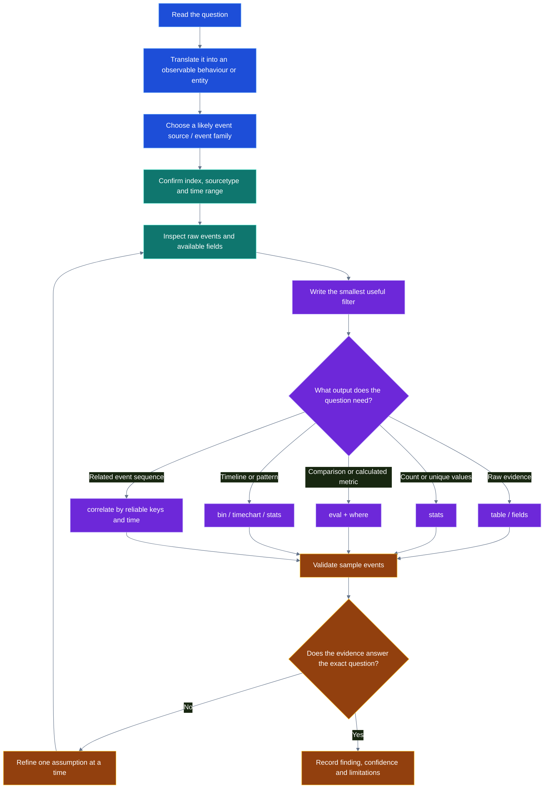
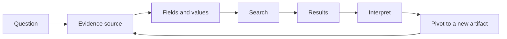
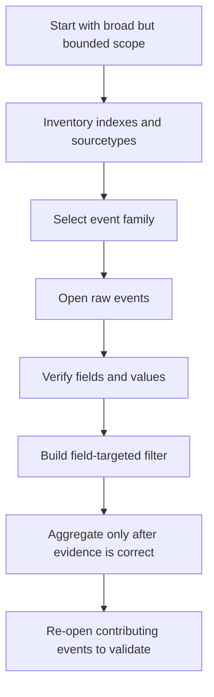
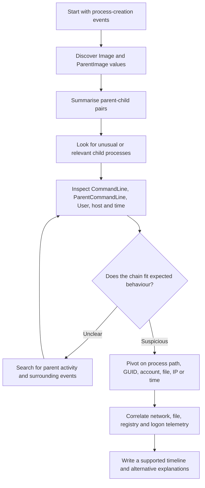
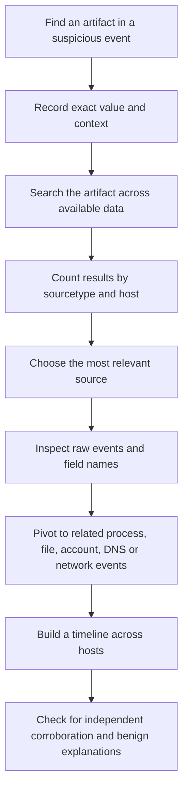
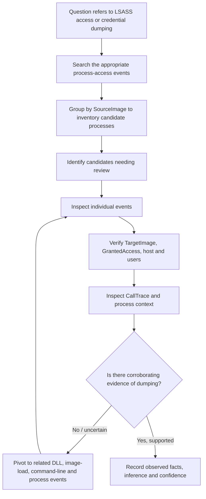
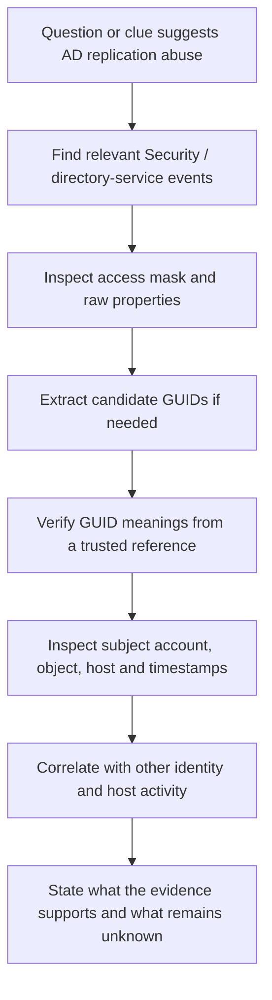
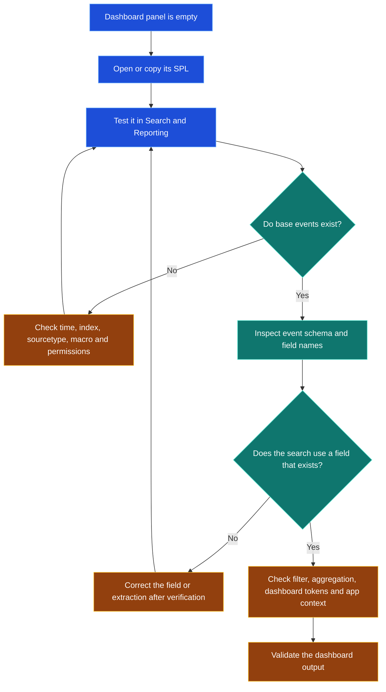
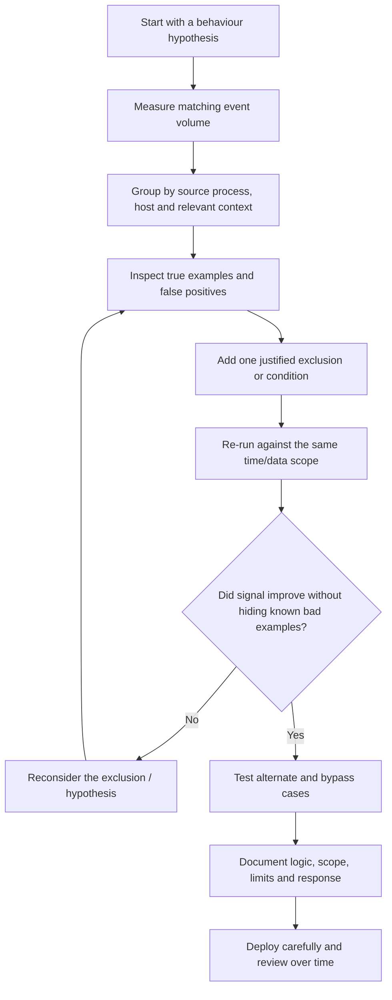
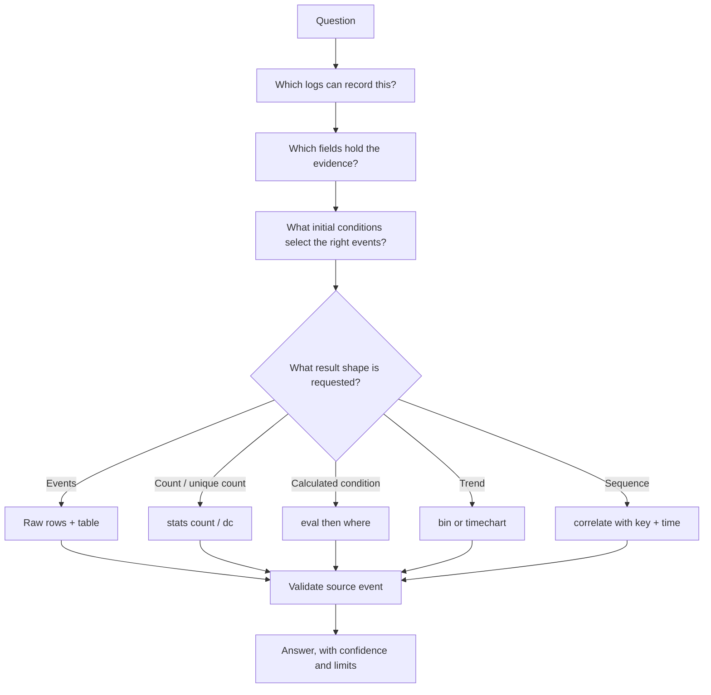

# Splunk SPL — SOC Investigation Field Manual

> [!abstract] Purpose
> A practical reference for **reading, writing, debugging, and explaining classic Splunk SPL** during HTB Academy exercises and junior SOC investigations. It is organised around decisions an analyst makes—not a list of commands to memorise.
>
> **Core rule:** understand the question → discover the data → verify the fields → write the smallest useful search → transform the results → validate the evidence.
>
> **Fast lookup:** use [Splunk_SPL_Quick_Reference_Obsidian](./Splunk_SPL_Quick_Reference_Obsidian.md) for command shapes and the short troubleshooting checklist.

> [!warning] Scope and limits
> - The query examples use the classic SPL patterns found in the HTB notes. Splunk also has SPL2; do not mix syntax or assumptions without checking the target environment.
> - Field names and data availability vary by sourcetype, add-on, field extraction, logging policy, and Splunk configuration. Treat field tables as **discovery hints**, not a guaranteed schema.
> - A matching event, unusual process, rare value, `UNKNOWN` call-trace segment, or statistical outlier is a **lead**, not by itself proof of compromise.
> - This manual builds a strong working method; competence still comes from repeatedly investigating data, checking raw events, and explaining your conclusions.

## How to use this manual

1. Read the master mind map and the query-building grammar.
2. Use the field-discovery ladder whenever you are unsure which fields exist.
3. Choose a command based on the output the question asks for.
4. Work the investigation maps one branch at a time.
5. When a query fails, use the debugging protocol instead of changing several things at once.
6. For every lab, keep a short investigation journal: question, fields verified, query iterations, evidence, alternative explanations, and confidence.

## Contents

- [1. The master mental model](Splunk_SPL_Field_Manual_Obsidian.md#1.%20The%20master%20mental%20model)
- [2. Splunk data model: what each word means](Splunk_SPL_Field_Manual_Obsidian.md#2.%20Splunk%20data%20model:%20what%20each%20word%20means)
- [3. SPL grammar: the rules of the language](Splunk_SPL_Field_Manual_Obsidian.md#3.%20SPL%20grammar:%20the%20rules%20of%20the%20language)
- [4. Field discovery: never guess the schema](Splunk_SPL_Field_Manual_Obsidian.md#4.%20Field%20discovery:%20never%20guess%20the%20schema)
- [5. Choose the command from the question](Splunk_SPL_Field_Manual_Obsidian.md#5.%20Choose%20the%20command%20from%20the%20question)
- [6. Command grammar reference](Splunk_SPL_Field_Manual_Obsidian.md#6.%20Command%20grammar%20reference)
- [7. Field and Event ID compass](Splunk_SPL_Field_Manual_Obsidian.md#7.%20Field%20and%20Event%20ID%20compass)
- [8. Investigation playbooks](Splunk_SPL_Field_Manual_Obsidian.md#8.%20Investigation%20playbooks)
- [9. Detection engineering: from hunt to alert](Splunk_SPL_Field_Manual_Obsidian.md#9.%20Detection%20engineering:%20from%20hunt%20to%20alert)
- [10. Performance and common failure modes](Splunk_SPL_Field_Manual_Obsidian.md#10.%20Performance%20and%20common%20failure%20modes)
- [11. A repeatable exam / lab method](Splunk_SPL_Field_Manual_Obsidian.md#11.%20A%20repeatable%20exam%20/%20lab%20method)
- [12. Debugging protocol](Splunk_SPL_Field_Manual_Obsidian.md#12.%20Debugging%20protocol)
- [13. Query patterns to practise](Splunk_SPL_Field_Manual_Obsidian.md#13.%20Query%20patterns%20to%20practise)
- [14. Investigation journal template](Splunk_SPL_Field_Manual_Obsidian.md#14.%20Investigation%20journal%20template)
- [15. Practice plan and mastery checklist](Splunk_SPL_Field_Manual_Obsidian.md#15.%20Practice%20plan%20and%20mastery%20checklist)
- [16. Glossary and official references](Splunk_SPL_Field_Manual_Obsidian.md#16.%20Glossary%20and%20official%20references)

---

# 1. The master mental model

## 1.1 The whole skill in one map



## 1.2 The loop analysts repeat



A useful artifact can be a process path, process GUID, parent process, account, hostname, IP address, domain, filename, registry path, event timestamp, access mask, or GUID. One search should ideally lead to a specific next question, not simply to a larger pile of results.

## 1.3 What it means to know SPL

You are getting fluent when you can reliably:

- Translate a natural-language question into filters, grouping keys, metrics, and output fields.
- Explain every clause in an SPL query in ordinary English.
- Discover the actual schema rather than assuming tutorial field names exist.
- Predict what each pipe stage does to the data and which fields survive.
- Distinguish event count from unique count, frequency from rarity, and correlation from causation.
- Pivot from one artifact to other event sources and build a coherent timeline.
- Test benign explanations, note missing telemetry, and state confidence without overstating the result.

---

# 2. Splunk data model: what each word means

## 2.1 Where an event comes from

A simplified path is:

**Source → collection → parsing/indexing → searchable event → SPL search → result/evidence**

- **Source:** Windows Event Logs, Sysmon, Linux syslog, DNS, firewall, application logs, and so on.
- **Collection:** a Universal Forwarder, Heavy Forwarder, HTTP Event Collector (HEC), or another input mechanism sends data to Splunk.
- **Indexer:** stores indexed event data and supports retrieval.
- **Search head / Search & Reporting:** lets an analyst run searches and use knowledge objects such as macros and saved searches.
- **SPL:** filters, transforms, calculates, aggregates, enriches, and presents search results.

For most HTB exercises, you work in **Search & Reporting**. When a search is empty, first work out whether the problem is data availability, time range, source selection, field extraction, search logic, or the dashboard itself.

## 2.2 The five words you must not confuse

| Term | Ask yourself | Example | What it is not |
|---|---|---|---|
| `index` | Which searchable data store? | `index="main"` | Not a log format |
| `sourcetype` | What kind of event/format? | `sourcetype="WinEventLog:Sysmon"` | Not the host name |
| `source` | Which input/file/channel supplied it? | A file or event-log channel | Not necessarily the machine |
| `host` | Which host value is associated with it? | `host="PC-01"` | Not guaranteed to equal `ComputerName` |
| `field` | Which named attribute is extracted? | `Image`, `User`, `DestinationIp` | Not a command |

One index can contain many sourcetypes; one sourcetype can contain events from many hosts. Fields present in one event class may be absent in another.

## 2.3 Event, raw event, and extracted field

An **event** is one recorded occurrence. It may have metadata and extracted fields:

- `_time` — timestamp Splunk assigned to the event.
- `_raw` — raw event text.
- `host`, `source`, `sourcetype` — metadata describing origin/type.
- Event-specific fields such as `EventCode`, `Image`, `CommandLine`, `TargetFilename`, `DestinationIp`, or `SourceImage`.

Treat `_raw` as the evidence check. A field extraction is convenient, but inspect the raw event when a field is missing, blank, inconsistent, or central to the conclusion.

## 2.4 Schema rule

> **Never promote a field name from a tutorial into a fact about your current dataset until you verify it.**

The HTB material uses examples such as `EventCode`, `ComputerName`, and `Account_Name`. Other environments may use `EventID`, `host`, `TargetUserName`, CIM-normalised names, or different extractions. If a table has blank columns, that does not prove the event lacks the behaviour; it may mean the field is named differently, absent for that event type, not extracted, or excluded upstream.

---

# 3. SPL grammar: the rules of the language

## 3.1 The sentence structure

A classic SPL search is a sequence of stages separated by a pipe `|`.

```spl
index="main" sourcetype="WinEventLog:Sysmon" EventCode=1
| stats count by ParentImage, Image
| sort - count
```

Read it left to right:

1. `index="main"` — scope the search to the `main` index.
2. `sourcetype="WinEventLog:Sysmon"` — restrict to this event type.
3. `EventCode=1` — select the event class described as process creation in the HTB Sysmon mapping.
4. `| stats count by ParentImage, Image` — replace the raw event list with one row per parent/child pair and count the events in each group.
5. `| sort - count` — order the summary by count, descending.

**The pipe is not OR.** It passes the current result set to the next command.

### General skeleton

```spl
index="<verified index>" sourcetype="<verified type>" <initial conditions>
| <command> <arguments>
| <command> <arguments>
| <final display or ordering>
```

This is a mental template, not a requirement to use every stage. Short queries can be correct; longer queries are not automatically better.

## 3.2 The grammar building blocks

| Element | Role | Example |
|---|---|---|
| Metadata selector | Scopes the data | `index="main"` |
| Field | Names an event attribute | `SourceImage` |
| Value | What a field/term should match | `"waldo"`, `10` |
| Operator | Connects or compares conditions | `=`, `!=`, `AND`, `OR` |
| Command | Performs an operation | `stats`, `eval`, `where` |
| Function | Calculates a value inside a command | `count`, `dc()`, `lower()` |
| Clause | Tells a command how to group/label | `by`, `AS` |
| Pipeline separator | Passes results onward | `|` |

Remember: `stats` is a command; `count` is a calculation; `by SourceImage` defines the grouping. `eval` is a command; `lower(Image)` is an expression/function inside it.

## 3.3 Initial search is usually implicit

These are usually equivalent in the classic SPL context:

```spl
index="main" "UNKNOWN"
```

```spl
search index="main" "UNKNOWN"
```

At the beginning, the `search` command is implied. It can also be used later in a pipeline to filter results from a previous command:

```spl
... | search isOutlier=1
```

## 3.4 Field-value condition grammar

Most basic conditions follow this mental form:

```text
FIELD OPERATOR VALUE
```

Examples:

```spl
EventCode=10
host="DESKTOP-EXAMPLE"
Image="*powershell.exe"
DestinationPort>=1024
```

- A field name is not normally quoted.
- String values or phrases can be quoted, especially when they contain spaces or punctuation.
- Numbers can be written as numbers where appropriate.
- Field names and values are different things. In `where`, an unquoted token can be interpreted as a field reference rather than a literal string.

## 3.5 AND, OR, NOT, and parentheses

- Multiple search terms are generally combined as **AND**.
- `OR` means either alternative can match.
- `NOT` excludes matching terms/conditions.
- Parentheses make the intended grouping explicit.

Example: process creation where the child image matches either command shell:

```spl
index="main" sourcetype="WinEventLog:Sysmon" EventCode=1
(Image="*cmd.exe" OR Image="*powershell.exe")
```

Plain English: “Find process-creation events in the selected data whose `Image` matches either pattern.”

**Best habit:** when combining required conditions with several OR alternatives, put the alternatives in parentheses. Do not rely on memory of precedence when the query matters.

## 3.6 Search wildcards are not regex

In ordinary search field matching, `*` matches a sequence of characters:

| Pattern | Intended use |
|---|---|
| `Image="powershell.exe"` | Match a specific field value |
| `Image="*powershell.exe"` | Match values ending in that executable name |
| `Image="*power*"` | Match values containing that string |
| `ComputerName="DESKTOP-01"` | Match an exact observed value |

Wildcard searches—especially leading wildcards—can cost more than a precise search. Use them for discovery when variation is unknown; narrow the query once you know the field and value.

**Regex is a different language.** A regex such as `.*` is not interchangeable with the simple search wildcard `*`.

In classic SPL, `where` uses evaluation-expression rules. For wildcard-like matching in `where`, use `like(field, "pattern%")` where `%` matches multiple characters; don't blindly copy `*` patterns from an initial search into `where`.

## 3.7 Search filters versus expression filters

### `search` — field against a literal/pattern

```spl
index="main" SourceImage="*notepad.exe"
```

This matches the `SourceImage` field against a value/pattern.

### `where` — expression, including field-to-field comparison

```spl
index="main" EventCode=10
| where SourceImage!=TargetImage
```

Here `SourceImage` and `TargetImage` are compared as fields. This is the important difference: in a `where` expression, unquoted field names refer to their values; quoted strings are literals.

For a `where` wildcard pattern:

```spl
... | where like(Image, "%powershell.exe")
```

Check the classic SPL command documentation for exact behavior on the Splunk version you are using.

## 3.8 Comparisons and missing fields

| Operator | Meaning |
|---|---|
| `=` | Equals |
| `!=` | Does not equal |
| `>` / `<` | Greater / less than |
| `>=` / `<=` | Greater/less than or equal |

Example:

```spl
DestinationPort>=1024
```

**Missing-field caution:** do not assume `Field!="value"` means “the field exists and has another value.” Missing values affect how filters behave. If field presence matters, test for it explicitly and inspect real events.

A common existence pattern in classic SPL searches is:

```spl
status=*
```

This is often used to require that `status` has a value in the matching event. Verify the behavior in the target syntax/data.

## 3.9 Field access versus output columns

The command controls not only what is shown, but sometimes what survives into later stages:

- `table` defines columns in the displayed result and is best near the end.
- `fields` keeps or removes fields for downstream processing.
- `rename` changes the field name used by subsequent stages.
- `stats` normally collapses raw events into summary rows and discards fields not grouped or aggregated.

Example:

```spl
... | stats count by SourceImage
```

After this, you generally have `SourceImage` and `count`, not every original event field. If you still need `TargetImage`, `CommandLine`, or `_raw`, either retain relevant fields through the aggregation or run a separate detail search.

## 3.10 The most important `stats` grammar

```spl
| stats <calculation> [AS <output_field>] [by <field1>, <field2>, ...]
```

Examples:

```spl
| stats count
| stats count by SourceImage
| stats count by ParentImage, Image
| stats dc(ComputerName) AS distinct_computers by Account_Name
| stats min(_time) AS first_seen max(_time) AS last_seen by User
```

Rules:

- The field after `by` is a **grouping key**.
- The field inside a function is the **value being measured**.
- The alias after `AS` is the output field name.
- More grouping fields create more specific groups and usually more rows.
- `stats count` with no `by` produces an overall aggregate row; adding `by` produces one row per distinct group.

### Count versus distinct count

- `count`: how many events/rows are in scope for the calculation.
- `dc(Field)`: how many distinct values of a field.

“Which account generated the most events?” and “which account reached the most unique computers?” are different questions. The first needs `count`; the second needs distinct-computer counting grouped by account.

## 3.11 Query order should tell an understandable story

A readable search usually moves through these stages:

1. **Scope:** index, sourcetype, time, event code.
2. **Filter:** relevant host, user, process, IP, filename, or event content.
3. **Transform:** calculate/normalise/extract if needed.
4. **Aggregate or correlate:** group, count, compare, build a time series.
5. **Filter the derived result:** apply a threshold using `where` or `search`.
6. **Display/order:** `table`, `sort`, `head`.

This is a reasoning pattern, not a rigid rule. A valid search may put a stage elsewhere when the command's semantics require it.

---

# 4. Field discovery: never guess the schema

## 4.1 Discovery ladder

Run these in order, adapting the scope to the lab. Expand events in the UI and verify actual values.

### A. Confirm that data exists

```spl
index="main" earliest=0
```

Use `earliest=0` only when the task calls for broad/all-history discovery and the time picker is compatible. Broad searches can be expensive; narrow them after mapping the dataset.

### B. Inventory sourcetypes

```spl
index="main"
| stats count by sourcetype
| sort - count
```

Question answered: “What kinds of records exist, and how many are in each type?”

### C. Inspect the likely source

```spl
index="main" sourcetype="WinEventLog:Sysmon"
```

Expand several events. Check `_raw`, selected fields, interesting fields, and whether the timestamp/host makes sense.

### D. Inventory event codes

```spl
index="main" sourcetype="WinEventLog:Sysmon"
| stats count by EventCode
| sort - count
```

Question answered: “Which event classes exist in this data?”

### E. Summarise fields on a scoped subset

```spl
index="main" sourcetype="WinEventLog:Sysmon" EventCode=1
| fieldsummary
```

`fieldsummary` describes fields in the **current search results**, not every field that might exist anywhere. A field can be absent from the summary because the selected events/time range do not contain it.

### F. Probe values in candidate fields

```spl
index="main" sourcetype="WinEventLog:Sysmon" EventCode=1
| stats count by Image
| sort - count
```

Or show a narrow set of evidence fields:

```spl
index="main" sourcetype="WinEventLog:Sysmon" EventCode=1
| table _time, host, ComputerName, User, ParentImage, Image, CommandLine
```

A blank column is a prompt to check the schema; it is not proof the behaviour did not occur.

## 4.2 Scope versus discovery: a safe sequence



## 4.3 Fast field probes

| Need | Pattern | Interpretation |
|---|---|---|
| Discover event sources | `stats count by sourcetype` | Count per source type |
| Discover event codes | `stats count by EventCode` | Count per event ID field |
| Discover process values | `stats count by Image` | Frequency per image value |
| Discover rare candidates | `rare limit=20 Image` | Less frequent values to inspect—not automatically malicious |
| Discover common values | `top limit=20 Image` | Common values / baseline clues |
| See sample fields | `table _time, host, _raw` | Evidence rows and original text |
| See field availability | `fieldsummary` | Fields seen in the current result set |

## 4.4 Time range is part of the query logic

The Search & Reporting time picker affects results. Search modifiers such as `earliest` and `latest` can also constrain them. A correct filter over the wrong period is still a wrong result.

Examples of common relative bounds:

```spl
earliest=-7d
```

```spl
earliest=-24h latest=now
```

For historical HTB datasets, the default “Last 24 hours” may exclude all the relevant events. Follow the exercise instructions; use all time when the question requires all available data, and set a precise window when investigating a particular sequence.

## 4.5 Search broad, then get specific

The HTB notes compare:

```spl
index="main" clue.local
```

```spl
index="main" *clue.local*
```

```spl
index="main" ComputerName="*clue.local"
```

The first is a useful discovery search when the field is unknown. The second broadens matching inside text. The third targets a known field. Once you discover where the clue lives, prefer the field-aware query. Leading wildcard searches can be costly.

---

# 5. Choose the command from the question

## 5.1 The output-shape decision table

| If the question asks… | Think about… | What must you decide? |
|---|---|---|
| “Show me the events/evidence” | Raw search + `table` | Which evidence fields are relevant? |
| “How many events?” | `stats count` | Overall count or count per group? |
| “How many unique computers/IPs/users?” | `stats dc(Field)` | Which field defines the unique entity? |
| “Which value appears most?” | `top Field` or `stats count by Field`, then sort descending | What exactly is being ranked? |
| “Which combinations are common?” | `stats count by A, B` | Which fields form the combination? |
| “Only keep rows where two fields differ” | `where A!=B` | Are both fields available at this stage? |
| “Calculate a duration/length/normalised value” | `eval` | What are the inputs and output name? |
| “Keep only rows above a calculated threshold” | `where` after calculation | Has the calculation already been created? |
| “Show a trend over time” | `bin`/`bucket` + `stats`, or `timechart` | What time span and grouping are appropriate? |
| “Extract a value from a string/path” | `rex` (or structured extraction) | What raw field contains it? |
| “Add external context from a CSV” | `lookup` | What is the join key, and is the lookup configured? |
| “Group related events into sequences” | Reliable keys + time constraints; sometimes `transaction` | What establishes that events belong together? |
| “Find possible abnormal activity” | Baseline / `eventstats` / `streamstats` / stats | What population is normal, and how is the threshold justified? |

## 5.2 Translate question words into SPL choices

| Question wording | Translate to | Common trap |
|---|---|---|
| **Which process?** | Identify the right event class and process field, then inspect values | `Image`, `SourceImage`, and `TargetImage` are not interchangeable |
| **Which parent launched it?** | Process-creation data; `ParentImage` / `ParentCommandLine` | A path/name match alone may not establish a specific process instance |
| **How many events?** | `count` | Do not substitute distinct count |
| **How many unique hosts?** | `dc(host_or_computer_field)` | Verify the real host field first |
| **Most frequent?** | `stats count by Field` + descending sort | Grouping at the wrong level changes the answer |
| **Earliest/latest?** | `min(_time)` / `max(_time)` by entity | Time picker can cut off the true first/last event |
| **Within N minutes?** | First/last times, `eval duration=last-first`, then `where duration < N*60` | Unix timestamp differences are seconds; confirm the question's intended definition |
| **Another/other process?** | Identify already-known candidate(s), then compare the complete candidate list/evidence | Do not guess based on a familiar process name |
| **Which IP did it contact?** | Network or DNS telemetry; verify direction and field names | A string in a command line is not proof a connection succeeded |
| **Which port?** | Inspect network events and direction (`SourcePort` vs `DestinationPort`) | Don't confuse a local ephemeral port with the remote service port |
| **What method / DLL?** | Find relevant process-access, image-load, command-line, or call-trace evidence | A loaded DLL may be legitimate; interpret in context |

## 5.3 The row-grain rule

Before using a summary, complete this sentence:

> **One output row represents one ________.**

Examples:

- `stats count by Image` → one image value.
- `stats count by ParentImage, Image` → one parent/child combination.
- `stats count by _time, Image` after hourly bucketing → one time bucket and image.
- `stats dc(ComputerName) by Account_Name` → one account, with a count of distinct computers for that account.

If you cannot explain what one row means, you are not ready to interpret the table.

---

# 6. Command grammar reference

## 6.1 Command picker: the core vocabulary

| Command | Job | Minimal pattern | Watch out for |
|---|---|---|---|
| `search` | Match/filter events | `field=value` | Search wildcard rules; broad text can be noisy |
| `where` | Filter using a Boolean expression | `\| where expression` | Field references vs quoted literals; wildcard use differs from initial search |
| `eval` | Create/replace a field | `\| eval new_field=expression` | The source fields must exist; same-name output overwrites |
| `stats` | Aggregate/collapse | `\| stats count by field` | Original raw fields usually disappear |
| `eventstats` | Add aggregate values back onto event rows | `\| eventstats avg(x) AS avg_x` | Baseline population and grouping must be intentional |
| `streamstats` | Running/windowed calculation | `\| streamstats ...` | Ordering and window semantics matter |
| `table` | Choose output columns | `\| table _time, host, Image` | Use late; may remove downstream access to fields |
| `fields` | Keep/remove fields | `\| fields Image CommandLine` or `\| fields - User` | Removing a field too early breaks later stages |
| `rename` | Rename field in results | `\| rename Image AS Process` | Subsequent stages should use the new name |
| `sort` | Order rows | `\| sort - count` | Sort after aggregation if ranking summary values |
| `head` | Keep first N results | `\| head 10` | Meaning depends on current order |
| `dedup` | Keep one representative per key | `\| dedup Image` | Not a frequency count; can discard useful evidence |
| `top` / `rare` | Show common/uncommon values | `\| top Image` | Common/rare does not equal safe/malicious |
| `bin` / `bucket` | Group timestamps into intervals | `\| bin _time span=1h` | Choose a span suited to the behaviour |
| `timechart` | Time series aggregation | `\| timechart span=1h count by Image` | Cardinality and split-by fields affect output |
| `rex` | Extract using regex | `\| rex field=Image "..."` | Test on actual raw values; escaping is easy to get wrong |
| `regex` | Filter with regex | `\| regex Image="..."` | Regex syntax differs from search wildcards |
| `lookup` | Enrich events with table data | `\| lookup table.csv key OUTPUT label` | Key match and lookup configuration matter |
| `inputlookup` | Read a lookup table | `\| inputlookup table.csv` | The lookup's content/configuration may differ |
| `transaction` | Group related events into transactions | `\| transaction key maxspan=...` | Expensive; key/time boundaries can create false relationships |
| `fieldsummary` | Report fields in current results | `\| fieldsummary` | Scoped to the current search results |
| `metadata` | Inventory source/sourcetype metadata | `\| metadata type=sourcetypes` | Metadata summaries are not a substitute for raw events |

## 6.2 `search`

Use it to retrieve events using index, time, keywords, field/value conditions, and Boolean logic.

```spl
index="main" sourcetype="WinEventLog:Sysmon" EventCode=1
```

At the beginning of the query, `search` is usually implicit. Later in the pipeline, it can filter a command's output:

```spl
... | search isOutlier=1
```

## 6.3 `where`

Use `where` when the condition is an eval-style expression, particularly a comparison between fields or a calculated field.

```spl
... | where SourceImage!=TargetImage
```

```spl
... | eval command_length=len(CommandLine)
| where command_length > 300
```

A numeric cutoff such as 300 is illustrative—not a universal maliciousness threshold.

For wildcard-like comparisons within `where`, the classic SPL pattern uses `like` and `%`:

```spl
... | where like(Image, "%powershell.exe")
```

## 6.4 `eval`

Use `eval` to create a new field or normalise/calculate one:

```spl
... | eval image_lower=lower(Image)
```

```spl
... | eval duration_seconds=last_seen-first_seen
```

Common functions seen in the HTB material:

- `lower(field)` / `upper(field)` — case normalisation.
- `len(field)` — string length.
- `if(condition, true_value, false_value)` — conditional value.
- `case(...)` — multiple conditional branches.
- `coalesce(a,b,...)` — first non-null value among candidates.
- `isnull(field)` — test null/missing status.
- `split(field, delimiter)`, `mvindex(...)`, `mvcount(...)` — manipulate multivalue values.

`eval` creates search-time result fields. It does not rewrite the original indexed event.

## 6.5 `stats`

### Useful aggregations

| Function | Measures | Example question |
|---|---|---|
| `count` | Rows/events in scope of the aggregation | Which process has the most events? |
| `dc(Field)` | Distinct field values | How many hosts did each account touch? |
| `values(Field)` | Distinct observed field values | Which targets/commands appear in this group? |
| `min(Field)` / `max(Field)` | Lowest/highest value | First/last timestamp per user |
| `avg(Field)` | Average numeric value | What is the mean for this group? |
| `stdev(Field)` | Standard deviation | How variable is the observed metric? |
| `sum(Field)` | Sum numeric values | What is the cumulative total? |

### Examples

Frequency by image:

```spl
... | stats count by Image | sort - count
```

Parent-child pairs:

```spl
... | stats count by ParentImage, Image | sort - count
```

Distinct computers per account:

```spl
... | stats dc(ComputerName) AS distinct_computers by Account_Name
```

First/last activity per account:

```spl
... | stats count AS event_count min(_time) AS first_seen max(_time) AS last_seen by Account_Name
```

### `stats` vs `eventstats` vs `streamstats`

| Command | Result shape | Mental model |
|---|---|---|
| `stats` | Summary rows; raw event detail collapses | “Summarise the selected results.” |
| `eventstats` | Original events plus aggregate fields | “Calculate a summary and attach it to relevant events.” |
| `streamstats` | Rows with running/windowed values | “Update the statistic as events are processed.” |

Use the command that matches the question, not the command that looks most advanced. The baseline population, group keys, chronological ordering, and window size are part of the analytic design.

## 6.6 `table`, `fields`, `rename`, `sort`, `dedup`

### Display evidence

```spl
... | table _time, host, ComputerName, User, Image, ParentImage, CommandLine
```

Use a short list of fields relevant to the question. `table *` is useful only for limited discovery and is usually too wide for a final result.

### Keep or remove fields

```spl
... | fields _time host Image CommandLine
```

```spl
... | fields - User
```

The second version removes `User` from downstream results; it does not delete data from the index.

### Rename a field

```spl
... | rename Image AS Process
```

Subsequent stages should refer to `Process`, not `Image`.

### Sort

```spl
... | sort - count
```

`- field` means descending; `+ field` means ascending. In a frequency hunt, sort **after** the aggregation you want to rank.

### Deduplicate

```spl
... | dedup Image
```

This keeps a representative row per `Image`. It does not count how many times the image occurred. Use `stats count by Image` when the question is about frequency.

## 6.7 Time commands: `bin` / `bucket`, `timechart`, `chart`

Exact event times can produce a row per timestamp and hide trends. Group to an interval that matches the behaviour you care about.

```spl
index="main" sourcetype="WinEventLog:Sysmon" EventCode=3
| bin _time span=1h
| stats count by _time, Image
| sort _time
```

- `bin` / `bucket` assigns events into fixed time buckets.
- `timechart` is designed for time-series aggregation.
- `chart` reshapes aggregate results for visual comparison.

A one-hour bucket can hide a short burst; a tiny bucket can create noisy output. Choose the resolution according to the question.

## 6.8 `rex` and `regex`

- `rex` **extracts** values into fields using a regular expression.
- `regex` **filters** events by whether a field matches a regular expression.

The core extraction pattern is:

```spl
... | rex field=<source_field> "<regex with named capture group>"
```

A named capture looks like `(?<filename>...)` or `(?P<filename>...)`, depending on the supported regex style. The captured value becomes a field.

Workflow for safe extraction:

1. Display a few raw events and identify the exact string format.
2. Test a regex against a known example.
3. Use a named capture group.
4. Check whether the new field is populated and whether it captures too much/too little.
5. Only then normalise or enrich the extracted value.

Windows path backslashes and escaping are frequent sources of mistakes. Confirm the displayed field value and use the syntax accepted in your environment.

## 6.9 `lookup` and `inputlookup`

A lookup adds context from a separate table, such as an asset inventory, owner map, known indicator list, or filename classification.

```spl
... | lookup malware_lookup.csv filename OUTPUTNEW is_malware
```

Conceptual flow:

1. Extract/normalise the key (for example, a filename).
2. Match the event key to the lookup's corresponding key column.
3. Add the requested context field.
4. Validate that rows match as expected.

`OUTPUTNEW` avoids replacing an already populated output field; `OUTPUT` can overwrite it. Confirm the key column and lookup configuration. An unmatched item means “no lookup match,” not “benign.”

```spl
| inputlookup malware_lookup.csv
```

Use this to inspect the lookup table itself.

## 6.10 `transaction` and subsearches

### `transaction`

Groups events around shared fields and time/start/end rules. It can be useful when the question truly requires a sequence of related raw events.

Before using it, ask:

- Is the key unique enough?
- Do host, process GUID, user, timestamps, and event boundaries matter?
- Is the maximum span justified?
- Will unrelated events sharing a common executable name be merged?
- Would a `stats` summary or a join/pivot answer the question more simply?

`transaction` can be expensive. A shared `Image` alone is often not enough to prove that events belong to the same process instance.

### Subsearch

A subsearch is a search nested inside another search, often used to generate values for the outer search. Inspect what the inner query returns and how it is applied. “Not in the top 100” means “outside this chosen top-value list,” not “malicious.”

## 6.11 `top`, `rare`, `fieldsummary`, and `metadata`

- `top Field` — common field values.
- `rare Field` — uncommon field values.
- `fieldsummary` — field presence/statistics for the current results.
- `metadata` — information about indexes/sourcetypes/sources, depending on command options and permissions.

These are discovery aids. They reveal distributions and candidate fields; they do not decide whether behaviour is malicious.

## 6.12 Command-specific versus universal grammar

Do not assume every command accepts the same separators, modifiers, or argument order.

Examples:

```spl
| stats count by ParentImage, Image
```

```spl
| table ParentImage Image
```

`stats` uses commas in its grouping-field list; `table` commonly accepts a space-separated field list. Learn each command’s documented syntax rather than applying one universal pattern.

---

# 7. Field and Event ID compass

> [!important] Use this section to choose where to look—not as a schema guarantee. Confirm the actual field names and event IDs in the target.

## 7.1 Field map by investigative question

| Question | Candidate fields | Validation questions |
|---|---|---|
| What happened and when? | `_time`, `_raw`, `host`, `source`, `sourcetype` | Is the timestamp correct? Does raw text support extracted fields? |
| Which process ran? | `Image`, `CommandLine`, `User`, `ComputerName` | Is `Image` the acting process for this event type? |
| What launched it? | `ParentImage`, `ParentCommandLine`, `ParentProcessGuid`, `ProcessGuid` | Does the event connect to a specific parent instance? |
| Which process accessed another? | `SourceImage`, `TargetImage`, `GrantedAccess`, `CallTrace`, `TargetProcessId` | Is the target process actually the one under investigation? |
| Which file was created? | `TargetFilename`, `Image`, `User`, host fields | Who created it, where, and was it executed later? |
| Which registry value changed? | `TargetObject`, `Details`, `Image`, user/host fields | Which key/value, process, and resulting data? |
| Which IP/port? | `SourceIp`, `SourcePort`, `DestinationIp`, `DestinationPort`, `Protocol` | Which side is local/remote? Did a connection event occur? |
| Which domain was queried? | `QueryName`, `Image`, `User`, `ComputerName` | Is the field present in the DNS event source? |
| Which account/computer? | `User`, `Account_Name`, `SubjectUserName`, `TargetUserName`, `ComputerName`, `host` | Which account field and machine field exist in this dataset? |
| Which AD right was accessed? | `Access_Mask` in HTB examples, raw `Properties`, GUIDs, subject/object fields | Is auditing enabled? What do the raw properties and GUIDs mean? |
| What DLL was loaded? | Often `Image`, `ImageLoaded` for Sysmon image-load examples | Which process loaded it, from what path, and when? |

## 7.2 Sysmon event map used by the HTB module

| Event ID | Course description | Investigative use |
|---:|---|---|
| 1 | Process creation | Process tree, parent/child, command line |
| 2 | File creation time changed | Possible timestamp manipulation; benign causes exist |
| 3 | Network connection | Process/network pivots; often high volume |
| 4 | Sysmon service state changed | Possible telemetry tampering; legitimate service starts/stops also occur |
| 5 | Process terminated | Process lifecycle and termination patterns |
| 6 | Driver loaded | Driver activity; context is essential |
| 7 | Image loaded | DLL/image load behaviour |
| 8 | CreateRemoteThread | Potential remote-thread injection behaviour |
| 10 | ProcessAccess | One process accessing another; LSASS investigation in the module |
| 11 | FileCreate | File creation and payload staging clues |
| 12 | Registry object create/delete | Registry changes |
| 13 | Registry value set | Registry value/configuration changes |
| 15 | FileCreateStreamHash | File stream and download context |
| 16 | Sysmon configuration changed | Possible logging configuration tampering |
| 17 | Pipe created | Inter-process communication |
| 18 | Pipe connected | Pipe communication |
| 22 | DNS query | DNS lookups and potential beaconing pivots |
| 23 | File deletion | Cleanup or destructive activity, with context |
| 25 | ProcessTampering | Process image manipulation behaviour |

Event IDs are only useful when you use the relevant event source and schema. The presence of an event code does not guarantee every field is available or that logging/auditing was enabled.

## 7.3 Important field distinctions

- **`Image`** commonly identifies the process involved in a Sysmon event.
- **`ParentImage`** identifies the parent process in process-creation events.
- **`SourceImage` / `TargetImage`** are used in the HTB process-access examples to identify the accessing process and target.
- **`ImageLoaded`** can identify the loaded image/DLL in the image-load example.
- **`host` / `ComputerName`** may refer to related but non-identical values; verify and cross-check.
- **`count` / `dc(field)`** measure event volume / unique values, respectively.

---

# 8. Investigation playbooks

Each playbook is a thinking sequence, not an automatic verdict. Start broad enough to discover data, then narrow based on observed evidence.

## 8.1 Playbook A — Build a process tree (Event ID 1)

### Investigation map



### Starting pattern

```spl
index="main" sourcetype="WinEventLog:Sysmon" EventCode=1
| stats count by ParentImage, Image
| sort - count
```

To inspect rather than just count:

```spl
index="main" sourcetype="WinEventLog:Sysmon" EventCode=1
| table _time, host, ComputerName, User, ParentImage, ParentCommandLine, Image, CommandLine, ProcessGuid, ParentProcessGuid
```

Use the second pattern only with fields verified to exist; remove irrelevant/missing columns.

### Analyst questions

1. Is this parent-child relationship expected for the host and software?
2. What did the child’s command line do?
3. Which user and privilege context were involved?
4. Does the timestamp align with a file creation or network event?
5. Can process GUIDs connect related events more precisely than a filename alone?
6. What benign explanation could fit this process chain?

## 8.2 Playbook B — Pivot from a clue across sources

### Investigation map



### Example pattern

```spl
index="main" "<known-artifact>"
| stats count by sourcetype, host
| sort - count
```

Then narrow to one discovered source type:

```spl
index="main" "<known-artifact>" sourcetype="<observed type>"
| table _time, host, ComputerName, User, Image, CommandLine, _raw
```

Example artifacts: IP, hostname, domain, filename, registry path, process name, GUID, username, or a distinctive command-line fragment.

**Correlation caution:** matching the same IP or executable string does not automatically mean the events belong to the same actor/process. Compare timestamps, hosts, identifiers, process context, direction, and raw event details.

## 8.3 Playbook C — Investigate LSASS / process access (Event ID 10)

This playbook reflects the HTB real-world section. It deliberately does not supply the exercise’s sought executable or other answer.

### Investigation map



### Inventory pattern

```spl
index="main" EventCode=10 lsass
| stats count by SourceImage
| sort - count
```

This is a starting inventory, not a verdict. Inspect the actual events and validate the schema. Useful fields in the HTB notes include `SourceImage`, `TargetImage`, `TargetProcessId`, `GrantedAccess`, `CallTrace`, `SourceUser`, and `TargetUser` when present.

### Detail view pattern

```spl
index="main" EventCode=10 lsass
| table _time, host, ComputerName, SourceImage, TargetImage, TargetProcessId, GrantedAccess, CallTrace, SourceUser, TargetUser
```

### Interpretation rules

- Confirm the **target** is the intended process; a keyword match alone is not sufficient.
- Treat access rights as evidence to interpret, not as a standalone proof of a successful dump.
- Review `CallTrace` in the context of the event; `UNKNOWN` can be a clue, not a universal signature.
- Seek corroboration from process creation, image/DLL loads, command line, file activity, and neighbouring timestamps.
- Consider legitimate diagnostics, security tools, runtime/JIT activity, and other benign explanations.

## 8.4 Playbook D — Directory-service access / possible DCSync (Event ID 4662)

### Investigation map



The HTB lesson uses `EventCode=4662`, an `Access_Mask` filter, account context, and GUIDs in event properties. The exact fields and audit coverage must be verified in the target.

If GUIDs are embedded in raw text and not extracted, first inspect the raw event, then use `rex` to capture the relevant substring. Confirm the extracted string and look up its meaning in a trusted source before drawing a conclusion. Do not call every Event ID 4662 a DCSync event.

## 8.5 Playbook E — DLL/image-load behaviour (Event ID 7)

### Reasoning flow

1. Confirm that image-load events exist and identify the process field and DLL field (the HTB example uses `ImageLoaded`).
2. Decide whether the question asks for a specific DLL, distinct DLL count, or suspicious process.
3. Group at the appropriate level—often by time bucket and process.
4. Inspect the underlying paths and process context for candidates.
5. Treat thresholds and directory exclusions from the lab as examples, not universal rules.

### Count distinct loaded images per process and hour

```spl
index="main" EventCode=7
| bin _time span=1h
| stats dc(ImageLoaded) AS unique_images by _time, Image
| where unique_images > <chosen_threshold>
| sort - unique_images
```

`<chosen_threshold>` is a placeholder. The value must be justified for your data and question. Many legitimate applications load multiple DLLs.

## 8.6 Playbook F — File creation and execution

Use file-create telemetry (Event ID 11 in the HTB mapping) to identify a file path and then pivot to process creation (Event ID 1) to check whether it ran.

Useful starting fields include `TargetFilename`, `Image`, user, host, and timestamp. Confirm the target filename field in the relevant event.

Questions:

- Was the file created under Downloads, Temp, AppData, ProgramData, or another path that matters for this environment?
- Which process wrote it, under which account, and when?
- Does a process-creation event execute the same file later?
- Does its command line reference an IP, domain, or script?
- Are there network events around that time?

An `.exe` extension or unusual directory is a lead, not a malware verdict.

## 8.7 Playbook G — Network and DNS pivot

Useful HTB event families: Sysmon Event ID 3 for network connections and Event ID 22 for DNS queries, where they are present and properly extracted.

Candidate fields from the lesson include `Image`, `SourceIp`, `SourcePort`, `DestinationIp`, `DestinationPort`, `Protocol`, `Initiated`, and `QueryName`. Field names may differ.

### Connection inventory

```spl
index="main" sourcetype="WinEventLog:Sysmon" EventCode=3
| stats count by Image, DestinationIp, DestinationPort
| sort - count
```

### Domain query inventory

```spl
index="main" sourcetype="WinEventLog:Sysmon" EventCode=22
| stats count by QueryName, Image
| sort - count
```

Questions:

- Which field is the remote destination in this event schema?
- What process initiated the activity?
- Is the IP also present in another source type or on another host?
- Is the domain popular/expected in this environment, or merely unfamiliar?
- Did a connection event occur, or is the address only present in a command line?

## 8.8 Playbook H — Registry and service-related activity

The HTB module uses Sysmon Event IDs 12 and 13 for registry-related activity, including value changes. Candidate fields include `TargetObject`, `Details`, `Image`, and user/host context.

For a suspicious key/value:

1. Search the relevant event class.
2. Inspect the exact registry path and data/value.
3. Identify the process and account that performed the action.
4. Correlate with process execution and timestamps.
5. Validate whether the change fits a legitimate installer, updater, service or administrative action.

## 8.9 Playbook I — Logons and account activity

For Windows Security events, the HTB notes use Event ID 4624 for successful logons and Event ID 4662 for directory-service object access. Verify the actual Security sourcetype and fields.

For a “distinct computers per account” question, reason in this order:

1. Filter to the relevant event type.
2. Filter the account field using the observed value representation.
3. Identify the field that represents a computer in this dataset.
4. Use `dc(computer_field)`, not `count`.
5. If needed, validate by listing the unique computer values or grouping by account and computer.

For suspicious account activity, inspect source IP, logon type, host, timestamp, surrounding process activity, and legitimate administrative context when those fields exist.

## 8.10 Playbook J — TTP hunting versus analytics hunting

TTP-based hunt asks: **“Did a recognisable technique leave expected artefacts?”**

The table turns the HTB examples into a compact decision guide. These are leads, not verdicts.

| HTB hunt theme | Starting telemetry / clue | What to inspect next | Main false-positive trap |
|---|---|---|---|
| Native Windows reconnaissance utilities | Sysmon 1; `Image`, `CommandLine` for tools such as `ipconfig.exe`, `net.exe`, `whoami.exe`, `netstat.exe`, `nbtstat.exe`, `hostname.exe`, `tasklist.exe` | Parent process, user, host, arguments, timing and sequence of commands | Administrators and support tools use these legitimately |
| DNS lookups for common hosting platforms | Sysmon 22; `QueryName`, `Image` | Full domain, process command line, file creation/download context and other hosts asking the same query | A reputable hosting platform can host benign and malicious content |
| PsExec-like remote execution | Sysmon 13 service `ImagePath`; Sysmon 11 file creation; Sysmon 18 named pipes | Check whether service, file and pipe evidence align on related hosts and times | Any one artifact can occur in legitimate administration |
| Archive creation/staging | Sysmon 11 and extensions such as `.zip`, `.rar`, `.7z` | File path, creator, account, host, subsequent execution or network transfer | Normal file compression and user workflows |
| PowerShell/Edge download-related activity | Sysmon 11; process associated with file creation; `Zone.Identifier` may appear | Link file path to process creation, command line, host, user, URL/IP and later execution | Download metadata indicates context, not that a file is malicious |
| Execution from Downloads | Sysmon 1; `Image` path under a user Downloads directory | Parent process, user, file origin, command line and network behaviour | Installers and portable utilities often run from Downloads |
| Executable/DLL creation outside Windows paths | Sysmon 11; `.exe`/`.dll` target paths | Creator process, destination path, signature/hash if available, and subsequent execution | Legitimate software stores binaries outside Windows too |
| Misspelled/masquerading names | Sysmon 1; compare `Image`, `ParentImage`, and command lines to expected names | Full path, signature, parent, user, file creation and behaviour | Name-only rules are brittle and can miss renamed variants |
| Non-standard ports | Sysmon 3 or relevant network logs; source/destination ports | Determine connection direction, destination process, host role and whether the port is expected | Non-standard ports can be legitimate; standard ports can be malicious |

### Native utility reconnaissance pattern from the lesson

```spl
index="main" sourcetype="WinEventLog:Sysmon" EventCode=1
(Image="*\\ipconfig.exe" OR Image="*\\net.exe" OR Image="*\\whoami.exe"
 OR Image="*\\netstat.exe" OR Image="*\\nbtstat.exe"
 OR Image="*\\hostname.exe" OR Image="*\\tasklist.exe")
| stats count by Image, CommandLine
| sort - count
```

This inventories process-creation events for the listed utilities, then groups by executable and command line. The key next step is to review parent, user, host, arguments, and timing—not to label every occurrence as malicious.

### DNS clue pattern from the lesson

```spl
index="main" sourcetype="WinEventLog:Sysmon" EventCode=22 QueryName="*github*"
| stats count by Image, QueryName
| sort - count
```

The full domain and surrounding process/file/network activity matter more than a substring match.

### PsExec-like execution: correlate multiple artifacts

The HTB lesson checks service registry data, file creation and named-pipe activity as separate clues. The examples below are useful to learn the query shapes; validate the field encoding before using them elsewhere.

```spl
index="main" sourcetype="WinEventLog:Sysmon" EventCode=13
Image="C:\\Windows\\system32\\services.exe"
TargetObject="HKLM\\System\\CurrentControlSet\\Services\\*\\ImagePath"
| rex field=Details "(?<reg_file_name>[^\\\\]+)$"
| eval reg_file_name=lower(reg_file_name)
| stats count values(Details) AS RegistryDetails by reg_file_name, ComputerName
| sort + count
```

```spl
index="main" sourcetype="WinEventLog:Sysmon" EventCode=11 Image=System
| stats count by TargetFilename
| sort - count
```

```spl
index="main" sourcetype="WinEventLog:Sysmon" EventCode=18 Image=System
| stats count by PipeName
| sort - count
```

Look for independent artifacts that align on a related host and time. A service path, file, or pipe by itself can be legitimate administration activity.

### Archive-file staging or transfer clues

```spl
index="main" EventCode=11
(TargetFilename="*.zip" OR TargetFilename="*.rar" OR TargetFilename="*.7z")
| stats count by ComputerName, User, TargetFilename
| sort - count
```

A created archive does not prove exfiltration. Check who created it, where it was written, which process was involved, and whether a later network event shows transfer activity.

### PowerShell / browser download-related file activity

```spl
index="main" sourcetype="WinEventLog:Sysmon" EventCode=11 Image="*powershell.exe*"
| stats count by Image, TargetFilename
| sort + count
```

```spl
index="main" sourcetype="WinEventLog:Sysmon" EventCode=11
Image="*msedge.exe" TargetFilename="*Zone.Identifier"
| stats count by TargetFilename
| sort + count
```

`Zone.Identifier` can provide download-origin context when the relevant data is logged. It is not a malware verdict. Pivot from the filename to process creation, user, host, command line and network evidence.

### Execution from Downloads / binaries outside Windows paths

```spl
index="main" EventCode=1
| regex Image="C:\\Users\\.*\\Downloads\\.*"
| stats count by Image
| sort - count
```

```spl
index="main" EventCode=11
(TargetFilename="*.exe" OR TargetFilename="*.dll")
TargetFilename!="*\\windows\\*"
| stats count by User, TargetFilename
| sort + count
```

These are location heuristics. Legitimate installers and portable tools can run from Downloads or create binaries outside the Windows directory. Correlate creator, execution, user, parent and time.

### Masquerading / misspelled executable names

The HTB lesson searches for `psexe`-like text in the child image, parent image, child command line and parent command line while excluding known spellings. The underlying reasoning is:

1. Search several relevant process fields, not just `Image`.
2. Group the alternative matches with parentheses.
3. Exclude known benign/exact names only when justified.
4. Inspect the full path, parent, command line, user and host.

A name-fragment rule is easy to evade by renaming a file; it should be combined with contextual evidence rather than treated as a complete detection.

### Connections on non-standard ports

```spl
index="main" EventCode=3
NOT (DestinationPort=80 OR DestinationPort=443 OR DestinationPort=22 OR DestinationPort=21)
| stats count by SourceIp, DestinationIp, DestinationPort
| sort - count
```

The port list is a teaching example. “Non-standard” depends on the network. Benign software can use unusual ports, and malicious traffic can use 443. Verify connection direction, destination process, hostname, DNS, command line and expected service behaviour.

Analytics-based hunt asks: **“Is this behaviour unusual relative to a defined population or time baseline?”**

Examples from the module include:

- Unusually long command lines (`len(CommandLine)`).
- Unexpected hourly counts of `cmd.exe` launches.
- A process generating an unusual number of network connections.
- A process loading a high number of distinct images/DLLs per time bucket.

TTP patterns can be brittle if an attacker changes the exact indicator. Analytics can be noisy if the baseline or group keys are poor. Strong investigations often combine both: a behaviour pattern plus context and a reasoned baseline.


## 8.11 Playbook K — Debug a Splunk app, dashboard, or macro

The HTB “Using Splunk Applications” section teaches that an app is a workspace containing dashboards, saved searches, macros, and other knowledge objects. An app can show no results even when the underlying events exist.

### App debugging flow



### Macros

A search macro is a reusable fragment of SPL embedded into another search. If a dashboard uses a macro to select an index or sourcetype, confirm that the macro points to the data actually ingested into this lab.

1. Find the search attached to the dashboard panel.
2. Identify macros used by the search.
3. Inspect the macro definition and source filters.
4. Run the underlying search independently.
5. Check the real index, sourcetype and fields.
6. Change the macro only after you understand which assumption is wrong.

### The `Computer` versus `ComputerName` lesson

The HTB notes show a Top Systems panel using a query shaped like:

```spl
sysmon EventCode=11 | top Computer
```

The panel returned no results because the corresponding HTB events used `ComputerName`, not `Computer`. The lesson's field-corrected shape was:

```spl
sysmon EventCode=11 | top ComputerName
```

This is specific to the lab's schema. In another Splunk environment, inspect the events and use the field that actually exists. Do not blindly copy either spelling.

| Symptom | First thing to check |
|---|---|
| No raw events | Time range, index, sourcetype, macro/source filter, permissions, ingestion |
| Raw events exist but panel is blank | Wrong field name, overly strict filter, incorrect aggregation |
| Manual search works but dashboard fails | Dashboard tokens, macro expansion, app context or time picker |
| Screenshot counts differ | Data snapshot, time range, sourcetype, field extraction or query difference |

Do not reinstall the app simply because a panel is empty. Find which layer is failing first.

---

# 9. Detection engineering: from hunt to alert

## 9.1 Hunt versus alert

| Hunt | Alert |
|---|---|
| Exploratory; designed to understand what happened | Repeatable; designed to detect relevant activity over time |
| Can be broad and iterative | Must be efficient and have acceptable false-positive volume |
| Analyst reviews many hypotheses | Should encode a clear condition, context and response path |
| Can tolerate some noise during discovery | Must not bury meaningful signals in constant noise |

A search that is helpful during a hunt is not automatically ready for alerting.

## 9.2 The alert-tuning loop



## 9.3 HTB `CallTrace` / `UNKNOWN` example: what it teaches

The course starts with events containing `CallTrace="*UNKNOWN*"`, identifies the event class that carries the signal, groups by `SourceImage`, then iteratively filters known noisy patterns, including self-access, certain .NET/JIT-related call-trace patterns, WOW64-related patterns, and Explorer in that particular environment. It then inspects remaining source, target and trace combinations.

The reusable lesson is the **method**, not the exact exclusion list:

1. Measure where the signal occurs.
2. Identify which event class and fields matter.
3. Examine source processes and individual event context.
4. Form a benign explanation for each noisy cluster.
5. Exclude only what evidence justifies excluding.
6. Re-check whether known suspicious examples remain visible.
7. Document the exclusion’s blind spot and revalidate after data/software changes.

An exclusion can reduce false positives and still hide malicious activity. Every exclusion has a cost.

## 9.4 Statistical baselines: design before coding

Before writing an outlier query, specify:

- **Metric:** event count, connection count, distinct DLLs, command length, etc.
- **Population:** per host, user, user-host pair, process, or something else.
- **Time grain:** per minute/hour/day, or rolling window.
- **Training/baseline period:** which time period represents normal behaviour?
- **Threshold:** why this cutoff? Is it merely copied from an exercise?
- **Data quality:** are logging gaps, missing values, or sparse data distorting the baseline?
- **Validation:** what do raw events around a flagged point show?

A threshold such as `average + 0.5 * stdev` or `average + 1.5 * stdev` is an instructional example, not a universal security standard. A weak baseline can make normal activity look anomalous and attacks look normal.

## 9.5 Example: abnormally long command lines

```spl
index="main" sourcetype="WinEventLog:Sysmon" Image="*cmd.exe*"
| eval command_length=len(CommandLine)
| table _time, host, User, ParentImage, command_length, CommandLine
| sort - command_length
```

This prioritises long command lines for inspection. Long does not automatically mean malicious; short commands can also be malicious. Keep host, user, parent and timestamp so you can evaluate context.

## 9.6 Example: hourly network volume per process

The shape of a rolling-baseline analysis is:

1. Filter to network events.
2. Bucket by an appropriate interval.
3. Count the behaviour at the intended granularity.
4. Calculate a baseline for the right group/population.
5. Label observations exceeding a justified threshold.
6. Inspect raw events for flagged intervals.

Do not assume that grouping only by `Image` is sufficient if multiple hosts or users can run the same executable. Decide what “normal” means before choosing the `by` fields.

## 9.7 Production-readiness checklist

Before converting a hunt into an alert, ask:

- Does it detect behaviour rather than one brittle filename or arbitrary string?
- Are source, target, host, user, time range, and event class explicit enough?
- Have true positives and benign samples been reviewed?
- Can legitimate applications produce the same signal?
- Do exclusions remove only justified noise? What attack could hide behind them?
- Is the query fast enough for its schedule and data volume?
- Does the alert include enough context for triage?
- Is there a defined action for the analyst who receives it?
- Who will review it after logging, OS, application, or environment changes?

---

# 10. Performance and common failure modes

## 10.1 Search-efficiency rules

1. Start with the known index and a reasonable time range.
2. Add the correct sourcetype and event family as soon as known.
3. Prefer field-targeted searches over broad raw-text searches once you know the field.
4. Avoid leading wildcards where an exact/prefix match works.
5. Keep discovery searches broad enough to find evidence, but narrow the query after discovery.
6. Use `stats` for counts and grouped summaries; do not use `transaction` when a count is enough.
7. Avoid `table *` on huge datasets.
8. Do not add exclusions before you understand the result population.

## 10.2 Common mistakes

| Mistake | Why it fails | Correction |
|---|---|---|
| Guessing a field name | The field may not exist in this sourcetype | Inspect raw events and `fieldsummary` |
| Confusing `host` and `ComputerName` | Metadata and event payload fields can differ | Cross-check both and verify the one the question requires |
| Using `count` for unique hosts | It counts events | Use `dc(host_or_computer_field)` |
| Using `dedup` for frequency | It removes duplicate rows rather than counting them | Use `stats count by Field` |
| Grouping by exact `_time` for a trend | Creates too many groups | Bucket time first |
| Sorting before the aggregate and assuming it still ranks aggregate values | `stats` changes the row set | Sort after the aggregation |
| Filtering a field after `stats` dropped it | The field is no longer available | Filter before `stats` or include it appropriately |
| Treating `rare` as malware | Rarity is not intent | Inspect context and corroborate |
| Adding many filters at once | You cannot identify which filter killed the results | Add one condition, rerun, inspect |
| Treating no results as proof nothing happened | Data, fields, time, permissions, or telemetry may be missing | State scope and test alternative causes |
| Copying alert thresholds from HTB | Training data and production data differ | Establish and validate a relevant baseline |
| Excluding every noisy process | Can create detection blind spots | Test the exclusion against known suspicious examples |
| Joining on common process name alone | Can merge unrelated process instances | Include host, time, process IDs/GUIDs and context where available |
| Reading a command without understanding output shape | You may misinterpret rows as events or vice versa | State the unit represented by a row |

## 10.3 Efficiency and correctness are not the same

A fast query can be wrong if its field or logic is wrong. A correct idea can be slow if the scope is much broader than necessary. Optimise only after you understand what the query is measuring and validate that optimisation does not change the intended result.

---

# 11. A repeatable exam / lab method

## 11.1 The 7-step procedure

### Step 1 — Translate the question

Write the requested output in plain English. Identify:

- entity/behaviour;
- event source or event family;
- filters;
- metric or relationship;
- requested output format.

### Step 2 — Discover source and event type

Use source inventory and event-code distribution if the question does not make the schema clear. Do not assume every lab contains the same sources.

### Step 3 — Confirm time scope

Read the exercise wording and check the time picker. Is it all available data, a fixed interval, a relative window, or a sequence within a duration?

### Step 4 — Inspect actual events and fields

Open representative raw events, run `fieldsummary` on a scoped set, and test candidate fields. Confirm values, not just names.

### Step 5 — Build the smallest search that finds the right event class

Start with verified source/scope and one relevant condition. Inspect the results. Add another condition only when you can explain why it belongs.

### Step 6 — Transform to the answer shape

Choose `stats`, `dc`, time buckets, `eval`, `where`, `sort`, or a correlation method based on the question. Add one stage at a time.

### Step 7 — Validate and report

- Re-open underlying events.
- Confirm the metric matches the question.
- Check time range, grouping, missing fields and exclusions.
- Look for independent corroboration and benign alternatives.
- Record observed facts separately from the inference.

## 11.2 The “what belongs where?” cheat model



## 11.3 How to reason on common question shapes

### “Find the most frequent account/process”

- Filter the correct event family.
- Verify the grouping field.
- `stats count by <field>`.
- Sort descending.
- Inspect the leading result’s raw records.

### “How many unique computers did account X touch?”

- Filter the event type and account.
- Verify the computer field.
- Use `dc(<computer_field>)`.
- Validate with a list/grouping query if required.

### “Among entities active within less than ten minutes, find the most active”

- Group by entity.
- Calculate count, earliest time and latest time.
- Calculate `duration_seconds=last_seen-first_seen`.
- Keep `duration_seconds < 600`.
- Sort by the requested count.
- Confirm that the event type actually represents the activity named in the question.

### “Find another suspicious process”

- Build the complete candidate list from the relevant event type.
- Identify the already-known process from prior evidence.
- Compare remaining candidates using event fields and context.
- Validate with raw events and related telemetry.
- Do not infer the answer from a process name alone.

### “Find an IP/port/callback”

- Identify the relevant network telemetry and actual source/destination fields.
- Establish direction: local source vs remote destination.
- Pivot the candidate IP/domain into other source types and hosts.
- Confirm a network event exists; a string in a command line is a clue, not proof a connection succeeded.
- For a port question, distinguish source/ephemeral port from destination/service port.

## 11.4 Common HTB assessment question shapes

These examples teach the query structure. Confirm the actual event code, account field, computer field, and sourcetype in the target before using them.

### A. “Which account generated the most ticket-request events?”

Translate the question into: event class → account field → event count → descending rank.

```spl
index="<verified index>" sourcetype="<verified security sourcetype>" EventCode=<verified event code>
| stats count by <verified account field>
| sort - count
```

The source notes mention Kerberos ticket requests and identify Event ID 4768 as a common ticket-granting-ticket request event; verify the exact event code and field values in the actual lab.

### B. “How many distinct computers were associated with SYSTEM in Event ID 4624?”

Translate the question into: Event ID 4624 → filter the account → count unique computers, not rows.

```spl
index="<verified index>" EventCode=4624 Account_Name="SYSTEM"
| stats dc(ComputerName) AS distinct_computers
```

Here `Account_Name` and `ComputerName` are candidate fields from the HTB example. Confirm both in raw events. A different target may use another account/computer field name or represent SYSTEM differently.

### C. “Among accounts whose activity spans under ten minutes, find the account with the highest event count.”

Translate the question into: group by account → count events and get first/last timestamps → calculate duration → keep spans under 600 seconds → rank by count.

```spl
index="<verified index>" EventCode=4624
| stats count AS event_count min(_time) AS first_seen max(_time) AS last_seen by <verified account field>
| eval duration_seconds=last_seen-first_seen
| where duration_seconds < 600
| sort - event_count
```

Event ID 4624 represents successful logons in the Windows Security context. Do not silently reinterpret it as failed logon attempts just because a question uses the word “attempts.” Validate the exact meaning requested and the event source.

---

# 12. Debugging protocol

Use this exact order. Do not change five parts of a query at once.

## 12.1 Zero results

1. Remove the most recently added condition.
2. Check the UI time picker and `earliest`/`latest` modifiers.
3. Confirm index and sourcetype contain data.
4. Confirm the event code field/value.
5. Check the field name and spelling against `_raw` and `fieldsummary`.
6. Check whether the field contains a full path, a filename, or another representation.
7. Test exact value before adding a wildcard.
8. Add conditions one at a time and note which one eliminates the results.

## 12.2 Too many results

1. Scope to the observed index and source.
2. Add event class.
3. Replace broad text search with a known field condition.
4. Narrow by host, user, process, IP, filename, domain, or relevant time.
5. Aggregate by the entity/relationship under investigation.
6. Review whether the question truly requires all time.
7. Avoid arbitrary exclusions before understanding why records match.

## 12.3 Slow search

- Avoid searching all indexes/sources when a relevant one is known.
- Avoid leading wildcards if an exact/prefix match is sufficient.
- Use field-specific filters once you know the field.
- Limit raw-event display to a practical scope.
- Prefer `stats` to `transaction` for simple counts.
- Use a smaller interval during exploration, then restore the required final time window.

## 12.4 Results appear but fields are blank

- Did the field exist in that event type?
- Is the exact field name/case different?
- Is the value in `_raw` but not extracted?
- Did an earlier `stats`, `table`, `fields`, or `rename` transform/remove it?
- Are you using `Image` where the event instead uses `SourceImage`, `TargetImage`, or `ImageLoaded`?

## 12.5 Wrong-looking count or table

- What does one output row represent?
- Are you counting events or distinct values?
- Did adding a `by` field split one group into many?
- Did you group by exact time instead of a bucket?
- Did `dedup` discard repeated evidence?
- Did `stats` remove fields needed to interpret the result?
- Is the top item truly relevant, or just the most common among the current filters?

## 12.6 Search differs from a screenshot

Possible explanations include a different time picker, data snapshot, app macro, sourcetype, field extraction, event count, Splunk version, permissions, or query text. Compare the underlying data and search logic rather than trying to force your result count to match a screenshot.

## 12.7 One-line stuck protocol

> **Undo the last change → verify time and source → inspect raw events → verify field names → test one condition at a time → check the row grain and metric.**

---

# 13. Query patterns to practise

These are reusable **shapes**. Replace placeholders only after verifying the real fields and data. Do not treat them as magic queries.

## 13.1 Inventory sourcetypes

```spl
index="main"
| stats count by sourcetype
| sort - count
```

## 13.2 Inventory event codes

```spl
index="main" sourcetype="WinEventLog:Sysmon"
| stats count by EventCode
| sort - count
```

## 13.3 Count by field and rank

```spl
index="<index>" <verified conditions>
| stats count by <field>
| sort - count
```

## 13.4 Count distinct field values

```spl
index="<index>" <verified conditions>
| stats dc(<field_to_count_uniquely>) AS distinct_values
```

## 13.5 Inspect evidence fields

```spl
index="<index>" <verified conditions>
| table _time, host, ComputerName, User, Image, ParentImage, CommandLine, _raw
```

Remove candidate fields that do not exist in the target event type; `_raw` can be wide, so use this on scoped results.

## 13.6 Parent-child frequency

```spl
index="main" sourcetype="WinEventLog:Sysmon" EventCode=1
| stats count by ParentImage, Image
| sort - count
```

## 13.7 Search either of two process names

```spl
index="main" sourcetype="WinEventLog:Sysmon" EventCode=1
(Image="*cmd.exe" OR Image="*powershell.exe")
| stats count by ParentImage, Image
| sort - count
```

## 13.8 Pivot a known artifact across sources

```spl
index="main" "<artifact>"
| stats count by sourcetype, host
| sort - count
```

## 13.9 Process-access inventory (HTB Event ID 10 pattern)

```spl
index="main" EventCode=10 lsass
| stats count by SourceImage
| sort - count
```

Next: inspect event details and verify `TargetImage`, access rights, host/user context and call trace as available.

## 13.10 Distinct images per process per hour

```spl
index="main" EventCode=7
| bin _time span=1h
| stats dc(ImageLoaded) AS distinct_images by _time, Image
| sort - _time
```

Only use after confirming `ImageLoaded` and `Image` exist for the target event data.

## 13.11 First/last activity and duration by account

```spl
index="<index>" <verified event type>
| stats count AS event_count min(_time) AS first_seen max(_time) AS last_seen by <account_field>
| eval duration_seconds=last_seen-first_seen
| where duration_seconds < <seconds>
| sort - event_count
```

## 13.12 Normalise a text field

```spl
... | eval normalised_name=lower(<field>)
```

## 13.13 Inspect possible high command-line length

```spl
index="main" sourcetype="WinEventLog:Sysmon" Image="*cmd.exe*"
| eval command_length=len(CommandLine)
| table _time, host, User, ParentImage, command_length, CommandLine
| sort - command_length
```

## 13.14 Inspect a suspicious candidate without aggregating away context

```spl
index="<index>" <event conditions> <candidate field condition>
| table _time, host, ComputerName, User, SourceImage, TargetImage, Image, CommandLine, ParentImage, GrantedAccess, CallTrace, _raw
```

This is intentionally a detail view. It is a probe: delete fields that do not exist for that event type and retain the ones that explain the hypothesis.

---

# 14. Investigation journal template

Copy this into a new Obsidian note for each question/hunt.

```markdown
# Splunk Investigation — [Question / Hunt]

## 1. Question in plain English
- What entity or behaviour am I investigating?
- Required output: raw event / one entity / count / unique count / timeline / sequence?

## 2. Hypothesis
- Likely source / sourcetype:
- Candidate event ID:
- Candidate fields:
- Expected behaviour:
- Plausible benign explanation:

## 3. Data and schema verified
- Time range:
- Index:
- Sourcetype:
- Field names confirmed from raw events:
- Example event and key values:

## 4. Query iterations
### Baseline search
```spl
[query]
```
Observation:

### Narrowed search
```spl
[query]
```
Why I added each condition:

### Summary / final result
```spl
[query]
```
One output row represents:

## 5. Validation
- Did I inspect raw samples?
- Is the metric correct (count vs distinct count)?
- Does the time range match the question?
- Did any command discard fields I still need?
- Have I checked a plausible benign explanation?
- What additional evidence would strengthen or weaken the hypothesis?

## 6. Conclusion
- Observed facts:
- Supported inference:
- Confidence: low / medium / high
- Limitations / missing telemetry:
- Next pivot:
- What I learned about SPL grammar:
```

---

# 15. Practice plan and mastery checklist

## 15.1 Progressive practice sequence

1. **Know the dataset:** indexes, sourcetypes, time picker, raw events, fields.
2. **Filter confidently:** exact values, wildcards, AND/OR/NOT, parentheses.
3. **Master `stats`:** count, distinct count, group keys, aliases, output row grain.
4. **Master event creation:** Event ID 1, parent/child process, command lines and user/host context.
5. **Pivot:** file, IP, domain, username, process and timestamp into additional sources.
6. **Transform:** `eval`, `rex`, `lookup`, field normalisation.
7. **Work with time:** first/last, duration, buckets, timechart, eventstats/streamstats concepts.
8. **Investigate TTPs:** process access, logons/AD access, DLL loads, registry/file activity.
9. **Compare and validate:** hunt hypotheses versus analytics/baselines.
10. **Tune alerts:** true positives, false positives, exclusions, bypasses, response context.

For each session, write and explain a query without copying the final answer. If you used a reference, explain what syntax rule you looked up and why.

## 15.2 Ready-to-work checklist

You can read an unfamiliar query when you can answer:

- What data is selected?
- What does each condition include or exclude?
- What does each pipe stage do?
- What fields are created, renamed, aggregated, or discarded?
- What does one output row represent?
- What exactly is being measured?
- What assumptions could make the result misleading?

You can write a new query when you can:

- translate the question into a source, filter, metric, grouping and output;
- verify fields in the actual data;
- add one stage at a time;
- debug zero/too many/slow results systematically;
- inspect raw evidence and articulate a conclusion with limits.

## 15.3 Quick self-test

For the query below, explain every part in plain English without looking above:

```spl
index="main" sourcetype="WinEventLog:Sysmon" EventCode=1
(Image="*cmd.exe" OR Image="*powershell.exe")
| stats count by ParentImage, Image
| sort - count
```

Then answer:

1. Which parts are scope filters?
2. What do the parentheses accomplish?
3. What is the command after the first pipe?
4. What calculation is performed?
5. What does one row represent?
6. Why is `sort` after `stats`?
7. What data is no longer in the summary table?
8. What would you run next to inspect one suspicious pair?

---

# 16. Glossary and official references

## 16.1 Small glossary

- **Aggregation:** summarising many events into groups and metrics.
- **Artifact:** a value that can be pivoted on, such as a process, file, IP, domain or account.
- **Baseline:** the population/time period used to represent expected behaviour.
- **Correlation:** linking records by keys, identity, time and context; not necessarily proof of causation.
- **Distinct count (`dc`):** the number of unique values in a field.
- **Event:** one recorded occurrence.
- **Field:** an attribute extracted from an event.
- **False positive:** an alert/search match that is benign for the use case.
- **Field schema:** the names and data structures actually available in a chosen result set.
- **Grain / row grain:** what one row in a summary represents.
- **Index:** searchable data store.
- **Pivot:** take one useful artifact and use it to search another event source or related behaviour.
- **Sourcetype:** classification of event data that influences parsing/extraction.
- **TTP:** tactic, technique, or procedure describing adversary behaviour.
- **Wildcard:** broad character match such as `*` in classic search expressions.

## 16.2 Main source used to build this guide

This manual is a consolidation of the user-provided **“Splunk & SPL — HTB Full Module Deep Dive”** note. It preserves the key HTB learning paths: data discovery, core SPL grammar, app/macro troubleshooting, process-tree hunting, cross-source pivots, Event ID 4662 context, LSASS process-access investigation, call-trace alert tuning, TTP-based hunts, analytics/baselines, skills-assessment reasoning, and a systematic debugging method. Exercise-specific field names are labelled as candidates and should be verified in the live target.

## 16.3 Official references

Use the documentation for the command and version available in the target. These links are starting points; classic SPL and SPL2 are not identical in every detail.

- [About the Splunk search language](https://help.splunk.com/en/splunk-enterprise/search/search-manual/10.2/search-overview/about-the-search-language)
- [Classic SPL `search` command](https://help.splunk.com/en/splunk-cloud-platform/search/search-reference/10.6/search-commands/search)
- [Classic SPL `where` command](https://help.splunk.com/en/splunk-enterprise/spl-search-reference/10.4/search-commands/where)
- [Classic SPL `stats` command](https://splunk.portal.heretto.com/en/splunk-enterprise/search/spl-search-reference/10.2/search-commands/stats)
- [Use stats and statistical functions](https://help.splunk.com/en/splunk-enterprise/search/search-manual/10.0/calculate-statistics/use-the-stats-command-and-functions)
- [`eval` command](https://help.splunk.com/en/splunk-enterprise/spl-search-reference/9.0/search-commands/eval)
- [Command quick reference](https://help.splunk.com/en/splunk-enterprise/search/spl-search-reference/9.1/quick-reference/command-quick-reference)
- [Sysmon documentation](https://learn.microsoft.com/en-us/sysinternals/downloads/sysmon)
- [HTB Academy — Introduction to Splunk & SPL](https://academy.hackthebox.com/app/module/218/section/2356)
- [HTB Academy — Using Splunk Applications](https://academy.hackthebox.com/app/module/218/section/2389)
- [HTB Academy — Intrusion Detection With Splunk](https://academy.hackthebox.com/app/module/218/section/2357)
- [HTB Academy — Detecting Attacker Behaviour Based on TTPs](https://academy.hackthebox.com/app/module/218/section/2388)
- [HTB Academy — Detecting Attacker Behaviour Based on Analytics](https://academy.hackthebox.com/app/module/218/section/2390)
- [HTB Academy — Skills Assessment](https://academy.hackthebox.com/app/module/218/section/2358)

---

# Final mental model

When you see a blank Splunk search bar, don't ask: “Which command should I memorise?” Ask:

1. **What fact or behaviour am I trying to establish?**
2. **Which event source can record it?**
3. **Which fields actually exist in this data?**
4. **What conditions select the right events?**
5. **Does the question ask for rows, count, unique values, time, or relationships?**
6. **Which command produces that output shape?**
7. **What fields survive each pipe stage?**
8. **Can I verify the result against raw events and benign alternatives?**
9. **What artifact should I pivot on next?**

That is the grammar of investigation: scope → filter → transform → aggregate/correlate → validate → explain.
