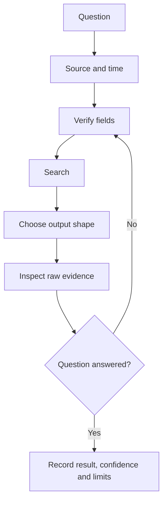
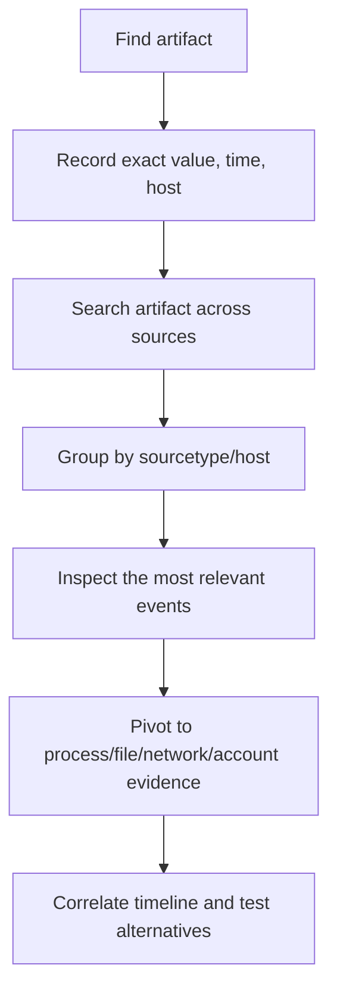
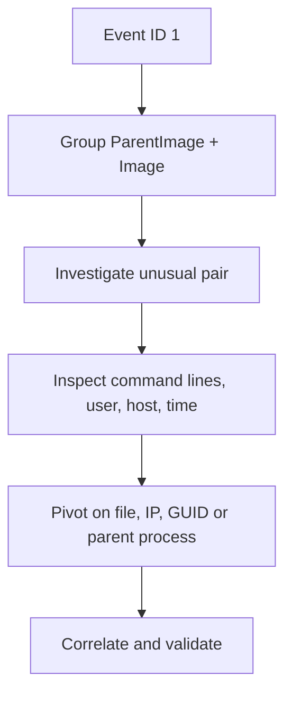
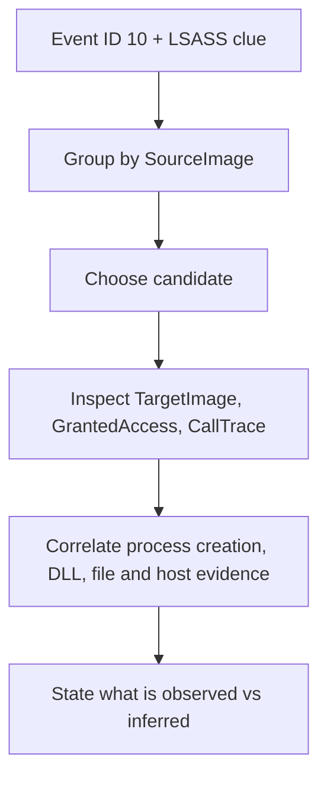

# SPL Grammar — Quick Reference

> **Core sequence:** scope → filter → discover/verify fields → transform → aggregate/correlate → validate.
>
> Use classic SPL syntax from your HTB lab. Confirm the field names in real events; this card does not guarantee a schema.

## 1. Read any SPL query left to right

```
index="main" sourcetype="WinEventLog:Sysmon" EventCode=1
| stats count by ParentImage, Image
| sort - count
```

- Before `|`: select matching events.
- `|`: pass results to the next command.
- `stats`: command.
- `count`: calculation/function.
- `by ParentImage, Image`: grouping keys.
- `sort - count`: descending count order.
- After `stats`, raw event fields not grouped/aggregated usually disappear.

## 2. Basic grammar

```
FIELD OPERATOR VALUE
| COMMAND ARGUMENTS
```

| Syntax | Meaning |
|---|---|
| `field=value` | Match a field to a value |
| `field!=value` | Exclude a value; check missing-field behaviour |
| `AND` | Both conditions required |
| `OR` | Either alternative can match |
| `NOT` | Exclude matching condition |
| `(A OR B)` | Make the grouping explicit |
| `*` | Wildcard in ordinary classic search field matching |
| `"phrase here"` | Quote a string/phrase when needed |
| Pipe separator | Pass results to the next command |
| `AS` | Give an output field an alias |

For `where`, use eval-expression rules. To match wildcard-like strings inside classic `where`, use `like(field, "%pattern%")` rather than blindly pasting the search wildcard syntax.

## 3. Dataset words

| Term | Meaning |
|---|---|
| `index` | Searchable data store |
| `sourcetype` | Type/format of log data |
| `source` | Input/file/channel context |
| `host` | Host metadata value |
| `_time` | Event timestamp |
| `_raw` | Raw event text |
| `field` | Extracted attribute of the event |

`host` is not guaranteed to equal `ComputerName`; inspect the event. Fields may vary by sourcetype and configuration.

## 4. Discover data and fields

```
index="main" earliest=0
```

```
index="main" | stats count by sourcetype | sort - count
```

```
index="main" sourcetype="WinEventLog:Sysmon" | stats count by EventCode | sort - count
```

```
index="main" sourcetype="WinEventLog:Sysmon" EventCode=1 | fieldsummary
```

```
index="main" sourcetype="WinEventLog:Sysmon" EventCode=1
| table _time, host, ComputerName, User, ParentImage, Image, CommandLine, _raw
```

If a field is blank: inspect `_raw`, field spelling, event type, time range, and whether an earlier command removed it.

## 5. Pick the command from the question

| Need | Pattern |
|---|---|
| Raw evidence | `table _time, host, User, Image, CommandLine` after the pipe |
| Count events | `stats count` after the pipe |
| Count per field | `stats count by Image`, then `sort - count` |
| Unique values | `stats dc(ComputerName) AS unique_hosts` |
| Count combinations | `stats count by ParentImage, Image` |
| Filter with field comparison | `where SourceImage!=TargetImage` after the pipe |
| Create/normalise field | `eval image_lower=lower(Image)` after the pipe |
| String length | `eval cmd_len=len(CommandLine)` after the pipe |
| First/last time | `stats min(_time) AS first max(_time) AS last by User` |
| Duration filter | `eval duration=last-first`, then `where duration < 600` |
| Bucket time | `bin _time span=1h`, then `stats count by _time, Image` |
| Extract text | `rex field=Image "<named capture regex>"` after the pipe |
| Enrich with lookup | `lookup table.csv key OUTPUT label` after the pipe |
| Most common | `top Image` or `stats count by Image`, then `sort - count` |
| Uncommon values | `rare Image` — rare does not mean malicious |

## 6. Know the important differences

- `count` = event/row volume; `dc(Field)` = number of distinct values.
- `dedup Field` = keep a representative row per value; it does **not** count frequency.
- `stats` = collapses to summary rows; `eventstats` = adds aggregates to event rows; `streamstats` = running/windowed calculation.
- `search` = common field/value filtering; `where` = eval-style expression and field-to-field comparison.
- `rex` = extract a field; `regex` = filter by pattern.
- `table` = display columns; `fields` = keep/remove fields for downstream stages.
- `host` versus `ComputerName`: related, not guaranteed to be identical.
- `Image` versus `SourceImage`/`TargetImage`/`ImageLoaded`: event-type dependent roles.
- A frequent or rare value is a lead; neither is proof of maliciousness.

## 7. Event ID compass from the HTB notes

| Sysmon ID | Description | First investigative fields to check |
|---:|---|---|
| 1 | Process creation | `Image`, `ParentImage`, `CommandLine`, `ParentCommandLine`, user/host, process GUIDs |
| 3 | Network connection | `Image`, source/destination IP and ports, protocol, initiated |
| 7 | Image/DLL load | Process `Image`, `ImageLoaded` |
| 10 | Process access | `SourceImage`, `TargetImage`, `GrantedAccess`, `CallTrace`, process IDs |
| 11 | File creation | `TargetFilename`, `Image`, user/host |
| 12/13 | Registry changes | `TargetObject`, `Details`, `Image` |
| 22 | DNS query | `QueryName`, `Image`, user/host |
| 4624 (Security) | Successful logon in HTB examples | Account field, computer/host, logon type/IP if present |
| 4662 (Security) | Directory-service object access in HTB lesson | `Access_Mask`, raw properties/GUIDs, subject/object fields |

Verify event IDs and fields against the current sourcetype and raw event.

## 8. Investigation maps

### General hunt



### Pivoting



### Process tree



### LSASS access (do not treat the first result as proof)



## 9. Safe patterns for first-pass investigation

### Process-parent relationships

```spl
index="main" sourcetype="WinEventLog:Sysmon" EventCode=1
| stats count by ParentImage, Image
| sort - count
```

### Cross-source pivot

```spl
index="main" "<artifact>"
| stats count by sourcetype, host
| sort - count
```

### Process access inventory

```spl
index="main" EventCode=10 <relevant keyword>
| stats count by SourceImage
| sort - count
```

### Distinct DLL/image count by process/time bucket

```spl
index="main" EventCode=7
| bin _time span=1h
| stats dc(ImageLoaded) AS unique_images by _time, Image
| sort - _time
```

### Command line length

```spl
index="main" sourcetype="WinEventLog:Sysmon" Image="*cmd.exe*"
| eval command_length=len(CommandLine)
| table _time, host, User, ParentImage, command_length, CommandLine
| sort - command_length
```

Replace placeholders and validate field availability before use.

## 10. Debugging order

### Zero results
1. Undo last filter.
2. Check time picker and `earliest`/`latest`.
3. Check index and sourcetype.
4. Check event code field/value.
5. Inspect `_raw` and field names.
6. Test exact values, then broaden carefully.
7. Add one condition at a time.

### Too many results
1. Add known sourcetype/event code.
2. Use a field-specific filter rather than raw-text search.
3. Narrow by host/user/process/IP/path/time.
4. Aggregate at the right row grain.

### Slow search
- Avoid unnecessary leading wildcards and `table *` on wide data.
- Prefer `stats` for simple summaries instead of `transaction`.
- Limit exploration time range, but restore the required final scope.

### Wrong count
- Are you counting events or unique values?
- Did `by` create extra groups?
- Did you group by exact time instead of bucket time?
- Did `dedup` remove repetitions?
- Did an earlier stage remove the field?

## 11. The ten-second pre-submit checklist

- [ ] I translated the question into a specific metric/output.
- [ ] I verified the source, event code, time range and field names.
- [ ] I know what one output row represents.
- [ ] I used `count` versus `dc()` correctly.
- [ ] I checked what fields survive each pipeline stage.
- [ ] I inspected underlying events for the winning result.
- [ ] I considered at least one benign alternative or data limitation.

## 12. Official references

- [About the Splunk search language](https://help.splunk.com/en/splunk-enterprise/search/search-manual/10.2/search-overview/about-the-search-language)
- [Classic SPL `search`](https://help.splunk.com/en/splunk-cloud-platform/search/search-reference/10.6/search-commands/search)
- [Classic SPL `where`](https://help.splunk.com/en/splunk-enterprise/spl-search-reference/10.4/search-commands/where)
- [`stats` and statistical functions](https://help.splunk.com/en/splunk-enterprise/search/search-manual/10.0/calculate-statistics/use-the-stats-command-and-functions)
- [`eval`](https://help.splunk.com/en/splunk-enterprise/spl-search-reference/9.0/search-commands/eval)
- [Command quick reference](https://help.splunk.com/en/splunk-enterprise/search/spl-search-reference/9.1/quick-reference/command-quick-reference)
- [Microsoft Sysmon](https://learn.microsoft.com/en-us/sysinternals/downloads/sysmon)
