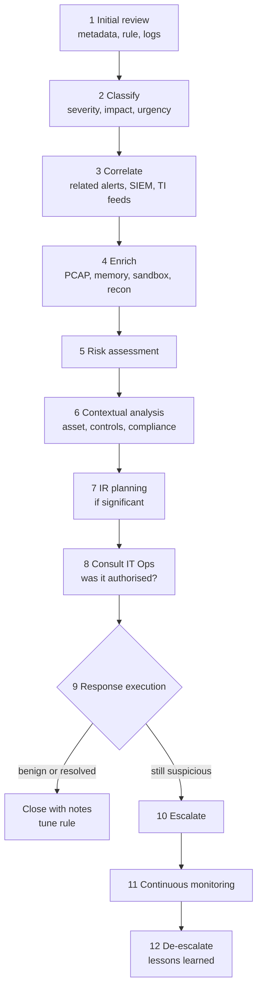

# 🛰️ SIEM Mastery Field Manual
> *From "I clicked the buttons" → "I know what Elasticsearch does when I click them."*

> [!abstract] What this note is
> A rebuilt, exhaustive study version of the HTB Academy text. The source is **9 exported pages, but only ~7 distinct sections** (Example 1 and Example 3 are each duplicated, the Triaging Process is duplicated). This note de-duplicates, then goes **under** the UI: fields, queries, aggregations, Windows internals, attacker evasion, detection logic.

## 🧭 Map
- [0 How to use this note (L1 / L2 / L3)](SIEM-Mastery-Field-Manual.md#0%20How%20to%20use%20this%20note%20(L1%20/%20L2%20/%20L3))
- [0.5 Critical clarification KQL is not one language](SIEM-Mastery-Field-Manual.md#0.5%20Critical%20clarification%20KQL%20is%20not%20one%20language)
- [1 The Microscopic Glossary](SIEM-Mastery-Field-Manual.md#1%20The%20Microscopic%20Glossary)
- [2 Log Anatomy & Fields Breakdown](SIEM-Mastery-Field-Manual.md#2%20Log%20Anatomy%20&%20Fields%20Breakdown)
- [3 The Machinery](SIEM-Mastery-Field-Manual.md#3%20The%20Machinery)
- [4 The What-If Scenarios](SIEM-Mastery-Field-Manual.md#4%20The%20What-If%20Scenarios)
- [5 First-Principles Mastery](SIEM-Mastery-Field-Manual.md#5%20First-Principles%20Mastery)
- [6 The Dotted-Field Decoder (KQL lab)](SIEM-Mastery-Field-Manual.md#6%20The%20Dotted-Field%20Decoder%20(KQL%20lab))
- [7 Assessment Walkthrough Eagle SOC](SIEM-Mastery-Field-Manual.md#7%20Assessment%20Walkthrough%20Eagle%20SOC)
- [8 L3 Teach-Back Kit (ELI5 + flashcards)](SIEM-Mastery-Field-Manual.md#8%20L3%20Teach-Back%20Kit%20(ELI5%20+%20flashcards))
- [9 Caveats & things the source text simplifies](SIEM-Mastery-Field-Manual.md#9%20Caveats%20&%20things%20the%20source%20text%20simplifies)

---

## 0 How to use this note (L1 / L2 / L3)

| Level | Meaning | Test |
|---|---|---|
| **L1** | You can repeat it | "What is 4625?" → "Failed logon." |
| **L2** | You can explain mechanism | "Why `.keyword` for aggregations?" → inverted index vs doc values |
| **L3** | You can teach it to a 5-year-old **and** predict how it breaks | "What happens if the field is missing / attacker renames the account?" |

Every glossary term below has an **ELI5** line. Section 8 has the full teach-back scripts.

### 🏙️ The master analogy (reused everywhere)
**A SIEM is a city's security control room.**

| Real thing | City analogy |
|---|---|
| Windows/Linux machine | A building |
| Log / event | A page in the building guard's notebook ("someone tried the door and failed") |
| Log shipper (agent) | A courier who photocopies notebook pages and drives them to HQ |
| Elasticsearch | A giant library that files every page on index cards so it can be found instantly |
| Index (`windows*`) | The "Windows buildings" shelf in the library |
| Field | One labelled box on the page: *who*, *where*, *when*, *what number* |
| Kibana | The wall of TV screens in the control room |
| Dashboard | One TV screen group; Visualization = one chart on it |
| KQL | The sentence you whisper to the librarian: "show me pages where *who* starts with svc-" |
| Alert | A flashing light |
| Triage | The night-shift guard deciding: "real burglar, stray cat, or janitor?" |
| Escalation | Calling the chief |

---

## 0.5 Critical clarification: KQL is not one language

> [!warning] Two completely different "KQL"s
> | | **Kibana Query Language** (this module) | **Kusto Query Language** |
> |---|---|---|
> | Where | Kibana search bar over Elasticsearch | Microsoft Sentinel, Defender XDR, Azure Data Explorer |
> | Style | Tiny filter syntax: `field: value and not other: x` | Full pipeline language: `Table \| where ... \| summarize ...` |
> | Aggregation | **Not in the query** — done by the visualization (Lens "Rows/Metrics") | **In the query** (`summarize count() by User`) |
> | Field names | Dotted ECS paths: `user.name`, `winlog.event_data.SubStatus` | Flat/column names: `Account`, `EventID`, `TargetUserName` |
>
> The text uses **Kibana KQL**. If your target job (SOC Analyst, Bahrain) uses Sentinel, you will need Kusto too — the *concepts* (fields, filters, group-by-count) transfer 1:1; the *syntax* does not. Elastic's other languages: **Lucene** (older query bar mode), **EQL** (sequences), **ES|QL** (pipe language), **Query DSL** (JSON; what Kibana actually sends).

---

## 1 The Microscopic Glossary

> [!info] Legend
> Each term: **Under the hood** → **Why a SOC analyst cares** → **Connects to** → **ELI5**. Terms are grouped in 4 blocks: **A** platform/UI, **B** data & search engine, **C** Windows/Linux security concepts, **D** SOC process & environment.
> Items marked *(implied)* are not literally in the text but are required to understand it.

### A · Platform & UI terms

#### SIEM
- **Under the hood:** Security Information & Event Management = (1) log collection, (2) normalisation into a common schema, (3) indexed storage, (4) search, (5) correlation/alert rules, (6) dashboards, (7) case/triage workflow. Here the SIEM is the **Elastic Stack** (Elasticsearch + Kibana).
- **Why SOC cares:** Single place to ask "what happened across 5,000 machines?" in seconds instead of RDP-ing into each one.
- **Connects to:** [Elasticsearch](SIEM-Mastery-Field-Manual.md#Elasticsearch), [Kibana](SIEM-Mastery-Field-Manual.md#Kibana), [Index / Index pattern / Data view](SIEM-Mastery-Field-Manual.md#Index%20/%20Index%20pattern%20/%20Data%20view).
- **ELI5:** One giant notebook where every building in town writes down what happened, and you can search it with one question.

#### Kibana (port `5601`) ==🟡"its like a backEnd "==
- **Under the hood:** A web app (Node.js) that talks to Elasticsearch's REST API (port `9200`). It stores *its own* objects (dashboards, data views, saved searches) in the hidden `.kibana*` indices. `http://[Target IP]:5601` is just Kibana's HTTP listener.
- **Why SOC cares:** It is your window: Discover (raw events), Dashboards, Lens, Alerts, Security app.
- **Connects to:** [Elasticsearch](SIEM-Mastery-Field-Manual.md#Elasticsearch), [Dashboard](SIEM-Mastery-Field-Manual.md#Dashboard), [Lens](SIEM-Mastery-Field-Manual.md#Lens).
- **ELI5:** The TV screen. The library (Elasticsearch) does the finding, Kibana draws the pictures.

#### Elasticsearch / Elastic
- **Under the hood:** A distributed ==🟡search engine== built on Lucene. Documents (JSON) are stored in **shards**; each text field is turned into an **inverted index** (word → list of documents) and each keyword/number field also gets **doc values** (column-oriented, for sorting/aggregating).
- **Why SOC cares:** Millisecond search over billions of events; every dashboard number is an Elasticsearch **aggregation**.
- **Connects to:** [Text vs keyword and .keyword](SIEM-Mastery-Field-Manual.md#Text%20vs%20keyword%20and%20.keyword), [Aggregation](SIEM-Mastery-Field-Manual.md#Aggregation), [Index / Index pattern / Data view](SIEM-Mastery-Field-Manual.md#Index%20/%20Index%20pattern%20/%20Data%20view).
- **ELI5:** A librarian with a magic card catalogue who can instantly say "these 50 pages mention a failed door-knock."

#### Dashboard
- **Under the hood:** A saved object (JSON in `.kibana`) = a grid of **panels** + optional global filters/time. Not data — only *instructions* for what to ask Elasticsearch.
- **Why SOC cares:** A wall of "what is abnormal right now"; the Eagle assessment dashboard `SOC-Alerts` has 7 panels.
- **Connects to:** [Visualization / Panel](SIEM-Mastery-Field-Manual.md#Visualization%20/%20Panel), [Time picker](SIEM-Mastery-Field-Manual.md#Time%20picker), [Saved objects](SIEM-Mastery-Field-Manual.md#Saved%20objects).
- **ELI5:** A poster board where you pin several charts.

#### Visualization / Panel
- **Under the hood:** One chart/table definition = {index/data view, filters, query, buckets (Rows/Columns), metric}. Rendered by re-running the aggregation every refresh.
- **Why SOC cares:** Each one answers exactly one detection question ("failed logons by user and host").
- **ELI5:** One picture on the poster board.

#### Lens
- **Under the hood:** Kibana's drag-and-drop visualization editor ("Edit lens"). It *generates* Elasticsearch aggregation JSON for you (see [3 The Machinery](SIEM-Mastery-Field-Manual.md#3%20The%20Machinery) for the exact DSL).
- **Why SOC cares:** Fast iteration; "Inspect → Requests" shows the real query — your bridge to Query DSL.
- **ELI5:** LEGO instructions where you click bricks and it builds the question for the librarian.

#### Table (visualization type) / Metric / Bar vertical stacked
- **Under the hood:** *Table* = flat grid, one row per unique combination of bucket values. *Metric* = a single big number. *Bar vertical stacked* = time/category on X, stacked segments by breakdown.
- **Why SOC cares:** Tables are the best for **who/where/how many** triage; bars for **when** (spikes).
- **ELI5:** Table = a list on paper. Bar = a skyscraper chart.

#### Rows / Columns / Metrics (Lens table slots)
- **Under the hood:** **Rows** and **Columns** = *bucket aggregations* (group-by). **Metrics** = *metric aggregation* computed per bucket. Multiple Rows = **nested** group-bys: user → within each user, host → within each host, logon type.
- **Why SOC cares:** The order of Rows changes which rows survive the top-N cut-off (see [Top values (terms aggregation) and Rank by](SIEM-Mastery-Field-Manual.md#Top%20values%20(terms%20aggregation)%20and%20Rank%20by)).
- **Connects to:** [Aggregation](SIEM-Mastery-Field-Manual.md#Aggregation), [Count of records](SIEM-Mastery-Field-Manual.md#Count%20of%20records).
- **ELI5:** Sort the toy box: first by colour (row 1), then by size within each colour (row 2), then count how many in each pile (metric).

#### Time picker (calendar icon, "last 15 years", Apply)
- **Under the hood:** A `range` filter on `@timestamp` added to every query: `@timestamp >= now-15y`. Relative ("last 15 years") is evaluated against the **browser's clock**; absolute is fixed dates.
- **Why SOC cares:** Default is *last 15 minutes* — lab/old data shows **"No results"** and you wrongly conclude "nothing happened". The text sets 15 years to cover historic lab events.
- **Connects to:** [@timestamp](SIEM-Mastery-Field-Manual.md#@timestamp), [Bucket](SIEM-Mastery-Field-Manual.md#Bucket).
- **ELI5:** "Only show me notebook pages written between these dates."

#### Add filter (filter pills)
- **Under the hood:** Structured conditions (Field – Operator – Value) saved as Query DSL fragments: `is` → `match_phrase`, `is not` → negated, `is one of`, `exists`, etc. ANDed with the KQL bar. Can be **pinned**, **disabled**, **negated**.
- **Why SOC cares:** Reproducible, clickable scoping (`event.code is 4625`). Different from KQL: filters are per-field GUI conditions, KQL is typed text.
- **ELI5:** Sticker rules on the screen: "only show pages with this stamp."

#### Search bar / KQL bar / "Update" button
- **Under the hood:** Free-text KQL parsed by Kibana into DSL. "Update" re-runs. See [0.5 Critical clarification KQL is not one language](SIEM-Mastery-Field-Manual.md#0.5%20Critical%20clarification%20KQL%20is%20not%20one%20language) and [6 The Dotted-Field Decoder (KQL lab)](SIEM-Mastery-Field-Manual.md#6%20The%20Dotted-Field%20Decoder%20(KQL%20lab)).
- **ELI5:** Where you type your question to the librarian.

#### Field search box (left sidebar: "user.")
- **Under the hood:** Lists fields known from the data view's **field list** (mapping + sampled docs). Typing `user.` returns `user.name`, `user.name.keyword`, `related.user.keyword`…
- **Why SOC cares:** The text calls it a way to "double-check the existence of a field." Existence in the field list ≠ field is populated in *your* events — confirm in Discover on a real document.
- **ELI5:** The index at the back of the book: does the word even exist?

#### Display name / Text alignment / Sorting / Panel title
- **Under the hood:** Pure presentation metadata in the saved object (column header `Username`, `Event logged by`, `# of logins`; right-align numbers; click header to sort).
- **Why SOC cares:** Clear naming = faster triage and fewer misreads. Note the text's rename **"Event logged by"** for `host.hostname` — it is the *reporter*, not the attacker's source.
- **ELI5:** Giving the columns friendly name tags.

#### Save and return / Save / "Store time with dashboard"
- **Under the hood:** *Save and return* = commit panel into the (unsaved) dashboard. *Save* = persist dashboard saved object. *Store time* = embed the time range in the dashboard so it always opens on it.
- **Why SOC cares:** Forgetting *Save* loses all edits (the text reminds you twice).

#### Edit lens / Clone panel / Customize panel / Create drilldown / Add from library
- **Under the hood:** Panel-level menu (gear). **Customize panel** can set a **panel-specific time range** (Example 4: from March 5 2023). **Drilldown** = click-through to Discover/another dashboard with context. **Library** = reusable saved visualizations.
- **ELI5:** Photocopy a chart, rename it, or set a link: "click here to see the details."

#### Saved objects
- **Under the hood:** Dashboards, data views, searches stored as JSON documents in `.kibana`. Exportable (NDJSON) and version-controllable.
- **Why SOC cares:** Detection content as code; share dashboards across SOCs.

#### SOC-Alerts (dashboard name)
- A pre-baked dashboard with 7 panels in the assessment (see [7 Assessment Walkthrough Eagle SOC](SIEM-Mastery-Field-Manual.md#7%20Assessment%20Walkthrough%20Eagle%20SOC)). The lab says reset the target if you deleted it.

### B · Data & search-engine terms

#### Index / Index pattern / Data view (`windows*`)
- **Under the hood:** An **index** is a named collection of documents (e.g., `winlogbeat-2023.03.05`). An **index pattern** (renamed **data view** in newer Kibana) is a Kibana-side wildcard `windows*` that says "query all indices whose name starts with `windows`". The text: *"data from various infrastructure sources is separated into different indices: network, Windows, Linux."*
- **Why SOC cares:** Wrong data view = wrong/empty data. Linux SSH events (assessment Viz 7) live in a *different* index than Windows ones.
- **Connects to:** [Field](SIEM-Mastery-Field-Manual.md#Field), [ECS](SIEM-Mastery-Field-Manual.md#ECS).
- **ELI5:** Which shelf in the library you search: "Windows shelf" or "Linux shelf".

#### Field
- **Under the hood:** A named key in the JSON document with a mapped type (`keyword`, `text`, `ip`, `date`, `long`…). Dots in names express a hierarchy (see [6 The Dotted-Field Decoder (KQL lab)](SIEM-Mastery-Field-Manual.md#6%20The%20Dotted-Field%20Decoder%20(KQL%20lab))).
- **ELI5:** One labelled box on the notebook page.

#### Mapping (implied)
- **Under the hood:** The schema: field → type + analyzer + sub-fields. Created explicitly (templates) or **dynamically** (Elasticsearch guesses). Dynamic mapping of a string produces **`text` + `.keyword` sub-field** — that is why this lab has `.keyword` fields.

#### Text vs keyword and `.keyword`
- **Under the hood:** 
  - **`text`**: analysed — lower-cased, tokenised (`svc-SQL1` → tokens like `svc`, `sql1`), stored in an inverted index for *full-text search*. **No doc values** → cannot be aggregated/sorted by default (fielddata off).
  - **`keyword`**: stored **exactly as-is** (case-sensitive, not split), has **doc values** → exact match, group-by, sort.
  - **`.keyword`**: the auto-created keyword *sub-field* of a text field (`user.name` is text; `user.name.keyword` is the exact copy). Dynamic mapping sets `ignore_above: 256` → **values longer than 256 chars are not indexed in `.keyword`** (silently).
- **Why SOC cares:** The text's rule: **aggregations (Rows) use `.keyword`; KQL queries use the base name.** Misuse = empty table or ignored field.
- **ELI5:** `user.name` = a sentence cut into words so you can search by word. `user.name.keyword` = the whole name taped to a jar, exactly spelled, so you can sort jars and count them.

> [!tip] ECS-compliant mapping note
> In a properly ECS-mapped index, `user.name` is **already `keyword`** and `.keyword` does not exist. `.keyword` appearing in this lab is a sign of **dynamic mapping**. In real SOCs you'll see both worlds — always look at the field list.

#### ECS (Elastic Common Schema) (implied)
- **Under the hood:** A naming standard: `event.*`, `user.*`, `host.*`, `source.*`, `destination.*`, `process.*`, `file.*`, `related.*`, `group.*`… so a rule for `source.ip` works on firewall, Windows and Linux logs.
- **Why SOC cares:** `event.code`, `user.name`, `host.name`, `group.name`, `event.action`, `related.ip` in the text are ECS fields. `winlog.*` is Winlogbeat-specific (non-ECS).
- **ELI5:** Everyone agrees to call the "who" box `user.name`, no matter which building wrote the page.

#### Normalisation / Parsing (implied)
- Raw event → structured fields. See [3 The Machinery](SIEM-Mastery-Field-Manual.md#3%20The%20Machinery).

#### Aggregation
- **Under the hood:** A computation over matching documents: **bucket aggs** (group docs: `terms`, `date_histogram`) and **metric aggs** (`value_count`, `avg`, `cardinality`). A Lens table = nested `terms` + a count.
- **Why SOC cares:** Detection thresholds (≥ N failures) are aggregations. Doc quote: *"We should use `.keyword` when it comes to aggregations."*
- **ELI5:** Counting: "put the pages in piles by person, tell me the pile sizes."

#### Bucket
- **Under the hood:** One group produced by a bucket agg (one username; one 1-day time slice). The text's Example 4 note: Elasticsearch uses buckets; with a relative range the **date interval auto-adjusts** (e.g., weekly instead of daily) so the number of bars stays near the target (defaults ≈ 50, max 100). **Use an absolute range for predictable buckets.**
- **ELI5:** One pile.

#### Top values of … (terms aggregation), "number of values 1000", "Rank by"
- **Under the hood:** `terms` agg returns the **top N** distinct values ranked by `_count` (Count of records), alphabetically (`_key`), or by a metric. The text sets **N = 1000**. Multi-shard terms aggs are *approximate* for high cardinality.
- **Why SOC cares:** If 5,000 distinct usernames exist, you see only 1000 → the 1001st (maybe the attacker) is invisible. "Rank by Alphabetical" first, "Count of records" after adding the metric (the text's Note).
- **Connects to:** [Count of records](SIEM-Mastery-Field-Manual.md#Count%20of%20records), [Rows / Columns / Metrics (Lens table slots)](SIEM-Mastery-Field-Manual.md#Rows%20/%20Columns%20/%20Metrics%20(Lens%20table%20slots)).
- **ELI5:** "Show me the 1000 biggest piles."

#### Count of records
- **Under the hood:** `doc_count` of each bucket = number of matching events (**not** number of *unique* users — that's `cardinality` / "Unique count"). Renamed `# of logins` via Display name.
- **Why SOC cares:** The text calls it `# of logins`, but in Example 1 it counts **failed** attempts. Naming matters: count of what?
- **ELI5:** How many pages are in the pile.

#### Query DSL (implied)
- The JSON that Kibana sends to Elasticsearch. See the full example in [3 The Machinery](SIEM-Mastery-Field-Manual.md#3%20The%20Machinery).

#### @timestamp (implied)
- The event time field (UTC, ISO 8601 / epoch ms). Time picker filters on it. See [2 Log Anatomy & Fields Breakdown](SIEM-Mastery-Field-Manual.md#2%20Log%20Anatomy%20&%20Fields%20Breakdown).

### C · Windows / Linux / security concepts

#### Windows Security Event Log, Event ID, `event.code`
- **Under the hood:** The Windows **EventLog service** writes audit records to `Security.evtx` (a binary XML log). Each record has an **EventID** (the "type of thing that happened") plus `EventData` name/value pairs. The audit policy decides whether it is written at all.
- **Why SOC cares:** Event IDs are the vocabulary of Windows detections.
- **Connects to:** [Event 4625](SIEM-Mastery-Field-Manual.md#Event%204625), [Event 4624](SIEM-Mastery-Field-Manual.md#Event%204624), [Event 4732 / 4733](SIEM-Mastery-Field-Manual.md#Event%204732%20/%204733).
- **ELI5:** Each type of thing that happens has a number stamp. 4625 = "door knock failed."

#### Event 4625 — An account failed to log on
- **Under the hood:** Logged on the machine that **was asked to authenticate** (the target host, or a DC for domain accounts). Key EventData: `TargetUserName`, `TargetDomainName`, `LogonType`, `Status`, `SubStatus`, `IpAddress`, `IpPort`, `WorkstationName`, `LogonProcessName`, `AuthenticationPackageName`.
- **Why SOC cares:** Brute force, password spraying, user enumeration, disabled/locked account probing.
- **Connects to:** [SubStatus 0xC0000072](SIEM-Mastery-Field-Manual.md#SubStatus%200xC0000072), [Logon type](SIEM-Mastery-Field-Manual.md#Logon%20type), [Brute force vs spraying vs stuffing](SIEM-Mastery-Field-Manual.md#Brute%20force%20vs%20spraying%20vs%20stuffing).
- **ELI5:** "Somebody tried the door key and it didn't work."

#### Event 4624 — An account was successfully logged on
- **Under the hood:** Creates a **logon session** (a `TargetLogonId`) with an access token. Fields: `LogonType`, `TargetUserName`, `IpAddress`, `WorkstationName`, `AuthenticationPackageName` (NTLM/Kerberos), `LogonProcessName`, `ElevatedToken`.
- **Why SOC cares:** Success after many 4625s = compromise. RDP by service account = anomaly (Example 3).
- **ELI5:** "The key worked, the door opened."

#### Event 4732 / 4733 — Member added to / removed from a security-enabled **local** group
- **Under the hood:** Fields: `MemberSid` (who was added/removed — **a SID**, `MemberName` often `-`), `TargetUserName` (group name), `TargetSid` (group SID, Administrators = `S-1-5-32-544`), `Subject*` (**the actor who made the change**). Local groups live in the machine's SAM (or AD for domain-local groups on DCs).
- **Why SOC cares:** Classic **persistence/privilege escalation**: attacker adds their account to local Administrators.
- **ELI5:** "Someone was invited into (or kicked out of) the VIP club."

#### SubStatus `0xC0000072`
- **Under the hood:** An **NTSTATUS** code. `0xC0000072` = `STATUS_ACCOUNT_DISABLED`. Bit layout: top bits `11` (`0xC`) = **error** severity; low word `0x0072` = specific reason. `Status` (e.g., `0xC000006D` = logon failure) is the *general* reason, `SubStatus` the *precise* one. Per the text, the "disabled" SubStatus appears when the **right credentials** were supplied — implying the account is real and the password is correct (so the account/password pair is *valid but disabled* — high-value intel for an attacker, and high-signal for you).
- **Connects to:** [Event 4625](SIEM-Mastery-Field-Manual.md#Event%204625).
- **ELI5:** The guard's note says *why* the key failed: "this key belongs to someone who's been put on a break."

#### Logon type
- **Under the hood:** Numeric `LogonType` in 4624/4625; Winlogbeat also gives a **name** in `winlog.logon.type`.

| # | Name | Typical cause |
|---|---|---|
| 2 | Interactive | Console/keyboard |
| 3 | Network | SMB, WinRM, PsExec, NLA pre-auth |
| 4 | Batch | Scheduled task |
| 5 | Service | A service starting |
| 7 | Unlock | Workstation unlock / **RDP session reconnect** |
| 8 | NetworkCleartext | IIS basic auth etc. |
| 9 | NewCredentials | `runas /netonly` |
| **10** | **RemoteInteractive** | **RDP / Terminal Services** |
| 11 | CachedInteractive | Offline cached domain creds |

- **Why SOC cares:** The type tells *how* you got in. Text filters `winlog.logon.type is RemoteInteractive` (= 10 = RDP) and **adds Logon Type as a column** in Example 1 refinements.
- **ELI5:** *Which door* was used: front door (keyboard), phone intercom (network), back-yard gate (RDP).

#### RDP (Remote Desktop Protocol) / RemoteInteractive
- **Under the hood:** Microsoft's remote GUI protocol, default **TCP 3389**, usually wrapped in TLS with **NLA** (CredSSP) so credentials are checked *before* a session is created.
- **Why SOC cares:** Most common intrusion/lateral-movement path; admins should use the PAW. See [First-principles RDP and NLA](SIEM-Mastery-Field-Manual.md#First-principles%20RDP%20and%20NLA) in Section 5.
- **ELI5:** Remote control of a computer's screen from far away.

#### Service account (`svc-`, `-svc`, `sql-svc1`, `svc-sql1`)
- **Under the hood:** A non-human identity that runs a service/scheduled task, often with high privilege and a long complex password that never expires. Does *not* normally log on interactively.
- **Why SOC cares:** **Any interactive/RDP logon by a service account is anomalous.** The text: *"Service account credentials are never used for RDP logons in corporate environments."*
- **Connects to:** [Naming convention](SIEM-Mastery-Field-Manual.md#Naming%20convention), [Logon type](SIEM-Mastery-Field-Manual.md#Logon%20type).
- **ELI5:** A robot janitor with a master key. It should never sit at the front desk.

#### Computer account (name ends with `$`)
- **Under the hood:** Every domain-joined machine has an AD account `HOSTNAME$`. It authenticates constantly (Kerberos, SMB) → huge noise. KQL `NOT user.name: *$` removes them.
- **Why SOC cares:** Noise reduction. Trade-off: machine accounts *are* abused (relay, delegation, ticket forging) and an attacker-created account named `x$` hides from this filter (see [4 The What-If Scenarios](SIEM-Mastery-Field-Manual.md#4%20The%20What-If%20Scenarios)).
- **ELI5:** The buildings themselves have name tags ending in `$`; we ignore them to focus on people.

#### Disabled account
- A valid account flagged `ACCOUNTDISABLE` in AD/SAM. It can **never** log on, even with a correct password, so a logon attempt is always a **4625** (never 4624). Used by terminated employees, default accounts (Guest), staged attacker accounts.
- **ELI5:** A badge that was deactivated; swiping it always fails, but *someone still tried*.

#### SID (Security Identifier) — `MemberSid`
- **Under the hood:** Immutable ID like `S-1-5-21-<domain/machine>-<RID>`. Names can change; SIDs don't. RID 500 = built-in Administrator; 1000+ = created accounts. Well-known: `S-1-5-32-544` = local Administrators.
- **Why SOC cares:** 4732 gives a **SID, not a name**. In the assessment an unknown person appears "only represented by SID" → you must **resolve** it (AD lookup, `Get-ADObject`, compare domain prefix).
- **ELI5:** A person's fingerprint number — doesn't change if they change their name.

#### Local group "Administrators"
- Group giving full control on one machine. Membership change = high-value event.
- **ELI5:** The "boss's list" for one building.

#### Domain Controller (DC)
- The AD server that authenticates domain logons; logs 4624/4625/4768/4769/4776 for domain activity. In the assessment, admin logons should happen on **PAWs or DCs only**.

#### PAW (Privileged Access Workstation)
- A hardened dedicated machine from which admins perform admin tasks. **Detection logic:** admin logon from anywhere else = anomaly (Viz 3 and Viz 6).
- **ELI5:** The one special clean room where the doctor operates; operating anywhere else is suspicious.

#### Default administrator account
- Built-in `Administrator` (RID 500); the text warns IT often uses it despite policy → noisy but also a **policy violation signal** and attractive attacker target (can't be locked out by default in some configs).

#### DMZ (demilitarised zone)
- A network segment between Internet and internal LAN hosting public servers. The text: *closed down, no servers exist there* → **any DMZ-sourced activity is anomalous**.

#### CIS hardening baselines
- Center for Internet Security configuration benchmarks (disable legacy protocols, tighten audit policy, etc.). Hardened endpoints → fewer false positives, and *deviations* are suspicious.

#### Whitelisting (application allow-listing)
- Only approved executables run (AppLocker/WDAC). "Limited extent" = gaps attackers use (living-off-the-land binaries).

#### Naming convention
- Predictable account/host names (`svc-`, `-svc`) let **detection by pattern** work, and let you spot violations. See the trap in [7 Assessment Walkthrough Eagle SOC](SIEM-Mastery-Field-Manual.md#7%20Assessment%20Walkthrough%20Eagle%20SOC): Example 3 hunts `svc-*` but the assessment convention is `*-svc` (e.g., `sql-svc1`).

#### Linux: `root`, `sudo`, SSH
- `root` = UID 0, unlimited power. Remote root login is **blocked** (`PermitRootLogin no`), so users log in as themselves and elevate with **`sudo`** (logged in `auth.log`/journal). A **successful remote root SSH login = impossible in a healthy environment → critical alert** (Viz 7).
- **ELI5:** Root is the king's key. Nobody may knock on the front gate as king; you must enter as a normal person and ask permission (sudo).

#### Brute force vs spraying vs stuffing
- **Brute force:** many passwords against **one** account → many 4625 for one `user.name`.
- **Spraying:** one/few passwords against **many** accounts (to stay below lockout) → many `user.name` from one `source.ip`/host.
- **Credential stuffing:** leaked username:password pairs from other breaches.
- The text: look for *"a single user with numerous failed attempts or various users connecting to (or from) the same endpoint."*

#### Lateral movement / IOC / Indicators
- **Lateral movement:** attacker hopping from machine to machine with stolen creds (RDP, SMB, WinRM). **IOC:** observable evidence (IP, hash, domain, account name).

### D · SOC process terms (Triaging Process)

| Term | Under the hood | Why a SOC cares | Connects to | ELI5 |
|---|---|---|---|---|
| **Alert** | Output of a detection rule/signature matching events | The unit of analyst work | [Triage](SIEM-Mastery-Field-Manual.md#Triage) | A flashing light |
| **Alert triaging** | Evaluate + prioritise alerts → decide threat level/impact | Limited analysts, unlimited alerts | Escalation | Night guard sorts: burglar / cat / janitor |
| **Escalation** | Hand-off to a higher tier/IR team with a *complete* summary | Right person, right time, decision authority | Tier 1/2/3 | Calling the chief with the full story |
| **Metadata** | Alert wrapper: timestamp, src/dst IP, affected systems, rule name | First 30-second context | Initial review | The label on the box |
| **Triggering rule/signature** | The logic that fired (e.g., 4732 + Administrators) | Tells you what to verify and which FP causes exist | Alert classification | The tripwire that rang |
| **Classification (severity/impact/urgency)** | Org-defined scoring matrix | Decides SLA and escalation | Risk assessment | Small/Medium/Big fire |
| **Correlation** | Linking alerts/events by user, host, IP, time | One alert is a clue; a chain is an incident | SIEM queries | Connecting dots |
| **Threat-intel feed** | Lists of known-bad IPs/hashes/domains/TTPs | Fast "is this known bad?" | Enrichment | The wanted-posters board |
| **Enrichment** | Adding context: geo-IP, asset criticality, owner, reputation, sandbox verdict | Turns raw alert into a decision | Risk assessment | Looking up who owns the car |
| **Packet capture (PCAP)** | Raw network bytes | Ground truth of network behaviour | Enrichment | A video recording of the road |
| **Memory dump** | Snapshot of RAM | Reveals malware/credentials not on disk | Enrichment | Photo of what's in the person's head right now |
| **Sandbox** | Isolated VM to detonate files/URLs | Safe behaviour analysis | Enrichment | Test the suspicious toy inside a locked glass box |
| **Reconnaissance of affected systems** | Look at connections, processes, file changes | Confirm compromise | Contextual analysis | Searching the room |
| **Risk assessment** | Likelihood × impact on assets/data/compliance | Prioritisation | Asset criticality | "How bad if this is real?" |
| **Lateral movement (risk)** | See above | Scope | Risk | The burglar going room to room |
| **Contextual analysis** | Asset criticality + data sensitivity + controls + compliance | Same alert is critical on a DC, boring on a lab VM | Security controls | Which house? Valuables inside? |
| **Security controls (firewall, IDS/IPS, endpoint protection)** | Preventive/detective tools | If an alert fired *through* a control → possible bypass | Contextual analysis | Locks and cameras |
| **Compliance/regulatory/contractual obligations** | Laws (GDPR-like), PCI, contracts | Forces reporting & timelines | Escalation | The rule book that says who must be told |
| **Incident Response (IR) plan** | Roles, comms, containment steps | Structured response | Escalation | The fire-drill plan |
| **Consultation with IT Operations** | Ask owners about changes/maintenance | #1 killer of false positives (e.g., an admin legitimately added a user) | Response execution | "Did you do this?" |
| **False positive / benign true positive** | Alert fired, nothing malicious / real activity but authorised | Tune rules, document | Response | False alarm vs. expected visitor |
| **Response execution** | Close with note, or proceed to IR | Outcome | Escalation | Decision time |
| **Escalation triggers** | Critical asset compromised, ongoing attack, unfamiliar/sophisticated technique, widespread impact, insider threat | Objective criteria | Policy | "When do I wake the boss?" |
| **External escalation (law enforcement, IR providers, CERTs)** | Legal/regulatory or capability need | Required in some breaches | Compliance | Calling the police/fire dept |
| **Continuous monitoring** | Keep watching + update escalated teams | Incidents evolve | Communication | Keep watching after calling the chief |
| **De-escalation** | Lower severity when contained; send summary/lessons learned | Frees resources, improves process | Lessons learned | "Danger over, here's what we learned" |
| **Tier 1 / Tier 2 / Tier 3 analyst** | T1 = triage; T2 = deeper investigation; T3 = hunting/IR/forensics | Know when to escalate vs consult | Assessment | Junior guard / detective / chief investigator |
| **MSSP** *(in your notes)* | Managed Security Service Provider doing SOC for clients | Common T1 entry route | — | A security company guarding other people's buildings |

---

## 2 Log Anatomy & Fields Breakdown

> [!info] Per-field template
> **Lives inside** → **Attacker manipulation / evasion** → **Defender detection use** → **Gotcha**.
> Spoofability scale: 🟢 hard for a remote attacker · 🟡 partly attacker-influenced · 🔴 attacker-chosen.

### 2.0 Field inventory (every field named in the text)

| # | Field | Used in | Type note | Spoofability |
|---|---|---|---|---|
| 1 | `event.code` | Ex1–4 filters | string `"4625"` | 🟢 (log tampering needs admin) |
| 2 | `winlog.channel` / `.keyword` | Ex1 KQL | `Security` | 🟢 |
| 3 | `user.name` / `.keyword` | all | whose name? depends on event | 🔴 for 4625, 🟡 else |
| 4 | `host.hostname` / `.keyword` | Ex1–3 | reporter machine | 🟢 remotely / 🟡 if host compromised |
| 5 | `host.name` / `.keyword` | Ex4 | reporter (ECS) | same |
| 6 | `winlog.logon.type` / `.keyword` | Ex1, Ex3 | name of LogonType | 🟡 (attacker picks protocol) |
| 7 | `winlog.event_data.SubStatus` | Ex2 | hex string | 🟢 |
| 8 | `related.ip` / `.keyword` | Ex3 | array of IPs | 🟡 (NAT/pivot/IPv6) |
| 9 | `related.user.keyword` | search result | array of names | 🔴/🟡 |
| 10 | `winlog.event_data.MemberSid` / `.keyword` | Ex4 | SID | 🟢 |
| 11 | `group.name` / `.keyword` | Ex4 | group display name | 🟢 (but **localised**) |
| 12 | `event.action` / `.keyword` | Ex4 | added/removed | 🟢 |
| 13 | `@timestamp` *(implied)* | time picker | UTC date | 🟢 remote / 🟡 local clock tamper |
| 14 | Alert metadata: timestamp, source IP, destination IP, affected systems, triggering rule | Triage step 1 | alert wrapper | varies |
| 15 | Linux SSH fields *(assessment Viz 7)* | Viz 7 | user, source IP, outcome | 🔴 username / 🟢 outcome |

---

### 2.1 `event.code` — the event-type number
- **Lives inside:** The Windows EventID as a **string** (`"4625"`), copied from `<EventID>` in the event XML. (`winlog.event_id` is the sibling.)
- **Attacker manipulation:**
  - Remote attacker can't change it. A **local admin** can: clear the log (**1102** Security log cleared; **104** other logs), disable the audit subcategory (`auditpol /set ... /success:disable` → **4719** policy change), stop/starve the EventLog service, or simply *not trigger* the audited path (e.g., use a protocol/logon path your policy doesn't audit).
  - Non-admins can write fake events only into **non-Security** channels (Application) — they can't forge `Security` events (needs `SeAuditPrivilege`/LSASS).
- **Defender use:** First filter of every rule: `event.code: 4625`. Combine with `winlog.channel: Security` so a fake `4625` in the Application log can't pollute (this is exactly why the text appends `AND winlog.channel.keyword: Security`).
- **Gotcha:** String vs number. In KQL `event.code: 4625` works either way; in ES|QL/EQL you'll compare to `"4625"`. Also the same ID means different things in different channels/providers.
- **ELI5:** The stamp on the page: "door knock failed."

### 2.2 `winlog.channel` — which Windows log it came from
- **Lives inside:** `Security`, `System`, `Application`, `Microsoft-Windows-Sysmon/Operational`, `Microsoft-Windows-PowerShell/Operational`, …
- **Attacker manipulation:** Can write custom events into channels they control to **mimic** event IDs (low-privilege forging in Application). Can't forge `Security`.
- **Defender use:** Anchor every rule to the right channel. The text's `AND winlog.channel.keyword: Security` = "ensure no unrelated logs are accounted for."
- **Gotcha:** Keyword is case-sensitive → `security` ≠ `Security` on `.keyword`.
- **ELI5:** Which notebook the page came from: the door notebook or the plumbing notebook.

### 2.3 `user.name` — the account name (**meaning changes per event!**)
- **Lives inside:** A copy of an event-specific field, chosen by the shipper/pipeline:

| Event | `user.name` is usually… | Therefore the question you can answer |
|---|---|---|
| 4625 (failed logon) | **TargetUserName** = the name that was **typed/attempted** | "Which names are being attacked?" |
| 4624 (success) | **TargetUserName** = account that **now has a session** | "Who got in?" |
| 4732/4733 (group change) | typically **SubjectUserName** = the **actor who made the change** (the *member* is in `MemberSid`) | "Who did the change?" — **not** who was added! |

  (Exact mapping depends on the pipeline — **verify in Discover on a real event**.) This is why Example 4's table has both `user.name` **and** `MemberSid`.
- **Attacker manipulation:** 🔴 for 4625 — the attacker types anything: guesses, real names, `ADMINISTRATOR`/`administrator`/`Administrator` (**three different keyword values** → aggregations split), `DOMAIN\user` vs `user@domain` vs `user` formats, trailing spaces, Unicode lookalikes. Creating accounts that **mimic your naming convention** (`svc-backup`) or end with `$` (to fall into the computer-account filter).
- **Defender use:**
  - Spray detection: `cardinality(user.name)` per source in a window.
  - Brute force: `count()` per `user.name`.
  - Service account anomaly: `user.name: svc-*` (and `*-svc*` — see Section 7).
  - Exclusions: the text excludes three names (`DESKTOP-DPOESND`, `WIN-OK9BH1BCKSD`, `WIN-RMMGJA7T9TC`) and `*$`.
- **Gotcha:** Exclude-by-name lists are *blind spots you wrote yourself*. Document why each exclusion exists and review them.
- **ELI5:** The name written on the visitor sign-in sheet — for failed knocks, whatever the stranger *claimed* to be.

### 2.4 `host.hostname` / `host.name` / `winlog.computer_name` — *which machine reported it*
- **Lives inside:** Three overlapping fields:
  - `winlog.computer_name` — `<Computer>` from the event XML (often FQDN on domain machines).
  - `host.hostname` — the OS hostname the shipper saw.
  - `host.name` — ECS host name (frequently lower-cased/normalised).
- **Meaning:** The machine that **logged** the event ("Event logged by" in the text). **Not** the attacker's machine.
- **Attacker manipulation:** Remote attacker 🟢 cannot change it. A compromised host can be renamed or cloned; **name variants** (`WS001`, `ws001`, `ws001.corp.local`) split aggregation rows.
- **Defender use:** Asset criticality lookup, "admin logon not from PAW" logic (`host.name` NOT in PAW/DC list), grouping.
- **Gotcha:** Using `host.hostname` for the source of an attack = wrong. Use `source.ip` / `related.ip` / `WorkstationName` (and know they're weaker).
- **ELI5:** The name of the building whose guard wrote the page — not the name of the visitor's home.

### 2.5 `winlog.logon.type`
- **Lives inside:** Human-readable name of the numeric `winlog.event_data.LogonType` (see table in Section 1). Text filters `RemoteInteractive`.
- **Attacker manipulation:** Chooses the *protocol*, so indirectly the type: RDP → 10; SMB/PsExec/WinRM → 3; scheduled tasks → 4; reconnecting to a disconnected RDP session → 7; RDP over NLA may show a **type 3** first. Tunnelling RDP via an SSH/Reverse proxy still logs type 10 but with source IP = the pivot.
- **Defender use:** `event.code: 4624 and winlog.logon.type: RemoteInteractive` (RDP success). Add type as a column to separate noisy 3 from meaningful 10 in Ex1.
- **Gotcha:** Filtering only on `RemoteInteractive` **misses RDP reconnects (type 7)** and failures logged as type 3 under NLA. Decide per use-case which types you include.
- **ELI5:** Which door they used.

### 2.6 `winlog.event_data.SubStatus` (and `Status`)
- **Lives inside:** Hex NTSTATUS, e.g.:

| SubStatus | Meaning | Detection use |
|---|---|---|
| `0xC0000064` | User name does not exist | **Username enumeration / spray with bad names** |
| `0xC000006A` | Wrong password for existing user | Real brute force target exists |
| **`0xC0000072`** | **Account disabled** (Ex2) | Terminated/staged account being used |
| `0xC0000234` | Account locked out | Spray/brute reached lockout threshold |
| `0xC0000071` | Password expired | Stale creds |
| `0xC000006F` | Outside allowed logon hours | Policy violation |
| `0xC0000070` | Workstation restriction | Account used from wrong host |
| `0xC000006D` | (Status) generic logon failure | Always parent of the above |

- **Attacker manipulation:** 🟢 OS-generated. But the attacker *learns from it* (how enumeration works) — and adjusts spray lists to avoid `0xC0000064`/lockout.
- **Defender use:** Ex2 filter `event.code: 4625 and winlog.event_data.SubStatus: 0xc0000072`. Each SubStatus is a **different detection**.
- **Gotcha:** The screenshot shows `0xc0000072` **lower-case**: on a keyword field matching is case-sensitive → look at a real stored value first. Also treat the text's claim ("appears when correct credentials are provided") as source behaviour to verify in your environment.
- **ELI5:** The guard's reason code: "the key is real, but its owner is on suspension."

### 2.7 `related.ip` (and `related.user`)
- **Lives inside:** An **array** of IPs that ECS pipelines collect from the event (typically includes `source.ip`; may include the host's own IP). The text uses `related.ip.keyword` as "the IP of the machine that initiated the logon".
- **Attacker manipulation:** 🟡 TCP-based protocols (RDP) need a real handshake, so pure spoofing is hard, but: **NAT/VPN/proxy** hides the real origin; **pivoting** through a compromised internal host shows *that* host; **IPv4-mapped IPv6** (`::ffff:10.0.0.5`) vs `10.0.0.5` split rows; local logons show `-`/`::1`/`127.0.0.1`.
- **Defender use:** Source attribution; "RDP from workstation subnet to server" rules; GeoIP enrichment; spray detection (`unique_count(user.name)` by `related.ip`).
- **Gotcha:** It's an **array** → a row per IP; may include *both* source and destination IPs, polluting counts. Prefer `source.ip` when present. Note `winlog.event_data.IpAddress`/`WorkstationName` (NTLM client-supplied) is weaker than the TCP source.
- **ELI5:** The return address on the envelope — but envelopes can be forwarded through a friend's house.

### 2.8 `winlog.event_data.MemberSid`
- **Lives inside:** SID of the account **added/removed** by 4732/4733 (`S-1-5-21-…-RID` or `S-1-5-32-…`).
- **Attacker manipulation:** 🟢 can't fake the SID in the log; can add an **existing low-profile account**, a **foreign/orphaned SID**, or a **SID-history** identity so the name never resolves.
- **Defender use:** Resolve SID → name (AD / `wmic useraccount get sid,name` / `Get-LocalUser`); compare with change tickets; alert on any addition to Administrators outside the approved change window.
- **Gotcha:** An unresolvable SID (the assessment's "only the SID value") means *deleted account, another domain's account, or local account on another host* — **not** automatically benign or malicious → this is where **IT Ops consultation** (triage step 8) is the correct first move.
- **ELI5:** The fingerprint number of the person invited into the VIP club.

### 2.9 `group.name`
- **Lives inside:** `TargetUserName` of 4732/4733 = the **group's display name** (`Administrators`).
- **Attacker manipulation:** 🟢 none directly. **But names are localised:** `Administrateurs` (French), `Administratoren` (German), `Администраторы` (Russian) — a rule on the English string is blind on those machines.
- **Defender use:** Include the **SID** (`winlog.event_data.TargetSid: S-1-5-32-544`) for language-proof detection; also watch **Remote Desktop Users, Backup Operators, Domain Admins**.
- **Gotcha:** Case/spelling on keyword fields. The text double-checks the group by adding `group.name.keyword` as a row.
- **ELI5:** The club's name on the door — written in the local language.

### 2.10 `event.action`
- **Lives inside:** Pipeline-derived verb for the event (for these events, values like "added-member-to-group" / "removed-member-from-group"). Answers the text's question "Was the user added or removed?".
- **Attacker manipulation:** 🟢 derived from event ID. 
- **Defender use:** Readable column & easy filters across ID families (4728/4732/4756 = adds).
- **Gotcha:** Value strings differ between shipper versions → check actual values.
- **ELI5:** The verb: "invited" or "kicked out."

### 2.11 `@timestamp` (implied)
- **Lives inside:** Event creation time (`TimeCreated` → UTC). Different from **when it was ingested** (`event.ingested`/`event.created`).
- **Attacker manipulation:** Local admin can change the clock (**4616** system time changed); malicious logs injected with future/past timestamps escape "last N hours" views; **clock skew** across hosts breaks sequence correlation (and Kerberos, which tolerates ~5 minutes by default).
- **Defender use:** All windows (`5m` brute force), sequences, baselines.
- **Gotcha:** Kibana *displays* in the browser time zone (default) while data is stored in UTC. Always compare in UTC when cross-referencing with other tools.
- **ELI5:** The clock on the wall when the page was written.

### 2.12 Alert metadata (Triage step 1)
`timestamp`, `source IP`, `destination IP`, `affected systems`, `triggering rule/signature`.
- **Manipulation:** Source IP may be a pivot/NAT; "affected system" may be the *victim* not the *origin*; rule names tell you the *expected* behaviour only.
- **Use:** Build the pivot: IP → all users/hosts it touched; host → all alerts in ±1h.

### 2.13 Linux SSH fields (assessment Viz 7; typical Filebeat `system.auth`)
- Typical: `user.name`, `source.ip`, `event.outcome` (success/failure), `system.auth.ssh.event` (`Accepted`/`Failed`/`Invalid`), `system.auth.ssh.method` (`password`/`publickey`). *Confirm real field names in Discover.*
- **Rule logic from the text:** root cannot SSH remotely → `user.name: root and event.outcome: success` ⇒ **critical**. Also: any activity at all on "left-over" servers is unusual.
- **Manipulation:** Attacker controls the **username** string, not the outcome.

---

### 2.14 Annotated sample events (illustrative — structure, not real data)

**4625 — failed logon (Example 1 & 2)**
```json
{
  "@timestamp": "2023-03-05T09:14:22.101Z",
  "event": { "code": "4625", "action": "logon-failed", "outcome": "failure" },
  "winlog": {
    "channel": "Security",
    "computer_name": "WS001.corp.local",
    "logon": { "type": "Network" },
    "event_data": {
      "TargetUserName": "anni",
      "Status": "0xc000006d",
      "SubStatus": "0xc0000072",
      "IpAddress": "10.10.20.15",
      "WorkstationName": "ATTACKBOX"
    }
  },
  "user":  { "name": "anni" },
  "host":  { "hostname": "WS001", "name": "ws001" },
  "related": { "ip": ["10.10.20.15"], "user": ["anni"] }
}
```
Read it: **who** (`user.name`) · **why failed** (`SubStatus`) · **how** (`logon.type`) · **from where** (`related.ip`) · **reported by** (`host.*`) · **when** (`@timestamp`).

**4732 — member added to local Administrators (Example 4)**
```json
{
  "event": { "code": "4732", "action": "added-member-to-group" },
  "winlog": { "channel": "Security",
    "event_data": {
      "MemberSid": "S-1-5-21-111-222-333-1105",
      "TargetUserName": "Administrators",
      "TargetSid": "S-1-5-32-544",
      "SubjectUserName": "it-admin1"
    } },
  "group": { "name": "Administrators" },
  "user":  { "name": "it-admin1" },
  "host":  { "name": "srv-fs01" }
}
```
Read it: **actor** (`user.name`) added **member** (`MemberSid`) to **group** (`group.name`) on **host** (`host.name`).

---

## 3 The Machinery

### 3.1 End-to-end data flow (what the text implies + what must exist underneath)

```mermaid
flowchart LR
  A["User/attacker action<br/>RDP, SSH, net localgroup"] --> B["OS component<br/>LSASS / sshd / SAM"]
  B --> C["Audit subsystem<br/>audit policy decides if logged"]
  C --> D["Local log store<br/>Security.evtx / auth.log"]
  D --> E["Log shipper<br/>reads + bookmarks"]
  E --> F["Transport<br/>TLS to ingest"]
  F --> G["Ingest pipeline<br/>parse, ECS map, enrich"]
  G --> H["Elasticsearch index<br/>windows*"]
  H --> I["Kibana query<br/>KQL + filters + time"]
  I --> J["Aggregation<br/>group + count"]
  J --> K["Dashboard panel"]
  K --> L["Analyst triage"]
  L --> M["Escalate or close"]
```



| Stage | What physically happens | Transformation | Where it can break |
|---|---|---|---|
| 1 Action | Someone enters a password over RDP | — | — |
| 2 OS decision | LSASS validates creds, picks Status/SubStatus | success→4624, failure→4625 | — |
| 3 Audit policy | "Audit Logon: success/failure" must be ON | Event is **created only if audited** | Policy off = **no log, no detection** |
| 4 Local store | Record appended to `Security.evtx` (binary XML) | XML `EventData` Name/Value | Log wraps (size limit) / cleared (1102) |
| 5 Shipper | Subscribes to channel, remembers a **bookmark** | XML → JSON; adds `host.*`, `winlog.*` | Agent stopped/blocked → silent gap |
| 6 Transport | HTTPS/TLS to Logstash/Elasticsearch | Encryption in transit | Cert expiry, proxy, buffer overflow |
| 7 Ingest | Pipeline renames fields to **ECS**, derives `event.action`, `related.*`, `winlog.logon.type` name, GeoIP | **Normalisation + enrichment** | Pipeline error → field missing |
| 8 Index | Document stored in shard; **text** fields → inverted index; **keyword/number/date** → doc values | Analysis & mapping | Mapping conflict → doc rejected |
| 9 Query | You type KQL + pick time + filters | Kibana compiles to Query DSL | Wrong field/case → 0 hits |
| 10 Aggregation | Shards compute `terms` buckets + counts, coordinator merges | Raw docs → counted groups | Top-N cut-off, approximate counts |
| 11 Render | Table sorted/aligned/renamed | Presentation | Misleading display names |
| 12 Human | Triage 12-step process | Alert → decision | Alert fatigue |

### 3.2 What Kibana really sends for *Example 1 (final)*
Inspect it yourself: **panel ⋯ → Inspect → Requests → Request**. Conceptually:

```json
{
  "size": 0,
  "query": { "bool": {
    "filter": [
      { "match_phrase": { "event.code": "4625" } },
      { "range": { "@timestamp": { "gte": "now-15y" } } },
      { "bool": { "must": [ { "match_phrase": { "winlog.channel.keyword": "Security" } } ],
                  "must_not": [ { "query_string": { "query": "user.name:*$" } } ] } }
    ],
    "must_not": [
      { "match_phrase": { "user.name.keyword": "DESKTOP-DPOESND" } },
      { "match_phrase": { "user.name.keyword": "WIN-OK9BH1BCKSD" } },
      { "match_phrase": { "user.name.keyword": "WIN-RMMGJA7T9TC" } }
    ] } },
  "aggs": { "username": {
    "terms": { "field": "user.name.keyword", "size": 1000, "order": { "_key": "asc" } },
    "aggs": { "event_logged_by": {
      "terms": { "field": "host.hostname.keyword", "size": 1000, "order": { "_count": "desc" } },
      "aggs": { "logon_type": {
        "terms": { "field": "winlog.logon.type.keyword", "size": 1000, "order": { "_count": "desc" } } } } } } } }
}
```
*(Approximate — shape, not byte-exact.)* Observe: **`.keyword` only appears in `aggs`** (and exact filters); KQL text becomes a query on the analysed field. Three nested `terms` = three Rows; `_count` = "# of logins".

### 3.3 How a single alert moves through the SOC (Triaging Process as a pipeline)



**Transformations along the triage path:** raw alert → *classified* alert → *correlated* alert (linked to a case) → *enriched* alert (geo, reputation, asset owner) → *risk-scored* → **decision** (close / consult / escalate). Each step adds fields, none removes evidence.

> [!tip] Order insight
> The text puts "Consultation with IT Operations" **before** "Response Execution": cheap human context eliminates the most false positives *before* you spend senior time. This is the answer to the assessment question *"escalate to Tier 2/3 or consult IT Ops first?"* when the evidence suggests an **authorised admin action** (Viz 5, 6) — but if IT Ops cannot confirm, **escalate immediately** (triggers: critical asset, unfamiliar technique).

### 3.4 Why dashboards are *detections*, not just charts
| Panel | Question it answers | Normal | Anomalous |
|---|---|---|---|
| Ex1 Failed logons (all) | Who is failing, where, how? | Handful per user | One user, many; many users, one endpoint |
| Ex2 Failed logons (disabled) | Is someone using a dead account? | Zero rows | Any row (`anni` on `WS001`) |
| Ex3 RDP by service acct | Is a robot sitting at a keyboard? | Zero rows | Any row (`svc-sql1`→`PKI`, 2 logons) |
| Ex4 Admin group change | Who is changing the VIP list? | Matches change tickets | Unknown SID / off-hours |

---
